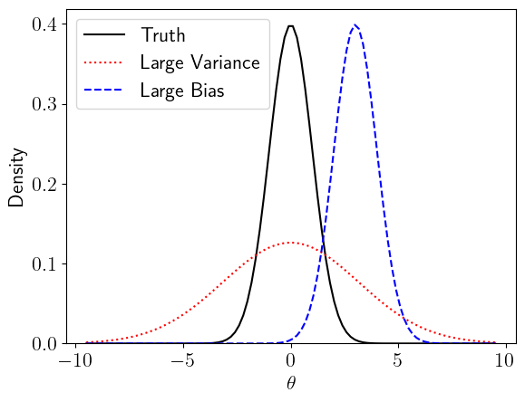
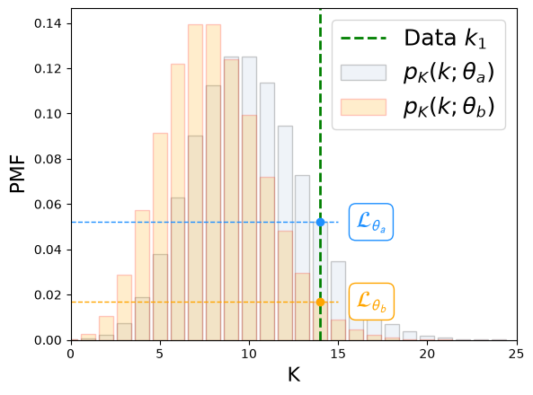
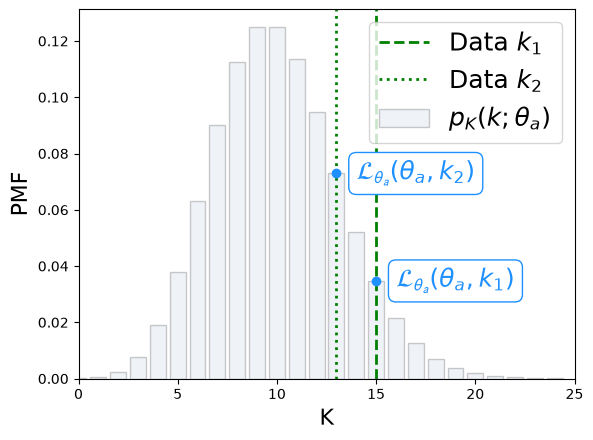
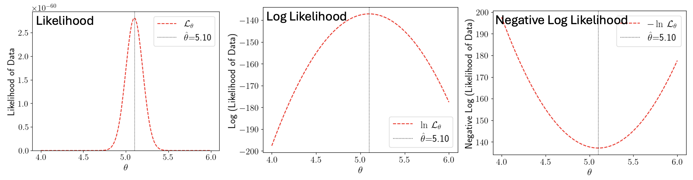

---
jupytext:
  formats: md:myst
  text_representation:
    extension: .md
    format_name: myst
kernelspec:
  name: python3
  display_name: 'Python 3'
---

(chapter:EstimatorsIntro)=
# Estimators Intro


* `numpy` methods: `random.default_rng`
* `scipy.stats` methods: `bootstrap`


<!--Week7-Tools/Tools.tex-->
<!--Week8-Tools/MaxLike.tex-->
<!--Week9-Fits-Tests/LeastSquares.tex-->

<!--
Describe Point and Interval Estimation with examples
Explain the Bootstrap Method
Implement the Bootstrap Method to esimate uncertainties
Define Consistency, Bias, and Minimum Variance and explain their importance for estimators
-->
We have considered **Estimates** a couple of times, most recently in [](#sec-sem), where we noted that the sample standard deviation, $\sigma_x$, is a good estimate for the true standard deviation.

In every day life, when we say "estimate" we mean "educated guess". In statistics the meaning is the same, but we have a very clear framework for how to go about making the educated guess. An Estimator should be **Consistent**, **Unbiased**, and **Minimum Variance**. We combine the **Bias** and **Variance** of an estimator into a single metric, the **Mean Squared Error**.

Consistency
: The Estimator for a parameter, $\hat{\theta}$, should approach the true value of the parameter, $\theta$, in the limit of infinite sample size $N$.

  $$\label{eq:est_consistency} \hat{\theta} \rightarrow \theta\;\; as \;\; N\rightarrow \infty$$

Bias
: The **Bias** $b$ of an estimator is the difference between the estimate and the true parameter. This should be small, preferably zero.

  $$\label{eq:est_bias}b = E[\hat{\theta}] - \theta$$

Variance
: The variance of an estimator, $V[\hat{\theta}]$, tells us how "spread out" the estimated values are. We want the estimator to be **precise**. This means we want the variance to be as small as possible. We calculate the variance in the [usual way](#eq:truevar), using the expectation.

  $$\label{eq:est_variance}V[\hat{\theta}] = E[\hat{\theta}^2] - E^2[\hat{\theta}] \equiv E[ (\hat{\theta}-E[\hat{\theta}])^2 ]$$  

Mean Squared Error (MSE)
: The **MSE** combines Bias and Variance into a single measure of estimator quality:

  ```{math}
  :label: eq:mse
  \text{MSE}[\hat{\theta}] = E\!\left[(\hat{\theta} - \theta)^2\right] = V[\hat{\theta}] + b^2
  ```

  An ideal estimator has zero bias ($b=0$) and small variance. The MSE makes clear that there is a balance between these two goals: a slightly biased estimator may have a lower MSE than an unbiased one if its variance is much smaller. This is known as the **bias–variance tradeoff**.

:::{figure} 
:label: fig:bias-var


A biased estimator is innaccurate. A large-variance estimator is imprecise.
:::

Estimating a parameter of a true distribution using data is known as **Point Estimation** because we are estimating a single value: a point. Providing a range of values in which we have some confidence is **Interval Estimation**; for example a Confidence Interval represents a range of values in which we expect some proportion of repeated experiments to fall. The proportion is the Confidence Level ([CL](#eq:cl)), and can be quoted as a percentage eg $95\%$, or in terms of standard deviations eg $1\sigma$[^sigmaCL].

[^sigmaCL]: The CL expressed as a percentage is $1-\alpha$, where $\alpha$ is the **Significance Level** (SL). There is clearly a redundancy between the terms CL and SL. When someone says their CL is $n\sigma$, they have also told you what the significance level is, but it is not $1-n\sigma$ because the $n\sigma$ is relative to the distribution, not to the number 1.

---

(sec:mean-est)=
## The Sample Mean as an Estimator for the True Mean

The Sample Mean $\overline{x}$ is an Estimator for the True Mean $\mu$.

```{math}
:label: eq:muhat
\hat{\mu} = \overline{x}
```

The "hat" notation $\hat{\mu}$ tells us "this is an estimator".

Consistency Check
: Does $\hat{\mu} \rightarrow \mu\; as \; N\rightarrow \infty$?

The [Law of Large Numbers](#eq:lln) tells us that **the Sample Mean is a consistent estimator for the true mean**. LLN reminder: If every possible measurement of $x$ is included in the calculation of $\overline{x}$, the probability of there being any measurable difference between $\overline{x}$ and $\mu$ is zero.

Bias Check
: What is the bias $b = E[\hat{\mu}] - \mu$?


Let's calculate the expectation of the sample mean:

```{math}
:label: eq:expmean

\begin{aligned}

E\left[\, \overline{x}\, \right]  & = E\left[ \dfrac{1}{N} \sum\limits_i^N x_i \right] \textcolor{blue}{\; because\; \overline{x}  = \frac{1}{N} \sum \limits_i^N x_i}\\ 
 
  & = \dfrac{1}{N} \sum\limits_i^N E\left[ x_i \right] \textcolor{blue}{\;because\; E[sum] = sum(E)} \\
 & = \dfrac{1}{N} \sum\limits_i^N E[X] \textcolor{blue}{\;because\; x_i\;are\; iid\; so\; E[x_i] = E[X]\; for\; all\; x_i}\\
  & = \dfrac{1}{N} N E[X]= E[X] \\                                                
\end{aligned}
```

We have shown that $E\left[\, \overline{x}\, \right] = E[X]$, which with the notation $\mu \equiv E[X]$ and for this choice of estimator $\hat{\mu} =\overline{x}$, shows that **the Sample Mean is an unbiased estimator for the True Mean**.

Variance Check
: Is the sample mean the minimum variance estimate for the true mean? Proving that an estimator is the minimum variance of all possible estimators is beyond the scope of this module, but we will look briefly at the variance of $\overline{x}$ because it gives us the [SEM](#eq:sem), and I will state without proof that $\overline{x}$ is the Minimum Variance Unbiased Estimator [MVUE](https://en.wikipedia.org/wiki/Rao%E2%80%93Blackwell_theorem) for $\mu$. 

Let's calculate the variance of the sample mean:

```{math}
:label: eq:varmean

\begin{aligned}
V\left[\, \overline{x}\, \right]  & = V\left[ \dfrac{1}{N} \sum\limits_i^N x_i \right] \textcolor{blue}{\; because\; \overline{x}  = \frac{1}{N} \sum \limits_i^N x_i}\\ 
 &= \sum\limits_i^N  V\left[ \dfrac{1}{N}  x_i \right] \textcolor{blue}{\;because\; V[sum] = sum(V)\; for\; iid\; x_i}\\
  & = \dfrac{1}{N^2}  \sum\limits_i^N V\left[ x_i \right] \textcolor{blue}{\;because\;V\left[ax\right] = a^2 V\left[x\right] }\\
  & = \dfrac{1}{N^2} N V[X]  \textcolor{blue}{\;because\; x_i\; \text{are iid, so}\; V[x_i]=V[X]\; \text{for all}\; i}\\
  & = \dfrac{1}{N} V[X] \\                                               
\end{aligned}
```

The variance of the sample means is $\dfrac{1}{N}$ times the true variance, $V[X]$. This gives us the standard deviation of the sample means, referred to as the SEM, because $\sigma_x = \sqrt{V[X]}$.


````{card}
For a single RV, we can Estimate the mean and its uncertainty directly from the data:

```{math}
:label: eq:mean-est-uncert
\begin{aligned}
\hat{\mu} \pm \hat{\sigma_{\mu}} & = \overline{x} \pm \sigma_{\overline{x}} \\ \\
                                 & = \overline{x} \pm \mathsf{SEM} \\ \\
                                 & = \overline{x} \pm \dfrac{ \sigma_{x} }{ \sqrt{N} } \\                                
\end{aligned}
```

````

---

(sec:var-est)=
## The Sample Variance as an Estimator for the True Variance

The Sample Variance $v_x$ is an Estimator for the True Variance $V[x]$.

```{math}
:label: eq:vhat
\hat{V}[X] = v_x
```

To check the Consistency, Bias, and Variance of the Estimator, we need to write down $\hat{V}[X] = v_x$ in terms of the True Variance, $V[X]$.

This is a long proof, my version of which is [here](#fig:lilyproof_varbias).  The conclusion is:

```{math}
:label: eq:vartruesamp
E\!\left[\hat{V}[X]\right] = \dfrac{N-1}{N} V[X]
```

Consistency Check
: Does $\hat{V}[X] \rightarrow V[X]\; as \; N\rightarrow \infty$?

In the **Asymptotic Limit** ($N\to\infty$), it is clear that $ \dfrac{N-1}{N} \to 1$. **The Sample Variance is a consistent estimator for the true variance**.


Bias Check
: We can use [](#eq:vartruesamp) in [](#eq:est_bias) to quantify the bias:

```{math}
:label: eq:varbias
b = E[\hat{V}[X]] - V[X] = \dfrac{N-1}{N} V[X] - V[X]
```
The Bias $b$ is non-zero, so **the Sample Variance is a biased estimator for the true variance**.

This is why we have the factor $\dfrac{1}{N-1}$ as opposed to $\dfrac{1}{N}$ in the [definition](#eq:varianceU) for the **Unbiased Variance**.

:::{note}
Bias is not the only thing that matters. Sometimes, the Best Estimator is not the zero bias estimator.
:::

If we continue simplifying [](#eq:varbias), we see that $b = -\dfrac{V[X]}{N} $: there is a negative bias. This means that our Estimator $\hat{V}[X]$ is smaller than the true variance $V[X]$. This makes sense, because in our Estimator we have used a finite number of measurements, which will be clustered around the sample mean $\overline{x}$. The True Variance uses **all possible measurements**. Given that these will include all of the measurements used for the sample variance plus a great deal more, it makes sense that the True Variance is larger than the sample variance. The larger we make $N$, the closer the Estimator gets to the True Variance.

:::{tip}
I acknowledge that thinking about the "variance on the variance" can cause issues in terms of making new neural connections[^neurons] in the old wheelbox[^wot]. The approach that works for me is to think of the variance as a parameter of the distribution; some number. All numbers have some uncertainty.
:::

[^neurons]: Learning new things means that neurons in our brains have formed new and lasting connections with other neurons.

[^wot]: The "old wheelbox" is a colloquialism; this is the affectionate yet somewhat frustrated way in which I refer to my brain, as a slightly dusty and creaky machine that nonetheless does what it I want it to most of the time.


Variance Check
: Calculating the variance on the sample variance (the square root of which gives us the Standard Error on the Variance, SEV) is not as straightforward as [](#eq:varmean), especially in cases where the data are not normally distributed. I have included some notes on this below for those who are interested, but we will note that **for all practical purposes ("fapp") we calculate the SEV** without the help of any analytical formulas, using eg the [**Bootstrap Method**](#sec:Resampling).


(sec:normal-sev)=
### The SEV for Normal data

In the **special case** that the data are Normally Distributed, the variance on the (unbiased) variance estimator $\hat{\theta} = v_x$ is[^noproof]:

```{math}
:label: eq:vest_unbiased
V[\hat{\theta}] =  \dfrac{2\theta^2}{N-1} 
```

[^noproof]: We will look at the proof of [](#eq:sev) once we have thought about the "chi squared", $\chi^2$, because it is a significantly more simple process if we use $\chi^2$.

The SEV is the square root of the variance:

```{math}
:label: eq:sev
\mathsf{SEV} = \sqrt{ \dfrac{2\theta^2}{N-1} }
```


If our data are normally distributed we can estimate the SEV from data, using the (unbiased) sample variance ($\hat{\theta} = v_x$) as an estimate for the true variance ($\theta=V[X]$), just as we can do for the [SEM](#eq:sem). Note that [](#eq:sev) applies for the [unbiased variance](#eq:varianceU) estimator. 

If we wish to use the [biased variance](#eq:variance) estimator, we must adjust the formula for the SEV, because:

$v_{x,\mathsf{biased}} =  \dfrac{N-1}{N}\, v_{x,\mathsf{unbiased}} $. 

This gives us the form of the Estimator Variance to use with the biased estimator:

```{math}
:label: eq:vest_biased
V[\hat{\theta_b}] =  \dfrac{2(N-1)\theta^2}{N^2} 
```


This gives us the form of the SEV to use with the biased estimator:

```{math}
:label: eq:sevB
\mathsf{SEV_b} = \sqrt{ \dfrac{2(N-1)\theta^2 }{N^2} }
```

(sec:central-moments-sev-gen)=
### The SEV and Central Moments

Generally, with no assumption of Normality, the Estimator Variance is:


```{math}
:label: eq:vest-gen
V[\hat{\theta}] =   \left( \kappa - \dfrac{N-3}{N-1} \right) \dfrac{\theta^2}{N}
```

and the SEV is:

```{math}
:label: eq:sev-gen
\mathsf{SEV} = \sqrt{ \left( \kappa - \dfrac{N-3}{N-1} \right) \dfrac{\theta^2}{N} }
```

where $\kappa$ is the **Kurtosis**, described briefly below in terms of **Central Moments**. 


Recall that we can write the Variance in terms of the Expectation, [](#eq:truevar). The Variance is the "second central moment", where the central moments $\mu_n$ are as follows:

$\mu_0 = E[(X-\mu)^0] = 1$
: The zeroth central moment is 1, because any number to the power zero is 1, and the expectation of a number is just the number.

$ \mu_1 = E[(X-\mu)^1] = 0$
: The first central moment is 0, because $E[(X-\mu)] = E[X] - E[\mu] =  \mu - \mu$, where we used  E(sum) = sum(E) [](#eq:expect_sum).

$\mu_2 = E[(X-\mu)^2] = \sigma^2$
: The second central moment is the **Variance**, as shown in [](#sec:truvar). This quantifies the **spread** of the distribution

$\mu_3 = E[(X-\mu)^3] = \sigma^3 \gamma_1 $
: The third central moment defines the **Skewness**, $\gamma_1$. This quantifies the **symmetry** of the distribution.

$\mu_4 = E[(X-\mu)^4] = \sigma^4 k $
: The fourth central moment defines the **Kurtosis**, $k$. This quantifies the relative **curvature** of the distribution. Positive kurtosis: fatter tails.


There is a somewhat accessible proof of [](#eq:sev-gen) on mathematics stack exchange [here](https://math.stackexchange.com/questions/72975/variance-of-sample-variance).


````{card}
For a single RV, we can Estimate the variance and its uncertainty directly from the data:

```{math}
:label: eq:var-est-uncert
\begin{aligned}
\hat{V}[X] \pm \hat{\sigma}_{V[X]} & = v_x \pm \sigma_{v_x} \\ \\
                                 & = v_x \pm \mathsf{SEV} \\                                
\end{aligned}
```

where the SEV is the Standard Error (uncertainty) on the Variance, and is most easily and efficiently calculated using e.g. the [**Bootstrap Method**](#sec:Resampling), as we shall see.

We noted in [](#eq:vartruesamp) that the [sample variance](#eq:variance) is a biased estimator for the true variance, hence the modified definition of [unbiased sample variance](#eq:varianceU). Before deciding that the the unbiased variance is the better estimator, we need to consider overall quality metric, the Mean Squared Error, for the two choices.

````

(sec:mse)=
## The Mean Squared Error (MSE)

Recall the bias of an estimator for some true parameter $\theta$ is [](#eq:est_bias): the difference between the Expectation of the estimate $\hat{\theta}$ and the true value of the parameter, $\theta$.

The MSE [](#eq:mse) considers the bias and variance of the estimator together. It is defined as the expectation of the square of the difference between the estimate and the true value, $E[(\hat{\theta} - \theta)^2]$. I have provided a proof of [](#eq:mse) in the dropdown below for those with a hankering for math-induced dopamine.


:::{dropdown} Proof of [](#eq:mse)

```{math}
:label: eq:mse_proof
\begin{aligned}

E\left[ (\hat{\theta} -\theta)^2 \right] &= E\left[ ( \hat{\theta} -\mu + \mu - \theta )^2 \right]\;\;\;\textcolor{blue}{Add\;and\;subtract\;\mu = E[\hat{\theta}]}\\
& = E\left[ ( \hat{\theta} - \mu)^2 \right] + E\left[ (\mu -  \theta )^2 \right] + 2E\left[ ( \hat{\theta} -\mu )  (\mu-  \theta )\right] \;\;\;\textcolor{blue}{E(sum) = sum(E)}\\
& = V[\hat{\theta} ] + E\left[ \mu^2 +  \theta^2 \cancel{- 2\mu\theta}  + 2 \hat{\theta}\mu  - 2\hat{\theta}\theta -2\mu^2 + \cancel{2\mu\theta}  \right] \\
& = V[\hat{\theta} ] + E\left[ \theta^2 \right]- E\left[\mu^2 \right]\ + 2E \left[\hat{\theta}\mu\right] - 2E \left[ \hat{\theta}\theta \right]\;\;\;\textcolor{blue}{E(sum) = sum(E)}\\
& = V[\hat{\theta} ] + E\left[ \theta^2 \right]- \mu^2  + 2\mu^2 - 2\mu E \left[\theta \right]\;\;\;\textcolor{blue}{E[E[\hat\theta]] =E[\mu] = \mu }\\
& = V[\hat{\theta} ] + \theta^2 + \mu^2 - 2\mu \theta \;\;\;\textcolor{blue}{E[\theta] = \theta}\\
& = V[\hat{\theta} ] + (\theta- \mu)^2 \\
& = V[\hat{\theta} ] + b^2 \\
%& = V[\hat{\theta} ] + E\left[ \theta^2 \right]- E\left[\mu^2 \right]\ + 2E \left[\hat{\theta}\mu\right] - 2E \left[ \hat{\theta}\theta) \right]\\
%& = V[\hat{\theta} ] + E\left[( \mu - \theta)^2 \right]\\
%& = V[\hat{\theta} ] + b^2 \right]

\end{aligned}
```
:::

Let's calculate the MSE using the two different estimators (biased and unbiased) for the variance.

Biased Sample Variance [](#eq:variance)
: True parameter: $\theta = V[X]$
  
  Estimator: $\hat{\theta} = \dfrac{1}{N} \sum\limits_i^N (x_i -\overline{x})^2$ 

  Bias: $b = -\dfrac{1}{N} \theta$

  Variance (assuming normality): $\dfrac{2(N-1)\theta^2}{N^2}$ 


Unbiased Sample Variance [](#eq:varianceU)
: True parameter: $\theta = V[X]$
  
  Estimator: $\hat{\theta} = \dfrac{1}{N-1} \sum\limits_i^N (x_i -\overline{x})^2$ 

  Bias: $b = 0$

  Variance (assuming normality): $\dfrac{2\theta^2}{N-1}$ 
 

(sec:binned-data)=
## What to do when Data are Binned?

Sometimes we do not have access to individual measurements. Instead, the data arrive already summarised in a **histogram**: we know the number of measurements $N_j$ falling in each bin, centred on bin centre $x_j$, for bins $j = 1, 2, \ldots, B$.

The total number of measurements is $N = \sum_{j=1}^{B} N_j$.

We can still estimate the mean and variance by treating each count $N_j$ as $N_j$ measurements all equal to $x_j$:

```{math}
:label: eq:binned-mean-est
\hat{\mu} = \overline{x} = \dfrac{\displaystyle\sum_{j=1}^{B} N_j\, x_j}{N}
```

```{math}
:label: eq:binned-var-est
\hat{V}[X] = v_x = \dfrac{1}{N-1}\sum_{j=1}^{B} N_j\, (x_j - \overline{x})^2
```

The Estimated SEM is unchanged: $\widehat{\mathsf{SEM}} = \sqrt{ \dfrac{\hat{V}[X]}{N} }$.


:::{note}
These estimators treat each bin as if all its measurements were exactly at the bin centre. This introduces a small **binning bias**, which decreases as the bin width $\Delta x$ decreases.
:::

:::{tip}
A more powerful approach when working with histograms is to fit the parameters of a probability distribution directly to the histogram using the Maximum Likelihood Method or Least Squares — see [](#sec:general-param-est).
:::


(sec:general-param-est)=
## Parameter Estimation Generally


In the two examples above, we looked at using Summary Statistics ($\overline{x}$ and $v_x$) as Estimators ($\hat{\mu}$ and $\hat{V}$) for the parameters of the True Underlying Distribution ($\mu$ and $\sigma^2$).

For a single RV following a (e.g.) Normal distribution, the parameters of the true distribution can be accessed directly from the data in this way. We saw that in the case of $\hat{\mu}$ it is possible to extract the **Uncertainty on the Estimated Mean**, using the [SEM](#sem). 

We can similarly extract the **Uncertainty on the Estimated Variance**, [SEV](#eq:sev-gen) if the data are normally distributed, but this is not quite as straightforward as the SEM; 

The parameters of the true underlying distribution will not always be so easily accessible from the data, so it is helpful to explore general methods for parameter estimation. 

The parameter estimation methods we will explore are the Maximum Likelihood Method and the Method of Least Squares. Both methods compare the data with true distributions having different parameter values, and find the parameter values that minimize the differences between data and truth. This process of minimising the differences is known as **Fitting**, or **Regression**, thus both these terms mean **Parameter Estimation**.


Before we go further, we must define the **Likelihood**.


(sec:likelihood-est)=
## Likelihood

We calculate probabilities by drawing a sample from a given distribution with known parameter(s) $\theta$. We can clearly only do this if we know the form of the PMF $p_K$ or PDF $f_X$, and the value(s) of its parameter(s), $\theta$.

Discrete RV $K$: probability $K=k$ from PMF
: $P(K=k | \theta) = p_K(k; \theta)$

Continuous RV $X$: probability $X\leq x$ from CDF
: $P(X\leq x | \theta) = \int\limits_{x\in S} f_X(x;\theta) dx$


* We know the true parameter.
* We want the probability of finding the data with some value (or some range of values).

**We calculate the probability of measuring our data in a given range by relying on what the true distribution is telling us.**


If we are trying to estimate the unknown underlying true distribution parameter(s) using the data, we clearly cannot use the CDF. We need to turn it on its head:

* We know the data distribution.
* We want the probability of finding the true parameter with some value.

How to do this?

<!--
We could try turning around the PMF definition, letting the parameter $\theta$ be the RV, as this is the thing we seek to measure, and using the data as the conditional:

$P(\theta=\theta_a | k) = p_\theta(\theta_a; k)$
-->

### Single data point

Let's consider a single measurement, $k_1$, and two different PMFs having the same form but different parameter values. One has $\theta=\theta_a$ and the other has $\theta=\theta_b$, illustrated in [](#fig:toylike1).


:::{figure}
:label: fig:toylike1


Two PMFs are plotted with different parameter values $\theta_a$ and $\theta_b$. A single data measurement is shown as a green dashed vertical line. The values of each PMF at that point are the likelihoods of the data point under the two different assumptions: $\mathcal{L_{\theta_a}} (\theta_a; k_1)$ and $\mathcal{L_{\theta_b}} (\theta_b; k_1)$.
:::

Based on this data point $k_1$ alone, I would infer that $\theta_a$ is the better parameter estimate, ie that $\theta_a$ is **more likely** to be the true parameter of the data than $\theta_b$.

I will define the **Likelihood** of the data being described by $\theta_a$:

$\mathcal{L_{\theta}}(\theta_a; k_1) = p_K(k_1; \theta_a)$

The Likelihood of true parameter $\theta_a$, given the single-valued data point $k_1$ is equal to the probability of measuring $k_1$, given the single-valued true parameter is $\theta_a$.

Ine the example shown in [](#fig:toylike1) I find $\mathcal{L_{\theta}}(\theta_a; k_1) > \mathcal{L_{\theta}}(\theta_b; k_1)$, and therefore conclude that $\theta_a$ is the most likely of the two parameter values I considered.

This is a toy version of the **Maximum Likelihood Method** for parameter estimation. The "toy" aspect arises from an important issue with the above example: we only used one data point. **We are very unlikely to successfully estimate a parameter using a single data point!**. The uncertainty on such an estimate would be so large as to make the estimate useless.


### Two data points

Let's consider two data points, and just consider a single parameter value, $\theta_a$. This is the parameter value for which we are going to calculate the Likelihood of the data.

:::{figure}
:label: fig:toylike2


A single PMF is plotted with parameter value $\theta_a$. Two data measurements are shown as green dashed vertical lines. The values of the PMF at each point are the likelihoods of the data points under the assumptions that the parameter is $\theta_a$.
:::


Now we have:

$\mathcal{L_{\theta}}(\theta_a; k_1) = p_K(k_1; \theta_a)$

$\mathcal{L_{\theta}}(\theta_a; k_2) = p_K(k_2; \theta_a)$

The question now is: "What is the Likelihood that the data points are described by a true distribution with the parameter value $\theta_a$, given **both** data measurements $k_1$ and $k_2$?"

Noting that the two measurements are IID, we can use the [Multiplication Rule](#sec:multrule) to write the **Joint Probability** of these two measurements as a product [](#eq:multrule-twodata):

```{math}
:label: eq:multrule-twodata
\mathcal{L_{\theta}}(\theta_a; k_1, k_2) = p_K(k_1; \theta_a)\, p_K(k_2; \theta_a)
```

This is nice because it allows us to extrapolate to the entire dataset $k$ of $N$ measurements $k_1, k_2, ..., k_N$:

```{math}
:label: eq:multrule-alldata
\mathcal{L_{\theta}}(\theta_a; k) = \prod_{i}^{N} p_K(k_i; \theta_a) 
```

If the RV in question is continuous, exactly the same definition holds, with the PMFs (probabilities) replaced by PDFs (densities): The Likelihood of the data $\mathcal{L_{\theta}}$ is the product of the densities $f_X$.

```{math}
:label: eq:multrule-alldata-cont
\mathcal{L_{\theta}}(\theta_a; x) = \prod_{i}^{N} f_X(x_i; \theta_a) 
```

### Likelihood is not a Probability


**The Likelihood of the data $\mathcal{L_{\theta}}$** having an underlying probability distribution with true parameter $\theta_a$ **is the product of the probabilities $p_K$** evaluated at each data point, where the PMF $p_K$ has parameter $\theta_a$.


We can use the Likelihood to make a statement about the probability of a given estimate $\theta_a$. The denominator is a normalising constant: the sum (or integral) of the Likelihood over **all possible parameter values** $\theta_j$, so that the result is a valid probability. (This is equivalent to a Bayesian posterior under a **uniform prior** over all candidate parameter values: the prior probability $P(\theta_j)$ is constant for all $j$, so it cancels from numerator and denominator.)

If the parameter $\theta$ can only take a finite or countable set of values (a **discrete parameter space**):

$P(\theta_a | \text{data}) = \dfrac{ \mathcal{L}_\theta(\text{data}\,|\,\theta_a) }{ \sum\limits_j \mathcal{L}_\theta(\text{data}\,|\,\theta_j) }$

If the parameter $\theta$ is continuous (a **continuous parameter space**):

$P(\theta_a | \text{data}) = \dfrac{ \mathcal{L}_\theta(\text{data}\,|\,\theta_a) }{ \int \mathcal{L}_\theta(\text{data}\,|\,\theta_j)\, d\theta }$

Note that the sum/integral is over **parameter values** $\theta_j$, not over values of the random variable. For example, in the Poisson case the RV $K$ is discrete, but the rate parameter $\theta$ is continuous — so we integrate over $\theta$.

The probability that this parameter value (given the data) is the best parameter estimate is equal to the Likelihood of the data for this parameter divided by the Total Likelihood for all possible parameter values (given the same data).

(sec:nll)=
### Negative Log Likelihood 

We noted in lectures that Logs are essential for computing likelihoods. Probabilities are confined to values in [0,1], and Likelihoods are products of $N$ probabilities (or densities, in the case of continuous RVs), where $N$ is our sample size.

The example I gave in the week 4 lectures was for $N=1000$ measurements, all with probability $p=0.5$ for simplicity.

$\prod\limits_i^N p_i = 0.5^{1000} \approx 9.33\times10^{-302}$

We noted that this is quite close to the smallest number a computer can compute.

```{code-cell} python
import sys
print(f"The smallest number my computer can compute = {sys.float_info.min}")
```

Given that we like large datasets and want to calculate Likelihoods (to estimate unknown parameters), we have a problem. But, it is okay, because we have Logarithms.

Log Rules
: Power rule: $$\label{eq:logrule_power} \log(a^b) = b\log(a)$$

  Quotient rule: $$\label{eq:logrule_quotient} \log(\dfrac{a}{b}) = \log(a) - \log(b)$$

  Product rule: $$\label{eq:logrule_product}\log(ab) = \log(a) + \log(b)$$

I have used just two values $a$ and $b$ in the examples above, but there is no limit to the number of values in e.g. the product:

```{math}
:label: eq:logprod
\log(\prod\limits_i^N a_i) = \sum\limits_i^N \log(a_i)

```

For our example above we have:

$\log(\prod\limits_i^N p_i) = \log( 0.5^{1000}) = 1000\times\log(0.5) \approx -693$

This is a much more manageable number, and **we have lost no information** in taking the log. 

The most useful base for the logarithm is $e$: Euler's number, which is called the **Natural Logarithm** and has its own symbol, $\ln$. Because the base is $e$, the power rule gives us: $\ln(e^a) = a$, which is very useful.

The default assumed by `numpy` is that when we ask for `log(a)` we want the Natural Log $\ln{a}$. If we want a log with base 10, we must use `log10(a)`.

Notice that the log of any number in the range (0,1) is **Negative**, so the Log Likelihood is destined to always be a negative number. This is fine of course, negative numbers being perfectly valid, but the tradition in statistics is to **Minimise** functions rather than **Maximise** them, so we more often quote the Negative Log Likelihood, which has a postive value and has a minimum at the most likely parameter value.

:::{card}

In summary, we calculate the **Negative Log Likelihood (NLL)** because it is numerically manageable for our computer and it is always a positive value, so we can use lots of nice `scipy` tools to `minimise` it and find the most likely parameter values, given some data.


```{math}
:label: eq:negloglike
\mathsf{NLL} = - \ln{\mathcal{L_{\theta}}}
```

:::


The Likelihood, Log Likelihood, and Negative Log Likelihood for some data are shown in [](#fig:likeLogNeg). The maxima of the Likelihood and Log Likelihood distributions and the minimum of the Negative Log Likelihood are found at the most likely parameter value parameter value. This value is the **Maximum Likelihood Estimate** for the parameter: $\hat{\theta}_{MLE}$


There is a turning point in the distributions at the maximum, which means the derivative is zero at this point. This is how we calculate the MLE, by setting the derivative of the Likelihood to zero and solving for the parameter.

:::{figure} 
:label: fig:likeLogNeg


The maxima of the Likelihood and Log Likelihood distributions and the minimum of the NLL are found at the most likely parameter value parameter value. This value is the Maximum Likelihood Estimate for the parameter.
:::


(sec:interval-est)=
## Interval Estimation

A **Confidence Interval** is an estimated range of values such that we expect CL% of repeated experiments to yield a value within that range. CL is the Confidence Level, for example 95% CL means that in 95% of repeated experiments, we expect the value to fall in the Confidence Interval. The Confidence Interval is a Frequentist construct. Like all frequentist statistics, it tells us nothing about a single experiment.

A **Credible Interval** is, in my opinion, a much more intuitive interval. It represents the most probable range of outcomes for a given single experiment. The Credible Interval is a Bayesian construct. It uses Prior Knowledge to allow us to estimate the range of probable outcomes for a single experiments.

:::{note}
People such as myself (particle physicists or similarly dorky types) might get home from work to find the oven on, and declare "I am 3 sigma confident that I did not leave the oven on". Because Confidence Levels are frequentist, this should be interpreted as "In 741 days, with conditions identical to today, where I came home to find the oven on, only 1 of these occasions would be my fault." Of course this is not actually what I mean when I say that. I mean I am 99.73% sure I did not leave the oven on this morning. So I should really say "I did not leave the oven on- 3 sigma credible interval". 
:::

We have seen [](#sec:crit-sig) that the size of the confidence interval is set using a predefined significance level $\alpha$, for example $\alpha=5\%$ gives us a 95% CL, and the confidence interval represents the central 95% of a normal distribution centered on the estimated mean $\hat{\mu} = \overline{x}$. The 95% CL can also be expressed as $\pm 1.96\sigma$, which means the same thing. Note that the Confidence Interval is predefined - it does not rely on the measured p value and Z value from the data.

We have also seen that the uncertainty on the estimated mean reduces with the number of measurements used [](#sem).

Sometimes, we will find that we have an estimate for the mean and cannot use the SEM for the uncertainty, because our data are not normally distributed. Other times, we will be estimating some parameter other than the mean, and it is not clear how to quantify the uncertainty from our data. 

Given that measurements without quoted uncertainties are meaningless, we must estimate the uncertainty. The [**Bootstrap Method**](#sec:Resampling) is an excellent way of doing this.


(sec:Resampling)=
## The Bootstrap Method

The Bootstrap Method is a **Nonparametric Resampling** method - random values are pulled from an existing dataset ("Resamples") without any required knowledge of the true underlying parameters ("Nonparametric").

An example of using the Bootstrap method is as follows (assume a starting dataset size of $N_d =100$, and an ideal dataset size of $N_r = 10,000$):

1. Randomly select a value from the data. 
2. Do this 100 times, allowing yourself to select the same measurement more than once.
3. Calculate the statistic of interest from the 100 measurements you randomly selected. 
4. Repeat the above three steps 9999 times.

The point of this process is not to recalculate the statistic - you have already calculated that from the original dataset. The point is to estimate the statistical uncertainty on that measured value. The larger dataset allows for a smaller estimator variance.

### Bootstrap Example: step-by-step

Let's generate some data using a seed such that every time we execute this function we get the same result.

```{code-cell} python
import numpy as np

# make a local instance of numpy's default (PCG64) pseudorandom number generator and set the seed - we only ever do this to get reproducible results for testing and for demonstrations.

#rng = np.random.default_rng(seed=42)
rng = np.random.default_rng(111)

# generate some fake data, normally distributed using arbitrary parameter choices

from scipy.stats import norm

norm_mean = 6.0
norm_sigma = 3.77
ndata = norm.rvs(loc=norm_mean, scale=norm_sigma, size=100, random_state=rng)

print(f"Generated Norm data with mu={norm_mean}, sigma={norm_sigma}")

```

Now we have a fake dataset of 100 measurements, let's bootstrap!

```{code-cell} python

def LongBootstrap(data):

  # Our statistic of interest is the standard deviation
  print( f"sample sigma: {np.std(data):.3f}")

  # Make an empty container to put our bootstrap stats in
  sigmas=[]

  # loop over the number of boostraps we want
  for i in range(9999):

    # Draw 100 random measurements from our dataset 

    # Important! values can be drawn more than once because we have replace=True. If we don't use replace=True, we will just get the original dataset back.

    rdata = rng.choice(data,replace=True, size=100)

    # Get the standard deviation of this set of 100 measurements

    rsigma = np.std(rdata)

    # Put the standard deviation in the container

    sigmas.append(rsigma)

    # now to the next of the 9999 iterations in the loop

  # end of loop, print the statistic with its uncertainty

  print( f"bootstrap estimate for sigma: {np.mean(sigmas):.3f} +/- {np.std(sigmas):.3f} ")

  return sigmas


# call the bootstrap function on the fake data we generated above

byhand_sigmas = LongBootstrap(ndata)

```


### Bootstrap Example: `scipy`

```{code-cell} python

def ScipyBootstrap(data):

  # thank you scipy for providing yet another lovely method

  from scipy.stats import bootstrap

  # first argument is data, second is the statistic of interest, optional rng parameter is for reproducibility

  sbs = bootstrap( (data,), np.std, rng=rng )

  sp_mean = np.mean(sbs.bootstrap_distribution)
  
  sp_ser = sbs.standard_error

  sp_ci_lo, sp_ci_hi = sbs.confidence_interval

  print( f"scipy bootstrap estimate for sigma: {sp_mean:.3f} +/- {sp_ser:.3f}")

  print( f"95% Confidence Interval: {sp_ci_lo:.3f}--{sp_ci_hi:.3f} ")

  return sbs.bootstrap_distribution

# call the function
scipy_sigmas = ScipyBootstrap(ndata)
```

### Parametric Bootstrap Example

If you know the underlying distribution (eg Norm in this case), you can do a parametric bootstrap using the parameters estimated from the data.

```{code-cell} python

def ParaBootstrap(data):

  psigmas=[]
  for i in range(9999):
    
    respin_data = norm.rvs(loc=np.mean(data), scale=np.std(data,ddof=1), size=100)

    psigmas.append( np.std(respin_data) )

  print( f"parametric bootstrap estimate for sigma: {np.mean(psigmas):.3f} +/- {np.std(psigmas):.3f} ") 

  return psigmas

# call the function

parametric_sigmas =ParaBootstrap(ndata)
```

### Plot Comparing Methods

This is a frequentist process, so the true value of $\sigma$ is expected to lie within our error margin in 68% of repeated experiments.

```{code-cell} python

def PlotBootsraps(a,b,c):

  import matplotlib.pyplot as plt

  fig, ax = plt.subplots()

  # don't have to define bins, but mpl makes strange choices
  sm = np.mean(a)
  ss = np.std(a)
  bins=np.linspace(sm-3*ss, sm+3*ss, 30)

  labs = ['byhand', 'scipy', 'parametric']
  cols = ['darkgreen', 'dodgerblue', 'grey']
  styles = ['-','--',':']
  for i, d in enumerate([a,b,c]):
    ax.hist(d, 
            fc='none',
            lw=2,
            ls=styles[i],
            ec=cols[i], 
            bins=bins,
            label=f'{labs[i]} {np.mean(d):.3f}+/-{np.std(d):.3f}')

  ax.set_xlabel(r"Bootstrap $\sigma$")

  # don't want legend to overlap with plot. Extend y-axis by 20%
  ymax = ax.get_ylim()[1]
  ax.set_ylim(0, ymax*1.2)

  plt.legend()
  plt.show()


# call the function

PlotBootsraps(byhand_sigmas,scipy_sigmas,parametric_sigmas)
```


