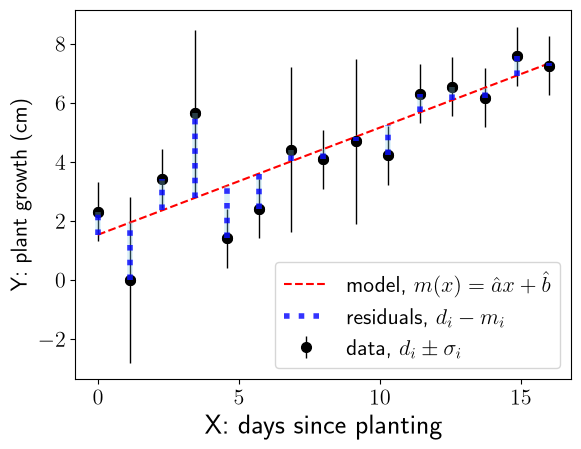
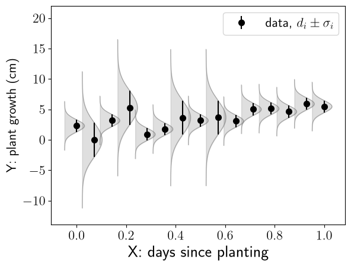
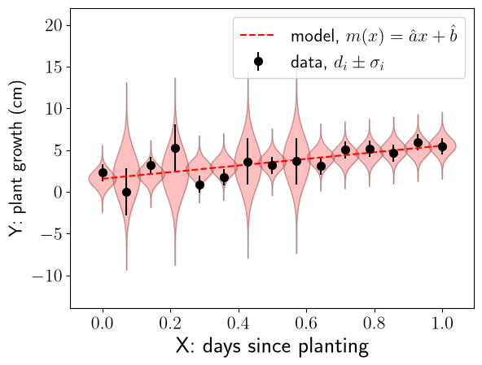
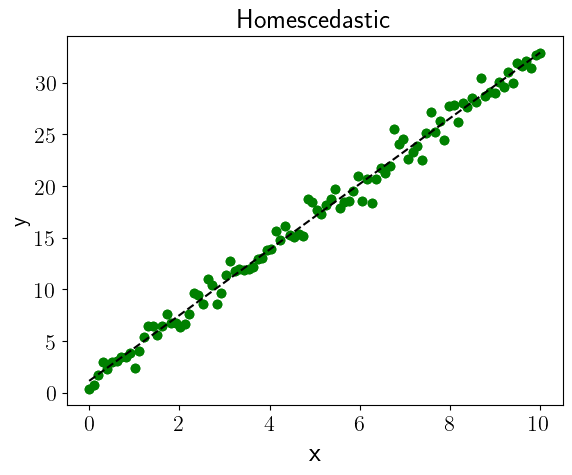
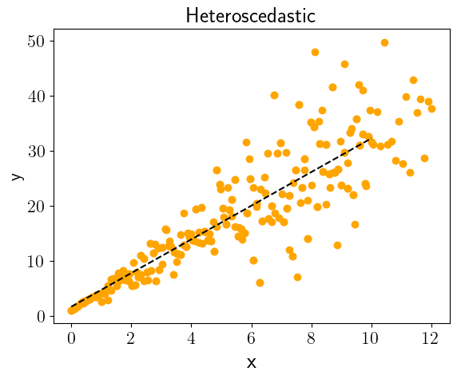
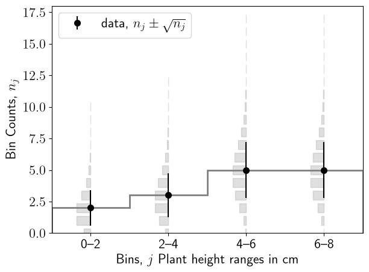
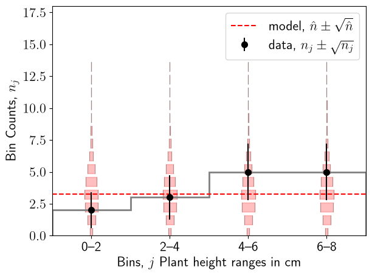
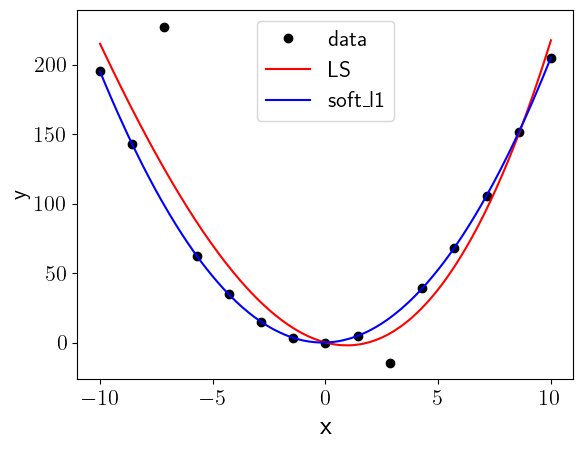

---
jupytext:
  formats: md:myst
  text_representation:
    extension: .md
    format_name: myst
kernelspec:
  display_name: Python 3
  language: python
  name: python3
---

(chapter:LeastSquares)=
# Least Squares Fitting

Fitting means estimating the parameters, and sometimes also the functional form,
that best describes a dataset. A functional form can have one parameter or lots of them.

The **Least Squares** approach minimises the [Residuals](#sec:ls-residuals) for all parameters simultaneously, to provide the best set of parameter estimates.  We will see that when the measurement uncertainties are Gaussian, minimising the sum of squared residuals is identical to minimising the [Negative Log Likelihood](#chapter:MaxLike).

An example of a Least Squares Fit (straight line) is shown in [](#fig:lsq) for an example of Plant growth as a function of time. The control variable is the number of days since planting ($x$-axis). The control variable has evenly spaced intervals and negligible uncertainty. The Random Variable is the measured plant growth ($y$-axis) which has measurement uncertainty indicated by the vertical error bars on the data points.

:::{figure} 
:label: fig:lsq



The Least Squares fit (red dashed line) is a simultaneous estimation of the parameters of the function $y(x)$. In this case the function is a straight line, $y(x)=ax+b$, with parameter estimates $\hat{a}=-4.17$ (the gradient or slope of the line) and $\hat{b}=0.70$ (the intercept: the value of $y(x)$ when $x=0$). Least Squares estimates these parameters by minimising^[minim] the sum of the squared Residuals. The Residuals are shown as blue dotted lines for each data point.
:::

[^minim]: minimising a function means setting the first derivative of the function to zero, and checking the second derivative is positive. See [](#sec:minim_intro).


(sec:ls-residuals)=
## Residuals

The differences between each data point $d(x_i)$[^n1] and the Least Squares fit function at that point $m(x_i;\,\hat{\theta})$ are the **Residuals**:

$d(x_i) - m(x_i;\,\hat{\theta})\;\;\; \rightarrow \;\;\; d_i - m_i$,

with the simplified notation, $d_i - m_i$, chosen for clarity below.


[^n1]: $d(x_i)$ are the $y$-values of the black points in [](#fig:lsq))

[^n2]: $m(x_i;\,\hat{\theta})$ are the $y$-values of the red dashed line in [](#fig:lsq), where $\hat{\theta}={\hat{a}, \hat{b}}$ are the parameter estimates from the fit.

Data points must always be provided with error bars, of course, because all measurements have uncertainty! We denote the uncertainty on each data point as $\sigma_i$. To take account of these uncertainties on the data points, we can Standardise the Residuals (divide each residual by the measurement uncertainty):

```{math}
:label: eq:ls_standresid

r_i = \dfrac{ d_i - m_i }{ \sigma_i}

```

To consider all the data, rather than a single point at a time[^seeL] we could just add all of the residuals together... but this would be a mistake. If some of them are positive and some of them are negative, they could cancel out and give us a tiny total residual, despite the data, $d$, being very far away from the Least Squares fit model, $m$.

[^seeL]: Compare with the calculation of Likelihoods (week 6 lecture) - when we calculate the Likelihood from many data points we combine them by multiplying the PMFs, because the Multiplication Rule tells us that $P(A\cap B)= P(A) P(B)$ for IID $A,B$.


If we **Square the Residuals** before summing over them, this cancellation problem goes away[^pro].

[^pro]: Another option would be to take the absolute values of the residuals, rather than squaring them. Laplace used this approach, before Gauss came along with the idea to square them - see for example [Stephen Sigler's paper](https://doi.org/10.1214/aos/1176345451). The absolute value can be a good choice for reducing the "pull" of outliers - see [](#sec:ls-outliers).

The **Sum of Squared Residuals** is then:

```{math}
:label: eq:ls_ssresid

\sum_i r^2_i = \sum\limits^N_i \left( \dfrac{d_i - m_i}{\sigma_i}\right)^2

```

The statistic defined in [](#eq:ls_ssresid) is known as **Pearson's Chi Squared**, $\chi^2$, where the sum is over $N$ measurements, $d_i \pm \sigma_i$ and model predictions, $m_i$ (with estimated parameters $\hat{\theta} = {\hat{a}, \hat{b}}$).


:::{tip} Fun Fact
Gauss came up with the Normal distribution to justify the Least Squares method. See [this nice blog](https://notarocketscientist.xyz/posts/2023-01-27-how-gauss-derived-the-normal-distribution/) for the story.
:::


(sec:ls-chisquared)=
## The Chi Squared Statistic, $\chi^2$

Rewriting [](#eq:ls_ssresid) with the notation $\chi^2 \equiv \sum\limits_i^N r^2_i$, The **Chi Squared Statistic** is:

```{math}
:label: eq:chisq
\chi^2 = \sum_{i=1}^{N} \left(\frac{d_i - m_i}{\sigma_i}\right)^2.
```

If we think of each **measurement $d_i \pm \sigma_i$** as representative of a normal distribution, Norm($d_i, \sigma_i$), we can generate the "data-centric" picture given in [](#fig:lsq_gaus).


:::{figure} 
:label: fig:lsq_gaus



Data-centric picture: each measurement $d_i \pm \sigma_i$ represents the mean and standard deviation of a Normal($d_i, \sigma_i$) distribution.
:::

If instead we think of each **fit point $m_i \pm \sigma_i$** as representative of a normal distribution, Norm($d_i, \sigma_i$), we can generate the "model-centric" picture given in [](#fig:lsq_gaus_model). Note that we are using the measurement uncertainty $\sigma_i$ at each data point as an estimator for the uncertainty on the model fit point.


:::{figure} 
:label: fig:lsq_gaus_model



Model-centric picture: each fit point $m_i \pm \sigma_i$ represents the mean and standard deviation of a Normal($m_i, \sigma_i$) distribution, where we are using the measured uncertainty on the data point as before for $\sigma_i$.
:::


Either of the choices are perfectly valid, with the [data-centric picture](#fig:lsq_gaus) perhaps being more intuitive, as it keeps the uncertainties attached to the data. We will use the [model-centric picture](#fig:lsq_gaus_model) to show that miniminising the Negative Log Likelihood is equivalent to minimising the Pearson Chi Squared statistic.

The Norm$(m_i, \sigma_i)$ PDF is:

```{math}
:label: eq:norm_pdf_lsq
f_Y(y) = \dfrac{1}{\sigma_i\sqrt{2\pi}}\exp\!\left[-\frac{1}{2}\left(\frac{y-m_i}{\sigma_i}\right)^2\right] 
```

The Likelihood (of the $N$ data measurements $d_i$ being described by model parameters $\theta_i = m_i, \sigma_i$) is then:

```{math}
:label: eq:norm_lik_lsq

\begin{aligned}

\mathcal{L}_{\theta}(\theta;d) &= \prod_{i=1}^{N}\dfrac{1}{\sigma_i\sqrt{2\pi}}\exp\!\left[-\dfrac{1}{2}\left(\dfrac{d_i-m_i}{\sigma_i}\right)^2\right]\\ \\

\end{aligned}
```

The Negative Log Likelihood is[^note]:

```{math}
:label: eq:chisq_ll
\begin{aligned}

\mathsf{NLL} = -\ln \mathcal{L} &= \sum\limits_i^N \ln(\sigma_i) + \sum\limits_i^N \frac{1}{2}\ln(2\pi) +\sum\limits_i^N \left[\dfrac{1}{2}\left(\dfrac{d_i-m_i}{\sigma_i}\right)^2\right] \\
& =  \sum\limits_i^N \ln\sigma_i +\frac{N}{2}\ln(2\pi) + \frac{1}{2}\chi^2.

\end{aligned}
```


[^note]: In [](#eq:norm_nll) we considered $\sigma$ as a fixed value (a parameter of the true underlying distribution), so the Likelihood product (over densities) gave us the term $N\ln \sigma$. In this case, the $\sigma$ are (potentially) different in each case, as they represent measurement uncertainties. So the term is $\sum\limits_i^N \ln \sigma_i$


Minimising the NLL over $\theta$ is therefore *identical* to minimising $\chi^2$.  If all uncertainties are equal (the *homoscedastic* case - see [](#fig:lsq_hetero_homo) ) the $\sigma_i$ terms are constant, so $\hat\theta_{\rm LS} = \hat\theta_{\rm MLE}$.

> **Note:** If we also optimise over the $\sigma_i$ individually the MLE gives $\hat\sigma_i = 0$ and $\chi^2 = 0$, which is trivially perfect but useless.  Least squares is interesting when the $\sigma_i$ are fixed by the measurement process.


::::{figure}
:label: fig:lsq_hetero_homo

:::{list-table}
:header-rows: 0

* - 
  - 
:::

Homoscedastic data have equal variances ($\sigma_i = \sigma$ for all $i$); heteroscedastic data do not.
::::


(sec:ls-binned)=
## Chi Squared with Binned Data

When data are binned (e.g. a histogram), the observed count $n_i$ in each bin follows a Poisson distribution ([](#sec:poisson)). An attempt to illustrate this is shown in [](#fig:lsq_poisson_data). The $K\sim$ Poisson($\lambda$) distribution has expectation $E[K]=\lambda$ and variance $V[K]=\lambda$, where the parameter $\lambda$ is the rate, e.g. the count per bin. The **count in each bin, $n_j$** is therefore the mean, $\lambda$, of a Poisson distribution, and the **uncertainty on the count in each bin, $\sigma_j$** is the square root of the Poisson variance: $\sqrt{V[K]} = \sqrt{\lambda} =  \sqrt{n_j}$. We can generate the "data-centric" picture given in [](#fig:lsq_poisson_data).


:::{figure} 
:label: fig:lsq_poisson_data



Data-centric picture of histogrammed (binned) data with Poisson uncertainties on the "counts per bin" RV.
:::


Just as we did the unbinned (Gaussian $\sigma$) example, we can instead think of each **fit point $m_j \pm \sigma_j$** as representative of a Poisson distribution, Poisson($m_j$), and generate the "model-centric" picture given in [](#fig:lsq_poisson_model). 

:::{figure} 
:label: fig:lsq_poisson_model



Model-centric picture of histogrammed (binned) data with Poisson uncertainties on the "counts per bin" RV. The uncertainties $\sigma_j = \sqrt{n_j}$ are now applied to the model fit points $\hat{n}_j$ at the centre of each bin.

:::

Let's consider the Chi Squared test statistic for the binned data:


```{math}
:label: eq:chisq-binned
\chi^2 = \sum\limits_j^{Nbins} \left( \frac{n_j - \hat{n}_j}{\sqrt{n_j}} \right)^2,
```

where $\hat{n}_j$ is the model prediction for bin $j$.


The **binned** standardised residuals [](#eq:ls_standresid) are often written in terms of the observed counts ($n_j$) and the expected counts ($\hat{n}_j$), as:

```{math}
:label: eq:chisq-binned-pop
 \frac{n_j - \hat{n}_j}{\sqrt{n_j}} = \frac{\mathsf{observed} - \mathsf{expected}}{\mathsf{\sqrt{observed}}}
```


(sec:ls-straightline)=
## Estimating the Parameters of a Straight Line

In the (unbinned) examples above, [](#fig:lsq) and [](#fig:lsq_gaus_model), the model is $m(x; \hat{\theta}) = \hat{a}x + \hat{b}$: a straight line. The parameter estimates $\hat{\theta} = {\hat{a}, \hat{b}}$ are made via the **Method of Least Squares, (LS)**. We will briefly cover the math here.


Just as for the [Maximum Likelihood Method](#chapter:MaxLike), we find the parameter estimates by minimising the objective function. For the MLE, the objective function is the [NLL](#eq:nll). For Least Squares, the objective function is the $\chi^2$.

For a straight line model $m(x; a,b) = ax + b$, the Chi Squared statistic is:

```{math}
:label: eq:chisq-line
\chi^2 = \sum_{i=1}^{N} \left( \frac{d_i - (ax_i + b) }{\sigma_i} \right)^2.
```

Expanding the square in each term of the numerator:

```{math}
:label: eq:chisq-line-expanded
\chi^2 = \sum_{i=1}^{N} \frac{1}{\sigma_i^2}
\bigl(d_i^2 + a^2 x_i^2 + b^2 + 2ab\,x_i - 2b\,d_i - 2a\,x_i\,d_i\bigr).
```

:::{tip}
There is going to be some quite "wordy" algebra below - let's make it more manageable using shorthand notation for the sums:

```{math}
:label: eq:ls-sums
s_1 = \sum_i \frac{1}{\sigma_i^2}, \quad
s_x = \sum_i \frac{x_i}{\sigma_i^2}, \quad
s_{xx} = \sum_i \frac{x_i^2}{\sigma_i^2}, \quad
s_y = \sum_i \frac{d_i}{\sigma_i^2}, \quad
s_{xy} = \sum_i \frac{x_i d_i}{\sigma_i^2}
```
:::


Just as for the MLE, we find the LS parameter estimates by taking the (partial) derivatives of the objective function (with respect to each of the parameters we seek to estimate) and setting them to zero. 


[1] Take the derivative of [](#eq:chisq-line-expanded) with respect to $a$
: $$ \label{eq:chisq_deriv_a} \frac{\partial \chi^2}{\partial a}= \sum_i \frac{1}{\sigma_i^2}(0 + 2ax_i^2 + 0 + 2bx_i - 0 - 2x_id_i)$$


[2] Set [](#eq:chisq_deriv_a) to zero and rearrange
: $$\label{eq:chisq_deriv_a_r}\sum_i \frac{x_id_i}{\sigma_i^2}= \hat a \sum_i \frac{x_i^2}{\sigma_i^2} + \hat b \sum_i \frac{x_i}{\sigma_i^2}$$

[3] Tidy up with our [shorthand notation](#eq:ls-sums)
: $$\label{eq:chisq_deriv_a_s}s_{xy} = \hat a \, s_{xx}+ \hat b\, s_x$$

The same three steps for the derivative with respect to the other parameter, $b$, give us:

```{math}
:label: eq:chisq_deriv_b_s
s_y = \hat a\, s_x + \hat b\,   s_1
```


<!--
```{math}
:label: eq:chisq_deriv_b
\frac{\partial \chi^2}{\partial b}
= \sum_i \frac{1}{\sigma_i^2}(0 + 0 + 2b + 2ax_i - 2d_i - 0) = 0.
```
-->


The simultaneous equations [](#eq:chisq_deriv_a_s) and [](#eq:chisq_deriv_b_s) (known as the **Normal Equations**) can be solved to find the parameter estimates.

We eliminate $\hat b$ as follows:

1. Multiply [](#eq:chisq_deriv_a_s) by $s_1$: $s_{xy}\, s_1 = \hat a \, s_{xx}\, s_1 + \hat b\, s_x\, s_1$

2. Multiply [](#eq:chisq_deriv_b_s) by $s_x$: $s_y s_x = \hat a\, s^2_x + \hat b\, s_x\,  s_1$

3. Subtract the two equations to eliminate solve for $\hat a$:

$$\label{eq:lsq_a} s_{xy} s_1  - s_y s_x  = (s_{xx} s_1 - s_x^2)\,\hat a $$

Following equivalent steps to solve for $\hat b$, we find:

$$\label{eq:lsq_b}
s_{xx} s_y - s_x s_{xy} = (s_{xx}s_1  - s_x^2)\,\hat b
$$


**The second derivatives** of [$\chi^2$](#eq:chisq-line-expanded) with respect to the parameters are:

```{math}
:label: eq:chisq_deriv_ab
\frac{\partial^2\chi^2}{\partial a^2} = \sum_i \frac{2x_i^2}{\sigma_i^2} = 2s_{xx}, \qquad
\frac{\partial^2\chi^2}{\partial b^2} = \sum_i \frac{2}{\sigma_i^2} = 2s_1, \qquad
\frac{\partial^2\chi^2}{\partial a\,\partial b} = \sum_i \frac{2x_i}{\sigma_i^2} = 2s_x.
```

So the **Hessian matrix** [](#sec:mma_hessian) is:

```{math}
:label: eq:chisq_hess
H = 2
\begin{bmatrix}
s_{xx} & s_x \\ \\
s_x & s_1 \\
\end{bmatrix}
```


The Hessian/2 has **determinant**[^det] $\Delta = \left( s_{xx}s_1 - s_x^2\right)$. We can recognise $\Delta$ as the common factor in [](#eq:lsq_a) in [](#eq:lsq_b), and write our parameter estimates as:

[^det]: The determinant of a matrix $\begin{bmatrix} A & B \\ C & D \\ \end{bmatrix}$ is $AD-BC$.

```{math}
:label: eq:ls-ahat
\hat a = \frac{ s_{xy} s_1 - s_y s_x }{\Delta},
```


```{math}
:label: eq:ls-bhat
\hat b = \frac{s_{xx} s_y - s_x s_{xy}}{\Delta}.
```

<!--
### Solution by Cramer's rule

The two equations can be written in matrix form as

$$
\begin{pmatrix} s_{xx} & s_x \\ s_x & s_1 \end{pmatrix}
\begin{pmatrix} \hat m \\ \hat c \end{pmatrix}
=
\begin{pmatrix} s_{xy} \\ s_y \end{pmatrix}.
$$

The determinant of the coefficient matrix is $\Delta = s_{xx}s_1 - s_x^2$.  Cramer's rule replaces each column in turn by the right-hand side vector and divides by $\Delta$:

$$
\hat m = \frac{1}{\Delta}\begin{vmatrix} s_{xy} & s_x \\ s_y & s_1 \end{vmatrix}
= \frac{s_{xy}s_1 - s_x s_y}{\Delta},
\qquad
\hat c = \frac{1}{\Delta}\begin{vmatrix} s_{xx} & s_{xy} \\ s_x & s_y \end{vmatrix}
= \frac{s_{xx}s_y - s_x s_{xy}}{\Delta}.
$$
-->
Note that $\Delta=s_{xx}s_1 - s_x^2$ depends only on $x_i$ and $\sigma_i$, not on the data values $d_i$:

<!--
```{math}
\begin{aligned}
\Delta &= s_{xx}s_1 - s_x^2 \\
	   &= \sum_i \frac{x_i^2}{\sigma_i^2} \sum_j \frac{1}{\sigma_j^2} - \sum_i \frac{x_i}{\sigma_i^2}\sum_j \frac{x_j}{\sigma_j^2} \\

\end{aligned}
```
-->


<!--
```{math}
:label: eq:delta_homo
\begin{aligned}
\Delta &= \frac{1}{\sigma^4}\left( N\sum_i x_i^2 - \left(\sum_i x_i \right)^2 \right)\\
       &= \frac{1}{\sigma^4}\left( N\sum_i x_i^2 - N^2\bar{x}^2 \right) \\[6pt]
       &= \frac{N}{\sigma^4}\left( \sum_i x_i^2 - N\bar{x}^2 \right) \\[6pt]
       &= \frac{N}{\sigma^4}\sum_i (x_i - \bar{x})^2
\end{aligned}
```

 the numerators and denominators of [](#eq:ls-ahat) [](#eq:ls-bhat) have cancelling powers $\sigma$.


::::{dropdown} Show parameter estimates for homoscedastic data
In the homoscedastic case ($\sigma_i = \sigma$), the sums simplify to
$s_1 = N/\sigma^2$, $s_x = N\bar{x}/\sigma^2$, $s_{xx} = \sigma^{-2}\sum_i x_i^2$,
$s_y = N\bar{d}/\sigma^2$, $s_{xy} = \sigma^{-2}\sum_i x_i d_i$,
and $\Delta = \frac{N}{\sigma^4}\sum_i(x_i-\bar{x})^2$.

Substituting into [](#eq:ls-ahat):

```{math}
:label: eq:ls-ahat-homo
\begin{aligned}
\hat a &= \frac{s_{xy}s_1 - s_y s_x}{\Delta} \\[6pt]
       &= \frac{\dfrac{N}{\sigma^4}\sum_i x_i d_i
                - \dfrac{N^2\bar{x}\bar{d}}{\sigma^4}}
              {\dfrac{N}{\sigma^4}\sum_i(x_i-\bar{x})^2} \\[10pt]
       &= \frac{\sum_i x_i d_i - N\bar{x}\bar{d}}
              {\sum_i(x_i-\bar{x})^2} \\[6pt]
       &= \frac{\sum_i(x_i-\bar{x})(d_i-\bar{d})}
              {\sum_i(x_i-\bar{x})^2}
\end{aligned}
```

For $\hat b$, the second normal equation [](#eq:chisq_deriv_b_s) in the homoscedastic case gives
$\bar{d} = \hat a\,\bar{x} + \hat b$, so immediately:

```{math}
:label: eq:ls-bhat-homo
\hat b = \bar{d} - \hat a\,\bar{x}.
```
::::
-->


(sec:ls-uncertainties)=
### Parameter Uncertainties

The propagation of uncertainties is treated in full in [Propagation of Uncertainties](#sec:dd-propuncert). Here we apply the [Taylor expansion](#eq:mma_taylor) method to the least-squares problem to obtain the uncertainties on the fitted parameters $\hat{\theta} = \{ \hat a, \hat b \}$.


$\chi^2(\theta) = \chi^2(\hat{\theta}) + \dfrac{\partial \chi^2}{\partial \theta}\bigg|_{\hat{\theta}} \, (\theta-\hat{\theta}) + \dfrac{1}{2!}\dfrac{\partial^2 \chi^2}{\partial \theta^2}\bigg|_{\hat{\theta}}\, (\theta-\hat{\theta})^2 + ...$


The first term
: $\chi^2(\hat{\theta})$ is the statistic evaluated at the estimated parameters, $a=\hat{a}$ and $b=\hat{b}$

The second term (first order derivative)
: $\dfrac{\partial \chi^2}{\partial \theta}\bigg|_{\hat{\theta}} =0$: the first derivative of the statistic evaluated at the estimated parameter values is zero by definition. This is because the derivative of a function at its minimum (or maximum) is zero.

The third term (second order derivative)
: $\dfrac{\partial^2 \chi^2}{\partial \theta^2}\bigg|_{\hat{\theta}}$: is the Hessian matrix of partial derivatives [](#eq:chisq_hess), evaluated at the parameter estimates.

   

Setting the second term to zero, and noting $(\theta-\hat{\theta}) = \begin{pmatrix} a-\hat a \\ b-\hat b \end{pmatrix}$, we have:

```{math}
:label: eq:chisq-taylor
\chi^2(a,b) = \chi^2(\hat a,\hat b) +
\frac{1}{2!}
\begin{pmatrix} a-\hat a \\ b-\hat b \end{pmatrix}^{\!\top}
\mathsf{H}
\begin{pmatrix} a-\hat a \\ b-\hat b \end{pmatrix},
```


The factor of $\tfrac{1}{2!}$ cancels with the factor of $2$ in [$\mathsf{H}$](#eq:chisq_hess), so the quadratic form simplifies to

```{math}
:label: eq:ls_chi2_taylor
\chi^2(a,b) = \chi^2(\hat a,\hat b) +
\begin{pmatrix} a-\hat a \\ b-\hat b \end{pmatrix}^{\!\top}
\begin{pmatrix} s_{xx} & s_x \\ s_x & s_1 \end{pmatrix}
\begin{pmatrix} a-\hat a \\ b-\hat b \end{pmatrix}.
```

The **Covariance Matrix** of the estimates is the inverse of the matrix in [](#eq:ls_chi2_taylor):

```{math}
:label: eq:ls_hess_hetero
\boldsymbol{\Sigma} = \begin{pmatrix} s_{xx} & s_x \\ s_x & s_1 \end{pmatrix}^{-1}
= \frac{1}{\Delta}\begin{pmatrix} s_1 & -s_x \\ -s_x & s_{xx} \end{pmatrix},
```

giving

```{math}
:label: eq:ls-cov
\sigma^2_{\hat a} = \frac{s_1}{\Delta}, \qquad
\sigma^2_{\hat b} = \frac{s_{xx}}{\Delta}, \qquad
\operatorname{cov}(\hat a,\hat b) = -\frac{s_x}{\Delta}.
```

The *linear correlation coefficient* between $\hat a$ and $\hat b$ is

$$
\rho(\hat a,\hat b) = \frac{\operatorname{cov}(\hat a,\hat b)}{\sigma_{\hat a}\,\sigma_{\hat b}}.
$$

A negative correlation is typical: if the slope is steeper than expected, the intercept tends to be lower to compensate.

<!--
(sec:ls-matrix)=
## Matrix generalization

The straight-line formulae extend to any model that is **linear in its parameters**, including polynomials and nonlinear bases such as $y = \theta_1 x^2 + \theta_2 x^3 + \theta_3 x^{-1}$.  Write

$$
y = \sum_j \theta_j f_{x,j} \quad \Longleftrightarrow \quad \mathbf{y} = \mathbf{f}_x \,\boldsymbol\theta,
$$

where $\mathbf{f}_x$ is a $[Z \times N]$ matrix ($Z$ = number of parameters, $N$ = number of measurements).  The chi-squared is

```{math}
:label: eq:chisq-matrix
\chi^2_{\rm rel} = (\mathbf{y} - \mathbf{f}_x\boldsymbol\theta)^{\top} \mathbf{H} (\mathbf{y} - \mathbf{f}_x\boldsymbol\theta).
```

Minimising over $\boldsymbol\theta$ yields the **normal equations**

$$
(\mathbf{f}_x^{\top}\mathbf{H}\mathbf{f}_x)\,\boldsymbol{\hat\theta} = (\mathbf{f}_x^{\top}\mathbf{H})\,\mathbf{y},
$$

so $\boldsymbol{\hat\theta} = \mathbf{B}\mathbf{y}$ with $\mathbf{B} = (\mathbf{f}_x^{\top}\mathbf{H}\mathbf{f}_x)^{-1}\mathbf{f}_x^{\top}\mathbf{H}$, and the covariance matrix is

```{math}
:label: eq:ls-cov-matrix
\boldsymbol{\Sigma} = \mathbf{B}\mathbf{H}\mathbf{B}^{\top} = (\mathbf{f}_x^{\top}\mathbf{H}\mathbf{f}_x)^{-1}.
```

(sec:ls-gauss-markov)=
## Ordinary Least Squares and the Gauss–Markov theorem

**Ordinary Least Squares (OLS)** refers to functions that are linear in their parameters (the basis functions $f_x$ need not be linear in $x$).  **Nonlinear Least Squares (NLS)** is for functions that are nonlinear in their parameters.

The **Gauss–Markov theorem** states: if the measurement uncertainties are homoscedastic and serially uncorrelated then the OLS estimator is the **Minimum Variance Unbiased Estimator (MVUE)** — it achieves the lowest possible variance among all linear unbiased estimators.  If the uncertainties are additionally Gaussian, OLS and MLE are identical.

If the data are **heteroscedastic** (different $\sigma_i$), we must either transform the data or use *Weighted Least Squares*, which keeps the $1/\sigma_i^2$ weights non-trivially.
-->


(sec:ls-homo)=
### Homoscedastic Least Squares 

If we follow the procedure above but with the assumption that our data are homoscedastic - constant variance - we have a simpler set of tasks.


:::{tip}
In the **homoscedastic** case ($\sigma_i = \sigma$ for all $i$), the shorthand sums [](#eq:ls-sums) simplify to:


```{math}
:label: eq:ls-sums-homo
s_1 = \frac{N}{\sigma^2}, \quad
s_x = \frac{N\bar{x}}{\sigma^2}, \quad
s_{xx} = \frac{1}{\sigma^2}\sum_i x_i^2, \quad
s_y = \frac{N\bar{d}}{\sigma^2}, \quad
s_{xy} = \frac{1}{\sigma^2}\sum_i x_i d_i
```

:::

<!--
Simultaneous Equations
: $\sum x_i y_i =a \sum x^2_i + b \sum x_i$
  
  $\sum y_i =a \sum x_i + Nb$
-->

Hessian/2
: $\mathsf{H/2} =  \begin{pmatrix} s_{xx} & s_x \\ \\ s_x & s_1 \end{pmatrix} = \dfrac{1}{\sigma^2} \begin{pmatrix} \sum x_i^2 & N\bar{x} \\ \\ N\bar{x} & N \end{pmatrix}$

Determinant
: $\Delta = \left( s_{xx} s_1 - s_x^2 \right) = \dfrac{1}{\sigma^4} \left( N \sum x^2_i - N^2\bar{x}^2 \right)$

Covariance Matrix = Inverse Hessian/2
: $\mathsf{H/2}^{-1} = \dfrac{1}{\Delta}\left(\dfrac{1}{\sigma^2}\right)^{-1} \begin{pmatrix} s_1 & -s_x \\ \\ -s_x & s_{xx} \end{pmatrix} = \dfrac{\sigma^2}{\Delta} \begin{pmatrix} N & -N\bar{x} \\ \\ -N\bar{x} & \sum x_i^2 \end{pmatrix} $

<!--
$\chi^2$ Statistic 
: $E[\chi^2] = E\left[ \sum\limits_i^N \dfrac{1}{\sigma^2} (d_i - m_i) \right]
			 = \dfrac{N}{\sigma^2} E\left[ \sum\limits_i^N (d_i - \hat{a}x_i + \hat{b}) \right]
 = \nu = N-2$
  
  $V[\chi^2] = 2\nu =2(N-2)$

  $\nu = \dfrac{(d_i-m_i)^2}{\sigma^2_y} $
-->

Parameter Uncertainties
: $\sigma^2_{\hat{a}} = \dfrac{s_1}{\Delta} = \dfrac{\sigma^2 N}{\Delta},\;\;\;\;\;\; \sigma^2_{\hat{b}} = \dfrac{s_{xx}}{\Delta} = \dfrac{ \sigma^2 \sum x_i^2}{\Delta}$


---

(sec:ls-python)=
## LSE with Python 

Let's generate some fake data that follows $y(x) = ax + b$ but has some added noise to make it more realistic.

```{code-cell} python
import numpy as np
from numpy.random import default_rng

def gen_data(seed=None):

  rng = default_rng(seed)

  # True parameter values
  a = -3.0
  b =  2.0

  # independent variable x
  x = np.linspace(0, 10, 10)

  # Gaussian Noise term: 10% (to make fake data more realistic)
  #noise = 0.1 * rng.standard_normal(x.size)
  noise = rng.standard_normal(x.size)

  # Fake data followin y(x) = ax + b with added noise
  data = a * x + b + noise 

  return x, data


# only set the seed for demos!
xvals, data = gen_data(seed=123)

print(f"data measurements: {data}")
```

Always plot the data before doing anything else, even when it is fake!


```{code-cell} python
import matplotlib.pyplot as plt

def plot_data(xvals, data):

  fig, ax = plt.subplots()

  ax.scatter(xvals, data, color='black', label="data")
  ax.set_xlabel('x')
  ax.set_ylabel('y')
  plt.legend()
  plt.show()


# only set the seed for demos!
plot_data(xvals, data)

```


Now let's do a by-hand implementation of a least squares fit ([homoscedastic](#sec:ls-homo)) to find the LSE for the parameters a and b:


```{code-cell} python
def byhand_LSE(x, data):

  # the number of data points
  N = len(data)

  # the shorthand sums for the homoscedastic case
  s1  = N
  sxx = np.sum(x**2)
  sx  = np.sum(x)
  sy  = np.sum(data)
  sxy = np.sum(x * data)

  # determinant
  delta = N * sxx - sx**2

  # parameter estimates
  a_est = (sxy * N  - sx * sy)  / delta
  b_est = (sxx * sy - sxy * sx) / delta

  model = a_est * x + b_est

  # residuals - not standardised
  resids    = model - data

  # number of degrees of freedom = Ndata - Nparams
  nu = N - 2

  # homoscedastic sigma^2
  sigma2  = np.sum(resids**2) / nu

  # parameter uncertainties
  sigma_a = np.sqrt(sigma2 * N    / delta)
  sigma_b = np.sqrt(sigma2 * sxx  / delta)
  cov_ab  = sigma2 * (-sx / delta)
  rho_ab  = cov_ab / (sigma_a * sigma_b)

    
  print(f"Slope      a: {a_est:.4f}  ±  {sigma_a:.4f}")
  print(f"Intercept  b: {b_est:.4f}  ±  {sigma_b:.4f}")
  print(f"cov(a,b):  {cov_ab:.4f}")
  print(f"rho(a,b):  {rho_ab:.4f}")

  return a_est, sigma_a, b_est, sigma_b

a_est, sigma_a, b_est, sigma_b = byhand_LSE(xvals, data)

```

Let's plot the fit result on top of the fake data:


```{code-cell} python


def plot_data_and_fit(x, data, a_est, sigma_a, b_est, sigma_b):

  import matplotlib.pyplot as plt

  fig, ax = plt.subplots()

  ax.scatter(xvals, data, color='black',label="data d(x)")
  model = a_est * x + b_est
  model_bdown = a_est * x + (b_est-sigma_b)
  model_bup = a_est * x + (b_est+sigma_b)
  model_adown = (a_est-sigma_a) * x + b_est
  model_aup = (a_est+sigma_a) * x + b_est
  ax.plot(xvals, model,'r--', label=f"model m(x) = {a_est:.2f}x + {b_est:.2f}")
  ax.fill_between(xvals, model_bdown, model_bup, alpha=0.25, color='red')
  ax.fill_between(xvals, model_adown, model_aup, alpha=0.25, color='red')
  ax.set_xlabel('x')
  ax.set_ylabel('y')
  plt.legend()
  plt.show()

plot_data_and_fit(xvals, data, a_est, sigma_a, b_est, sigma_b)

```


(sec:ls-scipy)=
### LSE with `scipy.optimize.least_squares` 

The [`scipy.optimize.least_squares`](https://docs.scipy.org/doc/scipy/reference/generated/scipy.optimize.least_squares.html) method allows us to find the LSE for parameters without doing doing any of the math above, but it is very easy to get it wrong without some understanding of what we have covered in this chapter. The method fits (estimates the parameters of) a model by minimising the sum of squares of a user-supplied **unstandardised** residuals function: the numerator $d_i - m_i$ of the standardised residual given in [](#eq:ls_standresid)

The method returns a `result` object from which we can get interesting things such as:

`r = result.fun`
: The vector of (unstandardised) residuals evaluated at the LSE for the parameters

`J = result.jac` 
: the Jacobian matrix of partial derivatives of the (unstandardised) residuals function, at the LSE for the parameters 

`theta = result.x`
: the vector of LSE parameter estimates.


**Important Note about `scipy`'s `least_squares`**

:::{warning}
Because `scipy`'s `least_squares` does not take a standardised residuals function, the Jacobian returned by the method is missing the $1/\sigma_i^2$ weights on the partial derivatives we calculated above e.g. [](#eq:chisq_deriv_a). This means that when we construct the Hessian with `H = J.T@J` it is not the same as the $\mathsf{H}/2$ from [](#eq:chisq_hess), which has $1/\sigma_i^2$ weights on all its elements.
:::


<!-- The scipy statistic `result.fun` is not the standardised $\chi^2$ statistic from [](#eq:chisq-line), but -->

The **unweighted sum of squared residuals** is:

$$
S = \sum_i (d_i - m_i)^2.
$$

In the homoscedastic case ($\sigma_i = \sigma$: the uncertainty on all measurements is equal), after fitting $Z=2$ parameters, the quantity $Q = S/\sigma^2$ follows a $\chi^2$ distribution with $\nu = N - Z$ degrees of freedom, whose mean is $\nu$.

$Q \sim \chi^2(\nu) \;\;\;\; E[Q] = E[\frac{S}{\sigma^2}] = \nu $ - see [](#eq:exp_chisq)

Multiplying the expectation by the constant $\frac{\sigma^2}{\nu}$ yields $E\left[\frac{S}{\nu}\right] = \sigma^2$, so $S/\nu$ is an unbiased estimate of $\sigma^2$: the formula is using the scatter of the residuals to estimate the uncertainty on the measurements, $\sigma$, when this is unknown.  

**When constructing the Covariance Matrix using the `result.jac` returned by `least_squares`, we must multiply through by the estimator for $\sigma^2$:  $\frac{S}{\nu}$**, where $\nu = N-N_p$.

```
# Vector of unstandardised residuals: [d_i - m_i] =  [d_i - (est_a * x_i + est_b) ]
r = result.fun

# Sum of squared unstandardised residuals
S = np.sum(r**2)

# Estimated sigma^2 from  E[\frac{S}{\sigma^2}] = \nu
sigma2_est = S / nu

# Jacobian of partial first derivatives without 1/\sigma^2 weights
J = result.jac

# Hessian of partial second derivatives without 1/\sigma^2 weights
H = J.T @ J

# Inverse of Hessian without \sigma^2 weights
Hinv = np.linalg.inv(H)

# Covariance Matrix: all terms must be multiplied through by sigma2_est
cov  = Hinv * sigma2_est 
```


Now that we have very clearly heeded the warnings above, let's fit!


```{code-cell} python

def scipy_LSE(x, data):
  from scipy.optimize import least_squares

  # residuals function, parameters are theta = [a, b]
  def residuals(theta, x, data):
  	# model: y = ax + b
  	model = theta[0] * x + theta[1]
  	# residual (not standardised!) : (data - model ) 
  	return data - model

  # we are estimating two parameters: a and b
  N_params = 2

  # number of degrees of freedom = N - N_params
  nu = len(data) - N_params

  # choose some starting values for the parameters a=1,b=1
  theta0 = np.array([1.0, 1.0])

  # call the fit function
  # first argument - residuals - is the d-m function we defined above
  # second argument - theta0 - is the array of starting parameter values for the fit
  # third argument - args=(x, data) - tells the fit that the x,data arguments of the residuals function are "spectators", we are not trying to estimate their values 

  result = least_squares(residuals, theta0, args=(xvals, data))

  # Vector of unstandardised residuals: [d_i - m_i] =  [d_i - (est_a * x_i + est_b) ]
  r = result.fun

  # Sum of squared unstandardised residuals
  S = np.sum(r**2)

  # Estimated sigma^2 from  E[\frac{S}{\sigma^2}] = \nu
  sigma2_est = S / nu

  # Jacobian of partial first derivatives without 1/\sigma^2 weights
  J = result.jac

  # Hessian of partial second derivatives without 1/\sigma^2 weights
  H = J.T @ J

  # Inverse of Hessian without \sigma^2 weights
  Hinv = np.linalg.inv(H)

  # Covariance Matrix: all terms must be multiplied through by sigma2_est
  cov  = Hinv * sigma2_est 
  var   = np.diagonal(cov)            # [sigma_a^2, sigma_b^2]
  sigma = var**0.5                    # [sigma_a, sigma_b]   
  cov_ab = cov[0, 1]
  rho_ab = cov_ab / (sigma[0] * sigma[1])


  print(f"Slope      a: {result.x[0]:.4f}  ±  {sigma[0]:.4f}")
  print(f"Intercept  b: {result.x[1]:.4f}  ±  {sigma[1]:.4f}")
  print(f"cov(a,b):  {cov_ab:.4f}")
  print(f"rho(a,b):  {rho_ab:.4f}")

scipy_LSE(xvals, data)
```

Note that the `scipy_LSE` function returns exactly the same parameters and uncertainties as the `byhand_LSE` function above.


(sec:ls-outliers)=
### Extreme outliers and robust least squares

Because the residuals appear **squared** in $\chi^2$, a single outlier can dominate the fit and pull the estimated parameters far from their true values.


**Robust Least Squares** replaces the squared residuals with a loss function that is less sensitive to large deviations.  The *Least Absolute Deviations* (LAD) method uses $|d_i - m_i|$ instead of $(d_i - m_i)^2$.  `scipy.optimize.least_squares` provides the `loss` argument with several built-in options:

| `loss`     | Effect |
|-----------|--------|
| `'linear'` | Standard LS (default) |
| `'soft_l1'`| Smooth approximation to LAD |
| `'huber'`  | Quadratic near zero, linear in the tails |
| `'cauchy'` | Very robust, maximally down-weights outliers |

The `f_scale` parameter is crucial for all `loss` functions other than `linear`. It sets the transition scale between the near-quadratic and near-linear regimes.


Let's generate some more fake data, this time having a quadratic form, $ y(x) = ax + bx^2$. We will make two of our data points into outliers for this example by inflating the noise on their positions by a factor $10^3$.

```{code-cell} python

def gen_quad_data(seed=None):

  rng = default_rng(seed)

  # True parameter values
  a = 0.5
  b = 2.0
  true_params = [a,b]

  # independent variable x
  x = np.linspace(-10, 10, 15)

  # Gaussian Noise term: 1% (to make fake data more realistic)
  noise = 0.01 * rng.standard_normal(x.size)
  
  # Add a couple of outliers with inflated residuals
  outliers = rng.integers(0, x.size, 2)
  noise[outliers] *= 10000

  # Fake data following y(x) = ax + bx^2 with added noise
  data = a * x + b * x**2 + noise 

  return x, data, true_params


# only set the seed for demos!
xvals_quad, data_quad, true_params = gen_quad_data(seed=123)

print(f"data measurements: {data}")
```

As usual, we will plot the fake data next.


```{code-cell} python
import matplotlib.pyplot as plt

def plot_quad_data(xvals, data):

  fig, ax = plt.subplots()

  ax.scatter(xvals, data, color='black', label="data")
  ax.set_xlabel('x')
  ax.set_ylabel('y')
  plt.legend()
  plt.show()


# only set the seed for demos!
plot_data(xvals_quad, data_quad)

```

Now let's fit!


```{code-cell} python
def LSE_fit(x, data):
  from scipy.optimize import least_squares

  def residuals_quad(p, x, y):
      return p[0] * x + p[1] * x**2 - y

  p0 = np.array([1.0, 1.0])

  # standard LS
  result_linear  = least_squares(residuals_quad, p0, args=(x, data))

  # robust LS with loss function soft_l1
  result_softl1  = least_squares(residuals_quad, p0, args=(x, data), loss='soft_l1', f_scale=0.1)

  print("True:        a={:.2f}, b={:.2f}".format(true_params[0], true_params[1]))
  
  print("Standard LS: a={:.2f}, b={:.2f}".format(*result_linear.x))
  
  print("soft_l1 LS:  a={:.2f}, b={:.2f}".format(*result_softl1.x))

  return result_linear.x[0], result_linear.x[1], result_softl1.x[0], result_softl1.x[1]

a_lin, b_lin, a_sl1, b_sl1 = LSE_fit(xvals_quad, data_quad)

```

Let's plot the fit result on top of the fake data:


```{code-cell} python


def plot_data_quad_and_fit(x, data, a_lin, b_lin, a_sl1, b_sl1 ):

  import matplotlib.pyplot as plt

  fig, ax = plt.subplots()

  ax.scatter(x, data, color='black',label="data d(x)")

  model_lin = a_lin * x + b_lin * x**2

  ax.plot(x, model_lin ,'r--', label=f"linear LS")

  model_softl1 = a_sl1 * x + b_sl1 * x**2

  ax.plot(x, model_softl1 ,'b:', label=f"soft l1 LS")

  ax.set_xlabel('x')
  ax.set_ylabel('y')
  plt.legend()
  plt.show()

plot_data_quad_and_fit(xvals_quad, data_quad,a_lin, b_lin, a_sl1, b_sl1)

```

The `soft_l1` loss function with `f_scale=0.1` prevents the outliers from pulling the fit away from the more reliable data points, resulting in significantly better parameter estimates.

<!--
(sec:ls-nonlinear)=
## Nonlinear models

When the model is **nonlinear in its parameters** — for example $y = a + b\,e^{cx}$ — the normal equations no longer have a closed-form solution.  Two common iterative strategies are:

**Simplex (Nelder–Mead).** Explores the parameter space by maintaining a simplex of $Z+1$ points and iteratively reflecting, expanding or contracting it toward the minimum.  Does not require gradient information.

**Gradient Search.** Uses the gradient $\nabla_\theta\chi^2$ to step downhill:

$$
\boldsymbol\theta_{j+1} = \boldsymbol\theta_j - \gamma\,\nabla_\theta\chi^2,
$$

where $\gamma$ is the step size.  Choosing $\gamma$ too small makes convergence slow; too large and the algorithm can overshoot or oscillate.

`scipy.optimize.least_squares` handles nonlinear models transparently through the same interface:

```{code-cell} python
from scipy.optimize import least_squares
from numpy.random import default_rng
import numpy as np

# nonlinear model y = a + b * exp(c*x)
a_true, b_true, c_true = 0.5, 2.0, -0.5
x_vals = np.linspace(0, 10, 15)
noise  = 0.1

rng = default_rng(123)
y_vals = a_true + b_true * np.exp(c_true * x_vals) \
         + noise * rng.standard_normal(x_vals.size)

def residuals_exp(p, x, y):
    return p[0] + p[1] * np.exp(p[2] * x) - y

p0 = np.array([1.0, 1.0, 1.0])

# soft_l1 is a good choice for nonlinear models too
res = least_squares(residuals_exp, p0, args=(x_vals, y_vals),
                    loss='soft_l1', f_scale=noise)

print("True:    a={:.2f}, b={:.2f}, c={:.2f}".format(a_true, b_true, c_true))
print("Fitted:  a={:.2f}, b={:.2f}, c={:.2f}".format(*res.x))
```

> **Pitfalls of nonlinear fitting:** the algorithm can get stuck in local minima, or miss shallow turning points if $\gamma$ is chosen poorly.  Always try multiple starting points $\boldsymbol\theta_0$ and inspect the residuals visually.

For models whose uncertainties are non-Gaussian, a **Generalized Linear Model (GLM)** is more appropriate — see `statsmodels.genmod`.


:::{figure} 
:label: fig:lsq_outliers



Outliers.
:::

-->

(sec:ls-summary)=
## Summary

The key results from this chapter are: To be added

<!--
Least squares minimises $\chi^2 = \sum_i (d_i - \mu_i)^2/\sigma_i^2$, which is equivalent to Gaussian MLE.

For a straight line $y = mx + c$, the analytical estimators are $\hat m = (s_{xy}s_1 - s_x s_y)/\Delta$ and $\hat c = (s_{xx}s_y - s_x s_{xy})/\Delta$ with $\Delta = s_{xx}s_1 - s_x^2$.

Parameter uncertainties come from the covariance matrix $\boldsymbol\Sigma = \mathbf{H}^{-1}$, giving $\sigma^2_{\hat m} = s_1/\Delta$, $\sigma^2_{\hat c} = s_{xx}/\Delta$, $\operatorname{cov}(\hat m,\hat c) = -s_x/\Delta$.

In `scipy.optimize.least_squares` the covariance is reconstructed as $(\mathbf{J}^\top\mathbf{J})^{-1} \times \chi^2/\nu$.

If data are heteroscedastic, or if outliers are present, standard OLS is no longer optimal and robust methods or weighted LS should be used.
-->
