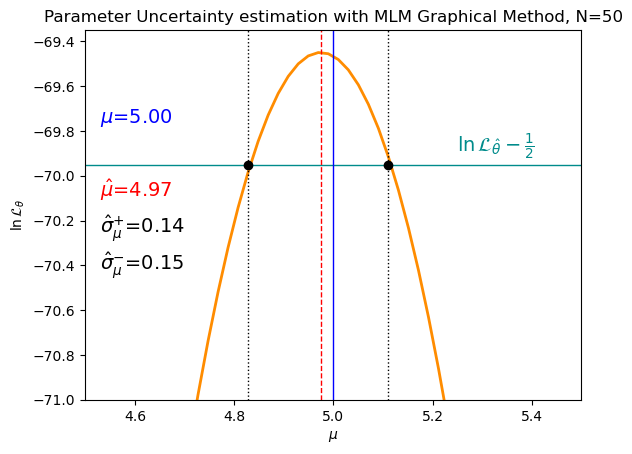

---
jupytext:
  formats: md:myst
  text_representation:
    extension: .md
    format_name: myst
kernelspec:
  display_name: Python 3
  language: python
  name: python3
---

(chapter:MaxLike)=
# Maximum Likelihood Estimation

* `scipy.stats` methods: `fit`
* `scipy.optimize` methods: `fsolve, minimize, minimize_scalar,`
* `scipy.special` methods: `binom, gammaln`
* `sympy` methods: `diff, solve, lambdify` 

<!--LectureSlides2025/MaxLike.tex-->
<!--PythonWorkshopsAndExamples2025/Week8-MathHelpers-and-MLE.py-->
<!--PythonWorkshopsAndExamples2025/MaximumLikelihood.py-->


Given a set of data $\{x_1, x_2, \ldots, x_N\}$, we want to estimate the unknown parameter(s) $\theta$ of the distribution from which the data were drawn. **Maximum Likelihood Estimation** (MLE) answers: *which value of $\theta$ makes the observed data most probable?*

---

(sec:likelihood)=
## The Likelihood Function (Recap)

Suppose data are independent and identically distributed (iid), each drawn from a PDF (or PMF) $f_X(x;\theta)$. The joint probability of observing all $N$ values is the product of the individual probabilities:

```{math}
:label: eq:likelihood
\mathcal{L}_\theta = \prod_{i=1}^{N} f_X(x_i;\,\theta)
```

This is the **Likelihood** $\mathcal{L}_\theta$: a function of the parameter $\theta$, not of $x$.

The **Maximum Likelihood Estimate** $\hat{\theta}$ is the value of $\theta$ that maximises $\mathcal{L}_\theta$:

```{math}
:label: eq:mle-def
\hat{\theta}_{\mathsf{MLE}} = \arg\max_\theta \mathcal{L}_\theta
```

---

### The Log-Likelihood

Products of many small numbers quickly underflow to zero numerically. The **log-likelihood** avoids this: because $\ln$ is monotonically increasing, maximising $\ln \mathcal{L}_\theta$ gives the same $\hat{\theta}$ as maximising $\mathcal{L}_\theta$:

```{math}
:label: eq:loglike
\ln \mathcal{L}_\theta = \sum_{i=1}^{N} \ln f_X(x_i;\,\theta)
```

In practice we almost always work with $\ln \mathcal{L}_\theta$. Numerical optimisers typically minimise, so we minimise the **negative log-likelihood** (NLL):

```{math}
:label: eq:nll
\mathsf{NLL}_{\theta} \equiv -\ln \mathcal{L}_\theta = -\sum_{i=1}^{N} \ln f_X(x_i;\,\theta)
```

The **Maximum Likelihood Estimate** $\hat{\theta}$ is the value of $\theta$ that **minimises** $\mathsf{NLL}_{\theta}$:

```{math}
:label: eq:nll-mle-def
\hat{\theta}_{\mathsf{MLE}} = \arg\min_\theta \mathsf{NLL}_{\theta}
```

---

(sec:mle-uncertainties)=
## Uncertainties on MLE

There are three approaches to calculating the uncertainty on a Maximum Likelihood parameter estimate:

Monte Carlo (Brute Force)
: Simulate the experiment $Z$ times. Each simulation gives an estimate $\hat{\theta}^{(j)}$. The standard deviation of $\{\hat{\theta}^{(j)}\}$ is $\sigma_{\hat{\theta}}$.

Information / Minimum Variance Bound
: Use the Fisher Information to compute a lower bound on the variance (see [](#sec:mle-information)).

Graphical Method
: Read off $\sigma_{\hat{\theta}}$ from the shape of the log-likelihood curve (see [](#sec:mle-graphical)).

---

(sec:mle-analytical)=
## Analytical MLE

To find $\hat{\theta}$ analytically we differentiate the log-likelihood and set the result to zero:

```{math}
:label: eq:score-zero
\frac{\partial \ln \mathcal{L}_\theta}{\partial \theta}\bigg|_{\hat{\theta}} = 0
```

We must also check that the second derivative is negative (confirming a maximum, not a minimum or saddle point).

---

(sec:mle-gauss)=
### Example: estimating Norm $\mu$ and $\sigma$

Let $X \sim$ Norm($\mu, \sigma$) with PDF $f_X(x;\mu,\sigma)= \frac{1}{\sigma\sqrt{2\pi}} e^{-(x-\mu)^2/(2\sigma^2)}$. 

For $N$ IID observations:

$$\ln \mathcal{L}_{\mu,\sigma} = -N\ln\sigma - N\ln\sqrt{2\pi} - \frac{1}{2\sigma^2}\sum_{i=1}^N (x_i - \mu)^2$$

**MLE for $\mu$**: setting $\dfrac{ \partial \ln \mathcal{L}}{\partial \mu} = 0$:

$$\sum_{i=1}^N(x_i - \mu) = 0\;\; \mathsf{when}\;\;\sum_{i=1}^N x_i = N\mu$$

```{math}
:label: eq:mle-mu
\hat{\mu}_{_\mathsf{MLE}} = \bar{x}
```

**MLE for $\sigma$**: setting $\dfrac{ \partial \ln \mathcal{L}}{\partial \sigma} = 0$:

$$-\frac{N}{\sigma} + \frac{1}{\sigma^3}\sum_{i=1}^N(x_i - \hat{\mu})^2 = 0 \implies \hat{\sigma}^2 = \frac{1}{N}\sum_{i=1}^N(x_i - \bar{x})^2$$

```{math}
:label: eq:mle-sigma
\hat{\sigma}^2 = \frac{1}{N}\sum_{i=1}^N(x_i - \bar{x})^2
```

Note: the factor $N$ (rather than $N-1$) arises in [](#eq:mle-sigma) because we used the MLE $\hat{\mu}=\bar{x}$ rather than the true $\mu$. Recall from [](#sec:var-est) that the **unbiased** sample variance divides by $N-1$.


---

(sec:mle-score)=
### The Score

At the maximum, the first derivative of the log-likelihood is zero. This derivative is called the **Score**:

```{math}
:label: eq:score
s = \frac{\partial \ln \mathcal{L}_\theta}{\partial \theta} = \frac{1}{\mathcal{L}_\theta}\frac{\partial \mathcal{L}_\theta}{\partial \theta}
```

Note that we have used the [chain rule](#sec:mma-chain-rule) in [](#eq:score).

For a vector of parameters $\theta = [\theta_1, \ldots, \theta_Z]$, the score is the gradient $s = \nabla \ln \mathcal{L}$, where $\nabla$ is the [gradient operator](#sec:mma-grad).

The score for a **single measurement** can helpfully be written in terms of the PDF, $f_X(x;\theta)$, which we will shorthand as $f$ in [](#eq:score-pdf):

```{math}
:label: eq:score-pdf
s_1 = \frac{\partial \ln f_X}{\partial \theta} = \frac{1}{f_X}\frac{\partial f_X}{\partial \theta}
```

The full score for $N$ measurements is the sum $s = \sum_i s_1(x_i)$.


The **Expectation of the Score** is zero: 

```{math}
:label: eq:escore-proof
\begin{aligned}
E[s_1] &= \int s_1\, f_X\, dx\\[4pt]
        &= \int \frac{\partial f_X}{\partial\theta}\, dx \\[4pt]
        &= \frac{\partial}{\partial\theta}\int f_X\, dx \\[4pt]
        &= \frac{\partial}{\partial\theta}\,1 = 0
\end{aligned}
```

Since $E[s_1] = 0$, its derivative with respect to $\theta$ is also zero. Differentiating both sides and unpacking the result gives a useful identity (using $\partial f_X/\partial\theta = s_1 f_X$):

```{math}
:label: eq:descore-proof

\begin{aligned}
\frac{\partial}{\partial\theta}E[s_1]
= \frac{\partial}{\partial\theta}\int s_1\, f_X\, dx
&= \int \frac{\partial}{\partial\theta}\left[s_1\, f_X\right]\, dx\\[4pt]

&= \int \left[\frac{\partial s_1}{\partial\theta}f_X + s_1\frac{\partial f_X}{\partial\theta}\right]dx \\[4pt]

&= \int \left[\frac{\partial s_1}{\partial\theta}f_X + s_1^2 f_X\right]dx\\[4pt]

&= E\!\left[\frac{\partial s_1}{\partial\theta}\right] + E[s_1^2] = 0

\end{aligned}
```

Rearranging:

```{math}
:label: eq:descore-result
E[s_1^2] = -E\!\left[\frac{\partial s_1}{\partial\theta}\right] 
```

---

(sec:mle-information)=
## The Fisher Information

The **Variance of the Score** for a single measurement is known as the **single-measurement Fisher Information** $\mathcal{J}_1$. Using the two results above for [$E[s_1]$](#eq:escore-proof) and [$E[s_1^2]$](#eq:descore-proof):


```{math}
:label: eq:vscore-proof

\begin{aligned}
\mathcal{J}_1 = V[s_1] &= E[s_1^2] - E^2[s_1] \\
        &= -E\!\left[\frac{\partial s_1}{\partial\theta}\right] - 0\\
        &= -E\!\left[\frac{\partial^2 \ln f_X}{\partial\theta^2}\right]
\end{aligned}

```

The Fisher Information for $N$ measurements is $\mathcal{J}_\theta = N\,\mathcal{J}_1$:

```{math}
:label: eq:information
\mathcal{J}_\theta \equiv N\,\mathcal{J}_1 = -N\,E\!\left[\frac{\partial^2 \ln f_X}{\partial \theta^2}\right]
```

A large $\mathcal{J}_\theta$ means the log-likelihood is sharply peaked: the data carry a lot of information about $\theta$, and we can discriminate close values of $\theta$ well.


The **Observed Information** for a single measurement is the curvature at $\hat{\theta}$ :

```{math}
:label: eq:information1
\mathcal{J}_1^{\text{obs}} = -\frac{\partial^2 \ln f_X}{\partial \theta^2}\bigg|_{\hat{\theta}}
```

and for all $N$ measurements is:

```{math}
:label: eq:informationN
\mathcal{J}_\theta^{\text{obs}} = N\mathcal{J}_1^{\text{obs}} 
```

**Example (Normal PDF for $\mu$).** For a single Normal measurement, $\partial^2 \ln f_X/\partial\mu^2 = -1/\sigma^2$, so from [](#sec:mle-gauss), the Fisher Information for $\mu$ from $N$ measurements is:

$$ \mathcal{J}_\mu = -N\,E\!\left[\frac{\partial^2 \ln f_X}{\partial \mu^2}\right] = \frac{N}{\sigma^2} = \frac{N}{V[X]} = \frac{1}{V[\bar{X}]}$$


---

(sec:ml_hess)=
### Hessian Matrix for Multiple Parameters

The Hessian Matrix for a function is the matrix of second order partial derivatives (see [Math Methods A: The Hessian](#sec:mma_hessian)). For multiple parameters $\theta = [\theta_1, \ldots, \theta_Z]$, the Hessian Matrix for the Log Likelihood is:

```{math}
:label: eq:hessian_ll
H_\theta = \begin{bmatrix}
\dfrac{\partial^2 \ln f_X}{\partial\theta_1^2} & \cdots & \dfrac{\partial^2 \ln f_X}{\partial\theta_1\partial\theta_Z}\\[6pt]
\vdots & \ddots & \vdots\\[6pt]
\dfrac{\partial^2 \ln f_X}{\partial\theta_Z\partial\theta_1} & \cdots & \dfrac{\partial^2 \ln f_X}{\partial\theta_Z^2}
\end{bmatrix}
```

The **Information Matrix** for $N$ measurements is defined in terms of the **single-measurement Hessian** $H_\theta$ of $\ln f_X$:

```{math}
:label: eq:info_matrix
\mathcal{J}_\theta = -N\,E[H_\theta]
```

**Example: Normal PDF for $\theta = \{\mu, \sigma\}$.**

For a single Normal measurement, the log-PDF is:

$$\ln f_X = -\ln\sigma - \frac{1}{2}\ln(2\pi) - \frac{(x-\mu)^2}{2\sigma^2}$$

The first partial derivatives are:

$$\frac{\partial \ln f_X}{\partial\mu} = \frac{x-\mu}{\sigma^2}, \qquad \frac{\partial \ln f_X}{\partial\sigma} = -\frac{1}{\sigma} + \frac{(x-\mu)^2}{\sigma^3}$$

The second partial derivatives are:

$$\frac{\partial^2\ln f_X}{\partial\mu^2} = -\frac{1}{\sigma^2}, \qquad \frac{\partial^2\ln f_X}{\partial\sigma^2} = \frac{1}{\sigma^2} - \frac{3(x-\mu)^2}{\sigma^4}, \qquad \frac{\partial^2\ln f_X}{\partial\mu\,\partial\sigma} = -\frac{2(x-\mu)}{\sigma^3}$$

The Expectations of the second partial derivatives, using $E[(x-\mu)^2]=\sigma^2$ and $E[x-\mu]=0$, are:

$$E\left[\frac{\partial^2\ln f_X}{\partial\mu^2}\right] = -\frac{1}{\sigma^2}, \qquad E\left[\frac{\partial^2\ln f_X}{\partial\sigma^2}\right]  = -\frac{2}{\sigma^2}, \qquad E\left[ \frac{\partial^2\ln f_X}{\partial\mu\,\partial\sigma}\right] = 0$$


Assembling the Information Matrix using $\mathcal{J}_\theta = -N\,E[H_\theta]$:

```{math}
:label: eq:infomat_norm
\mathcal{J}_\theta = -N\begin{bmatrix} -1/\sigma^2 & 0 \\ 0 & -2/\sigma^2 \end{bmatrix} = \begin{bmatrix} N/\sigma^2 & 0 \\ 0 & 2N/\sigma^2 \end{bmatrix}
```

The off-diagonal zeros
: The zero off-diagonal terms mean $\hat{\mu}$ and $\hat{\sigma}$ are **Uncorrelated Estimators** — information about $\mu$ and information about $\sigma$ are completely separable for the Normal distribution.

The relative size
: The Information for the standard deviation, $\mathcal{J}_\sigma = 2N/\sigma^2$, is twice the size of the Information for the mean, $\mathcal{J}_\mu = N/\sigma^2$.


---


(sec:mvb)=
### The Minimum Variance Bound (MVB)

The **Rao-Cramér-Fréchet (RCF) Inequality** states that for any **unbiased** estimator $\hat{\theta}$:

```{math}
:label: eq:rcf
V[\hat{\theta}] \geq \frac{1}{\mathcal{J}_\theta}
```

The right-hand side, $1/\mathcal{J}_\theta$, is the **Minimum Variance Bound (MVB)**. If an estimator achieves $V[\hat{\theta}] = 1/\mathcal{J}_\theta$ it is the **Minimum Variance Unbiased Estimator (MVUE)**, the best possible unbiased estimator.

Example
: For the Gaussian mean, $\mathcal{J}_\mu = N/\sigma^2$, so MVB $= \sigma^2/N = V[\bar{X}]$. The sample mean $\hat{\mu}=\bar{x}$ attains this bound — it is the MVUE.


For a **biased** estimator with bias $b = E[\hat{\theta}]-\theta$, the full RCF inequality is:

```{math}
:label: eq:rcf-biased
V[\hat{\theta}] \geq \left(1 + \frac{db}{d\theta}\right)^2 \bigg/ \mathcal{J}_\theta
```

and the corresponding lower bound on the [MSE](#eq:mse) is:

```{math}
:label: eq:mse-bound
\text{MSE} \geq \left(1 + \frac{db}{d\theta}\right)^2 \bigg/ \mathcal{J}_\theta \;\; + \;\; b^2
```

---

### Using the Information Matrix


The diagonal entries in e.g. [](#eq:infomat_norm) are the individual Fisher informations for each parameter, and their values become most meaningful when we invert the matrix to get the [Minimum Variance Bounds](#eq:rcf) (MVBs):

```{math}
:label: eq:infomat_norm_invert
\mathcal{J}_\theta^{-1} = \begin{bmatrix} \sigma^2/N & 0 \\ 0 & \sigma^2/(2N) \end{bmatrix}
```

The MVB for $\hat{\mu}$ is $\sigma^2/N$, which is the **variance of the sample mean** $\bar{x}$ (the squared [SEM](#eq:sem)) — confirming that $\bar{x}$ is an efficient estimator (it "saturates the bound").

The MVB for $\hat{\sigma}$ is $\sigma^2/(2N)$, which is half the bound for $\hat{\mu}$. **This makes sense**: every observation contributes two pieces of information about $\sigma$: how far it sits from the mean (via $(x_i - \mu)^2$), and the sign of that deviation (which contributes to estimating $\mu$ but averages out for $\sigma$). So $\sigma$ is actually easier to pin down precisely than $\mu$ from the same dataset.

More generally, a larger diagonal entry in the $\mathcal{J}_\theta$ matrix means a smaller MVB, i.e. the parameter is more precisely estimable. The diagonal entries grow linearly with $N$ (**more data $\rightarrow$ more information**, as expected) and shrink with $\sigma^2$ (noisier data → harder to estimate $\mu$, which also makes intuitive sense).


---

(sec:mle-graphical)=
### The Graphical Method

The shape of the Log Likelihood near its maximum encodes the uncertainty on $\hat{\theta}$. To see this, [Taylor-expand](#eq:mma_taylor) $\ln \mathcal{L}_\theta$ about $\hat{\theta}$:

$$\ln \mathcal{L}_\theta = \ln \mathcal{L}_{\hat{\theta}} + \underbrace{\frac{d\ln\mathcal{L}}{d\theta}\bigg|_{\hat{\theta}}}_{=\,0\text{ (score)}} (\theta - \hat{\theta}) + \frac{1}{2}\frac{d^2\ln\mathcal{L}}{d\theta^2}\bigg|_{\hat{\theta}}(\theta - \hat{\theta})^2 + \cdots$$


The first derivative at $\hat{\theta}_{\mathsf{MLE}}$ (the **Score**) is zero by definition. 

The second derivative at $\hat{\theta}$ is the (negative) of the Observed Fisher information [$-\mathcal{J}_1^{obs}$](#eq:information1), which is the (negative) of the [MVB](#eq:rcf): $-\dfrac{1}{V[\hat{\theta}]}$, so:


```{math}
:label: eq:loglike-taylor
\ln \mathcal{L}_\theta \approx \ln \mathcal{L}_{\hat{\theta}} -\dfrac{1}{2} \frac{(\theta-\hat{\theta})^2}{\,V[\hat{\theta}]}
```

Note that the term $\frac{(\theta-\hat{\theta})^2}{\,V[\hat{\theta}]}$ resembles the square of the [standard normal RV](#eq:z), $z^2$. This is a Gaussian shape! The Log Likelihood is approximately parabolic near its peak. 

Rearranging [](#eq:loglike-taylor) with $V[\hat{\theta}] = \sigma^2_{\hat{\theta}}$:

```{math}
:label: eq:loglike-taylor-re
 \ln \mathcal{L}_{\hat{\theta}} - \ln \mathcal{L}_\theta \approx \dfrac{1}{2} \left( \frac{\theta-\hat{\theta}}{\,\sigma_{\hat{\theta}}}\right)^2
```

We note that at $\theta = \hat{\theta} + \sigma_{\hat{\theta}}$,

```{math}
:label: eq:thetaplus
 \ln \mathcal{L}_{\hat{\theta}} - \ln \mathcal{L}_{\hat{\theta} + \sigma_{\hat{\theta}}} \approx \dfrac{1}{2} \left( \frac{\sigma_{\hat{\theta}}}{\,\sigma_{\hat{\theta}}}\right)^2 = \dfrac{1}{2},
```

and similarly at $\theta = \hat{\theta} - \sigma_{\hat{\theta}}$,

```{math}
:label: eq:thetaminus
 \ln \mathcal{L}_{\hat{\theta}} - \ln \mathcal{L}_{\hat{\theta} - \sigma_{\hat{\theta}}} \approx \dfrac{1}{2} \left( \frac{-\sigma_{\hat{\theta}}}{\,\sigma_{\hat{\theta}}}\right)^2 = -\dfrac{1}{2},
```


The uncertainty $\sigma_{\hat{\theta}} = \sqrt{V[\hat{\theta}]}$ can be read off as the distance from the peak to where $\ln \mathcal{L}$ falls by $1/2$:

```{math}
:label: eq:loglike-drop
\ln \mathcal{L}_{\hat{\theta}} - \ln \mathcal{L}_{\hat{\theta}\pm\sigma_{\hat{\theta}}} = \frac{1}{2}
```

<!--In practice: plot $\ln \mathcal{L}_\theta$ vs $\theta$, as per the example in [](#fig:graph-meth), find the peak $\hat{\theta}$, and read off the values of $\theta$ where the curve drops by $1/2$ from the peak. The half-width is $\sigma_{\hat{\theta}}$.-->

This cute way of estimating the MLE uncertainty is illustrated in [](#fig:graph-meth); find the peak $\hat{\theta}$, and read off the values of $\theta$ where the curve drops by $1/2$ from the peak. The half-width is $\sigma_{\hat{\theta}}$

:::{figure}
:label: fig:graph-meth


The graphical method is one way to estimate the uncertainty on a maximum likelihood estimate.
:::

---

(sec:mle-numerical)=
## Numerical MLE with `scipy`

When the Log Likelihood has no closed-form derivative, or when there are many parameters, we use numerical optimisation. The standard approach is to minimise the NLL (the NLL is the Objective Function).


Here we look at what can be done with ```sympy``` and at a few of the (many) methods ```scipy``` offers:
* ```fit``` [ [scipy.stats.fit](https://docs.scipy.org/doc/scipy/reference/generated/scipy.stats.fit.html) ] is a particularly easy way to get the Maximum Likelihood pararameter estimate when using specific probability distributions
* ```fsolve``` [ [scipy.optimize.fsolve](https://docs.scipy.org/doc/scipy/reference/generated/scipy.optimize.fsolve.html)
 ] is a method for doing the same if you can figure out the first derivative of the function.
* ```minimize_scalar```  [ [scipy.optimize.minimize_scalar](https://docs.scipy.org/doc/scipy/reference/generated/scipy.optimize.minimize_scalar.html#scipy.optimize.minimize_scalar
) ] is another method for doing the same, and you don't need to calculate the derivative function.

---

(sec:minim_intro)=
### General Introduction to Minimisation


We will look at this function, which is the one chosen for scipy's `minimize_scalar` example:

$f(x) = (x-2) \cdot x \cdot (x+2)^2$

Let's plot the function before we do anything else. The scipy example does not specify a domain for x, so let's make one up:

$-10 \leq x \leq 10$

```{code-cell} python
# define the function
def f1(x):
    return (x-2) * x * (x+2)**2
```


```{code-cell} python
# plot the function over our chosen range with some sub-ranges to check the close-up behaviour

def plot_func(x0=None,x1=None):
    
    import numpy as np
    import matplotlib.pyplot as plt

    if(x0 and x1):
        fig, ax = plt.subplots(nrows=1, ncols=1, figsize=(6,4), layout='tight')
        x = np.linspace(x0,x1,1000)

        ax.plot(x, f1(x), label="f(x)")
        ax.set_xlabel('X')
        ax.set_ylabel('f(x)')
    else:
      fig, axs = plt.subplots(nrows=1, ncols=3, figsize=(8,4), layout='tight')
      x0s=[-10,-5,-2.5]
      x1s=[10,5,2.5]
      for i,ax in enumerate(axs):

        x = np.linspace(x0s[i],x1s[i],1000)

        ax.plot(x, f1(x), label="f(x)")
        ax.set_xlabel('X')
        ax.set_ylabel('f(x)')

    plt.show()

plot_func()
```

Plotting the function over various ranges allows us to see that what looks like a long, flat minimum over the range -10,10 actually has what looks like two minima and a maximum in the region -2.5,2.5.

Let's use the `minimize_scalar` method to find the coordinates of the global minimum.

<!--### `minimize_scalar` for f(x)-->


```{code-cell} python
def minimize_demo(f1):

    import scipy.optimize as opt

    result = opt.minimize_scalar(f1)

    return result.x, result.fun

mini_x, mini_f = minimize_demo(f1)    

print(f" * minimize_scalar minimum at x = {mini_x:.3f}, f = {mini_f:.3f}")
```

Lets replot around the lowest of the two minima, $x\approx 1.28$, to check the result by eye.

```{code-cell} python
plot_func(1,1.5)
```

Scipy's `minimize_scalar` result of `(x=1.28, f(x)=-9.91)` looks legit. How did it do that? Calculus! 

---


### Using `sympy` for the math behind `minimize_scalar` :

We find the minimum of a function by differentiating it, as the derivative of a function evaluated at some point is its gradient (or slope), and the gradient is zero at points where the function turns over.

1. Find the function's turning points. We do this by taking the derivative and using sympy's `solve` to find the roots.
2. Determine if the points are minima or maxima. We use the second derivative for this. If it is **positive**, we have a **minimum**, because the function is curving upwards in the positive direction on either side of the turning point. Vice versa for **negative: maximum**. If the second derivative is zero, the turning point is an "inflection point", rather than a maximum or minimum.
3. Select the minimum with the lowest function value.


```{code-cell} python
def sympy_minimise_function(f):

    from sympy import symbols, diff, lambdify, solve
    
    x = symbols('x')

    #---------------------------
    # 1) Find the turning points
    #---------------------------

    # Calculate the first derivative of the function
    d1 = diff( f(x), x)

    # Find the values of x for which df/dx is zero
    x_when_derivative_is_zero = solve(d1, x)

    # Make a list of the numeric values of x at the turning points
    x_turning_points = [float(xi) for xi in x_when_derivative_is_zero] 

    #---------------------------
    # 2) Determine if the turning points are minima or maxima.
    #---------------------------

    # Calculate the second derivative of the function
    d2 = diff( d1, x)

    # get the numeric values of the second derivative by providing a value for x
    evaluate_d2 = lambdify(x, d2)

    # take the values of x for which the second derivative is positive: minima
    x_minima= [x for x in x_turning_points if evaluate_d2(x)>0 ]

    #---------------------------
    # 3) Determine the global minimum, which is the one with the lowest function value.
    #---------------------------

    # List of function values at each minimum
    f_at_x_minima = [f(x) for x in x_minima]

    # List index of the lowest minimum
    minindex = f_at_x_minima.index(min(f_at_x_minima))

    # x and f(x) at the lowest minimum
    x_for_fmin = x_minima[minindex]
    f_for_fmin = f_at_x_minima[minindex]

    return x_for_fmin, f_for_fmin

sympy_mini_x, sympy_mini_f = sympy_minimise_function(f1)

print(f"Find the lowest minimum coordinates `by hand' (using sympy): ")
print(f" * x = {sympy_mini_x:.3f}, f = {sympy_mini_f:.3f}")


print(f"Find the lowest minimum coordinates using minimize_scalar: ")    
print(f" * x = {mini_x:.3f}, f = {mini_f:.3f}")
```

---

## Parameter Estimation : Binomial `p`

Now that we understand how a function is minimised, let's try doing this with a Negative Log Likelihood Function.

We will use the Binomial distribution and ask the question "what is the most likely value of p, given the data?"

We will try this a few different ways.

Reminder of the forms of the **Binomial PMF**
$$p_K(k) = C_k^n\, p^k\, (1-p)^{n-k}\;\;\;\;\; 0\leq k \leq n$$,

and the **Binomial Coefficient**:
$$C_k^n = \dfrac{n!}{k!(n-k)!}$$,

and the general form for the **Negative Log Likelihood**:

$$\mathsf{NLL} = - \ln\mathcal{L} = \sum\limits_i^N \ln {p_K(k_i)}$$.

---

### `sympy` methods

This is essentially the "by-hand" method, with a bit of help from `sympy` on the derivatives, and perhaps most helpfully, on finding the roots with `solve`. All of this can also be done with a pen and paper, but `sympy` can be very useful.

The NLL has a minimum at the most likely value of `p`, aka the Maximum Likelihood Estimate (MLE) for p.

The code below has the following steps:
* The symbolic functional form of the Binomial PMF, `sym_pmf`.
* The negative log of this, `sym_nll`, which is the Negative Log Likelihood (NLL),
* The first derivative of the NLL, `sym_dnll_dp`, provides the Objective Function which has a value of zero at the mle estimate for `p`.

Note that the Binomial Coefficient does not depend on `p`. As such, $C_k^n$ will vanish when we take the derivative of the NLL with respect to p. We do not need to calculate it explicitly in this example, but we would need to calculate it for the PMF probabilities, in which case we would use:


```
# scipy.special.binom is the binomial coefficient function

from scipy.special import binom as bnc
binco = bnc(n,k)
```

:::{warning}

There are several subtleties needed for maximising the helpfulness of `sympy`. Relevant here:
1. When defining the `symbols`, if they are constrained to positive values you should mark them as such with the flag `positive=True`.
2. `sympy` will not simplify/expand/cancel the results it finds unless you explictly ask it to. In the example below we use `expand_log` to put the result in the helpful log rules form of `log(abc) = log(a) + log(b) + log(c)`, and we use `cancel` to cancel terms like `a**b * a**-b = a**0 = 1`

:::


```{code-cell} python
# let's do this first of all with sympy
def estimate_binomial_p_sympy():

    from sympy import symbols, log, expand_log, diff, cancel
    from sympy.solvers import solve
  
    # Important Note: the positive=True flag is crucial for getting a sensible answer from solve
    c,n,p,k = symbols('c n p k', positive=True)

    #  does not depend on p, so when we take the derivative with respect to p it will disappear. So can just call it c.
    def sym_pmf(c, n, p, k):
        return  c * p**k * (1-p)**(n-k)

    sym_L = sym_pmf(c, n, p, k)
    print(f"Binomial Likelihood:\n {sym_L}")

    def sym_nll(c, n, p, k):
        return -log( sym_L )
    sym_NLL_notsimp = sym_nll(c, n, p, k)
    #print(f"Unexpanded Log of Binomial Likelihood:\n {sym_NLL_notsimp}")

    # important step: tell sympy to use log rules
    # if we take the derivative of the sym_NLL directly, we get a weird second estimate...
    sym_NLL= expand_log(sym_NLL_notsimp, factor=1)
    print(f"Negative Log Likelihood:\n {sym_NLL}")

    def sym_dnll_dp(c, n, p, k):      
        return diff(sym_NLL, p)

    sym_dNLL_dp = sym_dnll_dp(c, n, p, k)
    # note that the first part of the second term (1 - p)**(-k + n)*(1 - p)**(k - n) = (1-p)^0 = 1
    # cancel the unhelpful complexity
    sym_dNLL_dp = cancel(sym_dNLL_dp)

    print(f"Derivative of Negative Log Likelihood:\n {sym_dNLL_dp}")

    # find the values for p at which this first derivative is equal to zero.
    from sympy.solvers import solve
    estimate1_p = solve(sym_dNLL_dp, p)
    print(f"Maximum Likelihood estimate(s) for p:\n {estimate1_p }")

estimate_binomial_p_sympy()
```

In the above code cell, `sympy` did the derivative for us and found the symbolic maximum likelihood estimate $\hat{p}_{_\mathsf{MLE}}$=k/n.

This solution makes perfect sense. If we toss the coin n=3 times and find k=1 heads, the information in the data is that there is a 1/3 chance of heads on each toss. So this is the logical value for the MLE of the parameter p.


---

(sec:ml_scipy_methods)=
### `scipy` Methods

Now, let's try out some of the ```scipy``` methods!

1. ```fit```
2. ```fsolve```
3. ```minimize_scalar```
4. ```minimize```

Note that ```scipy``` methods are numeric rather than symbolic, so we need to pass in values for n and k (k is the data). We are not providing a value for p because this is the parameter we are estimating, but we will often pass an initial guess and/or bounds on this parameter, depending on the method in question.


**Set the fake data and ```n``` parameter value**:

```{code-cell} python

def gen_binom_data():
  import numpy as np
  # n parameter: number of coin tosses
  n=50
  # some fake data points I made up, for the number of heads from 50 tosses
  data=np.array([27,28,29,11])
  return data, n

binom_data, binom_n = gen_binom_data()

```

---

(sec:ml_scipy_fit)=
### ```scipy.stats.fit```

This is a lovely simple way to estimate the parameter of a ```scipy.stats``` probability distribution. Note that it cannot be used for a regular function.

In this example we pass three things to `fit()`:
* The binomial distribution, ```dist=binom``` without setting the parameters, straight "out-of-the-box" from ```scipy.stats import binom```.
* The data, ```data=data```, which is an array of values for the RV (e.g. number of heads)
* The bounds, ```bounds = {'n': (n,n), 'p': (0.001, 0.999) }```, on the parameters `n` and `p` of the Binomial distribution. For the `n` parameter we fix it by setting the lower and upper bound to the same value. For the `p` parameter we let it vary between 0.001-0.999, which is close to the maximum range allowed for a probability ($0\leq\,$`p`$\,\leq 1$).

The fit function returns a dictionary with the keys ```params, success, message```. The ```params``` key has three elements for the three possible parameters of the binomial distribution, in the order ```n, p, loc```.

```{code-cell} python
# ------------------------#
# METHOD: scipy.stats.fit
# ------------------------#
def estimate_binomial_p_scipy_fit(n,data):

  from scipy.stats import binom, fit

  bounds = {'n': (n,n), 'p': (0.001, 0.999) }

  result_fit = fit(dist=binom, data=data, bounds=bounds)

  mle_est_p = result_fit.params[1]

  return mle_est_p 

mle_est_fit = estimate_binomial_p_scipy_fit(binom_n,binom_data)

print(f"scipy.stats.fit MLE estimate for p={mle_est_fit:.3f}")

print(f"\n (full precision: {mle_est_fit})")
```

---

(sec:ml_scipy_fsolve)=
### ```scipy.optimize.fsolve```

The job of ```fsolve``` is to provide the roots of a function or system of functions. For ```fsolve``` to work, the function must have roots, meaning it must be equal to zero at one or more values of its variable(s).

This method is well-suited for the first derivative of the Log Likelihood function, $\dfrac{d}{dp} \ln \mathcal{L}$, as this is zero at the maximum likelihood estimate for `p`; or in other words, the root of the derivative LL function is `p`.

In this example we pass three things to ```fsolve```:
* The Objective Function, ```func=dLL_dp```, is the derivative, $\dfrac{d}{dp} \ln \mathcal{L}$, which the algorithm sets to zero in order to determine the root, ```p```.
* An initial guess at the parameter, ```x0=p_guess```, which gives the algorithm a starting point.
* The names of the objective function arguments that we are **not** seeking to estimate, ```args=spectators```. In this the objective function requires the data and n parameter, but these are known and are therefore not the job of the algorithm to solve for.

The ```fsolve``` function returns an array of the roots. In our example here there is only one root, as there is only one peak in a well-constructed Likelihood (or Log Likelihood, or Negative Log Likelihood) distribution.

```{code-cell} python
# ------------------------------#
# METHOD: scipy.optimize.fsolve
# ------------------------------#
def estimate_binomial_p_scipy_fsolve(n,data):

  import scipy.optimize as opt
  import numpy as np

  # we have some fail-safes in this function to catch cases where p=0,1, because there is no option for bounds in fsolve
  # the dLL_dp form was provided to us above in the printout from sympy:
  # Derivative of Negative Log Likelihood:
  # (k - n*p)/(p**2 - p)
  def dLL_dp(p, n, data):
      k = data
      if(p==0 or p==1):
          return -np.inf         
      return np.sum( (k - n*p)/(p**2 - p) )

  p_guess = 0.1

  spectators = (n, data)

  result_fsolve = opt.fsolve(func=dLL_dp, x0=p_guess, args=spectators )

  mle_est_p = result_fsolve[0]

  return mle_est_p 

mle_est_fsolve = estimate_binomial_p_scipy_fsolve(binom_n,binom_data)

print(f"scipy.optimize.fsolve MLE estimate for p={mle_est_fsolve:.3f}")

print(f"\n (full precision: {mle_est_fsolve})")
```

---

(sec:ml_scipy_minimize_scalar)=
### ```scipy.optimize.minimize_scalar```

The  ```minimize_scalar``` function finds the minimum of the passed scalar function.

This method does not require the function to have "roots", and so does not need the derivative; the Negative Log Likelihood itself is just fine. We must take care to pass the Negative, which has a minimum, and not the Log Likelihood, which has a maximum and therefore will not work.

In this example we pass three things to ```minimize_scalar```:
* The function to be minimised, ```fun=NLL```. Note the name of this is ```fun``` rather than ```func``` for ```fsolve```.
* As per ```fsolve```, the names of the function arguments that we are **not** seeking to estimate, ```args=spectators```.
* Similar to ```fit```, we pass the bounds on the parameter we are seeking, ```bounds=bounds_p```.

The ```minimize_scalar``` returns a dictionary with several keys. The key we are interested in is ```x```, which is the maximum likelihood estimate for the ```p``` parameter.

```{code-cell} python
# ---------------------------------------#
# METHOD: scipy.optimize.minimize_scalar
# ---------------------------------------#
def estimate_binomial_p_scipy_minimize_scalar(n,data):

    import scipy.optimize as opt
    import numpy as np
    from scipy.special import binom as bnc

    def NLL(p, n, data ):
        k = data
        c = bnc(n,k) 
        log_pmf = np.log(c) + k * np.log(p) + (n-k) * np.log(1-p) 
        return -1*np.sum( log_pmf )

    # we will pass the same spectators as we defined for fsolve.
    spectators = (n, data)

    # we also need to give some bounds on p (not needed for all methods, but we don't have time for that!)
    bounds_p = (0.001,0.999)

    result_minimize_scalar = opt.minimize_scalar(fun=NLL, args=spectators, bounds=bounds_p)

    mle_est_p = result_minimize_scalar.x

    return mle_est_p 

mle_est_minimize_scalar = estimate_binomial_p_scipy_minimize_scalar(binom_n,binom_data)

print(f"scipy.optimize.minimize_scalar MLE estimate for p={mle_est_minimize_scalar:.3f}")

print(f"\n (full precision: {mle_est_minimize_scalar})")
```

---

(sec:ml_scipy_minimize)=
### ```scipy.optimize.minimize```

The use of this method is not necessary for the Binomial, as it is a scalar function, but I am including it in case future-you needs to minimize a vector function. It works perfectly well on scalar functions too.

The differences to note with respect to ```minimize_scalar``` include:
* There is a required argument, ```x0=p_guess```, which is the initial guess at the parameter or parameters to be estimated.
* The ```bounds``` must be passed as a list of one or more tuples, rather than a tuple
* The ```x``` returned is an array, so in our case where just one parameter value is being sought, we access it with ```x[0]```

```{code-cell} python
# ---------------------------------------#
# METHOD: scipy.optimize.minimize
# ---------------------------------------#
def estimate_binomial_p_scipy_minimize(n,data):

    import scipy.optimize as opt
    import numpy as np
    from scipy.special import binom as bnc

    def NLL(p, n, data ):

        # Guard: BFGS can step outside (0,1) during line search
        if p <= 0.0 or p >= 1.0:
          return 1e10

        k = data
        c = bnc(n,k) 
        log_pmf = np.log(c) + k * np.log(p) + (n-k) * np.log(1-p) 
        return -1*np.sum( log_pmf )

    p_guess = 0.1
    spectators = (n, data)
    # Note: BFGS does not support parameter bounds; the NLL returns
    # large values near p=0 and p=1, keeping the optimiser in the valid domain.
    result_minimize = opt.minimize(fun=NLL, x0=p_guess, args=spectators,
                                   method='BFGS')

    mle_est_p = result_minimize.x[0]

    # hess_inv: BFGS quasi-Newton approximation to [−∂²ln𝓛/∂p²]⁻¹ = Var(p̂)
    var_p = result_minimize.hess_inv[0, 0]

    return mle_est_p, var_p

mle_est_minimize, var_p_minimize = estimate_binomial_p_scipy_minimize(binom_n, binom_data)

import numpy as np
print(f"scipy.optimize.minimize MLE estimate for p = {mle_est_minimize:.3f}")
print(f"Estimated std dev on p̂:          {np.sqrt(var_p_minimize):.4f}")
print(f"\n (full precision: {mle_est_minimize})")
```

The uncertainty on the MLE follows from the curvature of the log-likelihood at its maximum.
For a parameter vector $\theta$, the **observed Fisher information** [](#eq:informationN) evaluated at $\hat{\theta}$ is:

$$
\mathcal{J}^{obs}_\theta = -\frac{\partial^2 \ln\mathcal{L}}{\partial\theta^2}\bigg|_{\hat{\theta}},
$$

and for large samples the MLE achieves the minimum variance [](#eq:rcf):

$$\Sigma \approx \dfrac{1}{\mathcal{J}^{obs}_\theta}$$

BFGS stores an approximation to this inverse Hessian as `result.hess_inv`; for a single parameter it is a $1\times1$ matrix, so the variance is `result.hess_inv[0, 0]`.

:::{warning} `hess_inv` is an approximation
`result.hess_inv` is **not** the exact inverse Hessian of $\ln\mathcal{L}$.  It is a quasi-Newton approximation
built up iteratively from gradient differences during the BFGS search.  For a well-converged optimisation on a
smooth, approximately-quadratic log-likelihood it is a reliable covariance estimate.  It may be inaccurate when:

* Convergence was poor (`result.success` is `False` or the number of iterations was very small).
* The log-likelihood is highly non-quadratic near the maximum (e.g. skewed posteriors, boundary effects).
* The true covariance is very large — BFGS can underestimate it in flat landscapes.

For a more reliable covariance, compute the Hessian of the NLL numerically (e.g. with `numdifftools.Hessian`)
and invert it, or use the Fisher information matrix derived analytically.
:::

---

## Model Tests

In [](#chapter:normtest) we looked at some test statistics for comparing the means of a distribution and a hypothesis, and for comparing the means of more than one distribution. These tests were limited to use with approximately Normal data.

Here we will look at tests for comparing the performance of two models. We will limit the model differences to a difference in parameter values, but note that the AIC and BIC tests can be used for different distributions.

---

### Log Likelihood Ratio (LLR)

The Log Likelihood Ratio test compares two different Log Likelihoods calculated on the same data, but with different models (e.g. different parameter choices).

```{math}
:label: eq:llr
   \mathsf{LLR} = 2(\ln\mathcal{L}_B - \ln\mathcal{L}_A).
```

Note that since Model B is more complex, $\ln\mathcal{L}_B \geq \ln\mathcal{L}_A$ always, so $\mathsf{LLR} \geq 0$. To use LLR, the models must be **nested**: Model A must be obtainable from Model B by fixing or constraining parameters.


Example 1
: $\mathcal{L} = \prod\limits_i^N f_{X} $, where $f_{X,A} =  ax^3$ and $f_{X,B} =  ax^3 / ( 1+ bx) $. 

  Model A has $N_p=1$ parameters, Model B has $N_p=2$. 

  Model A is nested in Model B, because if $b=0$, they are the same. 

  The difference in degrees of freedom $\nu$ is $|\nu_A - \nu_B| = 1$.

Example 2
: $f_{X,A} =  ax^3,\;\;\; 0.1< a < 0.2$ and $f_{X,B} =  ax^3,\;\;\;0 < a < 1$. 

  Model A has an additional **constraint** with respect to model B. 

  $|\nu_A - \nu_B| = 1$

**Wilks' Theorem.** Under the null hypothesis that Model A is correct, and for large $N$:

$$\mathsf{LLR} \sim \chi^2_\nu, \qquad \nu = N_{p,B} - N_{p,A}$$

where $\nu$ is the difference in the number of free parameters. A large LLR — falling in the tail of the $\chi^2_\nu$ distribution — is evidence against Model A. The $p$-value is $P(\chi^2_\nu > \mathsf{LLR})$.

**Worked example (coin toss).** Model A: $p=0.5$ (no free parameters, $\nu_A=0$). Model B: $p=27/50$ (one fitted parameter, $\nu_B=1$). So $\nu=1$.

$$\ln\mathcal{L}_A = \ln(0.09596) = -2.344, \qquad \ln\mathcal{L}_B = \ln(0.11263) = -2.184$$

$$\mathsf{LLR} = 2\bigl(-2.184 - (-2.344)\bigr) = 0.320$$

Since $\chi^2_1(0.05)=3.84$ and $0.320 < 3.84$, the $p$-value is $0.57$: we **fail to reject** the fair-coin hypothesis at the 5\% level.

---

### Akaike and Bayes Information Criteria (AIC and BIC)

If we want to compare un-nested models, we can use the AIC or BIC statistics. They
both balance the simplicity of the model (k: number of model parameters) with the
quality of fit to data.

The Akaike Information Criterion (AIC):

```{math}
:label: eq:aic
   \mathsf{AIC} = 2k - 2\ln\mathcal{L}_{\hat{\theta}}.
```

The Bayesian Information Criterion (BIC):

```{math}
:label: eq:bic
   \mathsf{BIC} = k\ln N - 2\ln\mathcal{L}_{\hat{\theta}}.
```

A smaller Information Criterion value is better, eg $\mathsf{AIC}_{a} < \mathsf{AIC}_{b}$ identifies the preferred model as a.


Last week we tossed a coin 50 times and it came up heads 27 times.

The Likelihood under Model $a$ (p=0.5)
:  $$\mathcal{L}_a = \dfrac{50!}{27! 23!} 0.5^{27} 0.5^{23} = 0.09596$$

The Likelihood under Model $b$ (p=27/50)
: $$\mathcal{L}_b = \dfrac{50!}{27! 23!} (27/50)^{27} (23/50)^{23} = 0.11263$$


Model $a$ fixes $p=0.5$ (a theoretical prediction, so $k_a=0$ free parameters). Model $b$ fits $p$ from the data ($k_b=1$). For BIC we take $N=50$ Bernoulli trials as the sample size.

The AICs
: $\mathsf{AIC}_a = 2(0) - 2\ln(0.09596) = 4.688$

  $\mathsf{AIC}_b = 2(1) - 2\ln(0.11263) = 6.367$

  $\mathsf{AIC}_a < \mathsf{AIC}_b \;\leftarrow$ model $a$ preferred by AIC

The BICs
: $\mathsf{BIC}_a = 0\cdot\ln(50) - 2\ln(0.09596) = 4.688$

  $\mathsf{BIC}_b = 1\cdot\ln(50) - 2\ln(0.11263) = 3.912 + 4.367 = 8.279$

  $\mathsf{BIC}_a < \mathsf{BIC}_b \;\leftarrow$ model $a$ preferred by BIC


---

### AIC Probabilities
We identify the minimum: $\mathsf{m} = \mathsf{min}(\mathsf{AIC}_a, \mathsf{AIC}_b) = \mathsf{min}(4.688, 6.367) = 4.688$

The Relative Likelihoods for AIC are:
: $r_a = \exp\!\left[\tfrac{1}{2}(m - \mathsf{AIC}_a)\right] = \exp\!\left[\tfrac{1}{2}(4.688 - 4.688)\right] = 1.000$

: $r_b = \exp\!\left[\tfrac{1}{2}(m - \mathsf{AIC}_b)\right] = \exp\!\left[\tfrac{1}{2}(4.688 - 6.367)\right] = 0.432$

The Akaike Weights are:
: $p_a = r_a / (r_a + r_b) = 1.000 / 1.432 = 0.699$
  
  $p_b = r_b / (r_a + r_b) = 0.432 / 1.432 = 0.302$

The weight $p_a = 0.699$ means model $a$ (fair coin, $p=0.5$) is the better-supported model with probability 70%. Since $|\mathsf{AIC}_a - \mathsf{AIC}_b| = 1.68 < 2$, this is classified as "not worth more than a bare mention" — see [Kass 1995](https://sites.stat.washington.edu/raftery/Research/PDF/kass1995.pdf). All three tests (LLR, AIC, BIC) agree: the data cannot meaningfully distinguish a fair coin from $p=0.54$.


```{code-cell} python
import numpy as np
from scipy.stats import chi2
from scipy.special import comb

def model_comparison(n=50, k=27):
    """Compare fair-coin (Model a) vs fitted-p (Model b) using LLR, AIC, BIC."""

    log_C = np.log(comb(n, k, exact=True))

    # Log-likelihoods
    lnL_a = log_C + k*np.log(0.5) + (n-k)*np.log(0.5)
    p_hat  = k / n
    lnL_b  = log_C + k*np.log(p_hat) + (n-k)*np.log(1 - p_hat)
    print(f"ln L_a (p=0.50)  = {lnL_a:.4f}")
    print(f"ln L_b (p={p_hat:.2f}) = {lnL_b:.4f}\n")

    # LLR test (nu = 1 extra parameter in model b)
    LLR  = 2 * (lnL_b - lnL_a)
    pval = chi2.sf(LLR, df=1)
    print(f"LLR = {LLR:.4f},  chi2(1) p-value = {pval:.3f}")
    print(f"  -> {{'Fail to reject' if pval > 0.05 else 'Reject'}} fair-coin hypothesis\n")

    # AIC  (k_a = 0, k_b = 1)
    AIC_a = 2*0 - 2*lnL_a
    AIC_b = 2*1 - 2*lnL_b
    print(f"AIC_a = {AIC_a:.4f},  AIC_b = {AIC_b:.4f}")
    print(f"  -> Model {{'a' if AIC_a < AIC_b else 'b'}} preferred  (|DELTA_AIC| = {abs(AIC_a-AIC_b):.3f})\n")

    # BIC  (k_a = 0, k_b = 1,  N = n Bernoulli trials)
    N = n
    BIC_a = 0*np.log(N) - 2*lnL_a
    BIC_b = 1*np.log(N) - 2*lnL_b
    print(f"BIC_a = {BIC_a:.4f},  BIC_b = {BIC_b:.4f}")
    print(f"  -> Model {{'a' if BIC_a < BIC_b else 'b'}} preferred  (|DELTA_BIC| = {abs(BIC_a-BIC_b):.3f})")

model_comparison()
```

---

### When to Use Each Test

| | LLR | AIC | BIC |
|---|---|---|---|
| Models must be nested | Yes | No | No |
| Gives a $p$-value | Yes (via $\chi^2_\nu$) | No | No |
| Parameter penalty | via $\nu$ | $+2k$ per param | $+k\ln N$ per param |
| Penalises complexity more as $N$ grows | No | No | Yes |

**Use LLR** when the models are nested — one is a special case of the other. It gives an explicit $p$-value via Wilks' theorem and is the most statistically powerful test when it applies.

**Use AIC or BIC** when models are non-nested: for example, comparing a Gaussian to an Exponential fit to the same data. A smaller value identifies the preferred model.

**AIC vs BIC**: BIC penalises extra parameters more heavily as $N$ grows — the $k\ln N$ factor exceeds $2k$ whenever $N > e^2 \approx 7.4$. For large datasets BIC therefore favours simpler models more aggressively than AIC. If the goal is predictive accuracy, AIC is usually preferred; if the goal is recovering the true model structure, BIC is more conservative and often appropriate.

