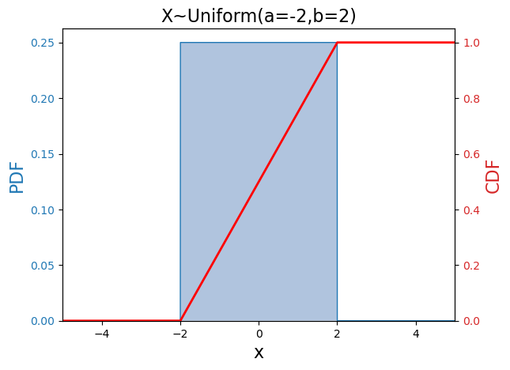
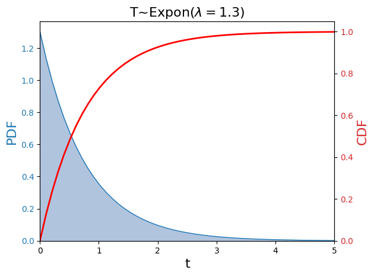
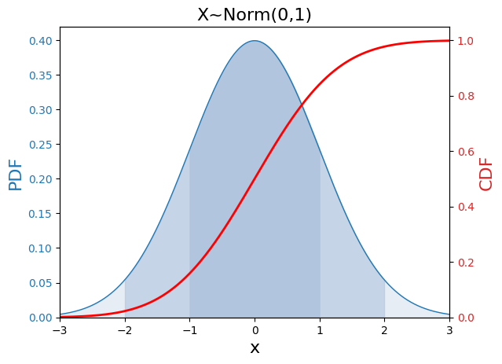
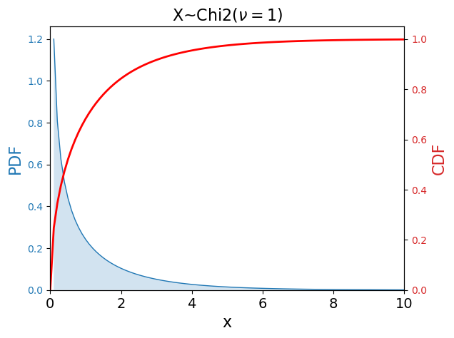
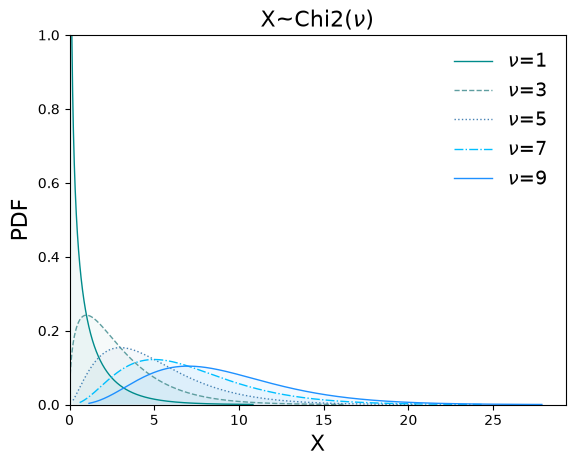
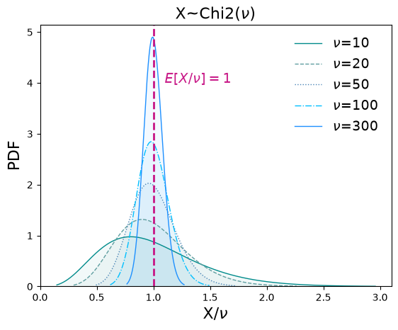

---
jupytext:
  formats: md:myst
  text_representation:
    extension: .md
    format_name: myst
kernelspec:
  name: python3
  display_name: 'Python 3'
---

(chapter:PDFs)=
# Continuous Probabilities & Likelihoods

(sec:uniform)=
## The Uniform Distribution

A Continuous RV with a flat probability distribution is 

$X\sim$ Uniform($a,b$).

The parameters are $a,b$: indicating the lower and upper bound of the support.

---

### PDF & Kernel

The Uniform PDF is:

```{math}
:label: eq:uniform_pdf
f_X(x) = \dfrac{1}{b-a} \;\; ; \;\;  a\leq x \leq b
```

The **Support** of $X$ is $a \leq x \leq b$.


A plot of the Uniform PDF for chosen parameter values $a=-2,b=2$ is shown in [](#fig:uniformPDF) along with the Cumulative Distribution Function (CDF).


:::{figure}
:label: fig:uniformPDF



The Uniform PDF is shown in blue with reference to the left-hand $y$-axis, and the CDF is shown in red with reference to the right-hand $y$-axis. Because $X$ is a continuous RV, the left-hand $y$-axis is the Density rather than the Probability. The CDF is the Cumulative probability, which must total 1 as a sum over all possible outcomes.
:::


For a PDF to be valid, it must satistify [Kolmogorov's normalisation axiom](#eq:kolmogorov2).

Is $\int\limits_{x_i \in S}\, f_X(x_i)\, dx =1$ ?

Normalisation check
: $\int\limits_{x=a}^b\, \dfrac{1}{b-a}\, dx = \dfrac{b-a}{b-a} = 1$: the Uniform PDF is valid (by definition).

---

### Probabilities

The Cumulative Probability (CDF) for a continuous RV is the integral over the range of the lower bound of the support to the value at which we want to know the CDF.

The integral is over the PDFs calculated at each possible value, $x_i$.

```{math}
:label: eq:continuous_cdf
F_X(x) = P(X\leq x) = \int\limits_{-\infty}^{x}\, f_X(x) \, dx
```

The Uniform CDF is:

```{math}
:label: eq:uniform_cdf
F_X(x) = P(X\leq x) = \int\limits_{a}^{x}\, \dfrac{1}{b-a} \, dx = \dfrac{x-a}{b-a}
```

---

### Expectation & Variance

The Uniform PDF has
: $$ \label{eq:uniform_expect} E[X] =  \dfrac{b+a}{2}$$
  
  $$ \label{eq:uniform_var} V[X] =  \dfrac{(b-a)^2}{12}$$


The **Expectation** is calculated as:

$E[X]= \int\limits_{a}^{b}\, \dfrac{x}{b-a} \, dx = \dfrac{b^2-a^2}{2(b-a)}= \dfrac{b+a}{2}$

The expectation of the square is:

$ E[X^2] = \int\limits_{a}^{b}\, \dfrac{x^2}{b-a} \, dx =  \dfrac{b^3-a^3}{3(b-a)} =  \dfrac{b^2+ab+a^2}{3}$

The **Variance** is calculated as:

$V[X]  = E[X^2] - E^2[X] = \dfrac{b^2+ab+a^2}{3} -  \dfrac{b^2 + 2ab + a^2}{4} = \dfrac{(b-a)^2}{12}$


---

### Python

```{code-cell} python

def ExploreUniform(a,b):

  # import the uniform distribution
  from scipy.stats import uniform

  # set up an instantiation of the distribution with our chosen parameter values a,b
  uni =  uniform(loc=a, scale=b-a) 

  # access the lower bound and upper bound of the support
  lb, ub = uni.support()

  print(f"Support is {lb} <= x <= {ub}")

  # calculate the cumulative probability of x<=(a+b)/2
  cdf1 = uni.cdf((a+b)/2)
  print(f"P(X<={(a+b)/2}) = {cdf1}")

  # extract the true mean and variance
  mean, var = uni.stats(moments='mv')
  print(f"Expectation = {mean}, Variance = {var}")

ExploreUniform(0.45,5)

```

---

### Likelihoods

Suppose we observe $N$ measurements $\mathbf{x} = (x_1, x_2, \ldots, x_N)$ drawn independently from Uniform($a,b$), but the parameters $a$ and $b$ are unknown.

The Likelihood is the joint PDF evaluated at the observed data:

```{math}
:label: eq:uniform_lik
\mathcal{L}(a,b; x) = \prod_{i=1}^{N} \dfrac{1}{b-a} = \dfrac{1}{(b-a)^N}

```

Where $a \leq x_i \leq b \;\forall\; i$


The Log Likelihood is then:

```{math}
:label: eq:loglike_uniform
\ln \mathcal{L}(a,b; x) = -N\ln(b-a)
```

Unlike for the PMF likelihoods, **we can't differentiate** [](#eq:loglike_uniform) to find the MLE. This is because the support itself depends on the parameters: the constraints $a \leq x_i \leq b$ mean the likelihood is zero for any $a > x_{(1)}$ or $b < x_{(N)}$, where $x_{(1)} = \min(x_i)$ and $x_{(N)} = \max(x_i)$ are the **order statistics**.

Within the feasible region, $\ln\mathcal{L}$ is maximised by minimising $(b-a)$. The tightest feasible interval is:

```{math}
:label: eq:uniform_mle
\hat{a} = x_{(1)} = \min(x_i), \qquad \hat{b} = x_{(N)} = \max(x_i)
```

This makes intuitive sense: the widest the interval needs to be is just enough to include all observed values.

---

(sec:expon)=
## The Exponential Distribution

A Continuous RV with an Exponential probability distribution is:

$X\sim$ Expon($\lambda$)

The parameter is $\lambda$, which is a rate parameter (similar to [Poisson $\lambda$](#sec:poisson) ). Note though that for Poisson $\lambda$, the RV $K$ is the **count in a given time interval** (a rate, discrete), whereas for Expon($\lambda$), the RV $X$ is a **time for a given count** (1/rate, continuous).

---

### PDF & Kernel

The Exponential PDF is:

```{math}
:label: eq:expon_pdf
f_X(x) = \lambda e^{-\lambda x} \;\; ; \;\;  0\leq x \leq \infty
```

The **Support** of $X$ is $0 \leq x \leq \infty$.

The **Kernel** of the Exponential PDF is given in [](#eq:expon_kernel).

```{math}
:label: eq:expon_kernel
 e^{-\lambda x}
```

A plot of the Exponential PDF for chosen rate parameter value $\lambda=1.3$ is shown in [](#fig:exponPDF) along with the Cumulative Distribution Function (CDF).

:::{figure}
:label: fig:exponPDF



The Exponential PDF is shown in blue with reference to the left-hand $y$-axis, and the CDF is shown in red with reference to the right-hand $y$-axis. The (rate) parameter value is $\lambda=1.3$, meaning the expected waiting time between successful events is the inverse of this: $1/1.3$, in units of time. The CDF is the Cumulative probability, which must total 1 as an integral over all possible outcomes.
:::


For a PDF to be valid, it must satistify [Kolmogorov's normalisation axiom](#eq:kolmogorov2).

Is $\int\limits_{x_i \in S}\, f_X(x_i) \, dx =1$ ?

Because we have a nice easy integral (exponentials always are), we will just do it:

```{math}
\begin{aligned}
\int\limits_0^{\infty}\, \lambda e^{-\lambda x} \, dx & = -\dfrac{\lambda}{\lambda} e^{-\lambda x} \bigg|_0^{\infty}\\
&= - \left( e^{-\infty} - e^{0} \right) \\
&= - \left( 0 - 1 \right) \\
&= 1
\end{aligned}
```

Normalisation check
: $\int\limits_0^{\infty}\, \lambda e^{-\lambda x} \, dx = 1$: the
Exponential PDF is valid.

---

### Probabilities

The [CDF](#eq:continuous_cdf) is calculated as the integral of the PDF.

The Probability of $X \leq x$, given some value of the parameter $\lambda$, is:

```{math}
:label: eq:expon_cdf
P(X\leq x |\,\lambda) = \int\limits_{x=0}^{x}  \lambda e^{-\lambda x} \, dx = 1-e^{-\lambda x}

```

Example
: What is the probability that I will wait less than or equal to one hour to hitch a lift on a road with an average hourly rate of hitchhiker pickups of $\lambda= 1.3$ ?

  $P(X\leq 1 | \lambda) = 1-e^{-\lambda x} = 1-e^{-1.3} = 0.727$

  What would Poisson give us? The question is now "what is the probability that a count of at least one occurs in a time period of 1H?"

  $1 - P(K=0 | \lambda) = 1 - e^{-\lambda} \dfrac{\lambda^k}{k!}= 1- e^{-1.3}\dfrac{1.3^0}{0!} = 1- 0.273  = 0.727$

---

### Expectation & Variance

The Exponential PDF has
: $$\label{eq:expon_expect}E[X] = \dfrac{1}{\lambda}$$

  $$\label{eq:expon_var}V[X] = \dfrac{1}{\lambda^2}$$

The **Expectation** is an integral product of two terms in $x$, so we have to do it piecewise (integration by parts). This is an excellent exercise, try it if you have time. 

I used: $u = x, u'= 1, v = −e^{-\lambda x}, v' = \lambda e^{-\lambda x}$.

The **Variance** is also calculated using integration by parts - I found I needed two rounds of by-parts integration for the variance.

---

### Python

```{code-cell} python

def ExploreExpon(mu):

  # import the exponential distribution
  from scipy.stats import expon

  # set up an instantiation of the distribution with our chosen parameter value mu (for lambda, the rate parameter)
  
  expo = expon(scale=1/mu) 

  # access the lower bound and upper bound of the support
  lb, ub = expo.support()

  print(f"Support is {lb} <= x <= {ub}")

  # calculate the cumulative probability of x<=1/mu
  cdf1 = expo.cdf(1/mu)
  print(f"P(X<={1/mu}) = {cdf1}")

  # extract the true mean and variance
  mean, var = expo.stats(moments='mv')
  print(f"Expectation = {mean}, Variance = {var}")

ExploreExpon(12.3)

```

---

### Likelihoods

Suppose we observe $N$ waiting times $\mathbf{x} = (x_1, x_2, \ldots, x_N)$ drawn independently from Expon($\lambda$).

The Likelihood is the joint PDF evaluated at all the observed data points:

```{math}
:label: eq:expon_lik
\mathcal{L}(\lambda; x) = \prod_{i=1}^{N} \lambda\, e^{-\lambda x_i}
= \lambda^N\, e^{-\lambda \sum_{i=1}^{N} x_i}
```

The Log Likelihood is:

```{math}
:label: eq:expon_loglik
\begin{aligned}
\ln\mathcal{L}(\lambda;\mathbf{x}) &= N\ln\lambda - \lambda\sum_{i=1}^{N} x_i \\
                                   &= N\ln\lambda - \lambda\, N\overline{x} \\
\end{aligned}
```

The Derivative of the Log Likelihood is:

```{math}
\dfrac{d}{d\lambda}\ln\mathcal{L} = \dfrac{N}{\lambda} - N\overline{x} = 0
```

We find the MLE by setting $\dfrac{d}{d\lambda}\ln\mathcal{L}=0$ and solving for $\lambda$:

```{math}
\hat{\lambda} = \dfrac{1}{\bar{x}}
```

The MLE of the rate $\lambda$ is the reciprocal of the sample mean waiting time — exactly what we would expect from $E[X]=1/\lambda$.

Example
: A hitch-hiker records the following waiting times (in hours): $1.2, 0.5, 0.8, 1.6, 0.4$. The MLE of the rate is:

  $\hat{\lambda} = \dfrac{5}{1.2+0.5+0.8+1.6+0.4} = \dfrac{5}{4.5} \approx 1.11 \text{ per hour}$


---
(sec:normdist)=
## The Normal Distribution

We have already looked at the Normal distribution in detail in [](#chapter:norm). Here is a brief summary for reference alongside the other continuous distributions in this chapter.

$X \sim$ Norm($\mu, \sigma$)

The parameters are $\mu$ (the mean, which sets the centre of the distribution) and $\sigma$ (the standard deviation, which sets the width).

---

### PDF & Kernel

The Normal PDF is:

```{math}
:label: eq:norm_pdf
f_X(x) = \dfrac{1}{\sigma\sqrt{2\pi}}\exp\!\left(-\dfrac{(x-\mu)^2}{2\sigma^2}\right) \;\;;\;\; -\infty \leq x \leq \infty
```

The **Support** of $X$ is $-\infty \leq x \leq \infty$.

The **Kernel** of the Normal PDF is:

```{math}
:label: eq:norm_kernel
e^{-\frac{1}{2}(\frac{(x-\mu)}{\sigma})^2}
```


A plot of the Normal PDF for chosen parameter values $\mu=0, \sigma=1$ is shown in [](#fig:normPDF) along with the Cumulative Distribution Function (CDF).

:::{figure}
:label: fig:normPDF



The Normal PDF is shown in blue with reference to the left-hand $y$-axis, and the CDF is shown in red with reference to the right-hand $y$-axis. The parameter values are $\mu=0$ (the mean) and $\sigma=1$. The CDF is the Cumulative probability, which must total 1 as an integral over all possible outcomes.
:::

The normalisation integral requires the [**Gaussian integral trick**](#sec:gaus-int-trick) given at the bottom of this chapter for those with an interest.


Normalisation check
: $\displaystyle\int_{-\infty}^{\infty} \dfrac{1}{\sigma\sqrt{2\pi}} e^{-(x-\mu)^2/2\sigma^2}\,dx = 1$: the Normal PDF is valid.

---

### Probabilities

The Normal CDF has no closed form in elementary functions. It is expressed in terms of the **error function**, $erf$:

```{math}
:label: eq:norm_cdf
F_X(x) = P(X \leq x) = \dfrac{1}{2}\left[1 + \mathrm{erf}\!\left(\dfrac{x-\mu}{\sigma\sqrt{2}}\right)\right]
```

where $\mathrm{erf}(u) = \dfrac{2}{\sqrt{\pi}}\int\limits_0^u e^{-t^2}\,dt$.

In practice we use `scipy.stats.norm.cdf()` to calculate Normal probilities. The probability within $n$ standard deviations of the mean follows the **68–95–99.7 rule**:

$P(\mu - \sigma \leq X \leq \mu+\sigma) \approx 0.683$

$P(\mu - 2\sigma \leq X \leq \mu+2\sigma) \approx 0.954$

$P(\mu - 3\sigma \leq X \leq \mu+3\sigma) \approx 0.997$

---

### Expectation & Variance

The Normal PDF has:
: $$\label{eq:norm_expect}E[X] = \mu$$

  $$\label{eq:norm_var}V[X] = \sigma^2$$

The **Expectation** $E[X] = \mu$ follows from the symmetry of $f_X(x)$ about $x=\mu$: the integrand of $\int\limits_{x\in S} x\,f_X(x)\,dx$ is an odd function[^odd] of $(x-\mu)$, so the integral evaluates to $\mu$ directly.

[^odd]: An odd function satisfies $f(-x) = -f(x)$: it is antisymmetric. The integral of an odd function over any symmetric interval $[-a, a]$ is exactly zero, because the positive and negative contributions cancel perfectly.

The **Variance** is $\sigma^2$ by construction — the PDF is parametrised so that $\sigma$ is exactly the standard deviation of the distribution.

---

### Python

```{code-cell} python

def ExploreNormal(mu, sigma):

  from scipy.stats import norm

  # set up an instantiation of the distribution with our chosen parameter values
  n = norm(loc=mu, scale=sigma)

  # access the support
  lb, ub = n.support()
  print(f"Support is {lb} <= x <= {ub}")

  # probability within one and two standard deviations of the mean
  p1 = n.cdf(mu + sigma) - n.cdf(mu - sigma)
  p2 = n.cdf(mu + 2*sigma) - n.cdf(mu - 2*sigma)
  print(f"P(mu - sigma <= X <= mu + sigma) = {p1:.4f}")
  print(f"P(mu - 2sigma <= X <= mu + 2sigma) = {p2:.4f}")

  # extract the true mean and variance
  mean, var = n.stats(moments='mv')
  print(f"Expectation = {mean}, Variance = {var}")

ExploreNormal(0, 1)

```

---

### Likelihoods

Suppose we observe $N$ measurements $\mathbf{x} = (x_1, x_2, \ldots, x_N)$ drawn independently from Normal($\mu, \sigma$).

The Likelihood is the joint PDF evaluated at the observed data:

```{math}
:label: eq:norm_lik

\begin{aligned}

\mathcal{L}(\mu,\sigma;x) &= \prod_{i=1}^{N}\dfrac{1}{\sigma\sqrt{2\pi}}\exp\!\left(-\dfrac{1}{2}\left(\dfrac{x_i-\mu}{\sigma}\right)^2\right)\\
&= \left(\dfrac{1}{\sigma\sqrt{2\pi}}\right)^{\!N} \exp\!\left(-\dfrac{1}{2}\sum_{i=1}^{N}\left(\dfrac{x_i-\mu}{\sigma}\right)^2\right)

\end{aligned}
```

The Log Likelihood is:

```{math}
:label: eq:norm_loglik

\begin{aligned}

\ln\mathcal{L}(\mu,\sigma;x) &= - N\ln(\sigma) - N\ln(2\pi) -\dfrac{1}{2}\sum_{i=1}^{N}\left(\dfrac{x_i-\mu}{\sigma}\right)^2

\end{aligned}
```

Setting the **Partial Derivatives** $\dfrac{ \partial}{\partial\mu}\ln\mathcal{L} = 0$ and $\dfrac{ \partial}{\partial\sigma}\ln\mathcal{L} = 0$ gives the MLEs:

```{math}
:label: eq:norm_mle
\hat{\mu} = \overline{x}, \qquad \hat{\sigma}^2 = \dfrac{1}{N}\sum_{i=1}^{N}(x_i - \overline{x})^2
```

Note that $\hat{\sigma}^2$ is the **biased** sample variance (divides by $N$, not $N-1$). See [](#chapter:EstimatorsIntro) for the distinction between the MLE and the unbiased estimator.

---

<!--TestStatistics.pdf slides 20-26 -->

(sec:chi2dist)=
## The $\chi^2$ Distribution

The $\chi^2$ distribution arises naturally when working with sums of squared Normal RVs. The Standard Normal RV is $z = \dfrac{x-\mu}{\sigma}$ (see [](#chapter:norm)). The $\chi^2$ RV is the sum of $\nu$ such squared Standard Normal RVs:

```{math}
:label: eq:chi2
\chi^2_{\nu} = \sum\limits_{i=1}^{\nu} z_i^2
```

where $\nu$ is the **Number of Degrees of Freedom**. Since it is a sum of squares, $\chi^2_\nu \geq 0$ always.

$X \sim \chi^2(\nu)$

The parameter is $\nu$: a positive integer giving the number of independent squared Standard Normal RVs in the sum.

---

### PDF & Kernel

<!--f(x;\nu) = \dfrac{x^{\nu/2-1}\, e^{-x/2}}{2^{\nu/2}\,\Gamma(\nu/2)} \;\;;\;\; x \geq 0-->

The $\chi^2$ PDF is:

```{math}
:label: eq:chi2_pdf
f_X(x;\nu) = \dfrac{2^{-\nu/2} }{\Gamma(\nu/2) } x^{(\nu/2) - 1}\, e^{-x/2}\; ; \;\;\; 0\leq x < \infty

```

The $\Gamma(\nu/2)$ in the denominator is the **Gamma Function**: $\Gamma(s) = \int\limits_0^{\infty} x^{s-1} e^{-x}\, dx$. It is a generalisation of the Factorial function to non-integer arguments.

Some nice properties of the Gamma function include:

* $\Gamma(1/2)  = \sqrt{\pi}$,
* $\Gamma(n ) = (n-1)!$ where $n$ is a positive integer,
* $\Gamma(s+1)  = s\Gamma(s)$

Notice that:

$\nu=1\; \rightarrow \;  \Gamma(1/2) = \sqrt{\pi} $

$\nu=2\; \rightarrow \;  \Gamma(2/2) = 0! = 1$

$\nu=3\; \rightarrow \;  \Gamma(3/2) = \Gamma(1/2 + 1)  =\frac{1}{2} \sqrt{\pi}$ 

<!--$\nu=4\; \rightarrow \;  \Gamma(4/2) = \bbl{1! = 1}$-->
<!--$\nu=5\; \rightarrow \;  \Gamma(5/2) = \gbl{\Gamma(3/2 + 1)  =3\sqrt{\pi}/4}$-->
and so on.

The **Support** of $X$ is $0 \leq x \leq \infty$.

The **Kernel** of the $\chi^2$ PDF is:

```{math}
:label: eq:chi2_kernel
x^{(\nu/2)-1}\,e^{-x/2}
```

A plot of the $\chi^2$ PDF and CDF for a parameter value of $\nu=1$ is shown in [](#fig:chi2PDF).

:::{figure}
:label: fig:chi2PDF



The $\chi^2$ PDF for $\nu=1$. 
:::

When we increase the number of degrees of freedom $\nu$ (the number of standard normal RVs in the sum) the $\chi^2$ PDF completely changes shape, because $\chi^2$ is the sum of the squared residuals.

:::{figure}
:label: fig:chi2PDF2



The $\chi^2$ PDF for several values of the degrees of freedom $\nu$. For small $\nu$ the distribution is strongly right-skewed[^skew]. As $\nu$ increases the distribution becomes more symmetric.
:::


Dividing RV by its Expected Value, $E[X] = \nu$, standardises it. As we increase $\nu$, the **Reduced** (standardised) $X/\nu$ RV distribution approaches Norm($\mu= 1, \sigma= \sqrt{2/\nu}$). The Reduced $\chi^2$ PDFs for a range of different parameter values $\nu=10,20,50,100,300$ are shown in [](#fig:chi2redPDF)


:::{figure}
:label: fig:chi2redPDF



The "reduced" $\chi^2$ PDF for the standardised RV $X/\nu$ for several values of the degrees of freedom $\nu$. For small $\nu$ the distribution is strongly right-skewed[^skew]. As $\nu$ increases the distribution becomes more symmetric, approaching a Normal distribution as per the [CLT](#sec:CLT) — since it is a sum of $\nu$ independent terms.
:::

[^skew]: A right-skewed distribution has its peak to the left of the expectation, with the mean lying to the right of the peak. So a right-skewed distribution is one with a long tail to the right of the peak.
---

### Probabilities

The $\chi^2$ CDF has no simple closed form[^rigf] and is evaluated numerically, as per the Normal CDF. In practice we use `scipy.stats.chi2.cdf()`.


[^rigf]: It is related to the **regularised incomplete gamma function**
$F(x;\nu) = P(\chi^2_\nu \leq x) = \dfrac{\gamma(\nu/2,\, x/2)}{\Gamma(\nu/2)}$, where $\gamma(s,t) = \int_0^t u^{s-1}e^{-u}\,du$ is the lower incomplete gamma function. 


<!--The $\chi^2$ distribution is frequently used to find **critical values**: for a significance level $\alpha$, the critical value $\chi^2_{\nu,\alpha}$ satisfies $P(\chi^2_\nu > \chi^2_{\nu,\alpha}) = \alpha$.-->

---

### Expectation & Variance

The $\chi^2(\nu)$ distribution has:
: $$E[X] = \nu$$

  $$V[X] = 2\nu$$

The Reduced $\chi^2(\nu)/\nu$ distribution has:
: $$E[X/\nu] = 1$$

  $$V[X/\nu] = \frac{2}{\nu}$$


<!--These follow directly from the definition [](#eq:chi2). Each squared Standard Normal term $z_i^2$ satisfies $E[z_i^2]=1$ and $V[z_i^2]=2$ (since $E[z^4]=3$ for the Standard Normal, so $V[z^2]=E[z^4]-E^2[z^2]=3-1=2$). Since the $z_i$ are independent:

$E[\chi^2_\nu] = \displaystyle\sum_{i=1}^\nu E[z_i^2] = \nu$

$V[\chi^2_\nu] = \displaystyle\sum_{i=1}^\nu V[z_i^2] = 2\nu$-->

---

### Python

```{code-cell} python

def ExploreChi2(nu):

  from scipy.stats import chi2

  # set up an instantiation of the distribution with our chosen degrees of freedom
  chisq = chi2(df=nu)

  # access the support
  lb, ub = chisq.support()
  print(f"Support is {lb} <= x <= {ub}")

  # extract the true mean and variance
  mean, var = chisq.stats(moments='mv')
  print(f"Expectation = {mean}, Variance = {var}")

  # critical value at 5% significance level (upper tail)
  alpha = 0.05
  crit = chisq.ppf(1 - alpha)
  print(f"Critical value at alpha={alpha}: chi2 > {crit:.3f}")

  # reduced chi2 
  red_chisq = chi2(df=nu, scale=1/nu)
  print(f"Reduced chisq:")

  # access the support
  lb, ub = red_chisq.support()
  print(f"Support is {lb} <= x <= {ub}")

  # extract the true mean and variance
  mean, var = red_chisq.stats(moments='mv')
  print(f"Expectation = {mean}, Variance = {var}")


ExploreChi2(5)

```

---

<!--
### Likelihoods

The $\chi^2$ distribution most often arises as a **derived distribution** rather than as a primary sampling model. Two key examples in this course are:

- The rescaled sample variance: $\dfrac{(N-1)S^2}{\sigma^2} \sim \chi^2(N-1)$ (see [](#chapter:estimators))
- The Pearson goodness-of-fit statistic: $\displaystyle\sum_i \dfrac{(O_i - E_i)^2}{E_i} \;\dot{\sim}\; \chi^2(\nu)$

When $\chi^2(\nu)$ is used directly as a sampling model for positive-valued data, the Likelihood for $N$ IID observations $\mathbf{x}$ is:

```{math}
:label: eq:chi2_lik
\mathcal{L}(\nu;\mathbf{x}) = \prod_{i=1}^{N} \dfrac{x_i^{\nu/2-1}\, e^{-x_i/2}}{2^{\nu/2}\,\Gamma(\nu/2)}
```

The Log Likelihood is:

```{math}
:label: eq:chi2_loglik
\ln\mathcal{L}(\nu;\mathbf{x}) = \left(\dfrac{\nu}{2}-1\right)\!\sum_i \ln x_i - \dfrac{1}{2}\sum_i x_i - \dfrac{N\nu}{2}\ln 2 - N\ln\Gamma\!\left(\dfrac{\nu}{2}\right)
```

The MLE of $\nu$ has no closed form and must be found numerically.
-->
---


## Summary of Kernels

```{table} Uniform, Expon, Norm,  ChiSquared

|  Name | Kernel  | E[X] | V[X] | Support | Parameters  | `scipy.stats` |
| ---   |  ---     | ---  | ---  | ---     |  ---        |  ---          |
| Uniform($a,b$) | $1$ | $\frac{b+a}{2}$ | $\frac{(b-a)^2}{12}$ | $[a,b]$ | $a,b$ | `uniform(loc=a,scale=b-a)` |
| Expon($\lambda$) | $e^{-\lambda x}$ | $\frac{1}{\lambda}$ | $\frac{1}{\lambda^2}$ | $[0,\infty)$ | $\lambda$ | `expon(scale=1/λ)` |
| Normal($\mu,\sigma$) | $e^{-x^2/2\sigma^2}$ | $\mu$ | $\sigma^2$ | $(-\infty,\infty)$ | $\mu,\sigma$ | `norm(loc=μ,scale=σ)` |
| $\chi^2(k)$ | $x^{(\nu/2)-1}e^{-x/2}$ | $\nu$ | $2\nu$ | $[0,\infty)$ | $\nu$ | `chi2(df=nu)` |


```

(sec:transforms)=
## Transforms: Changing Variables

In real life we often cannot measure the RV we want directly. We measure $X$ and want the PDF for $Y = f(X)$. We saw in [](#sec:dd-varfunc) that we can access the uncertainties on a function using Expectation Algebra or using Taylor Series expansion.

---

### 1D Monotonic Transform

Suppose $Y = f(X)$ is a **monotonically increasing** ([](#fig:mono)) function of $X$ (no turning points), with inverse $X = g(Y)$.

Because $Y$ increases whenever $X$ increases:

```{math}
P(Y \leq y) = P(X \leq g(y)) = F_X(g(y))
```

Differentiating the CDF of $Y$ to get its PDF:

```{math}
f_Y(y) = \dfrac{d}{dy} F_Y(y) = \dfrac{d}{dy} F_X(g(y)) = \dfrac{dg}{dy}\, f_X(g(y)) = \dfrac{dx}{dy}\, f_X(x)
```

For a **monotonically decreasing** function the same argument applies with a sign flip, so in general:

```{math}
:label: eq:transform_1d
f_Y(y) = \left|\dfrac{dx}{dy}\right| f_X(x)
```

where $x = g(y)$ is the inverse function evaluated at $y$.

:::{note}
If $f(X)$ is **not** monotonic, we can split the domain into intervals on which it is monotonic and sum the contributions. 
:::

Example
: Suppose $X \sim$ Expon($\lambda$) with PDF $f_X(x;\lambda) = \lambda e^{-\lambda x}$ 

  Define a new RV $Y = 2X$: "double the waiting time"

  $x = \dfrac{y}{2}$

  $\dfrac{dx}{dy} = \dfrac{1}{2}$

  $f_Y(y) = \dfrac{1}{2}\, \lambda\, e^{-\lambda \frac{y}{2}} = \dfrac{\lambda}{2}\, e^{-(\lambda/2)\, y}$

  $Y \sim$ Expon($\lambda/2$): doubling the RV (waiting time) is equivalent to halving the rate parameter $\lambda$.

---

(sec:gaus-int-trick)=
### Gaussian Integral Trick

Let $I = \int\limits_{-\infty}^{\infty} e^{-u^2}\,du$. We cannot evaluate $I$ directly, but we can evaluate $I^2$:

```{math}
\begin{aligned}
I^2 &= \left(\int_{-\infty}^{\infty} e^{-x^2}\,dx\right)\!\left(\int_{-\infty}^{\infty} e^{-y^2}\,dy\right)
     = \int_{-\infty}^{\infty}\!\int_{-\infty}^{\infty} e^{-(x^2+y^2)}\,dx\,dy
\end{aligned}
```

Switching to polar coordinates $x = r\cos\theta$, $y = r\sin\theta$, with area element $dx\,dy = r\,dr\,d\theta$:

```{math}
\begin{aligned}
I^2 &= \int_0^{2\pi}\!\int_0^{\infty} e^{-r^2}\, r\,dr\,d\theta
     = 2\pi \int_0^{\infty} r\,e^{-r^2}\,dr
     = 2\pi \left[-\tfrac{1}{2}e^{-r^2}\right]_0^{\infty}
     = \pi
\end{aligned}
```

So $I = \int\limits_{-\infty}^{\infty} e^{-u^2}\,du = \sqrt{\pi}$. 

Substituting $u = \dfrac{(x-\mu)}{\sigma\sqrt{2}}$ 

gives $\dfrac{du}{dx} = \dfrac{1}{\sigma\sqrt{2}}$

We can use this to show that the Normal PDF is valid:

 $\int\limits_{-\infty}^{\infty} \dfrac{1}{\sigma\sqrt{2\pi}}\exp\!\left(-\dfrac{(x-\mu)^2}{2\sigma^2}\right)\,dx = \dfrac{1}{\sigma\sqrt{2\pi}} \cdot \sigma\sqrt{2} \cdot I = \dfrac{I}{\sqrt{\pi}} = 1$

 ---
 

### Multivariate Transform and the Jacobian

For a multivariate RV $X = (X_1, X_2, \ldots, X_Z)$ transformed to $Y = (Y_1, Y_2, \ldots, Y_Z)$ via some set of relationships $Y_{(i)} = f(X_{(1)}, \ldots, X_{(Z)})$, the generalisation of [](#eq:transform_1d) involves the **Jacobian**:

```{math}
:label: eq:transform_jacobian
f_{Y}(y) = \dfrac{1}{|J|}\, f_{X}(x)
```

where $J$ is the **determinant** of the $Z\times Z$ matrix of partial derivatives:

```{math}
:label: eq:jacobian
J = \begin{vmatrix}
\dfrac{\partial y_1}{\partial x_1} & \cdots & \dfrac{\partial y_1}{\partial x_Z} \\
\vdots & \ddots & \vdots \\
\dfrac{\partial y_Z}{\partial x_1} & \cdots & \dfrac{\partial y_Z}{\partial x_Z}
\end{vmatrix}
```

Example: Cartesian to Polar
: Points $(x,y)$ are uniformly distributed in a plane. We transform to polar coordinates $(r,\theta)$ via $r = \sqrt{x^2+y^2}$, $\theta = \arctan(y/x)$.

  The partial derivatives give:

  $\dfrac{\partial r}{\partial x} = \dfrac{x}{r}, \quad \dfrac{\partial r}{\partial y} = \dfrac{y}{r}, \quad \dfrac{\partial \theta}{\partial x} = -\dfrac{y}{r^2}, \quad \dfrac{\partial \theta}{\partial y} = \dfrac{x}{r^2}$

  The Jacobian determinant is:

  $J = \dfrac{x}{r}\cdot\dfrac{x}{r^2} - \dfrac{y}{r}\cdot\left(-\dfrac{y}{r^2}\right) = \dfrac{x^2+y^2}{r^3} = \dfrac{1}{r}$

  So $f(r,\theta) = r\, g(x,y)$: if $(x,y)$ are uniform (constant $g$), then $f(r,\theta) \propto r$, meaning the density in polar coordinates increases linearly with $r$. This makes geometric sense — concentric rings of equal width have area $\propto r$.

---


