---
jupytext:
  formats: md:myst
  text_representation:
    extension: .md
    format_name: myst
kernelspec:
  name: python3
  display_name: 'Python 3'
---

(chapter:bay)=
# Bayesian Inference

Bayesian Inference gives us a framework for **updating our beliefs** about a parameter $\theta$ using data $y$. Rather than treating $\theta$ as a fixed but unknown constant (the Frequentist view), the Bayesian approach treats $\theta$ as a random variable with its own probability distribution, and updates that distribution as data arrive.


---

(sec:bay_baythm)=
## Bayes' Theorem Revisited

We already met Bayes' theorem in {ref}`sec:pe_baythm`, where we wrote it as {eq}`eq:pe_bayes`:

$$P(A | B) = \frac{P(B | A)\, P(A)}{P(B)}$$

The A and B in the above formula are events. We noted that Bayes' theorem becomes most interesting when we define the events as a hypothesis (or parameter value) $\theta$ and a dataset $y$:

$$P(\theta | y) = \frac{P(y | \theta)\, P(\theta)}{P(y)}$$

When using Bayes' theorem in this way, it is convenient to define each of the terms:

- **$P(y | \theta) \to \mathcal{L}(\theta | y)$**: the **Likelihood** of the data $y$ being described by a parameter value $\theta$. The data are now *fixed* (we've already observed them) and $\theta$ is what varies.
- **$P(\theta) \to \pi(\theta)$**: the **Prior** Probability, $\pi$, is the belief about $\theta$ before seeing the data, not a frequency from a repeatable experiment. The use of the Greek letter $\pi$ is a deliberate choice to keep it separate from sampling probabilities.
- **$P(y) \to \int \mathcal{L}(\theta|y)\, \pi(\theta)\, d\theta$**: the **Evidence**; $P(y)$ isn't an independent quantity — it's what we get by integrating the numerator over all possible $\theta$ values. Writing the integral out explicitly makes this obvious, and guarantees the right hand side integrates to 1.
- **$P(\theta | y)$**: the **Posterior** Probability of the parameter $\theta$, given the data.

Bayes' Theorem relates the **Posterior** probability of a parameter given data to the **Likelihood** of the data given the parameter, the **Prior** probability of the parameter, and the **Evidence**:

:::{figure} /figures/BayesPic.png
:name: fig:bay_bayespic
:width: 100%

Bayes' theorem: The Posterior is equal to the product of the Likelihood and Prior, divided by the Evidence.
:::


Each element has a precise name and role:

| Term | Symbol | Meaning |
|---|---|---|
| **Posterior** | $P(\theta \mid y)$ | Our updated belief about $\theta$ after seeing data $y$ |
| **Likelihood** | $\mathcal{L}(\theta \mid y)$ | The probability of observing data $y$ given $\theta$ |
| **Prior** | $\pi(\theta)$ | Our belief about $\theta$ before seeing data |
| **Evidence** | $\int \mathcal{L}(\theta \mid y)\, \pi(\theta)\, d\theta$ | A normalisation constant ensuring $\int P(\theta \mid y)\, d\theta = 1$ |

The Prior is a PDF (or PMF for discrete $\theta$), not a single number. In the discrete example below there are only two hypotheses, so the Prior reduces to two numbers: $\pi(\theta_s)$ and $\pi(\theta_h)$. This is a special case; in general $\theta$ ranges continuously over a whole parameter space and the Prior is a full probability distribution over that space.

The Posterior Probability $P(\theta|y)$ is a PDF with a maximum at $\hat{\theta}_{\mathsf{MAP}}$: the **Maximum a Posteriori (MAP)** estimate for $\theta$:


```{math}
\hat{\theta}_{\mathsf{MAP}} = \arg\max_\theta \; P(\theta | y) = \arg\max_\theta \; \mathcal{L}(\theta|y)\; \pi(\theta)
```

The maximum value of the Posterior PDF is the [**Mode**](#sec:tandc_medmod), rather than the mean; the Posterior expectation is not (necessarily) equal to the MAP. The mode and mean are identical for distributions that are symmetric (eg Normal).

If the Prior is **uniform** (uninformative), then $\hat{\theta}_{\mathsf{MAP}} = \hat{\theta}_{\mathsf{MLE}}$. In the limit of large $N$, $\hat{\theta}_{\mathsf{MAP}} \rightarrow \hat{\theta}_{\mathsf{MLE}}$, **regardless of the prior chosen**. This is because the information in the data grows with $N$, while the information in the Prior is static, so quickly becomes irrelevant in the presence of large datasets. We will look at this in the specific examples below.

:::{tip}
The key advantage of MAP over MLE is that it incorporates prior beliefs — especially valuable with small datasets. 
:::


The Uncertainty on the MAP is provided by the **Credible Interval**: a range of posterior values that contains the true parameter with a specified probability (e.g. 95%). This is the intuitive statement that many people incorrectly associate with Frequentist confidence intervals.


---

(sec:bay_covid)=
## Bayesian Inference

Let's do a toy example that is familiar to us, to get familiar with the terms in [Bayes' theorem](#fig:bay_bayespic).

A screening test for a rare condition has the following known properties (from the manufacturer):

:::{table}
:label: tab:bay_covid
|| Positive, $y=1$  | Negative $y=0$ | 
|---|---|---|
| **Sick** ($\theta_s$) | $p = 1$ | $p = 0$ |
| **Healthy** ($\theta_h$) | $p = 0.05$ | $p = 0.95$ |
:::

The data $y$ are **Bernoulli**: a binary outcome from a single test. Each hypothesis specifies a different value of the Bernoulli parameter $p$ — each lives in its own probability distribution:

::::{grid} 2 2 2 2

:::{figure} /figures/NewBernCovid_sick.png
:name: fig:bay_bernsick
:width: 100%
Bernoulli PMF under the sick hypothesis ($\theta_s$): $p = 1$, so a positive result is certain.
:::

:::{figure} /figures/NewBernCovid_healthy.png
:name: fig:bay_bernhealthy
:width: 100%
Bernoulli PMF under the healthy hypothesis ($\theta_h$): $p = 0.05$, a small false-positive rate.
:::

::::

We will now walk through each term of [](#fig:bay_bayespic) in turn.

---

(sec:bay_covidlike)=
### Likelihoods

Let's remind ourselves of the [Bernoulli PMF](#eq:pmf_bernpmf), and adjust the notation such that we can work with it more clearly in terms of Bayes' theorem.

```{math}
:label: eq:bay_rebern
\begin{aligned}
p_K(k) & = p^k (1-p)^{1-k} \\[6pt]
p_Y(y \mid \theta) &= \theta^y (1-\theta)^{1-y}\\
\end{aligned}
```

The PMF $p_K(k)$ tells us the probability of measuring the data with a value $k$ given the Bernoulli parameter $p$. On the second line of [](#eq:bay_rebern) we have rephrased this using using $p \rightarrow \theta$ for the Bernoulli parameter and $k \rightarrow y$ for the data. We have done this to make things more general and less confusing as we go forward.

Recall that the Bernoulli PMF is a product of two terms:

Success term 
: $\theta^y$: The probability of success to the power of the number of successes

Failure term 
: $(1-\theta)^{1-y}$: The probability of failure to the power of the number of failures.

For $N=1$ the Likelihood equals the PMF, and for Bernoulli the PMF is two-valued:

```{math}
:label: eq:bay_bernlike
\begin{aligned}
\mathcal{L}(\theta_s \mid y) & = \theta_s^y (1-\theta_s)^{1-y} \\[6pt]
\mathcal{L}(\theta_h \mid y) & = \theta_h^y (1-\theta_h)^{1-y} \\[6pt]
\end{aligned}
```

For positive tests ($y=1$), the Likelihoods reduce to the "success terms", and for negative tests ($y=0$) they reduce to the "failure terms". This gives us exactly the parameter values in [](#tab:bay_covid):


:::{table}
:label: tab:bay_covid2
|| Positive, $y=1$  | Negative $y=0$ | 
|---|---|---|
| **Sick** ($\theta_s$) | $\mathcal{L}(\theta_s \mid y=1) = \theta_s=1$ | $\mathcal{L}(\theta_s \mid y=0) = 1-\theta_s=0$ |
| **Healthy** ($\theta_h$) | $\mathcal{L}(\theta_h \mid y=1)=\theta_h=0.05$ | $\mathcal{L}(\theta_h\mid y=0)=1-\theta_h=0.95$ |
:::

Under $\theta_s$ a positive test is certain; under $\theta_h$ it occurs with probability 0.05 (the [false positive rate](#eq:hyp_fpr)).

---

(sec:bay_covidprior)=
### Priors

The prevalence of this condition in the general population is roughly 1 in 1000. 

We interpret this as the probability of having the condition before looking at any data.


$$\pi(\theta_s) = \tfrac{1}{1000}, \qquad \pi(\theta_h) = \tfrac{999}{1000}$$

The prior distribution $\pi(\theta)$ is reduced to two numbers, because there are only two hypotheses. In general $\theta$ ranges over a continuous parameter space and the Prior is a full distribution. 

:::{warning}
Note that setting $\pi(\theta_s) = 1/1000$ without stating the uncertainty is highly improper! A continuous prior, like the Beta distribution we'll meet in [](#sec:bay_betpdf), would allow us to express the prior with uncertainty, as we always should. This is a toy example.
:::

---

(sec:bay_evcon)=
### Evidence

The denominator of [](#fig:bay_bayespic) is the total probability of the data (a single outcome) under all hypotheses, weighted by their priors. With two discrete hypotheses it is a sum:

```{math}
:label: eq:bay_evidence

\begin{aligned}
\text{Evidence} &= \mathcal{L}(\theta_s \mid y=1)\,\pi(\theta_s) + \mathcal{L}( \theta_h \mid y=1)\,\pi(\theta_h) \\
&= 1 \times \tfrac{1}{1000} + 0.05 \times \tfrac{999}{1000} \\
&= 0.001 + 0.04995 \\
&= 0.05095
\end{aligned}
```

Note that the integral is over the parameters $d\theta$, not the data $y$: this is the evidence for a positive test result only (one of the two possible outcomes). The same procedure can be done for the other possible outcome, $y=0$.

Note also that in the continuous case this sum becomes the integral in [](#fig:bay_bayespic), which is often impossible to compute analytically — a key motivation for the numerical methods in the next chapter, [](#sec:mcmc_mcmc). 

:::{tip} Evidence
The Evidence is not specific to a particular hypothesis (ie, a particular parameter value). It is just a number, a normalising constant, which ensures the Posterior on the left hand side of bayes is a valid Probability distribution with integral 1. As such, we do not consider the Evidence in the following sections, but it will be crucial in the next chapter when we think about [**Predictive Posteriors**](#sec:mcmc_predpost).
:::

---

(sec:bay_covidpost)=

### Posterior

We now have everything we need. For a positive test result $y=1$:

```{math}
:label: eq:bay_covidpost

P(\theta_s \mid y=1) = \frac{\mathcal{L}( \theta_s \mid y=1)\,\pi(\theta_s)}{\text{Evidence}} = \frac{(1)(0.001)}{0.05095} \approx 0.0196

```

Despite a perfect sensitivity — sick people **always** test positive — the probability of actually being sick, $\theta_s$, given a positive test, $y=1$, is only $\approx 2\%$. The condition is so rare that most positive results come from the small false-positive rate applied to the large healthy population.


The full posterior table for positive tests[^note1] for both hypotheses is:

| | Likelihood $\mathcal{L}( \theta \mid y=1)$ | Prior $\pi(\theta)$ | Numerator | Evidence | Posterior $P(\theta \mid y=1)$ |
|---|---|---|---|---|---|
| $\theta_s$ | 1 | 0.001 | 0.001 | 0.05095 | **0.0196** |
| $\theta_h$ | 0.05 | 0.999 | 0.04995 | 0.05095 | **0.9804** |

[^note1]: an equivalent table can of course be constructed for negative tests.


The use of data to construct a posterior in this way is called **Bayesian Updating**:

- **Before** the test, we held a Prior $\pi(\theta_s) = 0.001$
- **After** the test, we calculated a Posterior $P(\theta_s \mid y=1) \approx 0.02$


---

(sec:bay_priodist)=
## Conjugate Distributions

In the Bernoulli example above we used a single value prior with no quoted uncertainty ($\pi(\theta_s) = \tfrac{1}{1000}$) - this is just about forgivable for a toy example for pedagogical purposes, but in general **we must insist that all numbers have quoted uncertainties, otherwise they are meaningless**.

Using a PDF as a prior distribution is the proper way forward, as we can extract the uncertainty directly from the Variance. Additionally, using a Prior distribution with a **kernel** that matches our Likelhood allows us to extract the form of the Posterior analytically; the Posterior distribution will have the same form as the Prior, with updated parameters. This kernel-matching is called **Conjugacy**.

:::{tip} Kernel Matching: Conjugacy
The **kernel** of a distribution is the part of its PDF or PMF that depends on the random variable — the normalising constant is dropped. Recognising kernel shapes is a powerful shortcut: when two distributions share a kernel shape, one is the natural conjugate prior for the other.
:::

Here we will look at two special PDFs which are ideally suited as Priors: the Beta and Gamma distributions.

---

(sec:bay_betpdf)=
### The Beta Distribution

The Beta PDF is the **Conjugate Prior** for the Bernoulli and Binomial PMFs. What this means is that if we have Bernoulli or Binomial data (Likelihoods), we should use a Beta PDF (with carefully selected shape parameter choices) for the Prior. This will give us a Beta Posterior with shape parameters we can calculate analytically using kernel matching.

```{math}
\begin{aligned}
\mathsf{Bernoulli\,}\mathcal{L}(\theta|y) \times \mathsf{Beta\,}\pi(\theta) \rightarrow \mathsf{Beta\,}P(\theta | y)\\[8pt]
\mathsf{Binomial\,}\mathcal{L}(\theta|y) \times \mathsf{Beta\,}\pi(\theta) \rightarrow \mathsf{Beta\,}P(\theta | y)\\

\end{aligned}
```


The [**Bernoulli**](#eq:pmf_bernpmf) and [**Binomial**](#eq:pmf_binpmf) likelihoods both have the same kernel shape in $\theta$, which they share with **Beta**:

```{math}
\begin{aligned}
\mathsf{Bernoulli:}& \quad \theta^y(1-\theta)^{1-y} \\
\mathsf{Binomial:} & \quad \theta^y(1-\theta)^{n-y} \\
\mathsf{Beta:} & \quad\theta^{\alpha-1}(1-\theta)^{\beta-1} \\
\end{aligned}
```

The Beta distribution places a probability distribution on the **parameter** $\theta$ itself — not on data. The random variable is $\theta$; we are expressing uncertainty about what $\theta$ might be, rather than about what a data point will be.

The **Beta PDF** is:

```{math}
:label: eq:bay_betapdf
f_\theta(\theta) = \frac{1}{B(\alpha,\beta)}\, \theta^{\alpha-1} (1-\theta)^{\beta-1};
\qquad 0 \leq \theta \leq 1, \quad \alpha > 0,\; \beta > 0
```

  where $B(\alpha, \beta)$ is the [Beta function](#eq:mmb_betadef) (a normalising constant).

The **Mode** of a Beta($\alpha,\beta$) Posterior distribution gives the **Maximum A Posteriori (MAP)** estimate: 

```{math}
:label: eq:bay_beta_map
\hat{\theta}_{\mathsf{MAP}} =\dfrac{\alpha-1}{\alpha+\beta-2}
```


The Beta **Expectation and Variance** are[^note2]:

$$\label{eq:bay_betaexp}E[\theta] = \frac{\alpha}{\alpha+\beta}$$

$$\label{eq:bay_betavar}V[\theta] = \frac{E[\theta]\,(1-E[\theta])}{\alpha+\beta+1}$$


[^note2]: see [MathMethodsB: Beta PDF](#sec:mmb_betavar) for notes on calculating the Beta $E[\theta]$ and $V[\theta]$.

The two **shape HyperParameters** $\alpha$ and $\beta$ allow for the Beta PDF to be something of a "chameleon", taking on any shape we need. A few example distributions are shown in [](#fig:bay_beta11): larger $\alpha$ pulls mass toward $\theta=1$; larger $\beta$ pulls it toward $\theta=0$; large equal values give a symmetric bell.

::::{grid} 2 2 2 2

:::{figure} /figures/Beta1_1.png
:name: fig:bay_beta11
:width: 100%
$\mathsf{Beta}(1,1)$: uniform — no prior knowledge.
:::

:::{figure} /figures/Beta1_100.png
:name: fig:bay_beta1100
:width: 100%
$\mathsf{Beta}(1,100)$: concentrated near 0 — strong prior belief that $\theta$ is small.
:::

:::{figure} /figures/BetaPDF-100-1.png
:name: fig:bay_beta1001
:width: 100%
$\mathsf{Beta}(100,1)$: concentrated near 1 — strong prior belief that $\theta$ is large.
:::

:::{figure} /figures/Beta100_100.png
:name: fig:bay_beta100100
:width: 100%
$\mathsf{Beta}(100,100)$: symmetric bell at 0.5 — strong belief that $\theta \approx 0.5$.
:::

::::


---

(sec:bay_berbet)=
### Bernoulli-Beta 

The **Conjugate Prior** for $Y\sim \mathsf{Bernoulli}(\theta)$ data is $\theta \sim \mathsf{Beta}(\theta)$.


The **Posterior Probability** is proportional to the Likelihood multiplied by the Prior:

```{math}
:label: eq:bay_propto
P(\theta \mid y) \propto \mathcal{L}(\theta \mid y)\; \pi(\theta)
```


Note that all three of the distributions in [](#eq:bay_propto) are functions of the parameter, $\theta$, not the RV of the PMF, $y$. A Beta Prior yields a Beta Posterior with updated shape hyperparameters $\alpha', \beta'$:

```{math}
:label: eq:bay_post
\mathsf{Beta}(\alpha', \beta') \propto \mathsf{Bernoulli}(\theta) \; \mathsf{Beta}(\alpha, \beta)
```


Let's calculate the shape hyperparameters, $\alpha', \beta'$,  of the **Beta Posterior** for a **Bernoulli Likelihood**.


```{math}
\begin{aligned}


\mathsf{Bernoulli\; Likelihood\;\;} &
\mathcal{L}(\theta\mid y) &
\propto &\; \theta^{y}(1-\theta)^{1-y} &\\[8pt]
\mathsf{Beta\; Prior\;\;} &
\pi(\theta) &
\propto &\; \theta^{\alpha-1}(1-\theta)^{\beta-1} &\\[8pt]
\mathsf{Beta\; Posterior\;\;} &
P(\theta \mid y) &
\propto &\; \theta^{\alpha'-1}(1-\theta)^{\beta'-1} &\\[8pt]
\end{aligned}
```


Matching powers ($A^{a} A^{b} = A^{a+b}$), we have:


```{math}
\begin{aligned}
\theta^{\alpha'-1} &= \theta^{y} \, \theta^{\alpha-1} \quad &\implies\quad \alpha' &= \alpha + y \\[6pt]
\theta^{\beta'-1} &= \theta^{1-y} \, \theta^{\beta-1} \quad &\implies\quad \beta' &= \beta + 1 -y\\[6pt]
\end{aligned}
```


A **positive** result ($y=1$) increments $\alpha$; a **negative** result ($y=0$) increments $\beta$. 

For a single **Bernoulli** data point with $y$ successes (zero or one!), the **Posterior** distribution is:

```{math}
:label: eq:bay_postbern1
P(\theta \mid y) \propto \mathsf{Beta}(\alpha+y,\; \beta+1-y)
```

:::{tip} 
You may notice that we are using $\propto$ a lot. Proportionality is sufficient here: having identified the kernel as a Beta, we know the full normalised PDF without computing the integral.
:::


We will commonly have more than one data point, and if we have $N$ Bernoulli trials the Likelihood is no longer equal to the PMF, but to the product of PMFs evaluated at each data point.

```{math}
:label: eq:bay_bernsums
\begin{aligned}
\mathcal{L}(\theta\mid y) &= \prod\limits_i^N \theta^{y_i}(1-\theta)^{1-y_i} \\[12pt]
& =  \theta^{\sum_i y_i}(1-\theta)^{\sum_i (1- y_i)} \\[8pt]
\end{aligned}
```

Because the data are in the exponents, the product over PMFs results in $y\rightarrow \sum_i y_i$ with respect to the single data-point case. So we find:

```{math}
\begin{aligned}
\alpha' &= \alpha + \sum_i y_i \\[6pt]
\beta' &= \beta + N-\sum_i y_i \\[6pt]
\end{aligned}
```

For N **Bernoulli** data points with $s = \sum y$ successes, the **Posterior** distribution is:

```{math}
:label: eq:bay_postbernN
P(\theta \mid y) \propto \mathsf{Beta}(\alpha+s,\; \beta+N-s)
```

The plots in [](#fig:bay_bb4) attempt to illustrate the conjugate update for a Bernoulli likelihood: the first panel compares the true Bernoulli probabilities (outlined bars) with the observed frequencies (filled bars), **in data space**, ie as a function of $y$, while the remaining panels show the Likelihood, Prior, and Posterior as functions of $\theta$ in parameter space.

:::{figure}
:label: fig:bay_bb4
:width: 100%
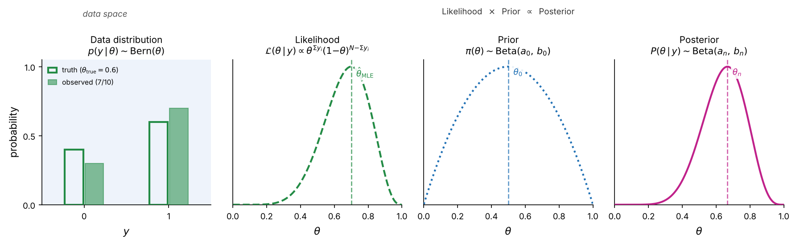

Four-panel illustration of Bernoulli–Beta conjugate inference. Outlined bars show the true Bernoulli probabilities; filled bars show the observed frequencies. Moving into parameter space, the likelihood (green dashed), prior (blue dotted), and posterior (magenta solid) are functions of $\theta$. These plots were generated with $N=10$, $\theta=0.6$, $y=7$, and a $\mathsf{Beta}(2,2)$ prior.
:::

---

(sec:bay_toyber)=
### Toy Bernoulli Example: Coin Toss

A coin toss is $\mathsf{Bernoulli}(\theta)$, where $\theta$ is the probability of heads. So for a fair coin, $\theta=0.5$.

I have no prior knowledge of whether the coin is fair or not, so I decide to start with a **Uniform Prior**. To construct a Uniform Prior that is conjugate to Bernoulli, I need a $\mathsf{Beta}(1, 1)$ distribution (see [](#fig:bay_beta11)).


The $\mathsf{Beta}(\alpha, \beta)$ [expectation](#eq:bay_betaexp) is $\alpha/(\alpha+\beta) =  1/2$.

I toss the coin and observe heads, $y=1$. The Posterior distribution, taking into account this one data point and using the [parameter update rule](#eq:bay_postbern1), is:

```{math}
\begin{aligned}
P(\theta \mid y=1) & \propto \mathsf{Beta}(\alpha+y,\; \beta+1-y)\\[6pt]
				   & \propto \mathsf{Beta}(\alpha+1,\; \beta+1-1)\\[6pt]
				   & \propto \mathsf{Beta}(2,\; 1)\\[6pt]

\end{aligned}
```

The Posterior [expectation](#eq:bay_betaexp) is $\alpha'/(\alpha'+\beta') =  2/3$.

One success has shifted our belief upward from $0.5$ to $0.67$. The rule is: **each success adds 1 to $\alpha$, each failure adds 1 to $\beta$**.

The Likelihood, and therefore the Posterior, are updated with every new data measurement, as illustrated in [](#fig:bay_map_n_bern). The corresponding parameter estimates:
* $\hat{\theta}_{\mathsf{MLE}}$: mode of the Likelihood distribution,
* $\hat{\theta}_{\mathsf{MAP}}$: mode of the Posterior distribution,

are identical when the Prior distribution is uniform, as it is in this case.

The Posterior Expectation $E[\theta]$ differs from $\hat{\theta}_{\mathsf{MAP}}$ because the mode and mean of the Posterior Beta are not equal; the distribution is not symmetric [](#fig:bay_bb4).

The $\pm 1\sigma$ Credible Interval on the MAP is also shown. See [](#sec:bay_python_berbet) for an example of this calculation in python.


:::{figure}
:width: 100%
:label: fig:bay_map_n_bern

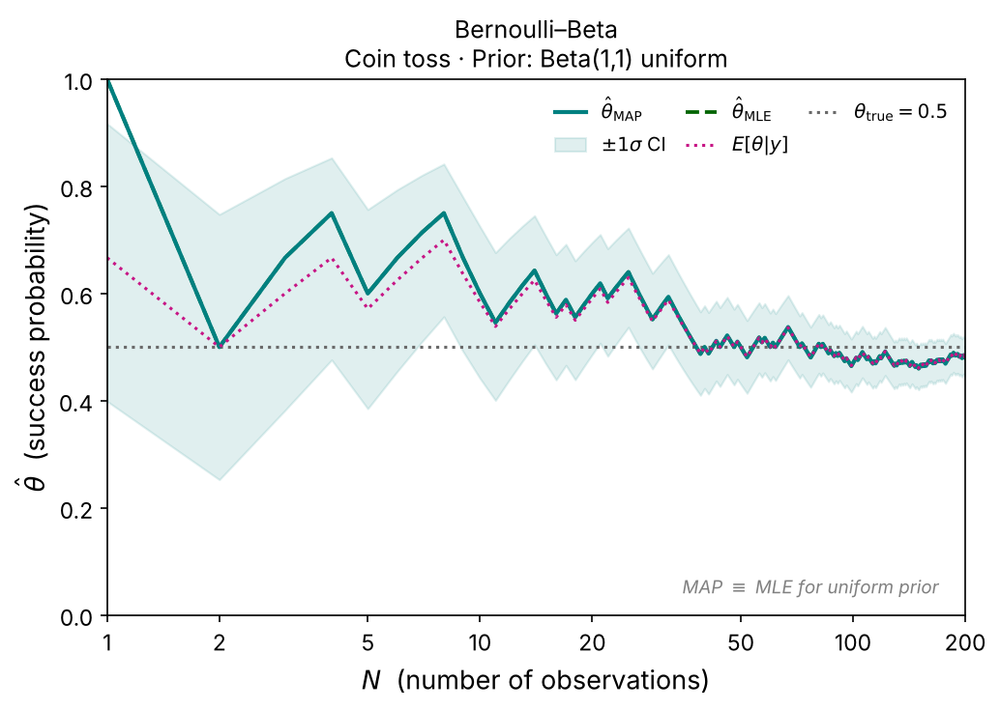

The MLE, MAP, and Posterior expectation for Bernoulli data with a Beta(1,1) **Uniform Prior**, as a function of the number of measurements $N$. The Uniform Prior means that $\hat{\theta}_{\mathsf{MLE}} = \hat{\theta}_{\mathsf{MAP}}$, which is why the $\hat{\theta}_{\mathsf{MLE}}$ cannot be seen in this plot - it is underneath the $\hat{\theta}_{\mathsf{MAP}}$.
:::


---

(sec:bay_binbet)=
### Binomial-Beta 

The **Conjugate Prior** for $Y\sim \mathsf{Binom}(n,\theta)$ data is also $\theta \sim \mathsf{Beta}(\theta)$. Just as for the Bernoulli case, a Beta Prior yields a Beta Posterior with updated shape hyperparameters $\alpha', \beta'$:

```{math}
:label: eq:bay_post_binom
\mathsf{Beta}(\alpha', \beta') \propto \mathsf{Binom}(n,\theta) \; \mathsf{Beta}(\alpha, \beta)
```

Let's calculate the shape hyperparameters, $\alpha', \beta'$,  of the **Beta Posterior** for a **Binomial Likelihood**.


```{math}
\begin{aligned}
\mathsf{Binomial\; Likelihood}& \quad \mathcal{L}(\theta\mid y) &\propto &\;\;\theta^y(1-\theta)^{n-y} \\[8pt]
\mathsf{Beta\; Prior} & \quad \pi(\theta) & \propto &\;\;\theta^{\alpha-1}(1-\theta)^{\beta-1} \\[8pt]
\mathsf{Beta\; Posterior} & \quad P(\theta \mid y) &\propto &\;\;\theta^{\alpha'-1}(1-\theta)^{\beta'-1} \\[8pt]
\end{aligned}
```

We find:

```{math}
\begin{aligned}
\alpha' &= \alpha + y\\[6pt]
\beta' &= \beta + (n-y) \\[6pt]
\end{aligned}
```

Just as for Bernoulli, a **positive** result ($y=1$) increments $\alpha$; a **negative** result ($y=0$) increments $\beta$. 


For a single **Binomial** experiment with $n$ trials and $y$ successes the **Posterior** is:

```{math}
:label: eq:bay_postbin1
P(\theta \mid y) \propto \mathsf{Beta}(\alpha+y,\; \beta + n - y)
```

For N **Binomial** experiments with $s = \sum y$ total successes from $nN$ total trials:

```{math}
:label: eq:bay_postbinN
P(\theta \mid y) \propto \mathsf{Beta}(\alpha+s,\; \beta + nN - s)
```

The plots in [](#fig:bay_binb4) attempt to illustrate the conjugate update for a Binomial likelihood: the first panel compares the true Binomial probabilities (outlined bars) with the observed frequency (filled bar), **in data space**, ie as a function of $y$, while the remaining panels show the Likelihood, Prior, and Posterior as functions of $\theta$ in parameter space.

:::{figure}
:label: fig:bay_binb4
:width: 100%
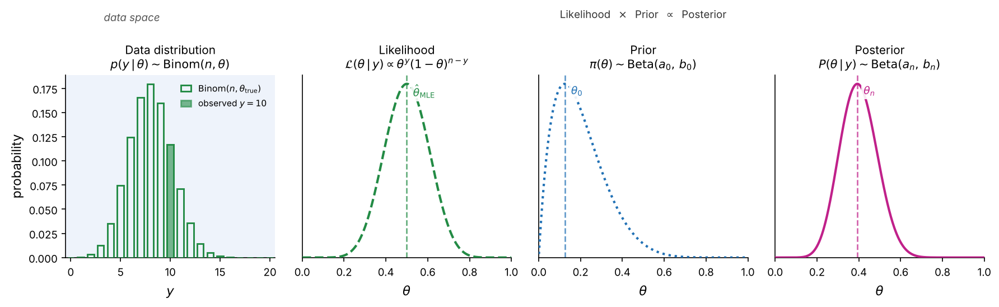

Four-panel illustration of Binomial–Beta conjugate inference. Outlined bars show the true Binomial probabilities; the filled bar shows the observed frequency (for N=1 experiment). Moving into parameter space, the likelihood (green dashed), prior (blue dotted), and posterior (magenta solid) are functions of $\theta$. These plots were generated with $N=1$, $n=20$, $y=10$, $\theta_{true}=0.4$ and a $\mathsf{Beta}(2,8)$ prior.
:::

---

(sec:bay_toybin)=
### Toy Binomial Example: Trick Shot

Let's consider a snooker player, Alf, trying for a difficult trick shot. He will try the shot $n=10$ times and count the number of successes, $y$. The data are $Y\sim\mathsf{Binomial}(n,\theta)$, where $\theta$ is the unknown probability of success for a single try.

I have some prior knowledge here: I am told the shot is difficult, so I decide to start with a Prior that reflects this, with an expectation of $0.2$ to reflect a chance of 1/5 of getting the shot.


To construct a Prior that is conjugate to Binomial, I need a Beta distribution with [expectation](#eq:bay_betaexp) $\alpha/(\alpha+\beta) =  1/5$, so it is tempting to try $\mathsf{Beta}(1,4)$; however, the Beta distribution with $\alpha=1$ is monotonically decreasing, with maximum value at zero. This doesn't feel like a sensible model for a rough estimate of 0.2. Let's look at a few different choices of $\mathsf{Beta}(\alpha,\beta)$ distribution that have $\beta = 4\alpha$, giving the expectation of 0.2:

```{code-cell} python
import matplotlib.pyplot as plt
from scipy.stats import beta
import numpy as np

alphas=[1,2,3,10,50]
betas = [a*4 for a in alphas]
x = np.linspace(0,1,100)

fig, ax = plt.subplots()
for a,b in zip(alphas, betas):
	beta_pdf = beta.pdf(x,a=a,b=b)
	ax.plot(x, beta_pdf, label=f"Beta({a},{b})")

plt.legend()
plt.show()
```

From eyeballing the plots, I like the look of $\mathsf{Beta}(2,8)$ to model the odds of Alf successfully potting a trick shot, as it covers the range down to very small values (very difficult shots) and has broad coverage.


Alf counts the successful shots in $n=10$ tries, and repeats the experiment over three days, $N=3$. The data are $y = [4,1,2]$.

The total number of successful shots is $s = \sum y = 7$, and the total number of tries is $Nn=30$.

The Posterior distribution, taking into account my choice of Prior, $\mathsf{Beta}(2,8)$, and these three data points, is:

```{math}
\begin{aligned}
P(\theta \mid y) & \propto \mathsf{Beta}(\alpha+s,\; \beta + nN - s)\\[6pt]
				 & \propto \mathsf{Beta}(2+7,\; 8 + 30 - 7)\\[6pt]
				 & \propto \mathsf{Beta}(9,\; 31)\\[6pt]

\end{aligned}
```

The Posterior [Beta expectation](#eq:bay_betaexp) is $\alpha'/(\alpha'+\beta') =  9/40$.

The data have shifted our belief upward from a **Prior** expectation of $0.2$ to a **Posterior** expectation of $0.225$. Alf's performance is slightly better than our prior expectation. Well done, Alf!


The series of images in [](#fig:bay_bbanim) shows the Binomial data distribution accumulating on the top panel. Each frame has an additional success count added as Alf keeps trying the shot and noting how many times out of ten he is making it. **Note that Alf's skill is not improving as time goes on - that would change the underlying true distribution**[^note7]. The bottom panel shows the Prior, Likelihood, and Posterior distributions in $\theta$. When the number of measurements $N$ is very small, the Posterior $P(\theta|y)$ distribution is clearly influenced by both the static Prior $\pi(\theta)$ distribution and the Likelihood of the data, $\mathcal{L}_{\theta}$. As data are added, they drag the Posterior away from the Prior distribution and towards the underlying true parameter value.

[^note7]: Recall that IID data is Independent and **Identically Distributed** - data must all come from the same underlying true probability distribution.

:::{figure}
:label: fig:bay_bbanim
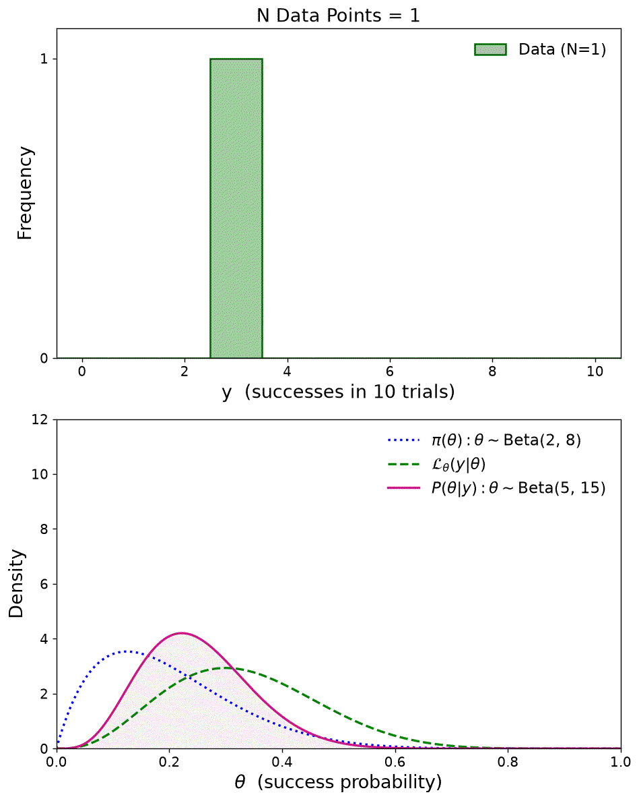

As we accumulate data, the Posterior distribution $P(\theta | y)$ gets closer to the Likelihood distribution, which is closing in on the parameter, $\theta$, of the data's true underlying probability distribution. 
:::


The Likelihood, and therefore the Posterior, are updated with every new data measurement, as illustrated in [](#fig:bay_bbanim) and [](#fig:bay_map_n_bin). The corresponding parameter estimates:
* $\hat{\theta}_{\mathsf{MLE}}$: mode of the Likelihood distribution,
* $\hat{\theta}_{\mathsf{MAP}}$: mode of the Posterior distribution,

are different - because the MAP includes the Prior - but converge for large $N$ because the information in the data (via the Likelihood) overwhelms the Prior distribution on $\theta$.

The Posterior Expectation $E[\theta]$ differs from the $\hat{\theta}_{\mathsf{MAP}}$ because the mode and mean of the Posterior Beta are not equal; the distribution is not symmetric. They converge for large $N$ as the Posterior distribution converges on the MAP.


:::{figure}
:width: 100%
:label: fig:bay_map_n_bin

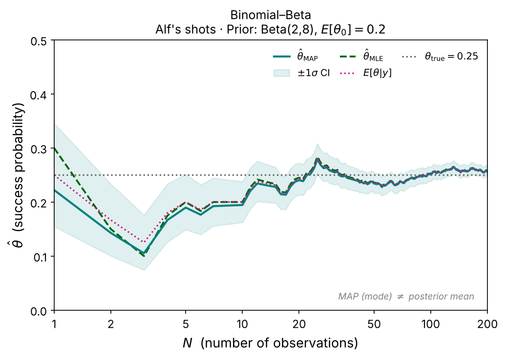

The MLE, MAP, and Posterior expectation for Binomial data with a Beta(2,8) **Informative Prior**, as a function of the number of measurements $N$. The $\pm 1\sigma$ Credible Interval on the MAP is also shown. See [](#sec:bay_python_binbet) for an example of this calculation in python.
:::


---


(sec:bay_gampdf)=
### The Gamma Distribution

(bayesian:gamma)=

The Gamma PDF is the **Conjugate Prior** for the Poisson and Exponential likelihoods. If we have Poisson or Exponential data, using a Gamma Prior will produce a Gamma Posterior whose shape hyperparameters we can calculate analytically using kernel matching.

```{math}
\begin{aligned}
\mathsf{Poisson\,}\mathcal{L}(\theta\mid y) \times \mathsf{Gamma\,}\pi(\theta) &\rightarrow \mathsf{Gamma\,}P(\theta | y)\\[8pt]
\mathsf{Exponential\,}\mathcal{L}(\theta\mid y) \times \mathsf{Gamma\,}\pi(\theta) &\rightarrow \mathsf{Gamma\,}P(\theta | y)\\
\end{aligned}
```

The [**Poisson**](#eq:pmf_poipmf) and [**Exponential**](#eq:pdf_exppdf) likelihoods both have the same kernel shape in $\lambda \rightarrow \theta$, which they share with **Gamma**:

```{math}
\begin{aligned}
\mathsf{Poisson}\propto & \quad \theta^y\,e^{-\theta} \\
\mathsf{Exponential}\propto & \quad \theta\, e^{-\theta y} \\
\mathsf{Gamma}\propto & \quad \theta^{\alpha-1}\,e^{-\beta\theta} \\
\end{aligned}
```

The Gamma distribution places a probability distribution on the **rate parameter** $\theta$ itself — not on data. The random variable is $\theta$; we are expressing uncertainty about what the true rate might be, rather than about what a data point will be.

The **Gamma PDF** is:

```{math}
:label: eq:bay_gammapdf
f(\theta) = \frac{\beta^\alpha}{\Gamma(\alpha)}\, \theta^{\alpha-1} e^{-\beta\theta};
\qquad \theta \geq 0, \quad \alpha > 0,\; \beta > 0
```

where $\Gamma(\alpha)$ is the [Gamma function](#eq:mmb_gamdef) (a normalising constant).

The **Mode** of the $\mathsf{Gamma}(\alpha,\beta)$ Posterior distribution gives the **Maximum A Posteriori (MAP)** estimate (for $\alpha\geq1$): 

```{math}
:label: eq:bay_gamma_map
\hat{\theta}_{\mathsf{MAP}} =\dfrac{\alpha-1}{\beta}
```

:::{dropdown} Show mode calculation

The Gamma kernel is $\theta^{\alpha-1}\,e^{-\beta\theta}$. 

The maximum is located by taking the derivative with respect to $\theta$, for which we use the [product rule](#sec:mma_prodr):

```{math}
\begin{aligned}
\dfrac{d}{d\theta} \theta^{\alpha-1}\,e^{-\beta\theta} 
& = \theta^{\alpha-1}\, \dfrac{d}{d\theta} e^{-\beta\theta} +  e^{-\beta\theta} \dfrac{d}{d\theta}  \theta^{\alpha-1} \\[8pt]

& = -\beta\,\theta^{\alpha-1}\,e^{-\beta\theta} +(\alpha-1)\,\theta^{\alpha-2}\,e^{-\beta\theta} \\[8pt]

& = \theta^{\alpha-2}\,e^{-\beta\theta} (\alpha - 1 - \beta\theta) 
\end{aligned}
```

The derivative is zero at $\hat{\theta}$:


$\hat{\theta}^{\alpha-2}\,e^{-\beta\hat{\theta}} (\alpha - 1 - \beta\hat{\theta}) = 0$

Which has solution $\hat{\theta} = \dfrac{\alpha-1}{\beta}$.

:::


The Gamma **Expectation and Variance** are[^note3]:

$$\label{eq:bay_gamexp}E[\theta] = \frac{\alpha}{\beta}$$

$$\label{eq:bay_gamvar}V[\theta] = \frac{\alpha}{\beta^2}$$

[^note3]: The Expectation and Variance can be calculated using [integration by parts](#sec:mma_intbypar), as per for the exponential PDF.

The two **shape HyperParameters** $\alpha$ and $\beta$ allow the Gamma PDF to be flexible in the same way as for the [Beta PDF](#eq:bay_betapdf): larger $\alpha$ shifts mass rightward toward larger rates; larger $\beta$ compresses the distribution and reduces variance; $\alpha = \beta = 1$ gives an Exponential distribution, as shown in [](#fig:bay_gamma11)


::::{grid} 2 2 2 2

:::{figure} /figures/GammaPDF-1-1.png
:name: fig:bay_gamma11
:width: 100%
$\mathsf{Gamma}(1,1)$: Expon.
:::


:::{figure} /figures/GammaPDF-5-1.png
:name: fig:bay_gamma51
:width: 100%
$\mathsf{Gamma}(5,1)$
:::

:::{figure} /figures/GammaPDF-100-1.png
:name: fig:bay_gamma1001
:width: 100%
$\mathsf{Gamma}(100,1)$
:::


:::{figure} /figures/GammaPDF-1-5.png
:name: fig:bay_gamma15
:width: 100%
$\mathsf{Gamma}(1,5)$: Expon.
:::

:::{figure} /figures/GammaPDF-5-5.png
:name: fig:bay_gamma55
:width: 100%
$\mathsf{Gamma}(5,5)$
:::


:::{figure} /figures/GammaPDF-100-5.png
:name: fig:bay_gamma1005
:width: 100%
$\mathsf{Gamma}(100,5)$
:::


::::


---


(sec:bay_poigam)=
### Poisson-Gamma

The **Conjugate Prior** for Poisson data is Gamma. A Gamma Prior yields a Gamma Posterior with updated shape hyperparameters $\alpha', \beta'$:

```{math}
\mathsf{Gamma}(\alpha', \beta') \propto \mathsf{Poisson}(\theta) \; \mathsf{Gamma}(\alpha, \beta)
```

Let's calculate the shape hyperparameters, $\alpha', \beta'$, of the Gamma Posterior for a Poisson Likelihood:

```{math}
\begin{aligned}

\mathsf{Poisson\; Likelihood\;\;} & \mathcal{L}(\theta\mid y) & \propto&\;\; \theta^{y}\, e^{-\theta} \\[6pt]
\mathsf{Gamma\; Prior\;\;} & \pi(\theta) & \propto &\;\;\theta^{\alpha-1}\,e^{-\beta\theta} \\[6pt]
\mathsf{Gamma\; Posterior\;\;}  & P(\theta \mid y)  & \propto &\;\;\theta^{\alpha'-1}\,e^{-\beta'\theta} \\[6pt]
\end{aligned}
```

Matching powers and exponential arguments ($A^a A^b = A^{a+b}$, $e^{-a}e^{-b} = e^{-(a+b)}$):

```{math}
\begin{aligned}
\theta^{\alpha'-1} &= \theta^{y} \, \theta^{\alpha-1} \quad &\implies\quad \alpha' &= \alpha + y \\[6pt]
e^{-\beta'\theta} &= e^{-\theta} \, e^{-\beta\theta} \quad &\implies\quad \beta' &= \beta + 1 \\[6pt]
\end{aligned}
```

A single Poisson observation adds $y$ to $\alpha$ and 1 to $\beta$, such that the **Posterior** is: 

```{math}
:label: eq:bay_postpoiss1
P(\theta \mid y) \propto \mathsf{Gamma}(\alpha + y,\; \beta + 1)
```

Because the data is in the exponent (see [](#eq:bay_bernsums) ), the Likelihood product over PMFs results in $y\rightarrow \sum_i y_i$ with respect to the single data-point case. When we were doing counting experiments ([](#sec:bay_berbet) and [](#sec:bay_binbet)) it was natural to leave this expressed as a sum, $s=\sum_i y_i$, but as the Poisson distribution models a rate, it is more natural to write the "sum of rates" in terms of the mean rate, $\bar{y}$, so we will use $N\bar{y} = \sum_i y_i$.

For $N$ Poisson rate observations with mean observed rate $\bar{y}$:

```{math}
:label: eq:bay_postpoissN
P(\theta \mid y) \propto \mathsf{Gamma}(\alpha + N\bar{y},\; \beta + N)
```

The plots in [](#fig:bay_pg4) attempt to illustrate the conjugate update for a Poisson likelihood: the first panel compares the true Poisson probabilities (outlined bars) with the observed frequency (filled bars), **in data space**, ie as a function of $y$, while the remaining panels show the Likelihood, Prior, and Posterior as functions of $\theta$ in parameter space.

:::{figure}
:label: fig:bay_pg4
:width: 100%
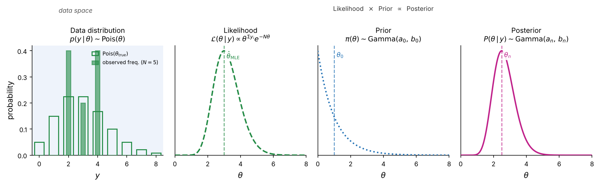

Four-panel illustration of Poisson-Gamma conjugate inference. Outlined bars show the true Poisson probabilities; the filled bars show the observed frequency. Moving into parameter space, the likelihood (green dashed), prior (blue dotted), and posterior (magenta solid) are functions of $\theta$. These plots were generated with $N=5$, $\sum y_i = 15$, $\theta_{\rm true}=3$, and a $\mathsf{Gamma}(1,1)$ prior.
:::


---

(sec:bay_toypoi)=
### Toy Poisson Example: Dog Spotting

Wherever I find myself in the world, an activity I enjoy on a weekend is "dog spotting": sitting outside at a cafe, noticing dogs on walks with their people.

Suppose I am modelling the mean number of dogs per hour[^note6], $\theta$, at a given cafe, with a Poisson likelihood. My Prior expectation is $\theta \approx 15$ dogs per hour. A little optimistic, perhaps, but I like to prioritise optimism at the weekends.

We choose the prior mean and variance to both equal 15 — following the Poisson’s own equal-mean/variance property (see [](#sec:pmf_poiev)) — which fixes both hyperparameters; I will require the Prior [Gamma expectation](#eq:bay_gamexp) and [variance](#eq:bay_gamvar) to be:

$E[\theta] = \dfrac{\alpha}{\beta} = 15$, $\;V[\theta] = \dfrac{\alpha}{\beta^2} = 15$.

[^note6]: If I am fortunate enough to encounter multiple dogs walking together with a single human, I will only count one of them.

Solving:

$$\frac{V[\theta]}{E[\theta]} = \frac{1}{\beta} = 1 \quad\implies\quad \beta = 1 \qquad \text{then} \qquad \frac{\alpha}{\beta} = \alpha = 15$$.


A quick sanity-check of the $\mathsf{Gamma}(15, 1)$ distribution:


```{code-cell} python
import matplotlib.pyplot as plt
from scipy.stats import gamma
import numpy as np

alpha=15
beta=1
x = np.linspace(0,50,250)

fig, ax = plt.subplots()
gamma_pdf = gamma.pdf(x,a=alpha,scale=1/beta)
ax.plot(x, gamma_pdf, label=f"Gamma({alpha},{beta})")

plt.legend()
plt.show()
```

The distribution of $\theta$ looks reasonable. I will use a Prior $\pi(\theta) = \mathsf{Gamma}(15, 1)$, with expectation $E[\theta] = 15$.

Now consider the data; on a particularly sweet weekend I racked up a total of $N=5$ independent dogspotting hours, and observed a mean rate of $\bar{y} = 12$ dogs per hour across these five experiments.

The [Posterior shape hyperparameters](#eq:bay_postpoissN) are:
 
 $\alpha' = \alpha +N\bar{y} = 15 + 5 \times 12 = 75$

 $\;\beta' = \beta + N = 1 + 5 = 6$.

The posterior is $\mathsf{Gamma}(75, 6)$, with expectation $E[\theta] = \dfrac{\alpha'}{\beta'} = \dfrac{75}{6} = 12.5$. The data have pulled our belief downward from 15 toward the observed mean of 12. The rule is: **each observation adds $y_i$ to $\alpha$ and 1 to $\beta$**.


The Likelihood, and therefore the Posterior, are updated with every new data measurement, as illustrated in [](#fig:bay_map_n_pois). The corresponding parameter estimates:
* $\hat{\theta}_{\mathsf{MLE}}$: mode of the Likelihood distribution,
* $\hat{\theta}_{\mathsf{MAP}}$: mode of the Posterior distribution,

are different - because the MAP includes the Prior - but converge for large $N$ because the information in the data (via the Likelihood) overwhelms the Prior distribution on $\theta$.

The Posterior Expectation $E[\theta]$ differs from $\hat{\theta}_{\mathsf{MAP}}$ because the mode and mean of the Posterior Gamma are not equal; the distribution is not symmetric. They converge for large $N$ as the Posterior distribution converges on the MAP.


:::{figure}
:width: 100%
:label: fig:bay_map_n_pois

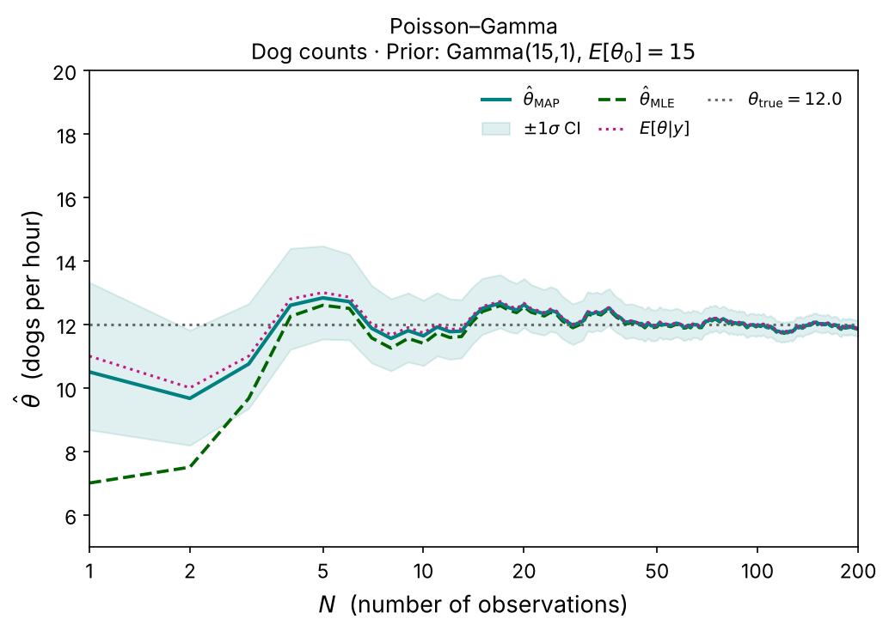

The MLE, MAP, and Posterior expectation for Poisson data with a Gamma(15,1) **Informative Prior**, as a function of the number of measurements $N$. The $\pm 1\sigma$ Credible Interval on the MAP is also shown. See [](#sec:bay_python_poisgam) for an example of this calculation in python.
:::


---

(sec:bay_expgam)=
### Expon-Gamma


The **Conjugate Prior** for Exponential data is also Gamma. A Gamma Prior yields a Gamma Posterior with updated shape hyperparameters $\alpha', \beta'$:

```{math}
\mathsf{Gamma}(\alpha', \beta') \propto \mathsf{Expon}(\theta) \; \mathsf{Gamma}(\alpha, \beta)
```

Let's calculate the shape hyperparameters, $\alpha', \beta'$, of the Gamma Posterior for a Exponential Likelihood:

```{math}
\begin{aligned}
\mathsf{Gamma\; Posterior}  \quad P(\theta \mid y)  & \propto \theta^{\alpha'-1}\,e^{-\beta'\theta} \\
\mathsf{Exponential\; Likelihood} \quad \mathcal{L}(\theta\mid y) & \propto \theta\, e^{-\theta y} \\
\mathsf{Gamma\; Prior} \quad \pi(\theta) & \propto \theta^{\alpha-1}\,e^{-\beta\theta} \\
\end{aligned}
```

Matching powers:

```{math}
\begin{aligned}
\theta^{\alpha'-1} &= \theta \, \theta^{\alpha-1} =\theta^{\alpha} \quad &\implies\quad \alpha' &= \alpha + 1 \\[6pt]
e^{-\beta'\theta} &= e^{-\theta y} \, e^{-\beta\theta} \quad &\implies\quad \beta' &= \beta + y \\[6pt]
\end{aligned}
```

A single Exponential observation adds 1 to $\alpha$ and $y$ to $\beta$, such that the **Posterior** is: 

```{math}
:label: eq:bay_postexpon1
P(\theta \mid y) \propto \mathsf{Gamma}(\alpha + 1,\; \beta + y)
```

For $N$ Exponential waiting time observations with mean observed rate $\bar{y}$:

```{math}
:label: eq:bay_postexponN
P(\theta \mid y) \propto \mathsf{Gamma}(\alpha + N,\; \beta + N\bar{y})
```

The plots in [](#fig:bay_eg4) attempt to illustrate the conjugate update for a Exponential likelihood: the first panel compares the true Exponential probabilities (solid line) with the observed frequency (vertical lines), **in data space**, ie as a function of $y$, while the remaining panels show the Likelihood, Prior, and Posterior as functions of $\theta$ in parameter space.

:::{figure}
:label: fig:bay_eg4
:width: 100%
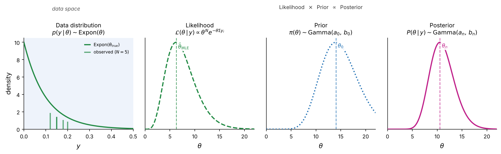

Four-panel illustration of Expon-Gamma conjugate inference. The solid line on the first panel shows the true Exponential PDF; the vertical lines show the measurements. Moving into parameter space, the likelihood (green dashed), prior (blue dotted), and posterior (magenta solid) are functions of $\theta$. These plots were generated with $N=5$, $\sum y_i = 0.80$, $\theta_{\rm true}=10$, and a $\mathsf{Gamma}(15,1)$ prior.
:::

---


(sec:bay_toyexp)=
### Toy Exponential Example: More Dog Spotting


Notice that there is a strong symmetry between the Exponential and Poisson distributions: **Poisson models counts per unit time**, while **Exponential models waiting times between events**. The same rate parameter $\theta$ appears in both.

We revisit the same dog-spotting scenario. Now, instead of counting dogs per hour, I record the gaps between sightings. Each inter-arrival time $y_i$ is modelled as $Y \sim \mathsf{Exponential}(\theta)$, where $\theta$ is the same underlying rate (dogs per hour).

Since we are modelling the same rate $\theta$, the **Prior is unchanged**: $\pi(\theta) = \mathsf{Gamma}(15, 1)$, with expectation $E[\theta] = 15$ dogs per hour.

```{code-cell} python
from scipy.stats import gamma
import matplotlib.pyplot as plt
import numpy as np

alpha, beta = 15, 1
x = np.linspace(0, 30, 300)

fig, ax = plt.subplots()
ax.plot(x, gamma.pdf(x, a=alpha, scale=1/beta), label=f"Gamma({alpha},{beta})")
ax.set_xlabel(r'$\theta$ (dogs per hour)')
plt.legend()
plt.show()
```

Over the same sweet weekend I record the inter-arrival times between dogs. I observe $N = 60$ waiting times in total, with a sample mean of $\bar{y} = \tfrac{1}{12}$ hour (approximately 5 minutes between dogs).

The [Posterior shape hyperparameters](#eq:bay_postexponN) are:

$\alpha' = \alpha + N = 15 + 60 = 75$

$\;\beta' = \beta + N\bar{y} = 1 + 60 \times \tfrac{1}{12} = 6$.

The posterior is $\mathsf{Gamma}(75, 6)$, with expectation $E[\theta] = \dfrac{75}{6} = 12.5$ dogs per hour.

The data have again pulled our belief downward from 15 toward the observed rate of 12. And notice: this is **exactly the same posterior as in the [Poisson example](#sec:bay_toypoi)**! This is not a coincidence: observing 60 inter-arrival times with mean $\bar{y} = \tfrac{1}{12}$ hour is equivalent to watching for 5 hours and counting 60 events — the same total time and the same total count as the Poisson experiment. The sufficient statistics are identical, so the posterior must be too.

The rule is: **each observation adds 1 to $\alpha$ and $y_i$ to $\beta$**.


:::{figure}
:label: fig:bay_egamanim
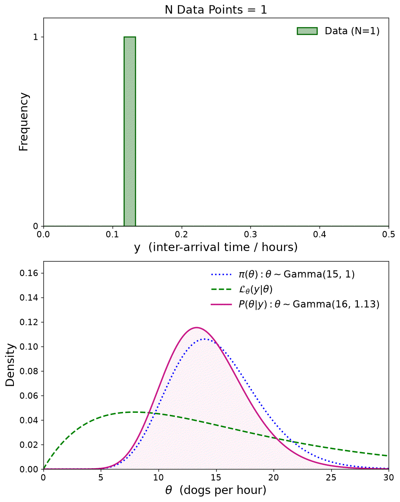

As we accumulate inter-arrival time data, the Posterior distribution $P(\theta | y)$ closes in on the true underlying rate.
:::


The Likelihood, and therefore the Posterior, are updated with every new data measurement, as illustrated in [](#fig:bay_map_n_exp). The corresponding parameter estimates:
* $\hat{\theta}_{\mathsf{MLE}}$: mode of the Likelihood distribution,
* $\hat{\theta}_{\mathsf{MAP}}$: mode of the Posterior distribution,

are different - because the MAP includes the Prior - but converge for large $N$ because the information in the data (via the Likelihood) overwhelms the Prior distribution on $\theta$.

The Posterior Expectation $E[\theta]$ differs from $\hat{\theta}_{\mathsf{MAP}}$ because the mode and mean of the Posterior Gamma are not equal; the distribution is not symmetric. They converge for large $N$ as the Posterior distribution converges on the MAP.


:::{figure}
:width: 100%
:label: fig:bay_map_n_exp

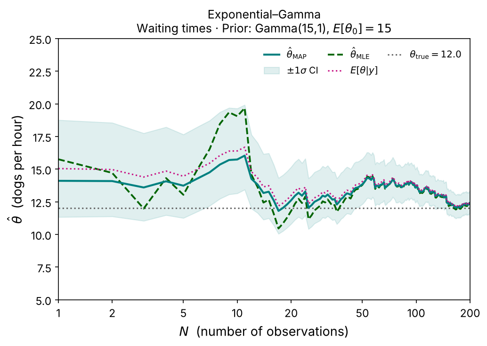

The MLE, MAP, and Posterior expectation for Exponential data with a Gamma(15,1) **Informative Prior**, as a function of the number of measurements $N$. The $\pm 1\sigma$ Credible Interval on the MAP is also shown. See [](#sec:bay_python_expgam) for an example of this calculation in python.
:::


---

(sec:bay_normnorm)=
### Normal-Normal

The **Conjugate Prior** for the mean of Normal data (with **known** variance $\sigma^2$) is also Normal. We use $\mu_0$ and $\sigma_0$ as the parameters of the Prior — unlike the shape hyperparameters $\alpha$ and $\beta$ of the Beta and Gamma, these have direct meaning: $\mu_0$ is our best guess for the mean before seeing any data, and $\sigma_0$ is how uncertain we are about that guess. See [Kevin Murphy's proof](https://www.cs.ubc.ca/~murphyk/Papers/bayesGauss.pdf) for the full derivation, including the case of unknown $\sigma^2$.

**A note on the random variable.** In the likelihood, $y$ is the random variable and $\mu$ is the unknown parameter. In the prior, the roles switch: $\mu$ becomes the random variable — the quantity we are uncertain about — and $\mu_0$ is its mean. The kernels make this concrete:

```{math}
\begin{aligned}
\mathsf{Normal\;Likelihood} \quad \mathcal{L}(\mu|y) &\propto
    \exp\!\left[-\frac{(y - \mu)^2}{2\sigma^2}\right]
    \quad (y \text{ is the RV}) \\[6pt]
\mathsf{Normal\;Prior} \quad \pi(\mu) &\propto
    \exp\!\left[-\frac{(\mu - \mu_0)^2}{2\sigma_0^2}\right]
    \quad (\mu \text{ is now the RV})
\end{aligned}
```

Both are Gaussians in $\mu$, so their product is also Gaussian — Normal is conjugate to Normal. The plots in [](#fig:bay_nn4) illustrate this; the same bell-curve is read first in data space (left panel, shaded blue) and then in parameter space.


:::{figure}
:label: fig:bay_nn4
:width: 100%
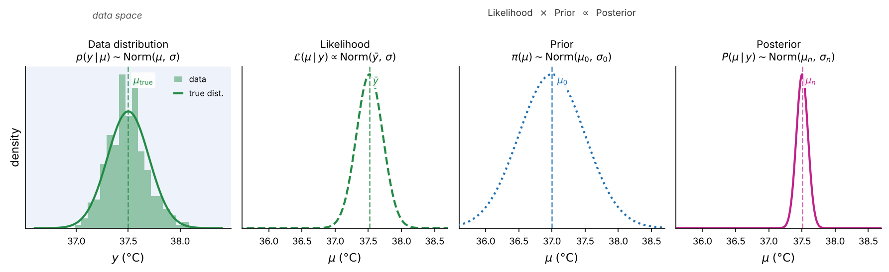

Four-panel illustration of Normal–Normal conjugate inference. The data panel shows a histogram of normally distributed data with the true distribution overlaid. The remaining three panels are in parameter space, the likelihood (green dashed), prior (blue dotted), and posterior (magenta solid) are shown as functions of $\mu$. These plots were generated with $N=5$, $\bar{y}=37.52$, $\sigma=0.2$, and prior $\mathsf{Norm}(37.0,\,0.5)$.
:::


It is convenient to work with **precision** $\lambda = 1/\sigma^2$. The **Posterior** after $N$ observations with sample mean $\bar{y}$ is:

```{math}
:label: eq:bay_postnorm
P(\mu \mid \mathbf{y}) \sim \mathsf{Norm}(\mu_n,\, \sigma_n), \qquad
\mu_n = \frac{\mu_0\lambda_0 + N\bar{y}\lambda}{\lambda_0 + N\lambda}, \qquad
\sigma_n^2 = \frac{1}{\lambda_0 + N\lambda}
```

where $\lambda_0 = 1/\sigma_0^2$. The posterior mean $\mu_n$ is a **precision-weighted average** of the prior mean and the sample mean: whichever source is more precise pulls harder. Each observation adds $\lambda$ to the precision — more data $\to$ higher $\lambda_n$ $\to$ smaller $\sigma_n^2$ $\to$ narrower posterior. As $N \to \infty$, $\mu_n \to \bar{y}$ and $\sigma_n \to 0$.

:::{dropdown} Derivation: completing the square
Expanding and collecting terms in $\mu$, the product of likelihood and prior gives

```{math}
P(\mu \mid \mathbf{y}) \propto \exp\!\left[-\tfrac{1}{2}(\lambda_0 + N\lambda)
\!\left(\mu - \frac{\mu_0\lambda_0 + N\bar{y}\lambda}{\lambda_0 + N\lambda}\right)^{\!2}\right]
```

which is Gaussian with the parameters in [](#eq:bay_postnorm).
:::

Since the Normal distribution is symmetric, the **MAP equals the posterior mean**:
$\hat{\mu}_{\mathsf{MAP}} = \mu_n$.

---

(sec:bay_toynorm)=
### Toy Normal Example: Body Temperature

You feel unwell and take your temperature $N$ times. Your thermometer has a known measurement noise of $\sigma = 0.2^{\circ}\text{C}$ (from the manufacturer's spec sheet — precision $\lambda = 1/0.04 = 25$). NHS guidance gives a healthy resting temperature of around $37.0^\circ\text{C}$, with individual variation of roughly $\sigma_0 = 0.5^\circ\text{C}$ (precision $\lambda_0 = 1/0.25 = 4$). This becomes the **Prior**: $\pi(\mu) = \mathsf{Norm}(37.0,\; 0.5)$.

After $N = 5$ readings — $[37.4,\; 37.6,\; 37.3,\; 37.8,\; 37.5]$ — the sample mean is $\bar{y} = 37.52^\circ\text{C}$.

The [Posterior parameters](#eq:bay_postnorm) are:

$$\lambda_n = 4 + 5 \times 25 = 129, \qquad \sigma_n = 1/\sqrt{129} \approx 0.088^\circ\text{C}$$

$$\mu_n = \frac{37.0 \times 4 + 37.52 \times 125}{129} = \frac{148 + 4690}{129} \approx 37.50^\circ\text{C}$$

The five measurements (each with precision 25) vastly outweigh the prior (precision 4): the data precision $5 \times 25 = 125$ is 31 times larger than $\lambda_0 = 4$, so $\mu_n$ is pulled almost all the way to $\bar{y}$. The posterior is also much narrower than either the prior or any single measurement: $\sigma_n \approx 0.088^\circ\text{C}$ versus $\sigma_0 = 0.5^\circ\text{C}$ and $\sigma = 0.2^\circ\text{C}$.

The Likelihood, and therefore the Posterior, are updated with every new data measurement, as illustrated in [](#fig:bay_map_n_norm). The corresponding parameter estimates:
* $\hat{\mu}_{\mathsf{MLE}}$: mode of the Likelihood distribution,
* $\hat{\mu}_{\mathsf{MAP}}$: mode of the Posterior distribution,

are different - because the MAP includes the Prior - but converge for large $N$ because the information in the data (via the Likelihood) overwhelms the Prior distribution on $\mu$.

The Posterior Expectation $E[\mu]$ is identical to $\hat{\mu}_{\mathsf{MAP}}$ because **the mode and mean of the Posterior Normal are equal**; the distribution is symmetric.


:::{figure}
:width: 100%
:label: fig:bay_map_n_norm

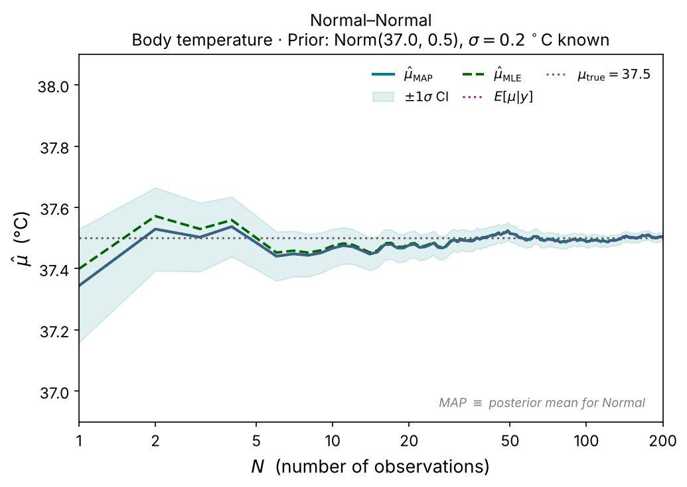

The MLE, MAP, and Posterior expectation for Normal data with a Norm(37,0.5) **Informative Prior**, as a function of the number of measurements $N$. The $\pm 1\sigma$ Credible Interval on the MAP is also shown. See [](#sec:bay_python_normnorm) for an example of this calculation in python.
:::


---

(sec:bay_sumtab)=
### Summary Table

A summary of the Conjugate Priors and Posterior hyperparameters is given in [](#tab:bay_conjp) for the distributions we have considered above.

(tab:bay_conjp)=
:::{table} Conjugate Priors and Posterior Hyperparameters

| Likelihood | Prior | Posterior |
|---|---|---|
| Bernoulli: $\theta^y(1-\theta)^{1-y}$ | $\mathsf{Beta}(\alpha, \beta)$ | $\mathsf{Beta}(\alpha+\sum y_i,\; \beta+N-\sum y_i)$ |
| Binomial: $\binom{n}{y}\theta^y(1-\theta)^{n-y}$ | $\mathsf{Beta}(\alpha, \beta)$ | $\mathsf{Beta}(\alpha+\sum y_i,\; \beta+Nn-\sum y_i)$ |
| Poisson: $e^{-\theta}\theta^y/y!$ | $\mathsf{Gamma}(\alpha, \beta)$ | $\mathsf{Gamma}(\alpha+N\bar{y},\; \beta+N)$ |
| Exponential: $\theta e^{-\theta y}$ | $\mathsf{Gamma}(\alpha, \beta)$ | $\mathsf{Gamma}(\alpha+N,\; \beta+N\bar{y})$ |
| Normal: $\exp[-(y-\mu)^2/2\sigma^2]$, $\sigma$ known | $\mathsf{Norm}(\mu_0, \sigma_0)$ | $\mathsf{Norm}(\mu_n, \sigma_n)$ — see [](#eq:bay_postnorm) |
:::

---


(sec:bay_priors)=
## Notes on Priors

**Why do we need a Prior?**
A Frequentist does not use a Prior, so the posterior is proportional to the likelihood: $P(\theta \mid y) \propto \mathcal{L}(\theta \mid y)$. The Bayesian counter-argument is that sampling distributions are also a form of subjective prior knowledge — we still have to choose a distribution family for the likelihood.

**Why use a conjugate Prior?**
Conjugate priors produce a posterior in closed form, making the analysis transparent. Beta is the conjugate prior for probability-valued parameters. Gamma is conjugate for rate/count parameters.

**Uninformative Priors**
If you have no prior knowledge, use a uniform (or weakly informative) prior. A uniform prior on the real line integrates to infinity — an **Improper Prior** — but this is acceptable as long as the resulting Posterior is proper (integrates to a finite value). See [Jeffreys Prior](https://en.wikipedia.org/wiki/Jeffreys_prior) for a principled way to choose uninformative priors. Note: a prior uniform in $X$ is not uniform in a transform of $X$.

**Avoid hard boundaries**
If your parameter must be physically positive but theoretically unrestricted, a uniform prior with a hard boundary at zero causes problems near the boundary. Prefer a soft constraint — a distribution that naturally decays near zero (e.g. a half-normal or exponential prior).

:::{tip}
Always plot the prior distribution before proceeding. It is easy to accidentally choose one with reasonable moments but a pathological shape.
:::


---

(sec:bay_python)=
## Python Examples

The short python examples here demonstrate the use of the conjugate distributions discussed above and the calculation of the MAP estimates and 95% Credible Intervals.

A **95% Credible Interval** $[a, b]$ means: given the data and the prior, there is a 95% probability that $\theta \in [a, b]$.

In Python, we can use the `ppf` (percent point function) of the posterior distribution to extract the credible interval about the mode of the Posterior distribution, which corresponds to the MAP.

Alternatively, there is a `interval` method provided by scipy.stats for continuous distributions. Note that this uses the **median** rather than the mode. They are often very close or equal, but not always. I understand that scipy have gone for this option for computational speed reasons.

I have included the `interval` method in the first example below for Bernoulli-Beta.


(sec:bay_python_berbet)=
### Bernoulli-Beta

For the [Toy Bernoulli-Beta example](#sec:bay_toyber): Toss a coin N times to determine whether it is a fair coin.

```{code-cell} python

def bernoulli_beta(N):

	print(f"{N} Bernoulli trials with uniform prior")
	
	from scipy.stats import bernoulli, beta
	import numpy as np

	# -------------------------
	# Data: Y ~ Bernoulli(theta)
	# -------------------------
	# Probability of heads (a fair coin)
	true_theta = 0.5 

	data_dist = bernoulli(true_theta)

	# Draw 10 RVs from the distribution: ten coin flips
	y = data_dist.rvs(size=10)

	# -------------------------
	# Likelihood: theta ~ Beta(aL,bL)
	# -------------------------	
	# Bernoulli PMF:  theta**y     * (1-theta)**(1-y)
	# Bernoulli Like: theta**s     * (1-theta)**(N-s)
	# Beta Like:      theta**(aL-1) * (1-theta)**(bL-1)

	s = np.sum(y)
	N = len(y)
	aL = s+1
	bL = N-s+1
	like_dist = beta(a=aL, b=bL)

	# MLE for Bernoulli theta is just the mean of the data
	mle_est =  np.mean(y)

	# -------------------------
	# Prior: theta~Beta(aP,bP)
	# -------------------------
	# Uniform (flat) Beta Prior: we know nothing.
	aP  = 1
	bP  = 1
	prior_dist   = beta(a=aP, b=bP)

	# -------------------------
	# Posterior: theta ~ Beta(a,b)
	# -------------------------
	# Beta Like : theta**(aL-1) * (1-theta)**(bL-1)   ~ Beta(s+1, N-s+1)
	# Beta Prior: theta**(aP-1) * (1-theta)**(bP-1)   ~ Beta(aP, bP)
	# Beta Post : theta**(aP+s-1) * (1-theta)**(bP+N-s-1) = Beta(aP+s, bP+N-s)

	a = aP + s      # posterior alpha: prior alpha + successes
	b = bP + N - s  # posterior beta:  prior beta  + failures
	post_dist = beta(a=a, b=b)

	# MAP for theta is the mode of the Beta posterior
	map_est = (a - 1) / (a + b - 2)

	# 95% credible interval for the MAP
	ci1 = post_dist.ppf(q=0.025)
	ci2 = post_dist.ppf(q=0.975)

	print(f"MLE = {mle_est}, MAP={map_est}, 95% CI=[{ci1:.2f},{ci2:.2f}]")

	# scipy's built-in interval uses the median, not the mode.
	ci_med = post_dist.interval(confidence=0.95)
	print(f"95% CI (.interval): {np.round(ci_med,2)}")


bernoulli_beta(10)

bernoulli_beta(100_000)
```

---

(sec:bay_python_binbet)=
### Binomial-Beta

For the [Toy Binomial-Beta Example](#sec:bay_toybin): Alf's trick shots: each observation is the number of successes in $n=10$ attempts, prior Beta(2,8).

```{code-cell} python
def binomial_beta(N):
	print(f"{N} Binomial observations, n=10 trials each, prior Beta(2,8)")
	from scipy.stats import binom, beta
	import numpy as np

	n = 10              # trials per observation
	true_theta = 0.25
	data_dist  = binom(n=n, p=true_theta)
	y = data_dist.rvs(size=N)

	S = int(np.sum(y))  # total successes across all N observations

	# MLE: total successes / total trials
	mle_est = S / (N * n)

	# Prior: Beta(aP, bP) — informative, E[theta]=0.2
	aP, bP = 2, 8

	# -------------------------
	# Posterior: Beta(aP + S, bP + N*n - S)
	# -------------------------
	# Binomial Like : theta**S * (1-theta)**(N*n - S)   ~ Beta(S+1, N*n-S+1)
	# Beta Prior    : theta**(aP-1) * (1-theta)**(bP-1) ~ Beta(aP, bP)
	# Beta Posterior: Beta(aP + S, bP + N*n - S)
	a = aP + S
	b = bP + N * n - S
	post_dist = beta(a=a, b=b)

	# MAP: mode of Beta(a, b)
	map_est = (a - 1) / (a + b - 2)

	# 95% credible interval for the MAP
	ci1 = post_dist.ppf(q=0.025)
	ci2 = post_dist.ppf(q=0.975)

	print(f"MLE={mle_est:.3f}, MAP={map_est:.3f}, 95% CI=[{ci1:.3f},{ci2:.3f}]")

binomial_beta(10)
binomial_beta(100_000)
```

---

(sec:bay_python_poisgam)=
### Poisson-Gamma

For the [Toy Poisson-Gamma Example](#sec:bay_toypoi): Dog counts: $Y_i \sim \mathsf{Poisson}(\theta)$, prior Gamma(15, 1) so $E[\theta_0]=15$.

```{code-cell} python
def poisson_gamma(N):
	print(f"{N} Poisson observations, prior Gamma(15,1)")
	from scipy.stats import poisson, gamma
	import numpy as np

	true_theta = 12.0
	data_dist  = poisson(mu=true_theta)
	y = data_dist.rvs(size=N)

	S = np.sum(y)       # sum of counts

	# MLE: sample mean
	mle_est = S / N

	# Prior: Gamma(aP, rate=bP)  —  E[theta] = aP/bP
	aP, bP = 15, 1

	# -------------------------
	# Posterior: Gamma(aP + S, rate = bP + N)
	# -------------------------
	# Poisson Like : prod exp(-theta) * theta**y_i  ~ Gamma(S+1, rate=N)
	# Gamma Prior  : theta**(aP-1) * exp(-bP*theta) ~ Gamma(aP, rate=bP)
	# Gamma Post   : Gamma(aP + S, rate = bP + N)
	a = aP + S
	b = bP + N              # posterior rate
	post_dist = gamma(a=a, scale=1.0/b)

	# MAP: mode of Gamma(a, rate=b) = (a-1)/b
	map_est = (a - 1) / b

	# 95% credible interval for the MAP
	ci1 = post_dist.ppf(q=0.025)
	ci2 = post_dist.ppf(q=0.975)

	print(f"MLE={mle_est:.3f}, MAP={map_est:.3f}, 95% CI=[{ci1:.3f},{ci2:.3f}]")

poisson_gamma(10)
poisson_gamma(100_000)
```

---

(sec:bay_python_expgam)=
### Expon-Gamma

For the [Toy Expon-Gamma Example](#sec:bay_toyexp): Waiting times between dogs: $Y_i \sim \mathsf{Exponential}(\theta)$, prior Gamma(15, 1).

```{code-cell} python
def expon_gamma(N):
	print(f"{N} Exponential observations, prior Gamma(15,1)")
	from scipy.stats import expon, gamma
	import numpy as np

	true_theta = 12.0                        # true rate (dogs per hour)
	data_dist  = expon(scale=1.0/true_theta)
	y = data_dist.rvs(size=N)

	S = np.sum(y)       # sum of waiting times

	# MLE: 1 / sample mean  (rate = inverse of mean waiting time)
	mle_est = N / S

	# Prior: Gamma(aP, rate=bP)  —  E[theta] = aP/bP
	aP, bP = 15, 1

	# -------------------------
	# Posterior: Gamma(aP + N, rate = bP + S)
	# -------------------------
	# Expon Like : prod theta * exp(-theta*y_i) ~ Gamma(N+1, rate=S)
	# Gamma Prior: theta**(aP-1) * exp(-bP*theta) ~ Gamma(aP, rate=bP)
	# Gamma Post : Gamma(aP + N, rate = bP + S)
	a = aP + N
	b = bP + S              # posterior rate
	post_dist = gamma(a=a, scale=1.0/b)

	# MAP: mode of Gamma(a, rate=b) = (a-1)/b
	map_est = (a - 1) / b

	# 95% credible interval for the MAP
	ci1 = post_dist.ppf(q=0.025)
	ci2 = post_dist.ppf(q=0.975)

	print(f"MLE={mle_est:.3f}, MAP={map_est:.3f}, 95% CI=[{ci1:.3f},{ci2:.3f}]")

expon_gamma(10)
expon_gamma(100_000)
```

---

(sec:bay_python_normnorm)=
### Normal-Normal

For the [Toy Normal-Normal Example](#sec:bay_toynorm): Estimate the mean body temperature $\mu$, given a thermometer with known noise $\sigma = 0.2^\circ\text{C}$ and a prior $\mathsf{Norm}(37.0,\; 0.5)$ based on NHS guidance.

```{code-cell} python
def normal_normal(N):
	print(f"{N} Normal observations, sigma=0.2 known, prior Norm(37.0, 0.5)")
	from scipy.stats import norm
	import numpy as np

	sigma     = 0.2     # known thermometer noise (°C)
	true_mu   = 37.5    # true mean temperature (°C)
	data_dist = norm(loc=true_mu, scale=sigma)
	y = data_dist.rvs(size=N)

	ybar = np.mean(y)

	# MLE: sample mean
	mle_est = ybar

	# Prior: Norm(mu0, sigma0)
	mu0, sigma0 = 37.0, 0.5

	# Precision
	lam  = 1.0 / sigma**2    # data precision (25 per observation)
	lam0 = 1.0 / sigma0**2   # prior precision (4)

	# -------------------------
	# Posterior: Norm(mu_n, sigma_n)
	# -------------------------
	# Normal Like : exp[-(y-mu)^2 / 2sigma^2]    — precision lam per obs
	# Normal Prior: exp[-(mu-mu0)^2 / 2sigma0^2] — precision lam0
	# Normal Post : Norm(mu_n, sigma_n)           — precision lam0 + N*lam
	lam_n   = lam0 + N * lam
	mu_n    = (mu0 * lam0 + N * ybar * lam) / lam_n
	sigma_n = 1.0 / np.sqrt(lam_n)
	post_dist = norm(loc=mu_n, scale=sigma_n)

	# MAP = posterior mean (Normal is symmetric: mode = mean)
	map_est = mu_n

	# 95% credible interval for the MAP
	ci1 = post_dist.ppf(q=0.025)
	ci2 = post_dist.ppf(q=0.975)

	print(f"MLE={mle_est:.3f}, MAP={map_est:.3f}, 95% CI=[{ci1:.3f},{ci2:.3f}]")

normal_normal(5)
normal_normal(100_000)
```
