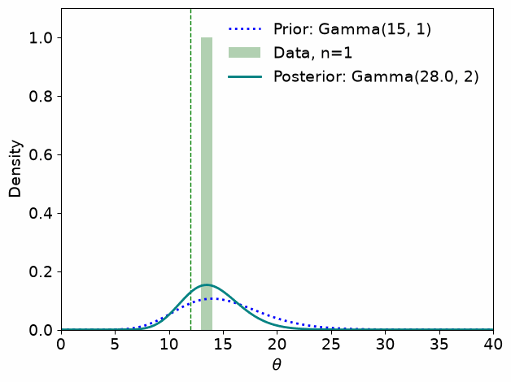
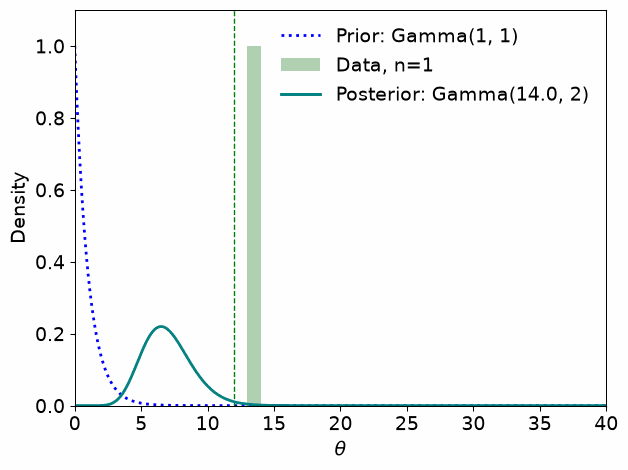

---
jupytext:
  formats: md:myst
  text_representation:
    extension: .md
    format_name: myst
kernelspec:
  name: python3
  display_name: 'Python 3'
---

(chapter:bay)=
# Bayesian Inference

* `scipy.stats`: `beta`, `gamma`, `nbinom`, `poisson`
* `scipy.special`: `beta as betafunc`
<!--* Workshop file: `Week10-BayesUpdating.py`-->


Bayesian Inference gives us a framework for **updating our beliefs** about a parameter $\theta$ using data $y$. Rather than treating $\theta$ as a fixed but unknown constant (the Frequentist view), the Bayesian approach treats $\theta$ as a random variable with its own probability distribution, and updates that distribution as data arrive.


---

(sec:bay_baythm)=
## Bayes' Theorem

We already met Bayes' theorem in {ref}`sec:pe_baythm`, where we wrote it as {eq}`eq:pe_bayes`:

$$P(A | B) = \frac{P(B | A)\, P(A)}{P(B)}$$

The A and B in the above formula are events. We noted that Bayes' theorem becomes most interesting when we define the events as a hypothesis (or parameter value) $\theta$ and a dataset $y$:

$$P(\theta | y) = \frac{P(y | \theta)\, P(\theta)}{P(y)}$$

When using Bayes' theorem in this way, it is convenient to define each of the terms:

- **$P(y | \theta) \to \mathcal{L}(y | \theta)$**: the **Likelihood** of the data $y$ being described by a parameter value $\theta$. The data are now *fixed* (we've already observed them) and $\theta$ is what varies.
- **$P(\theta) \to \pi(\theta)$**: the **Prior** Probability, $\pi$, is the belief about $\theta$ before seeing the data, not a frequency from a repeatable experiment. The use of the Greek letter $\pi$ is a deliberate choice to keep it separate from sampling probabilities.
- **$P(y) \to \int \mathcal{L}(y | \theta)\, \pi(\theta)\, d\theta$**: the **Evidence**; $P(y)$ isn't an independent quantity — it's what we get by integrating the numerator over all possible $\theta$ values. Writing the integral out explicitly makes this obvious, and guarantees the right hand side integrates to 1.
- **$P(\theta | y)$**: the **Posterior** Probability of the parameter $\theta$, given the data.

Bayes' Theorem relates the **Posterior** probability of a parameter given data to the **Likelihood** of the data given the parameter, the **Prior** probability of the parameter, and the **Evidence**:

:::{figure} /figures/BayesPic.png
:name: fig:bay_bayespic
:width: 60%
Bayes' theorem: The Posterior is equal to the product of the Likelihood and Prior, divided by the Evidence.
:::

<!--
```{math}
:label: eq:bay_bayes

P(\theta \mid y) = \frac{\mathcal{L}(y \mid \theta)\; \pi(\theta)}{\int \mathcal{L}(y \mid \theta)\, \pi(\theta)\, d\theta}
```
-->

Each element has a precise name and role:

| Term | Symbol | Meaning |
|---|---|---|
| **Posterior** | $P(\theta \mid y)$ | Our updated belief about $\theta$ after seeing data $y$ |
| **Likelihood** | $\mathcal{L}(y \mid \theta)$ | The probability of observing data $y$ given $\theta$ |
| **Prior** | $\pi(\theta)$ | Our belief about $\theta$ before seeing data |
| **Evidence** | $\int \mathcal{L}(y \mid \theta)\, \pi(\theta)\, d\theta$ | A normalisation constant ensuring $\int P(\theta \mid y)\, d\theta = 1$ |

The Prior is a PDF (or PMF for discrete $\theta$), not a single number. In the discrete example below there are only two hypotheses, so the Prior reduces to two numbers: $\pi(\theta_s)$ and $\pi(\theta_h)$. This is a special case; in general $\theta$ ranges continuously over a whole parameter space and the Prior is a full probability distribution over that space.


---

(sec:bay_covid)=
## A Medical Screening Test

A screening test for a rare condition has the following known properties (from the manufacturer):

:::{table}
:label: tab:bay_covid
|| Positive, $y=1$  | Negative $y=0$ | 
|---|---|---|
| **Sick** ($\theta_s$) | $p = 1$ | $p = 0$ |
| **Healthy** ($\theta_h$) | $p = 0.05$ | $p = 0.95$ |
:::

The data $y$ are **Bernoulli**: a binary outcome from a single test. Each hypothesis specifies a different value of the Bernoulli parameter $p$ — each lives in its own probability distribution:

::::{grid} 1 1 2 2

:::{figure} /figures/NewBernCovid_sick.png
:name: fig:bay_bernsick
:width: 100%
Bernoulli PMF under the sick hypothesis ($\theta_s$): $p = 1$, so a positive result is certain.
:::

:::{figure} /figures/NewBernCovid_healthy.png
:name: fig:bay_bernhealthy
:width: 100%
Bernoulli PMF under the healthy hypothesis ($\theta_h$): $p = 0.05$, a small false-positive rate.
:::

::::

We will now walk through each term of [](#fig:bay_bayespic) in turn.

---

(sec:bay_covidlike)=
### Likelihoods

Let's remind ourselves of the [Bernoulli PMF](#eq:pmf_bernpmf), and adjust the notation such that we can work with it more clearly in terms of Bayes' theorem.

```{math}
:label: eq:bay_rebern
\begin{aligned}
p_K(k) & = p^k (1-p)^{1-k} \\[6pt]
p_Y(y \mid \theta) &= \theta^y (1-\theta)^{1-y}\\
\end{aligned}
```

The PMF $p_K(k)$ tells us the probability of measuring the data with a value $k$ given the Bernoulli parameter $p$. On the second line of [](#eq:bay_rebern) we have rephrased this using using $p \rightarrow \theta$ for the Bernoulli parameter and $k \rightarrow y$ for the data. We have done this to make things more general and less confusing as we go forward.

Recall that the Bernoulli PMF is a product of two terms:

Success term 
: $\theta^y$: The probability of success to the power of the number of successes

Failure term 
: $(1-\theta)^{1-y}$: The probability of failure to the power of the number of failures.

For $N=1$ the Likelihood equals the PMF, and for Bernoulli the PMF is two-valued:

```{math}
:label: eq:bay_bernlike
\begin{aligned}
\mathcal{L}(y\mid \theta_s) & = \theta_s^y (1-\theta_s)^{1-y} \\[6pt]
\mathcal{L}(y\mid \theta_h) & = \theta_h^y (1-\theta_h)^{1-y} \\[6pt]
\end{aligned}
```

For positive tests ($y=1$), the Likelihoods reduce to the "success terms", and for negative tests ($y=0$) they reduce to the "failure terms". This gives us exactly the parameter values in [](#tab:bay_covid):


:::{table}
:label: tab:bay_covid2
|| Positive, $y=1$  | Negative $y=0$ | 
|---|---|---|
| **Sick** ($\theta_s$) | $\mathcal{L}(y=1\mid \theta_s) = \theta_s=1$ | $\mathcal{L}(y=0\mid \theta_s) = 1-\theta_s=0$ |
| **Healthy** ($\theta_h$) | $\mathcal{L}(y=1\mid \theta_h)=\theta_h=0.05$ | $\mathcal{L}(y=0\mid \theta_h)=1-\theta_h=0.95$ |
:::

Under $\theta_s$ a positive test is certain; under $\theta_h$ it occurs with probability 0.05 (the [false positive rate](#eq:hyp_fpr)).

---

(sec:bay_covidprior)=
### Priors

The prevalence of this condition in the general population is roughly 1 in 1000. 

We interpret this as the probability of having the condition before looking at any data.


$$\pi(\theta_s) = \tfrac{1}{1000}, \qquad \pi(\theta_h) = \tfrac{999}{1000}$$

The prior distribution $\pi(\theta)$ is reduced to two numbers, because there are only two hypotheses. In general $\theta$ ranges over a continuous parameter space and the Prior is a full distribution. 

:::{warning}
Note that setting $\pi(\theta_s) = 1/1000$ without stating the uncertainty is highly improper! A continuous prior, like the Beta distribution we'll meet in [](#sec:bay_betpdf), would allow us to express the prior with uncertainty, as we always should. This is a toy example.
:::

---

(sec:bay_evcon)=
### Evidence

The denominator of [](#fig:bay_bayespic) is the total probability of the data (a single outcome) under all hypotheses, weighted by their priors. With two discrete hypotheses it is a sum:

```{math}
:label: eq:bay_evidence

\begin{aligned}
\text{Evidence} &= \mathcal{L}(y=1 \mid \theta_s)\,\pi(\theta_s) + \mathcal{L}(y=1 \mid \theta_h)\,\pi(\theta_h) \\
&= 1 \times \tfrac{1}{1000} + 0.05 \times \tfrac{999}{1000} \\
&= 0.001 + 0.04995 \\
&= 0.05095
\end{aligned}
```

Note that the integral is over the parameters $d\theta$, not the data $y$: this is the evidence for a positive test result only (one of the two possible outcomes). The same procedure can be done for the other possible outcome, $y=0$.

Note also that in the continuous case this sum becomes the integral in [](#fig:bay_bayespic), which is often impossible to compute analytically — a key motivation for the numerical methods in the next chapter. <!-- TODO: add link to MCMC chapter when complete -->

---

(sec:bay_covidpost)=

### Posterior

We now have everything we need. For a positive test result $y=1$:

```{math}
:label: eq:bay_covidpost

P(\theta_s \mid y=1) = \frac{\mathcal{L}(y=1 \mid \theta_s)\,\pi(\theta_s)}{\text{Evidence}} = \frac{(1)(0.001)}{0.05095} \approx 0.0196

```

Despite a perfect sensitivity — sick people **always** test positive — the probability of actually being sick, $\theta_s$, given a positive test, $y=1$, is only $\approx 2\%$. The condition is so rare that most positive results come from the small false-positive rate applied to the large healthy population.


The full posterior table for positive tests[^note1] for both hypotheses is:

| | Likelihood $\mathcal{L}(y=1\mid \theta)$ | Prior $\pi(\theta)$ | Numerator | Evidence | Posterior $P(\theta \mid y=1)$ |
|---|---|---|---|---|---|
| $\theta_s$ | 1 | 0.001 | 0.001 | 0.05095 | **0.0196** |
| $\theta_h$ | 0.05 | 0.999 | 0.04995 | 0.05095 | **0.9804** |

[^note1]: an equivalent table can of course be constructed for negative tests.


The use of data to construct a posterior in this way is called **Bayesian Updating**:

- **Before** the test, we held a Prior $\pi(\theta_s) = 0.001$
- **After** the test, we calculated a Posterior $P(\theta_s \mid y=1) \approx 0.02$

<!--The data have updated our belief. With more data (more tests), the posterior would narrow further.-->

---

(sec:bay_priodist)=
## Prior Distributions

In the Bernoulli example above we used a single value prior with no quoted uncertainty ($\pi(\theta_s) = \tfrac{1}{1000}$) - this is just about forgivable for a toy example for pedagogical purposes, but in general **we must insist that all numbers have quoted uncertainties, otherwise they are meaningless**.

Using a PDF as a prior distribution is the proper way forward, as we can extract the uncertainty directly from the Variance. Additionally, using a Prior distribution with a **kernel** that matches our Likelhood allows us to extract the form of the Posterior analytically; the Posterior distribution will have the same form as the Prior, with updated parameters. This kernel-matching is called **Conjugacy**.

:::{tip} Kernel Matching: Conjugacy
The **kernel** of a distribution is the part of its PDF or PMF that depends on the random variable — the normalising constant is dropped. Recognising kernel shapes is a powerful shortcut: when two distributions share a kernel shape, one is the natural conjugate prior for the other.
:::

Here we will look at two special PDFs which are ideally suited as Priors: the Beta and Gamma distributions.


(sec:bay_betpdf)=
### The Beta Distribution

The Beta PDF is the **Conjugate Prior** for the Bernoulli and Binomial PMFs. What this means is that if we have Bernoulli or Binomial data (Likelihoods), we should use a Beta PDF (with carefully selected shape parameter choices) for the Prior. This will give us a Beta Posterior with shape parameters we can calculate analytically using kernel matching.

```{math}
\begin{aligned}
\mathsf{Bernoulli\,}\mathcal{L}(y|\theta) \times \mathsf{Beta\,}\pi(\theta) \rightarrow \mathsf{Beta\,}P(\theta | y)\\[8pt]
\mathsf{Binomial\,}\mathcal{L}(y|\theta) \times \mathsf{Beta\,}\pi(\theta) \rightarrow \mathsf{Beta\,}P(\theta | y)\\

\end{aligned}
```

<!--
```{math}
\begin{aligned}
\mathsf{Posterior} &\sim \mathsf{Likelihood} \times \mathsf{Prior}  \\
P(\theta | y) &\sim \mathcal{L}(y|\theta) \times \pi(\theta)  \\
\end{aligned}
```
-->

The [**Bernoulli**](#eq:pmf_bernpmf) and [**Binomial**](#eq:pmf_binpmf) likelihoods both have the same kernel shape in $\theta$, which they share with **Beta**:

```{math}
\begin{aligned}
\mathsf{Bernoulli:}& \quad \theta^y(1-\theta)^{1-y} \\
\mathsf{Binomial:} & \quad \theta^y(1-\theta)^{n-y} \\
\mathsf{Beta:} & \quad\theta^{\alpha-1}(1-\theta)^{\beta-1} \\
\end{aligned}
```

The Beta distribution places a probability distribution on the **parameter** $\theta$ itself — not on data. The random variable is $\theta$; we are expressing uncertainty about what $\theta$ might be, rather than about what a data point will be.

The **Beta PDF** is:

```{math}
:label: eq:bay_betapdf
f_\theta(\theta) = \frac{1}{B(\alpha,\beta)}\, \theta^{\alpha-1} (1-\theta)^{\beta-1};
\qquad 0 \leq \theta \leq 1, \quad \alpha > 0,\; \beta > 0
```

  where $B(\alpha, \beta)$ is the [Beta function](#eq:mmb_betadef) (a normalising constant).

The Beta **Expectation and Variance** are[^note2]:

$$\label{eq:bay_betaexp}E[\theta] = \frac{\alpha}{\alpha+\beta}$$

$$\label{eq:bay_betavar}V[\theta] = \frac{E[\theta]\,(1-E[\theta])}{\alpha+\beta+1}$$


[^note2]: see [MathMethodsB: Beta PDF](#sec:mmb_betavar) for notes on calculating the Beta $E[\theta]$ and $V[\theta]$.

The two **shape HyperParameters** $\alpha$ and $\beta$ allow for the Beta PDF to be something of a "chameleon", taking on any shape we need. A few example distributions are shown in [](#fig:bay_beta11): larger $\alpha$ pulls mass toward $\theta=1$; larger $\beta$ pulls it toward $\theta=0$; large equal values give a symmetric bell.

::::{grid} 1 1 2 2

:::{figure} /figures/Beta1_1.png
:name: fig:bay_beta11
:width: 100%
$\mathsf{Beta}(1,1)$: uniform — no prior knowledge.
:::

:::{figure} /figures/Beta1_100.png
:name: fig:bay_beta1100
:width: 100%
$\mathsf{Beta}(1,100)$: concentrated near 0 — strong prior belief that $\theta$ is small.
:::

:::{figure} /figures/BetaPDF-100-1.png
:name: fig:bay_beta1001
:width: 100%
$\mathsf{Beta}(100,1)$: concentrated near 1 — strong prior belief that $\theta$ is large.
:::

:::{figure} /figures/Beta100_100.png
:name: fig:bay_beta100100
:width: 100%
$\mathsf{Beta}(100,100)$: symmetric bell at 0.5 — strong belief that $\theta \approx 0.5$.
:::

::::

---

(sec:bay_berbet)=
### Bernoulli-Beta 

The **Conjugate Prior** for $Y\sim \mathsf{Bernoulli}(\theta)$ data is $\theta \sim \mathsf{Beta}(\theta)$.


The **Posterior Probability** is proportional to the Likelihood multiplied by the Prior:

```{math}
:label: eq:bay_propto
P(\theta \mid y) \propto \mathcal{L}(y \mid \theta)\; \pi(\theta)
```

<!--
:::{note} Proportionality
In [](#eq:bay_propto) we are ignoring the Bayes denominator (the evidence: a normalising factor) and will also use only the kernels of the Likelihood and Prior distributions. Note that this is a temporarry simplification.
:::
-->

Note that all three of the distributions in [](#eq:bay_propto) are functions of the parameter, $\theta$, not the RV of the PMF, $y$. A Beta Prior yields a Beta Posterior with updated shape hyperparameters $\alpha', \beta'$:

```{math}
:label: eq:bay_post
\mathsf{Beta}(\alpha', \beta') \propto \mathsf{Bernoulli}(\theta) \; \mathsf{Beta}(\alpha, \beta)
```

Let's calculate the shape hyperparameters, $\alpha', \beta'$,  of the **Beta Posterior** for a **Bernoulli Likelihood**.


```{math}
\begin{aligned}
\mathsf{Beta\; Posterior} & \quad P(\theta \mid y) = \theta^{\alpha'-1}(1-\theta)^{\beta'-1} \\[8pt]
\mathsf{Bernoulli\; Likelihood}& \quad \mathcal{L}(y|\theta) = \theta^y(1-\theta)^{1-y} \\[8pt]
\mathsf{Beta\; Prior} & \quad \pi(\theta) = \theta^{\alpha-1}(1-\theta)^{\beta-1} \\[8pt]

\end{aligned}
```

Matching powers ($A^{a} A^{b} = A^{a+b}$), we have:


```{math}
\begin{aligned}
\theta^{\alpha'-1} &= \theta^{y} \, \theta^{\alpha-1} \quad &\implies\quad \alpha' &= \alpha + y \\[6pt]
\theta^{\beta'-1} &= \theta^{1-y} \, \theta^{\beta-1} \quad &\implies\quad \beta' &= \beta + 1 -y\\[6pt]
\end{aligned}
```


A **positive** result ($y=1$) increments $\alpha$; a **negative** result ($y=0$) increments $\beta$. 

For a single **Bernoulli** data point with $y$ successes (zero or one!), the **Posterior** distribution is:

```{math}
:label: eq:bay_postbern1
P(\theta \mid y) \propto \mathsf{Beta}(\alpha+y,\; \beta+1-y)
```

We will commonly have more than one data point, and if we have $N$ Bernoulli trials the Likelihood is no longer equal to the PMF, but to the product of PMFs evaluated at each data point.

```{math}
:label: eq:bay_bernsums
\begin{aligned}
\mathcal{L}(y|\theta) &= \prod\limits_i^N \theta^{y_i}(1-\theta)^{1-y_i} \\[12pt]
& =  \theta^{\sum_i y_i}(1-\theta)^{\sum_i (1- y_i)} \\[8pt]
\end{aligned}
```

Because the data are in the exponents, the product over PMFs results in $y\rightarrow \sum_i y_i$ with respect to the single data-point case. So we find:

```{math}
\begin{aligned}
\alpha' &= \alpha + \sum_i y_i \\[6pt]
\beta' &= \beta + N-\sum_i y_i \\[6pt]
\end{aligned}
```

For N **Bernoulli** data points with $s = \sum y$ successes, the **Posterior** distribution is:

```{math}
:label: eq:bay_postbernN
P(\theta \mid y) \propto \mathsf{Beta}(\alpha+s,\; \beta+N-s)
```

---

(sec:bay_toyber)=
### Toy Bernoulli Example: Coin Toss

A coin toss is $\mathsf{Bernoulli}(\theta)$, where $\theta$ is the probability of heads. So for a fair coin, $\theta=0.5$.

I have no prior knowledge of whether the coin is fair or not, so I decide to start with a **Uniform Prior**. To construct a Uniform Prior that is conjugate to Bernoulli, I need a $\mathsf{Beta}(1, 1)$ distribution (see [](#fig:bay_beta11)).


The $\mathsf{Beta}(\alpha, \beta)$ [expectation](#eq:bay_betaexp) is $\alpha/(\alpha+\beta) =  1/2$.

I toss the coin and observe heads, $y=1$. The Posterior distribution, taking into account this one data point and using the [parameter update rule](#eq:bay_postbern1), is:

```{math}
\begin{aligned}
P(\theta \mid y=1) & \propto \mathsf{Beta}(\alpha+y,\; \beta+1-y)\\[6pt]
				   & \propto \mathsf{Beta}(\alpha+1,\; \beta+1-1)\\[6pt]
				   & \propto \mathsf{Beta}(2,\; 1)\\[6pt]

\end{aligned}
```

The Posterior [expectation](#eq:bay_betaexp) is $\alpha'/(\alpha'+\beta') =  2/3$.

One success has shifted our belief upward from $0.5$ to $0.67$. The rule is: **each success adds 1 to $\alpha$, each failure adds 1 to $\beta$**.

---

(sec:bay_binbet)=
### Binomial-Beta 

The **Conjugate Prior** for $Y\sim \mathsf{Binom}(n,\theta)$ data is also $\theta \sim \mathsf{Beta}(\theta)$. Just as for the Bernoulli case, a Beta Prior yields a Beta Posterior with updated shape hyperparameters $\alpha', \beta'$:

```{math}
:label: eq:bay_post_binom
\mathsf{Beta}(\alpha', \beta') \propto \mathsf{Binom}(n,\theta) \; \mathsf{Beta}(\alpha, \beta)
```

Let's calculate the shape hyperparameters, $\alpha', \beta'$,  of the **Beta Posterior** for a **Binomial Likelihood**.


```{math}
\begin{aligned}
\mathsf{Beta\; Posterior} & \quad P(\theta \mid y) = \theta^{\alpha'-1}(1-\theta)^{\beta'-1} \\[8pt]
\mathsf{Binomial\; Likelihood}& \quad \mathcal{L}(y|\theta) = \theta^y(1-\theta)^{n-y} \\[8pt]
\mathsf{Beta\; Prior} & \quad \pi(\theta) = \theta^{\alpha-1}(1-\theta)^{\beta-1} \\[8pt]

\end{aligned}
```

We find:

```{math}
\begin{aligned}
\alpha' &= \alpha + y\\[6pt]
\beta' &= \beta + (n-y) \\[6pt]
\end{aligned}
```

Just as for Bernoulli, a **positive** result ($y=1$) increments $\alpha$; a **negative** result ($y=0$) increments $\beta$. 


For a single **Binomial** experiment with $n$ trials and $y$ successes the **Posterior** is:

```{math}
:label: eq:bay_postbin1
P(\theta \mid y) \propto \mathsf{Beta}(\alpha+y,\; \beta + n - y)
```

For N **Binomial** experiments with $s = \sum y$ total successes from $nN$ total trials:

```{math}
:label: eq:bay_postbinN
P(\theta \mid y) \propto \mathsf{Beta}(\alpha+s,\; \beta + nN - s)
```


---

(sec:bay_toybin)=
### Toy Binomial Example: Trick Shot

Let's consider a snooker player, Alf, trying for a difficult trick shot. He will try the shot $n=10$ times and count the number of successes, $y$. The data are $Y\sim\mathsf{Binomial}(n,\theta)$, where $\theta$ is the unknown probability of success for a single try.

I have some prior knowledge here: I am told the shot is difficult, so I decide to start with a Prior that reflects this, with an expectation of $0.2$ to reflect a chance of 1/5 of getting the shot.


To construct a Prior that is conjugate to Binomial, I need a Beta distribution with [expectation](#eq:bay_betaexp) $\alpha/(\alpha+\beta) =  1/5$, so it is tempting to try $\mathsf{Beta}(1,4)$; however, the Beta distribution with $\alpha=1$ is monotonically decreasing, with maximum value at zero. This doesn't feel like a sensible model for a rough estimate of 0.2. Let's look at a few different choices of $\mathsf{Beta}(\alpha,\beta)$ distribution that have $\beta = 4\alpha$, giving the expectation of 0.2:

```{code-cell} python
import matplotlib.pyplot as plt
from scipy.stats import beta
import numpy as np

alphas=[1,2,3,10,50]
betas = [a*4 for a in alphas]
x = np.linspace(0,1,100)

fig, ax = plt.subplots()
for a,b in zip(alphas, betas):
	beta_pdf = beta.pdf(x,a=a,b=b)
	ax.plot(x, beta_pdf, label=f"Beta({a},{b})")

plt.legend()
plt.show()
```

From eyeballing the plots, I like the look of $\mathsf{Beta}(2,8)$ to model the odds of Alf successfully potting a trick shot, as it covers the range down to very small values (very difficult shots) and has broad coverage.


Alf counts the successful shots in $n=10$ tries, and repeats the experiment over three days, $N=3$. The data are $y = [4,1,2]$.

The total number of successful shots is $s = \sum y = 7$, and the total number of tries is $Nn=30$.

The Posterior distribution, taking into account my choice of Prior, $\mathsf{Beta}(2,8)$, and these three data points, is:

```{math}
P(\theta \mid y) & \propto \mathsf{Beta}(\alpha+s,\; \beta + nN - s)\\[6pt]
				 & \propto \mathsf{Beta}(2+7,\; 8 + 30 - 7)\\[6pt]
				 & \propto \mathsf{Beta}(9,\; 31)\\[6pt]

```

The Posterior [Beta expectation](#eq:bay_betaexp) is $\alpha'/(\alpha'+\beta') =  9/40$.

The data have shifted our belief upward from a **Prior** expectation of $0.2$ to a **Posterior** expectation of $0.225$. Alf's performance is slightly better than our prior expectation. Well done, Alf!


The series of images in [](#fig:bay_bbanim) shows the Binomial data distribution accumulating on the top panel. Each frame has an additional success count added as Alf keeps trying the shot and noting how many times out of ten he is making it. Note that Alf's skill is not improving as time goes on - that would change the underlying true distribution. The bottom panel shows the Prior, Likelihood, and Posterior distributions in $\theta$. When the number of measurements $N$ is very small, the Posterior $P(\theta|y)$ distribution is clearly influenced by both the static Prior $\pi(\theta)$ distribution and the Likelihood of the data, $\mathcal{L}_{\theta}$. As data are added, they drag the Posterior away from the Prior distribution and towards the underlying true parameter value.


:::{figure}
:label: fig:bay_bbanim


As we accumulate data, the Posterior distribution $P(\theta | y)$ gets closer to the Likelihood distribution, which is closing in on the parameter, $\theta$, of the data's true underlying probability distribution. 
:::


---


(sec:bay_gampdf)=
### The Gamma Distribution

(bayesian:gamma)=

The Gamma PDF is the **Conjugate Prior** for the Poisson and Exponential likelihoods. If we have Poisson or Exponential data, using a Gamma Prior will produce a Gamma Posterior whose shape hyperparameters we can calculate analytically using kernel matching.

```{math}
\begin{aligned}
\mathsf{Poisson\,}\mathcal{L}(y|\theta) \times \mathsf{Gamma\,}\pi(\theta) &\rightarrow \mathsf{Gamma\,}P(\theta | y)\\[8pt]
\mathsf{Exponential\,}\mathcal{L}(y|\theta) \times \mathsf{Gamma\,}\pi(\theta) &\rightarrow \mathsf{Gamma\,}P(\theta | y)\\
\end{aligned}
```

The [**Poisson**](#eq:pmf_poipmf) and [**Exponential**](#eq:pdf_exppdf) likelihoods both have the same kernel shape in $\lambda \rightarrow \theta$, which they share with **Gamma**:

```{math}
\begin{aligned}
\mathsf{Poisson}\propto & \quad \theta^y\,e^{-\theta} \\
\mathsf{Exponential}\propto & \quad \theta\, e^{-\theta y} \\
\mathsf{Gamma}\propto & \quad \theta^{\alpha-1}\,e^{-\beta\theta} \\
\end{aligned}
```

The Gamma distribution places a probability distribution on the **rate parameter** $\theta$ itself — not on data. The random variable is $\theta$; we are expressing uncertainty about what the true rate might be, rather than about what a data point will be.

The **Gamma PDF** is:

```{math}
:label: eq:bay_gammapdf
f(\theta) = \frac{\beta^\alpha}{\Gamma(\alpha)}\, \theta^{\alpha-1} e^{-\beta\theta};
\qquad \theta \geq 0, \quad \alpha > 0,\; \beta > 0
```

where $\Gamma(\alpha)$ is the [Gamma function](#eq:mmb_gamdef) (a normalising constant).

The Gamma **Expectation and Variance** are[^note3]:

$$\label{eq:bay_gamexp}E[\theta] = \frac{\alpha}{\beta}$$

$$\label{eq:bay_gamvar}V[\theta] = \frac{\alpha}{\beta^2}$$

[^note3]: The Expectation and Variance can be calculated using [integration by parts](#sec:mma_intbypar), as per for the exponential PDF.

The two **shape HyperParameters** $\alpha$ and $\beta$ allow the Gamma PDF to be flexible in the same way as for the [Beta PDF](#eq:bay_betapdf): larger $\alpha$ shifts mass rightward toward larger rates; larger $\beta$ compresses the distribution and reduces variance; $\alpha = \beta = 1$ gives an Exponential distribution, as shown in [](#fig:bay_gamma11)


<!--Note: in `scipy.stats.gamma`, pass `scale=1/beta` when $\beta$ is a rate parameter (as above).-->

::::{grid} 1 1 2 3

:::{figure} /figures/GammaPDF-1-1.png
:name: fig:bay_gamma11
:width: 100%
$\mathsf{Gamma}(1,1)$: Expon.
:::


:::{figure} /figures/GammaPDF-5-1.png
:name: fig:bay_gamma51
:width: 100%
$\mathsf{Gamma}(5,1)$
:::

:::{figure} /figures/GammaPDF-100-1.png
:name: fig:bay_gamma1001
:width: 100%
$\mathsf{Gamma}(100,1)$
:::


:::{figure} /figures/GammaPDF-1-5.png
:name: fig:bay_gamma15
:width: 100%
$\mathsf{Gamma}(1,5)$: Expon.
:::

:::{figure} /figures/GammaPDF-5-5.png
:name: fig:bay_gamma55
:width: 100%
$\mathsf{Gamma}(5,5)$
:::


:::{figure} /figures/GammaPDF-100-5.png
:name: fig:bay_gamma1005
:width: 100%
$\mathsf{Gamma}(100,5)$
:::


::::


---


(sec:bay_poigam)=
### Poisson-Gamma

The **Conjugate Prior** for Poisson data is Gamma. A Gamma Prior yields a Gamma Posterior with updated shape hyperparameters $\alpha', \beta'$:

```{math}
\mathsf{Gamma}(\alpha', \beta') \propto \mathsf{Poisson}(\theta) \; \mathsf{Gamma}(\alpha, \beta)
```

Let's calculate the shape hyperparameters, $\alpha', \beta'$, of the Gamma Posterior for a Poisson Likelihood:

```{math}
\begin{aligned}
\mathsf{Gamma\; Posterior}  \quad P(\theta \mid y)  & \propto \theta^{\alpha'-1}\,e^{-\beta'\theta} \\[6pt]
\mathsf{Poisson\; Likelihood} \quad \mathcal{L}(y|\theta) & \propto \theta^{y}\, e^{-\theta} \\[6pt]
\mathsf{Gamma\; Prior} \quad \pi(\theta) & \propto \theta^{\alpha-1}\,e^{-\beta\theta} \\
\end{aligned}
```

Matching powers and exponential arguments ($A^a A^b = A^{a+b}$, $e^{-a}e^{-b} = e^{-(a+b)}$):

```{math}
\begin{aligned}
\theta^{\alpha'-1} &= \theta^{y} \, \theta^{\alpha-1} \quad &\implies\quad \alpha' &= \alpha + y \\[6pt]
e^{-\beta'\theta} &= e^{-\theta} \, e^{-\beta\theta} \quad &\implies\quad \beta' &= \beta + 1 \\[6pt]
\end{aligned}
```

A single Poisson observation adds $y$ to $\alpha$ and 1 to $\beta$, such that the **Posterior** is: 

```{math}
:label: eq:bay_postpoiss1
P(\theta \mid y) \propto \mathsf{Gamma}(\alpha + y,\; \beta + 1)
```

Because the data is in the exponent (see [](#eq:bay_bernsums) ), the Likelihood product over PMFs results in $y\rightarrow \sum_i y_i$ with respect to the single data-point case. When we were doing counting experiments ([](#sec:bay_berbet) and [](#sec:bay_binbet)) it was natural to leave this expressed as a sum, $s=\sum_i y_i$, but as the Poisson distribution models a rate, it is more natural to write the "sum of rates" in terms of the mean rate, $\bar{y}$, so we will use $N\bar{y} = \sum_i y_i$.

For $N$ Poisson rate observations with mean observed rate $\bar{y}$:

```{math}
:label: eq:bay_postpoissN
P(\theta \mid y) \propto \mathsf{Gamma}(\alpha + N\bar{y},\; \beta + N)
```

---

(sec:bay_toypoi)=
### Toy Poisson Example: Dog Spotting

Wherever I find myself in the world, an activity I enjoy on a weekend is "dog spotting": sitting outside at a cafe, noticing dogs on walks with their people.

Suppose I am modelling the mean number of dogs per hour[^note6], $\theta$, at a given cafe, with a Poisson likelihood. My Prior expectation is $\theta \approx 15$ dogs per hour. A little optimistic, perhaps, but I like to prioritise optimism at the weekends.

We choose the prior mean and variance to both equal 15 — following the Poisson’s own equal-mean/variance property (see [](#sec:pmf_poiev)) — which fixes both hyperparameters; I will require the Prior [Gamma expectation](#eq:bay_gamexp) and [variance](#eq:bay_gamvar) to be:

$E[\theta] = \dfrac{\alpha}{\beta} = 15$, $\;V[\theta] = \dfrac{\alpha}{\beta^2} = 15$.

[^note6]: If I am fortunate enough to encounter multiple dogs walking together with a single human, I will only count one of them.

Solving:

$$\frac{V[\theta]}{E[\theta]} = \frac{1}{\beta} = 1 \quad\implies\quad \beta = 1 \qquad \text{then} \qquad \frac{\alpha}{\beta} = \alpha = 15$$.


A quick sanity-check of the $\mathsf{Gamma}(15, 1)$ distribution:


```{code-cell} python
import matplotlib.pyplot as plt
from scipy.stats import gamma
import numpy as np

alpha=15
beta=1
x = np.linspace(0,50,250)

fig, ax = plt.subplots()
gamma_pdf = gamma.pdf(x,a=alpha,scale=1/beta)
ax.plot(x, gamma_pdf, label=f"Gamma({alpha},{beta})")

plt.legend()
plt.show()
```

The distribution of $\theta$ looks reasonable. I will use a Prior $\pi(\theta) = \mathsf{Gamma}(15, 1)$, with expectation $E[\theta] = 15$.

Now consider the data; on a particularly sweet weekend I racked up a total of $N=5$ independent dogspotting hours, and observed a mean rate of $\bar{y} = 12$ dogs per hour across these five experiments.

The [Posterior shape hyperparameters](#eq:bay_postpoissN) are:
 
 $\alpha' = \alpha +N\bar{y} = 15 + 5 \times 12 = 75$

 $\;\beta' = \beta + N = 1 + 5 = 6$.

The posterior is $\mathsf{Gamma}(75, 6)$, with expectation $E[\theta] = \dfrac{\alpha'}{\beta'} = \dfrac{75}{6} = 12.5$. The data have pulled our belief downward from 15 toward the observed mean of 12. The rule is: **each observation adds $y_i$ to $\alpha$ and 1 to $\beta$**.


<!--
The series of images in [](#fig:bay_pganim) shows the effect of adding additional data measurements on the posterior distribution. The Prior, shown as a blue dotted line, is static. As data is added, it drags the posterior away from the prior distribution.

:::{figure}
:label: fig:bay_pganim


As we add data, the posterior distribution $P(\theta | y)$ closes in on the true parameter value, which in this case is 12, indicated by a green vertical dashed line.
:::


The series of images in [](#fig:bay_pganim2) shows the same story but with a really bad choice of prior: Gamma(1,1). Even with a very poor choice of prior, a sensible posterior emerges, as the data is given more weight than the prior.


:::{figure}
:label: fig:bay_pganim2


Even with a very poor choice of Prior, the posterior distribution $P(\theta | y)$ finds its way to the vicinity of the true parameter value, given sufficient data.
:::
-->

---

(sec:bay_expgam)=
### Expon-Gamma


The **Conjugate Prior** for Exponential data is also Gamma. A Gamma Prior yields a Gamma Posterior with updated shape hyperparameters $\alpha', \beta'$:

```{math}
\mathsf{Gamma}(\alpha', \beta') \propto \mathsf{Expon}(\theta) \; \mathsf{Gamma}(\alpha, \beta)
```

Let's calculate the shape hyperparameters, $\alpha', \beta'$, of the Gamma Posterior for a Exponential Likelihood:

```{math}
\begin{aligned}
\mathsf{Gamma\; Posterior}  \quad P(\theta \mid y)  & \propto \theta^{\alpha'-1}\,e^{-\beta'\theta} \\
\mathsf{Exponential\; Likelihood} \quad \mathcal{L}(y|\theta) & \propto \theta\, e^{-\theta y} \\
\mathsf{Gamma\; Prior} \quad \pi(\theta) & \propto \theta^{\alpha-1}\,e^{-\beta\theta} \\
\end{aligned}
```

Matching powers:

```{math}
\begin{aligned}
\theta^{\alpha'-1} &= \theta \, \theta^{\alpha-1} =\theta^{\alpha} \quad &\implies\quad \alpha' &= \alpha + 1 \\[6pt]
e^{-\beta'\theta} &= e^{-\theta y} \, e^{-\beta\theta} \quad &\implies\quad \beta' &= \beta + y \\[6pt]
\end{aligned}
```

A single Exponential observation adds 1 to $\alpha$ and $y$ to $\beta$, such that the **Posterior** is: 

```{math}
:label: eq:bay_postexpon1
P(\theta \mid y) \propto \mathsf{Gamma}(\alpha + 1,\; \beta + y)
```

For $N$ Exponential waiting time observations with mean observed rate $\bar{y}$:

```{math}
:label: eq:bay_postexponN
P(\theta \mid y) \propto \mathsf{Gamma}(\alpha + N,\; \beta + N\bar{y})
```

---


(sec:bay_toyexp)=
### Toy Exponential Example: More Dog Spotting


Notice that there is a strong symmetry between the Expon and Poisson distributions.

Poisson models "counts per time", while Expon models "waiting time between events".

<!--Short example here giving more practice and highlighting similarities between expon and poisson-->

---


A summary of the Conjugate Priors and Posterior hyperparameters is given in [](#tab:bay_conjp) for the distributions we have considered above.

(tab:bay_conjp)=
:::{table} Conjugate Priors and Posterior Hyperparameters

| Likelihood | Prior | Posterior |
|---|---|---|
| Bernoulli: $\theta^y(1-\theta)^{1-y}$ | $\mathsf{Beta}(\alpha, \beta)$ | $\mathsf{Beta}(\alpha+y,\; \beta+1-y)$ |
| Binomial: $\binom{n}{y}\theta^y(1-\theta)^{n-y}$ | $\mathsf{Beta}(\alpha, \beta)$ | $\mathsf{Beta}(\alpha+y,\; \beta+n-y)$ |
| Poisson: $e^{-\theta}\theta^y/y!$ | $\mathsf{Gamma}(\alpha, \beta)$ | $\mathsf{Gamma}(\alpha+n\bar{y},\; \beta+n)$ |
| Exponential: $\theta e^{-\theta y}$ | $\mathsf{Gamma}(\alpha, \beta)$ | $\mathsf{Gamma}(\alpha+n,\; \beta+n\bar{y})$ |
:::
---

(sec:bay_normnorm)=
### Normal-Normal

<!-- Table of parameter updates is in DAT-Software-Exercise-2025-2026-v2.tex L157 -->


## Parameter Estimation and Uncertainty

(sec:bay_map)=
### Maximum A Posteriori Estimation

The Posterior Probability $P(\theta \mid y)$ is a PDF with a maximum at $\hat{\theta}_{\mathsf{MAP}}$: the **Maximum a Posteriori (MAP)** estimate for $\theta$:


$$\hat{\theta}_{\mathsf{MAP}} = \arg\max_\theta \; P(\theta \mid y) = \arg\max_\theta \; \mathcal{L}(y \mid \theta)\; \pi(\theta)$$

If the Prior is **uniform** (uninformative), then $\hat{\theta}_{\mathsf{MAP}} = \hat{\theta}_{\mathsf{MLE}}$. 

In the limit of large $N$, $\hat{\theta}_{\mathsf{MAP}} \rightarrow \hat{\theta}_{\mathsf{MLE}}$, **regardless of the prior chosen**. This is because the information in the data grows with $N$, while the information in the Prior is static, so quickly becomes irrelevant in the presence of large datasets.

:::{tip}
The key advantage of MAP over MLE is that it incorporates prior beliefs — especially valuable with small datasets. 
:::

The maximum value of the Posterior PDF is the [**Mode**](#sec:tandc_medmod). 

The Mode of the Beta($\alpha',\beta'$) distribution gives $\hat{\theta}_{\mathsf{MAP}} =\dfrac{\alpha'-1}{\alpha'+\beta'-2}$.


The Mode of the Gamma($\alpha',\beta'$) distribution gives $\hat{\theta}_{\mathsf{MAP}} = \dfrac{\alpha'-1}{\beta'}$ (for $\alpha'\geq1$).

:::{dropdown} Show mode calculation

The Gamma kernel is $\theta^{\alpha-1}\,e^{-\beta\theta}$. 

The maximum is located by taking the derivative with respect to $\theta$, for which we use the [product rule](#sec:mma_prodr):

```{math}
\begin{aligned}
\dfrac{d}{d\theta} \theta^{\alpha-1}\,e^{-\beta\theta} 
& = \theta^{\alpha-1}\, \dfrac{d}{d\theta} e^{-\beta\theta} +  e^{-\beta\theta} \dfrac{d}{d\theta}  \theta^{\alpha-1} \\[8pt]

& = -\beta\,\theta^{\alpha-1}\,e^{-\beta\theta} +(\alpha-1)\,\theta^{\alpha-2}\,e^{-\beta\theta} \\[8pt]

& = \theta^{\alpha-2}\,e^{-\beta\theta} (\alpha - 1 - \beta\theta) 
\end{aligned}
```

The derivative is zero at $\hat{\theta}$:


$\hat{\theta}^{\alpha-2}\,e^{-\beta\hat{\theta}} (\alpha - 1 - \beta\hat{\theta}) = 0$

Which has solution $\hat{\theta} = \dfrac{\alpha-1}{\beta}$.

:::


<!-- to add here

For the Bernoulli example with uniform prior, both the MLE and MAP are 1.

This is because the MAP does not take the shape of the distribution into account - only its MODE. The expectation and mode are very different for a uniform prior and one data point.

If we were to attempt to calculate the [MLE](#eq:pmf_mle_bern) for $\theta$ based on this single data point, we would find $\hat{\theta}_{\mathsf{MLE}}= 1$. 


But, using a (uniform, uninformative) Prior in combination with the single data point gives us a different estimate $\hat{\theta}_{\mathsf{MAP}}= 2/3$ - this is the Maximum A Posteriori (MAP) estimate, which we will come to shortly.


For the Binomial example with Alf's trick shot:

The MLE is $\hat{\theta} = \dfrac{\sum y}{Nn} = \dfrac{\mathsf{total\; successes}}{\mathsf{total\; trials}} = \dfrac{7}{30} \approx 0.233$. This only takes the data into account, with no heedance to the prior. 

The posterior distribution also has a maximum, which is not necessarily at the expectation (mean), because the maximum is the **mode** of the distribution and the mean and mode only coincide if the distribution is symmetric.

The mode of a $\mathsf{Beta}(\alpha',\beta')$ distribution is at $\dfrac{\alpha'-1}{\alpha'+\beta'-2} = (8-1) / (8+27-2) = 7/ 33$. This is slightly lower than the MLE, because our Prior was a little pessimistic in comparison to the data.

-->


---

(sec:bay_credint)=
### Credible Intervals

The Uncertainty on the MAP is provided by the **Credible Interval**: a range of posterior values that contains the true parameter with a specified probability (e.g. 95%). This is the intuitive statement that many people incorrectly associate with Frequentist confidence intervals.

> A **95% Credible Interval** $[a, b]$ means: given the data and the prior, there is a 95% probability that $\theta \in [a, b]$.

In Python, use the PPF (percent point function) of the posterior distribution, eg:


```{code-cell} python
def poisson_gamma():
	from scipy.stats import poisson, gamma
	import numpy as np
	import matplotlib.pyplot as plt


	# prior 
	prior_alpha = 15
	prior_beta  = 1
	prior_dist = gamma(a=prior_alpha,scale=1/prior_beta)

	# data
	data_n = 5
	data_mean = 12
	data_dist = poisson( mu=data_mean )
	data = data_dist.rvs( size=data_n )

	# posterior
	post_alpha = prior_alpha + data_n * np.mean(data)
	post_beta  = prior_beta + data_n
	post_dist = gamma(a=post_alpha,scale=1/post_beta)

	# mode of gamma is MAP
	map_est = (post_alpha - 1) / post_beta

	# 95% credible interval
	lower = post_dist.ppf(q=0.025)
	upper = post_dist.ppf(q=0.975)
	print(f"MAP: {map_est:.2f}, 95% CI: [{lower:.2f}, {upper:.2f}]")

	# alternatively (using the median rather than the mode)- they are very close to equal for this posterior distribution.
	ci = post_dist.interval(confidence=0.95)
	print(f"95% CI (.interval): {np.round(ci,2)}")

poisson_gamma()

```

<!-- A **95% Confidence Interval** (Frequentist) means: if you repeated the experiment 100 times, 95 of the resulting intervals would contain the true value. The true value is fixed; the interval is random.-->

---

(sec:bay_priors)=
## Notes on Priors

**Why do we need a Prior?**
A Frequentist does not use a Prior and writes $P(\theta \mid y) = \mathcal{L}(y \mid \theta)$. The Bayesian counter-argument is that sampling distributions are also a form of subjective prior knowledge — we still have to choose a distribution family for the likelihood.

**Why use a conjugate Prior?**
Conjugate priors produce a posterior in closed form, making the analysis transparent. Beta is the conjugate prior for probability-valued parameters. Gamma is conjugate for rate/count parameters.

**Uninformative Priors**
If you have no prior knowledge, use a uniform (or weakly informative) prior. A uniform prior on the real line integrates to infinity — an **Improper Prior** — but this is acceptable as long as the resulting Posterior is proper (integrates to a finite value). See [Jeffreys Prior](https://en.wikipedia.org/wiki/Jeffreys_prior) for a principled way to choose uninformative priors. Note: a prior uniform in $X$ is not uniform in a transform of $X$.

**Avoid hard boundaries**
If your parameter must be physically positive but theoretically unrestricted, a uniform prior with a hard boundary at zero causes problems near the boundary. Prefer a soft constraint — a distribution that naturally decays near zero (e.g. a half-normal or exponential prior).

**Advice**: Always plot the prior distribution before proceeding. It is easy to accidentally choose one with reasonable moments but a pathological shape.


---

(sec:bay_sum)=
## Summary

| Concept | Key equation | Python |
|---|---|---|
| Bayes' Theorem | $P(\theta\|y) \propto \mathcal{L}(y\|\theta)\,\pi(\theta)$ | — |
| Beta prior | $f(\theta) \propto \theta^{\alpha-1}(1-\theta)^{\beta-1}$ | `scipy.stats.beta(a, b)` |
| Bernoulli-Beta | $\alpha' = \alpha+y,\; \beta' = \beta+1-y$ | update $\alpha, \beta$ |
| MAP | mode of posterior | `(a_post-1)/b_post` for Gamma |
| 95% Credible Interval | posterior quantiles | `gamma.ppf(0.025, ...)`, `gamma.ppf(0.975, ...)` |
| Gamma prior | $f(\theta) \propto \theta^{\alpha-1}e^{-\beta\theta}$ | `scipy.stats.gamma(a, scale=1/b)` |
| Poisson-Gamma | $\alpha' = \alpha+n\bar{y},\; \beta' = \beta+n$ | update $\alpha, \beta$ |
<!--| Predictive | $\text{NBinom}(\alpha', \beta'/(\beta'+1))$ | `scipy.stats.nbinom(n, p)` |-->

The power of Bayesian inference lies in its behaviour with small datasets: the prior preserves uncertainty where the data are sparse, and the posterior converges robustly as data accumulate. 


(sec:bay_python)=
## Python Examples

(sec:bay_python_berbet)=
### Bernoulli-Beta

Toss a coin N times to determine whether it is a fair coin.

```{code-cell} python

def bernoulli_beta(N):

	print(f"{N} Bernoulli trials with uniform prior")
	
	from scipy.stats import bernoulli, beta
	import numpy as np

	# -------------------------
	# Data: Y ~ Bernoulli(theta)
	# -------------------------
	# Probability of heads (a fair coin)
	true_theta = 0.5 

	data_dist = bernoulli(true_theta)

	# Draw 10 RVs from the distribution: ten coin flips
	y = data_dist.rvs(size=10)

	# -------------------------
	# Likelihood: theta ~ Beta(aL,bL)
	# -------------------------	
	# Bernoulli PMF:  theta**y     * (1-theta)**(1-y)
	# Bernoulli Like: theta**s     * (1-theta)**(N-s)
	# Beta Like:      theta**(aL-1) * (1-theta)**(bL-1)

	s = np.sum(y)
	N = len(y)
	aL = s+1
	bL = N-s+1
	like_dist = beta(a=aL, b=bL)

	# MLE for Bernoulli theta is just the mean of the data
	mle_est =  np.mean(y)

	# -------------------------
	# Prior: theta~Beta(aP,bP)
	# -------------------------
	# Uniform (flat) Beta Prior: we know nothing.
	aP  = 1
	bP  = 1
	prior_dist   = beta(a=aP, b=bP)

	# -------------------------
	# Posterior: theta ~ Beta(a,b)
	# -------------------------	
	# Beta Like : theta**(aL-1) * (1-theta)**(bL-1)
	# Beta Prior: const
	# Beta Post : Beta Like

	a = aL
	b = bL
	post_dist = beta(a=a, b=b)

	# MAP for theta is the mode of the Beta posterior
	map_est = (a - 1) / (a + b - 2)

	# 95% credible interval for the MAP
	ci1 = post_dist.ppf(q=0.025)
	ci2 = post_dist.ppf(q=0.975)

	print(f"MLE = {mle_est}, MAP={map_est}, 95% CI=[{ci1:.2f},{ci2:.2f}]")

bernoulli_beta(10)

bernoulli_beta(100_000)
```
