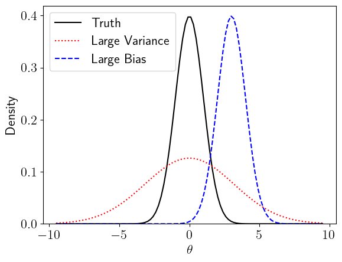
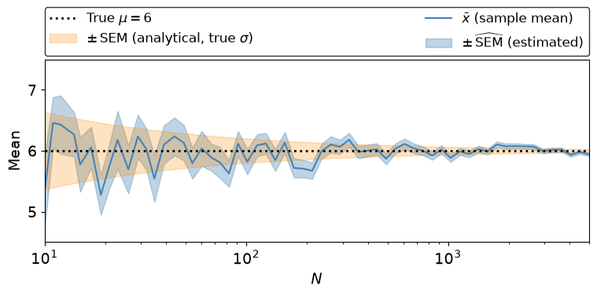
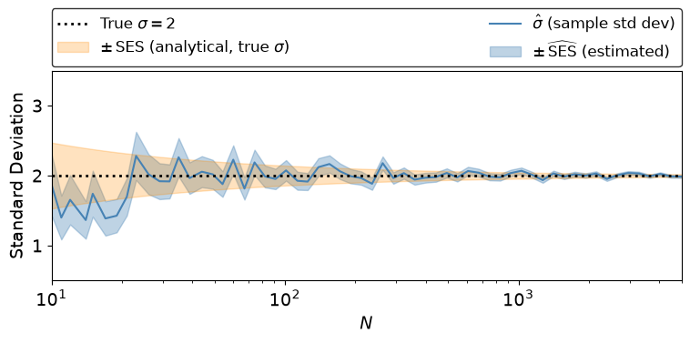
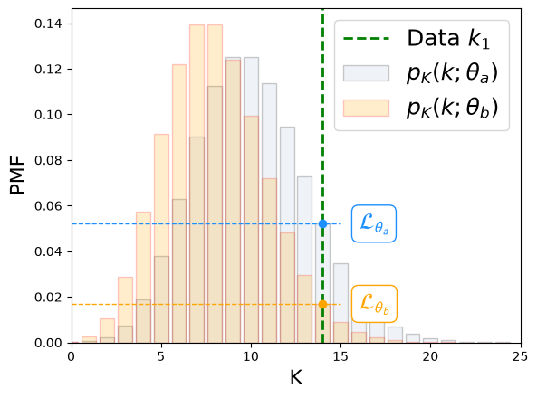
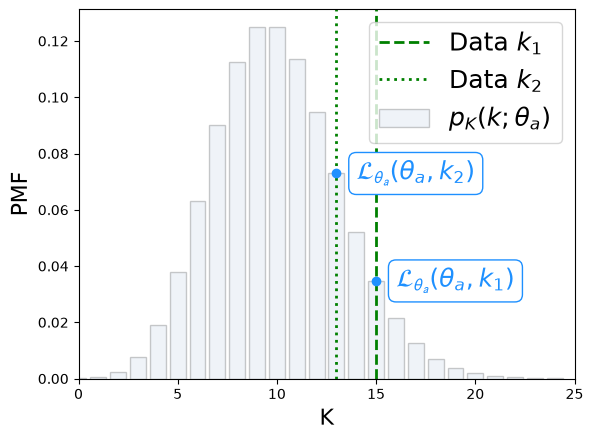
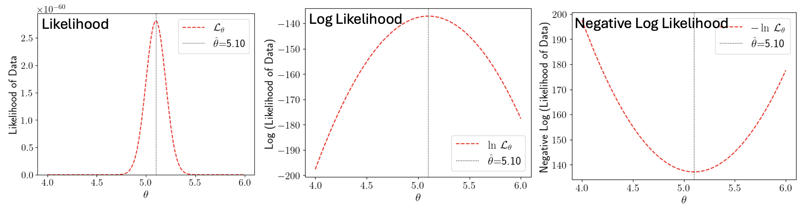

---
jupytext:
  formats: md:myst
  text_representation:
    extension: .md
    format_name: myst
kernelspec:
  name: python3
  display_name: 'Python 3'
---

(chapter:ei)=
# Estimators Intro


* `numpy` methods: `random.default_rng, argmin, allclose`
* `scipy.stats` methods: `bootstrap`


<!--Week7-Tools/Tools.tex-->
<!--Week8-Tools/MaxLike.tex-->
<!--Week9-Fits-Tests/LeastSquares.tex-->

<!--
Describe Point and Interval Estimation with examples
Explain the Bootstrap Method
Implement the Bootstrap Method to esimate uncertainties
Define Consistency, Bias, and Minimum Variance and explain their importance for estimators
-->
We have considered **Estimates** a couple of times, most recently in [](#sec:normt_semsec), where we noted that the sample standard deviation, $\sigma_x$, is a good estimate for the true standard deviation.

In every day life, when we say "estimate" we mean "educated guess". In statistics the meaning is the same, but we have a very clear framework for how to go about making the educated guess. An Estimator should be **Consistent**, **Unbiased**, and **Minimum Variance**. We combine the **Bias** and **Variance** of an estimator into a single metric, the **Mean Squared Error**.

Consistency
: The Estimator for a parameter, $\hat{\theta}$, should approach the true value of the parameter, $\theta$, in the limit of infinite sample size $N$.

  $$\label{eq:ei_estcon} \hat{\theta} \rightarrow \theta\;\; as \;\; N\rightarrow \infty$$

Bias
: The **Bias** $b$ of an estimator is the difference between the estimate and the true parameter. This should be small, preferably zero.

  $$\label{eq:ei_estbias}b = E[\hat{\theta}] - \theta$$

Variance
: The variance of an estimator, $V[\hat{\theta}]$, tells us how "spread out" the estimated values are. We want the estimator to be **precise**. This means we want the variance to be as small as possible. We calculate the variance in the [usual way](#eq:dd_truvar), using the expectation.

  $$\label{eq:ei_estvar}V[\hat{\theta}] = E[\hat{\theta}^2] - E^2[\hat{\theta}] \equiv E[ (\hat{\theta}-E[\hat{\theta}])^2 ]$$  

Mean Squared Error (MSE)
: The **MSE** combines Bias and Variance into a single measure of estimator quality:

  ```{math}
  :label: eq:mse
  \text{MSE}[\hat{\theta}] = E\!\left[(\hat{\theta} - \theta)^2\right] = V[\hat{\theta}] + b^2
  ```

  An ideal estimator has zero bias ($b=0$) and small variance. The MSE makes clear that there is a balance between these two goals: a slightly biased estimator may have a lower MSE than an unbiased one if its variance is much smaller. This is known as the **bias–variance tradeoff**.

:::{figure} 
:label: fig:ei_biasvar


A biased estimator is innaccurate. A large-variance estimator is imprecise.
:::

Estimating a parameter of a true distribution using data is known as **Point Estimation** because we are estimating a single value: a point. Providing a range of values in which we have some confidence is **Interval Estimation**; for example a Confidence Interval represents a range of values in which we expect some proportion of repeated experiments to fall. The proportion is the Confidence Level ([CL](#eq:hyp_cl)), and can be quoted as a percentage eg $95\%$, or in terms of standard deviations eg $1\sigma$[^sigmaCL].

[^sigmaCL]: The CL expressed as a percentage is $1-\alpha$, where $\alpha$ is the **Significance Level** (SL). There is clearly a redundancy between the terms CL and SL. When someone says their CL is $n\sigma$, they have also told you what the significance level is, but it is not $1-n\sigma$ because the $n\sigma$ is relative to the distribution, not to the number 1.

---

(sec:ei_meanest)=
## The Sample Mean as an Estimator for the True Mean

The Sample Mean $\overline{x}$ is an Estimator for the True Mean $\mu$.

```{math}
:label: eq:muhat
\hat{\mu} = \overline{x}
```

The "hat" notation $\hat{\mu}$ tells us "this is an estimator".

Consistency Check
: Does $\hat{\mu} \rightarrow \mu\; as \; N\rightarrow \infty$?

The [Law of Large Numbers](#eq:dd_lln) tells us that **the Sample Mean is a consistent estimator for the true mean**. LLN reminder: If every possible measurement of $x$ is included in the calculation of $\overline{x}$, the probability of there being any measurable difference between $\overline{x}$ and $\mu$ is zero.

Bias Check
: What is the bias $b = E[\hat{\mu}] - \mu$?


Let's calculate the expectation of the sample mean:

```{math}
:label: eq:expmean

\begin{aligned}

E\left[\, \overline{x}\, \right]  & = E\left[ \dfrac{1}{N} \sum\limits_i^N x_i \right] \textcolor{blue}{\mathsf{\; because\; \overline{x}  = \frac{1}{N} \sum \limits_i^N x_i}}\\ 
 
  & = \dfrac{1}{N} \sum\limits_i^N E\left[ x_i \right] \textcolor{blue}{\mathsf{\;because\; E[sum] = sum(E)}} \\
 & = \dfrac{1}{N} \sum\limits_i^N E[X] \textcolor{blue}{\mathsf{\;because\; x_i\;are\; iid\; so\; E[x_i] = E[X]\; for\; all\; x_i}}\\
  & = \dfrac{1}{N} N E[X]= E[X] \\                                                
\end{aligned}
```

We have shown that $E\left[\, \overline{x}\, \right] = E[X]$, which with the notation $\mu \equiv E[X]$ and for this choice of estimator $\hat{\mu} =\overline{x}$, shows that **the Sample Mean is an unbiased estimator for the True Mean**.

Variance Check
: Is the sample mean the minimum variance estimate for the true mean? Proving that an estimator is the minimum variance of all possible estimators is briefly touched upon later in these notes [](#sec:mle_mvb), but we will look briefly at the variance of $\overline{x}$ now because it gives us the [SEM](#eq:normt_sem), and I will state without proof that $\overline{x}$ is the Minimum Variance Unbiased Estimator [MVUE](https://en.wikipedia.org/wiki/Rao%E2%80%93Blackwell_theorem) for $\mu$. 

Let's calculate the variance of the sample mean[^notevn]:

```{math}
:label: eq:varmean

\begin{aligned}
V\left[\, \overline{x}\, \right]  & = V\left[ \dfrac{1}{N} \sum\limits_i^N x_i \right] \textcolor{blue}{\; \mathsf{ because\; \overline{x}  = \frac{1}{N} \sum \limits_i^N x_i}}\\ 
 &= \sum\limits_i^N  V\left[ \dfrac{1}{N}  x_i \right] \textcolor{blue}{\mathsf{\;because\; V[sum] = sum(V)\; for\; IID\; x_i}}\\
  & = \dfrac{1}{N^2}  \sum\limits_i^N V\left[ x_i \right] \textcolor{blue}{\mathsf{\;because\;V\left[ax\right] = a^2 V\left[x\right] }}\\
  & = \dfrac{1}{N^2} N V[X]  \textcolor{blue}{\mathsf{\;because\; x_i\; \text{are iid, so}\; V[x_i]=V[X]\; \text{for all}\; i}}\\
  & = \dfrac{1}{N} V[X] \\                                               
\end{aligned}
```

[^notevn]: Equivalent choices of notation for the variance on the mean: $v_{\overline{x}} \equiv V[\overline{x}]$


The variance of the sample means is $\dfrac{1}{N}$ times the true variance, $V[X]$. This gives us the standard deviation of the sample means, referred to as the SEM, because $\sigma = \sqrt{V}$.

Equivalent Notation
: $V[\overline{x}] \equiv v_{\overline{x}} \equiv \sigma^2_{\overline{x}} \equiv \mathsf{SEM}^2\;\;\leftarrow\;\;$ Variance on the mean 

  $V[X] \equiv \sigma^2_{\mathsf{true}} \equiv \sigma^2\;\;\leftarrow\;\;$ True variance


We have shown that
: $V[ \overline{x} ] = \dfrac{1}{N} V[X]$ 

  $\sigma^2_{\overline{x}} = \dfrac{1}{N} \sigma^2_{\mathsf{true}}\;\;\leftarrow\;\;$ Equivalent Notation

Therefore the SEM is
: $\mathsf{SEM} = \sigma_{\overline{x}} = \dfrac{\sigma_{\mathsf{true}}}{\sqrt{N}}$

The Estimated SEM is
: $\widehat{\mathsf{SEM} } = \hat{\sigma}_{\overline{x}} = \dfrac{\sigma_{x}}{\sqrt{N}}$


````{card}
For a single RV, we can **Estimate** the mean and its uncertainty directly from the data.

Using $\hat{\mu} = \overline{x}$ and $\hat{\sigma}_{\mu} = \sigma_{\overline{x}} $:

```{math}
:label: eq:ei_meanunc

\hat{\mu} \pm \hat{\sigma}_{\mu}  = \overline{x} \pm \mathsf{SEM} = \overline{x} \pm \dfrac{ \sigma_{\mathsf{true}} }{ \sqrt{N} }
```

Additionally using $\hat{\sigma}_{\mathsf{true}} = \sigma_{x}$:

```{math}
:label: eq:ei_meanuncest

\hat{\mu} \pm \hat{\sigma}_{\mu} = \overline{x} \pm \widehat{\mathsf{SEM}} = \overline{x} \pm \dfrac{ \sigma_{x} }{ \sqrt{N} }
```


````

A plot illustrating the reduction of the $\mathsf{SEM}$ and $\widehat{\mathsf{SEM}}$ as the number of measurements N increases is shown in [](#fig:ei_semvn).

:::{figure}
:label: fig:ei_semvn



The SEM versus the number of measurements.
:::

---

(sec:ei_varest)=
## The Sample Variance as an Estimator for the True Variance

The Sample Variance $v_x$ is an Estimator for the True Variance $V[X]$. We will use the following general notation to avoid bamboozling statements such as "the variance of the variance estimator" in what follows:

$\theta \equiv V[X]$: the true variance.

$\hat{\theta}_u \equiv \hat{V}[X]$: the [unbiased variance](#eq:tandc_varu) estimator.

$\hat{\theta}_b \equiv \hat{V}[X]$: the [biased variance](#eq:tandc_var) estimator.


The Expectation and Bias for the two choices of variance estimator are given in [](#tab:ei_varest).

[^proofa]: Proofs are given in [Math Methods B: Bias of the Sample Variance](#sec:mmb_varbias).

:::{table} The Expectation and Bias for the unbiased and biased variance estimators
:align: center
:label: tab:ei_varest
| Variance Estimator $\hat{\theta}$ | Expectation[^proofa]  | Bias $b = E[\hat{\theta}] - \theta$ |
|---|---|---|
| $\hat{\theta}_u = \dfrac{1}{N-1} \sum\limits_i^N (x_i - \bar{x})^2$   | $E[\hat{\theta}_u] = \theta$  | $b=0$ | 
| $\hat{\theta}_b = \dfrac{1}{N} \sum\limits_i^N (x_i - \bar{x})^2$   |  $E[\hat{\theta}_b] =\dfrac{N-1}{N} \theta$  | $b = -\dfrac{\theta}{N}$ | 
:::


Consistency Check
: Does $\hat{\theta} \rightarrow \theta\; as \; N\rightarrow \infty$?

  In the biased variance case, we can see that in the **Asymptotic Limit** ($N\to\infty$), $ \dfrac{N-1}{N} \to 1$, so this estimator is consistent.

  In the unbiased variance case, we found $E[\hat{\theta}_u] = \theta$, so this estimator is consistent.


Bias Check
: From [](#tab:ei_varest), we see that the biased variance estimator is biased and the unbiased variance estimator is unbiased!

:::{note}
Bias is not the only thing that matters. Sometimes, the Best Estimator is not the zero bias estimator.
:::

It makes sense that the biased variance estimator $\hat{\theta}$ is smaller than the true variance $\theta$, because in our Estimator we have used a finite number of measurements, which will be clustered around the sample mean $\overline{x}$. The True Variance uses **all possible measurements**. Given that these will include all of the measurements used for the sample variance plus a great deal more, it makes sense that the True Variance is larger than the sample variance. The larger we make $N$, the closer the Estimator gets to the True Variance.

:::{tip}
I acknowledge that thinking about the "variance on the variance" can cause issues in terms of making new neural connections[^neurons] in the old wheelbox[^wot]. The approach that works for me is to think of the variance as a parameter of the distribution; some number. All numbers have some uncertainty.
:::

[^neurons]: Learning new things means that neurons in our brains have formed new and lasting connections with other neurons.

[^wot]: The "old wheelbox" is a colloquialism; this is the affectionate yet somewhat frustrated way in which I refer to my brain, as a slightly dusty and creaky machine that nonetheless does what it I want it to most of the time.


Variance Check
: Calculating the variance on the sample variance (the square root of which gives us the Standard Error on the Variance, SEV) is not as straightforward as the [variance on the mean](#eq:varmean), especially in cases where the data are not normally distributed. I have included some notes on this below for those who are interested, but we will note that **for all practical purposes (fapp) we calculate the SEV** without the help of any analytical formulas, using eg the [**Bootstrap Method**](#sec:ei_res) introduced below.


(sec:ei_sev)=
### The Standard Error on the Variance (SEV)

Notation 
: $\theta \equiv V[X]$: the true variance.

  $\hat{\theta}_b \equiv \hat{V}[X] = \frac{1}{N} \sum\limits_i^N  (x_i - \overline{x})^2 $ is the biased variance estimator.

  $\hat{\theta}_u \equiv \hat{V}[X] = \frac{1}{N-1} \sum\limits_i^N  (x_i - \overline{x})^2 $ is the unbiased variance estimator.   


In the **special case** that the data are **Normally Distributed**, the Variances (along with the Biases and Mean Squared Errors) on the two choices of variance estimator are given in [](#tab:ei_varest_var).


:::{table} The Variance, Bias, and MSE for the biased and unbiased variance estimators with **Normal Data**
:align: center
:label: tab:ei_varest_var
| Variance Estimator  | $V[\hat{\theta}]$[^proof1] | Bias $b=E[\hat{\theta}] -\theta$ | $\mathsf{MSE} = V[\hat{\theta}] + b^2$ |
|---|---|---|---|
| $\hat{\theta}_u = \dfrac{1}{N-1} \sum\limits_i^N (x_i - \bar{x})^2$   | $V[\hat{\theta}_u] = \dfrac{2\theta^2}{N-1}$  | $b=0$| $\dfrac{2\theta^2}{N-1}$| 
| $\hat{\theta}_b = \dfrac{1}{N} \sum\limits_i^N (x_i - \bar{x})^2$  | $V[\hat{\theta}_b] = \dfrac{2(N-1)\theta^2}{N^2}$  |  $b=-\dfrac{\theta}{N}$ | $\dfrac{(2N-1)\theta^2}{N^2}$ |
:::


[^proof1]: The proofs are given in [Math Methods B: SEV for Normal Data](#sec:mmb_sevpro).

In the **general case**, with **no Normality assumption**, the variances on the two choices of variance estimator are written in terms of the **Kurtosis**, $\kappa$, described briefly in [MathMethodsB:Central Moments](#sec:mmb_cenmo). They are given in [](#tab:ei_varest_var_gen). 


:::{table} The Variance, Bias, and MSE for the biased and unbiased variance estimators. There is no requirement of Normal data for these forms - they are generally true.
:align: center
:label: tab:ei_varest_var_gen
| Variance Estimator | $V[\hat{\theta}]$[^proof2] | $\mathsf{MSE} = V[\hat{\theta}] + b^2$ |
|---|---|---|
| $\hat{\theta}_u$ | $V[\hat{\theta}_u] = \left(\kappa - \dfrac{N-3}{N-1}\right)\dfrac{\theta^2}{N}$ |  $\left(\kappa - \dfrac{N-3}{N-1}\right)\dfrac{\theta^2}{N}$ |
| $\hat{\theta}_b$ | $V[\hat{\theta}_b] = \dfrac{(N-1)^2}{N^2}V[\hat{\theta}_u]$ |  $\dfrac{(N-1)^2}{N^2}V[\hat{\theta}_u] + \dfrac{\theta^2}{N^2}$ |
:::


[^proof2]: The biased estimator result follows from $\hat{\theta}_b = \frac{N-1}{N}\hat{\theta}_u$, giving $V[\hat{\theta}_b] = \left(\frac{N-1}{N}\right)^2 V[\hat{\theta}_u]$. Setting $\kappa = 3$ (Normal distribution) recovers the results in [](#tab:ei_varest_var).


<!--For those with a mathematical bent, there is a somewhat accessible proof of [](#eq:sev-gen) on mathematics stack exchange [here](https://math.stackexchange.com/questions/72975/variance-of-sample-variance).-->

The **Standard Error on the Variance [SEV](#eq:ei_sev)** is the square root of the variance, which takes one of the four forms given in [](#tab:ei_varest_var) and [](#tab:ei_varest_var_gen).

$$\label{eq:ei_sev} \mathsf{SEV} = \sqrt{V[\hat{\theta}]}$$


````{card}
For a single RV, we can Estimate the variance and its uncertainty directly from the data:

```{math}
:label: eq:ei_varunc
\begin{aligned}
\hat{V}[X] \pm \hat{\sigma}_{V[X]} & = v_x \pm \sigma_{v_x} \\ \\
                                 & = v_x \pm \mathsf{SEV} \\                                
\end{aligned}
```

where the SEV is the Standard Error (uncertainty) on the Variance, and is most easily and efficiently calculated using e.g. the [**Bootstrap Method**](#sec:ei_res), as we shall see.

<!--We noted in [](#eq:vartruesamp) that the [sample variance](#eq:tandc_var) is a biased estimator for the true variance, hence the modified definition of [unbiased sample variance](#eq:tandc_varu). -->

Before deciding that the the unbiased variance is the better estimator, we need to consider overall quality metric, the Mean Squared Error, for the two choices.

````

A plot illustrating the reduction of the Standard Error on the Standard Deviation $\mathsf{SES}$ and $\widehat{\mathsf{SES}}$  (see [Math Methods B: SES](#sec:mmb_ses)) as the number of measurements N increases is shown in [](#fig:ei_sesvn).

:::{figure}
:label: fig:ei_sesvn



The SES versus the number of measurements.
:::


---

(sec:ei_bin)=
## What to do when Data are Binned?

Sometimes we do not have access to individual measurements. Instead, the data arrive already summarised in a **histogram**: we know the number of measurements $n_j$ falling in each bin, centred on bin centre $c_j$, for bins $j = 1, 2, \ldots, M$.

The total number of measurements is $N = \sum\limits_{j=1}^{M} n_j$.

We can still estimate the mean and variance by treating each count $n_j$ as $n_j$ measurements all equal to $c_j$ (see [](#eq:tandc_binmea)):

```{math}
:label: eq:binned-mean-est
\overline{x} = \dfrac{1}{N} \sum_{j=1}^{M} n_j\, c_j
```

The (unbiased) binned sample variance is:

```{math}
:label: eq:binned-var-est
v_x = \dfrac{1}{N-1}\sum\limits_{j=1}^{M} n_j\, (c_j - \overline{x})^2
```

The Estimated SEM formula is unchanged: $\widehat{\mathsf{SEM}} = \sqrt{ \dfrac{v_x}{N} }$.


:::{note}
These estimators treat each bin as if all its measurements were exactly at the bin centre. This introduces a small **binning bias**, which decreases as the bin width $\Delta x$ decreases.
:::

:::{tip}
A more powerful approach when working with histograms is to fit the parameters of a probability distribution directly to the histogram using the methods of [Maximum Likelihood](#chapter:mle) or [Least Squares](#chapter:lse).
:::


---

(sec:ei_genparest)=
## Parameter Estimation Generally


In the two examples above, we looked at using Summary Statistics ($\overline{x}$ and $v_x$) as Estimators for the parameters of the True Underlying Distribution ($\mu$ and $\sigma^2$).

For a single RV following a (e.g.) Normal distribution, the parameters of the true distribution can be accessed directly from the data in this way. We saw that in the case of $\hat{\mu}$ it is possible to extract the **Uncertainty on the Estimated Mean**, using the [SEM](#eq:normt_sem), and the **Uncertainty on the Estimated Variance** using the appropriate form for the [SEV](#eq:ei_sev).


The parameters of the true underlying distribution will not always be so easily accessible from the data, so it is helpful to explore general methods for parameter estimation. 

The parameter estimation methods we will explore are the methods of [Maximum Likelihood](#chapter:mle) and [Least Squares](#chapter:lse). Both methods compare the data with true distributions having different parameter values, and find the parameter values that minimize the differences between data and truth. This process of minimising the differences is known as **Fitting**, or **Regression**, thus both these terms mean **Parameter Estimation**.


Before we go further, we must define the **Likelihood**.

---

(sec:ei_like)=
## Likelihood

We calculate probabilities by drawing a sample from a given distribution with known parameter(s) $\theta$. We can clearly only do this if we know the form of the PMF $p_K$ or PDF $f_X$, and the value(s) of its parameter(s), $\theta$.

Discrete RV $K$: probability $K=k$ from PMF
: $P(K=k | \theta) = p_K(k; \theta)$

Continuous RV $X$: probability $X\leq x$ from CDF
: $P(X\leq x | \theta) = \int\limits_{x\in S} f_X(x;\theta) dx$


* We know the true parameter.
* We want the probability of finding the data with some value (or some range of values).

**We calculate the probability of measuring our data in a given range by relying on what the true distribution is telling us.**


If we are trying to estimate the unknown underlying true distribution parameter(s) using the data, we clearly cannot use the CDF. We need to turn it on its head:

* We know the data distribution.
* We want the probability of finding the true parameter with some value.

How to do this?

<!--
We could try turning around the PMF definition, letting the parameter $\theta$ be the RV, as this is the thing we seek to measure, and using the data as the conditional:

$P(\theta=\theta_a | k) = p_\theta(\theta_a; k)$
-->

(sec:ei_toy_single)=
### Toy Example: Single data point

Let's consider a single measurement, $k_1$, and two different PMFs having the same form but different parameter values. One has $\theta=\theta_a$ and the other has $\theta=\theta_b$, illustrated in [](#fig:ei_toyl1).


:::{figure}
:label: fig:ei_toyl1


Two PMFs are plotted with different parameter values $\theta_a$ and $\theta_b$. A single data measurement is shown as a green dashed vertical line. The values of each PMF at that point are the likelihoods of the data point under the two different assumptions: $\mathcal{L_{\theta_a}} (\theta_a; k_1)$ and $\mathcal{L_{\theta_b}} (\theta_b; k_1)$.
:::

Based on this data point $k_1$ alone, I would infer that $\theta_a$ is the better parameter estimate, ie that $\theta_a$ is **more likely** to be the true parameter of the data than $\theta_b$.

I will define the **Likelihood** of the data being described by $\theta_a$:

$\mathcal{L_{\theta}}(\theta_a; k_1) = p_K(k_1; \theta_a)$

The Likelihood of true parameter $\theta_a$, given the single-valued data point $k_1$ is equal to the probability of measuring $k_1$, given the single-valued true parameter is $\theta_a$.

Ine the example shown in [](#fig:ei_toyl1) I find $\mathcal{L_{\theta}}(\theta_a; k_1) > \mathcal{L_{\theta}}(\theta_b; k_1)$, and therefore conclude that $\theta_a$ is the most likely of the two parameter values I considered.

This is a toy version of the **Maximum Likelihood Method** for parameter estimation. The "toy" aspect arises from an important issue with the above example: we only used one data point. **We are very unlikely to successfully estimate a parameter using a single data point!**. The uncertainty on such an estimate would be so large as to make the estimate useless.

(sec:ei_toy_two)=
### Toy Example: Two data points

Let's consider two data points, and just consider a single parameter value, $\theta_a$. This is the parameter value for which we are going to calculate the Likelihood of the data.

:::{figure}
:label: fig:ei_toyl2


A single PMF is plotted with parameter value $\theta_a$. Two data measurements are shown as green dashed vertical lines. The values of the PMF at each point are the likelihoods of the data points under the assumptions that the parameter is $\theta_a$.
:::


Now we have:

$\mathcal{L_{\theta}}(\theta_a; k_1) = p_K(k_1; \theta_a)$

$\mathcal{L_{\theta}}(\theta_a; k_2) = p_K(k_2; \theta_a)$

The question now is: "What is the Likelihood that the data points are described by a true distribution with the parameter value $\theta_a$, given **both** data measurements $k_1$ and $k_2$?"

Noting that the two measurements are IID, we can use the [Multiplication Rule](#sec:pe_mulrul) to write the **Joint Probability** of these two measurements as a product [](#eq:multrule-twodata):

```{math}
:label: eq:multrule-twodata
\mathcal{L_{\theta}}(\theta_a; k_1, k_2) = p_K(k_1; \theta_a)\, p_K(k_2; \theta_a)
```

This is nice because it allows us to extrapolate to the entire dataset $k$ of $N$ measurements $k_1, k_2, ..., k_N$:

```{math}
:label: eq:multrule-alldata
\mathcal{L_{\theta}}(\theta_a; k) = \prod_{i}^{N} p_K(k_i; \theta_a) 
```

If the RV in question is continuous, exactly the same definition holds, with the PMFs (probabilities) replaced by PDFs (densities): The Likelihood of the data $\mathcal{L_{\theta}}$ is the product of the densities $f_X$.

```{math}
:label: eq:multrule-alldata-cont
\mathcal{L_{\theta}}(\theta_a; x) = \prod_{i}^{N} f_X(x_i; \theta_a) 
```

(sec:ei_likenot)=
### Likelihood is not a Probability


**The Likelihood of the data $\mathcal{L_{\theta}}$** having an underlying probability distribution with true parameter $\theta_a$ **is the product of the probabilities $p_K$** evaluated at each data point, where the PMF $p_K$ has parameter $\theta_a$.


We can use the Likelihood to make a statement about the probability of a given estimate $\theta_a$. The denominator is a normalising constant: the sum (or integral) of the Likelihood over **all possible parameter values** $\theta_j$, so that the result is a valid probability. (This is equivalent to a Bayesian posterior under a **uniform prior** over all candidate parameter values: the prior probability $P(\theta_j)$ is constant for all $j$, so it cancels from numerator and denominator.)

If the parameter $\theta$ can only take a finite or countable set of values (a **discrete parameter space**):

$P(\theta_a | \text{data}) = \dfrac{ \mathcal{L}_\theta(\text{data}\,|\,\theta_a) }{ \sum\limits_j \mathcal{L}_\theta(\text{data}\,|\,\theta_j) }$

If the parameter $\theta$ is continuous (a **continuous parameter space**):

$P(\theta_a | \text{data}) = \dfrac{ \mathcal{L}_\theta(\text{data}\,|\,\theta_a) }{ \int \mathcal{L}_\theta(\text{data}\,|\,\theta_j)\, d\theta }$

Note that the sum/integral is over **parameter values** $\theta_j$, not over values of the random variable. For example, in the Poisson case the RV $K$ is discrete, but the rate parameter $\theta$ is continuous — so we integrate over $\theta$.

The probability that this parameter value (given the data) is the best parameter estimate is equal to the Likelihood of the data for this parameter divided by the Total Likelihood for all possible parameter values (given the same data).

(sec:ei_nll)=
### Negative Log Likelihood 

We noted in lectures that Logs are essential for computing likelihoods. Probabilities are confined to values in [0,1], and Likelihoods are products of $N$ probabilities (or densities, in the case of continuous RVs), where $N$ is our sample size.

The example I gave in the week 4 lectures was for $N=1000$ measurements, all with probability $p=0.5$ for simplicity.

$\prod\limits_i^N p_i = 0.5^{1000} \approx 9.33\times10^{-302}$

We noted that this is quite close to the smallest number a computer can compute.

```{code-cell} python
import sys
print(f"The smallest number my computer can compute = {sys.float_info.min}")
```

Given that we like large datasets and want to calculate Likelihoods (to estimate unknown parameters), we have a problem. But, it is okay, because we have [Logarithms](#sec:mma_logs).

Log Rules
: Power rule: $$\label{eq:ei_logpow} \log(a^b) = b\log(a)$$

  Quotient rule: $$\label{eq:ei_logquo} \log\left(\dfrac{a}{b}\right) = \log(a) - \log(b)$$

  Product rule: $$\label{eq:ei_logpro}\log(ab) = \log(a) + \log(b)$$

I have used just two values $a$ and $b$ in the examples above, but there is no limit to the number of values in e.g. the product:

```{math}
:label: eq:logprod
\log(\prod\limits_i^N a_i) = \sum\limits_i^N \log(a_i)

```

For our example above we have:

$\log(\prod\limits_i^N p_i) = \log( 0.5^{1000}) = 1000\times\log(0.5) \approx -693$

This is a much more manageable number, and **we have lost no information** in taking the log. 

The most useful base for the logarithm is $e$: Euler's number, which is called the **Natural Logarithm** and has its own symbol, $\ln$. Because the base is $e$, the power rule gives us: $\ln(e^a) = a$, which is very useful.

:::{tip}
The default assumed by `numpy` is that when we ask for `log(a)` we want the **Natural Logarithm**, $\ln{a}$. If we want a log with base 10, we must use `log10(a)`.
:::

Notice that the log of any number in the range (0,1) is **Negative**, so the Log Likelihood is destined to always be a negative number. This is fine of course, negative numbers being perfectly valid, but the tradition in statistics is to **Minimise** functions rather than **Maximise** them, so we more often quote the Negative Log Likelihood, which has a postive value and has a minimum at the most likely parameter value.

:::{card}

In summary, we calculate the **Negative Log Likelihood (NLL)** because it is numerically manageable for our computer and it is always a positive value, so we can use lots of nice `scipy` tools to `minimise` it and find the most likely parameter values, given some data.


```{math}
:label: eq:negloglike
\mathsf{NLL} = - \ln{\mathcal{L_{\theta}}}
```

:::


The Likelihood, Log Likelihood, and Negative Log Likelihood for some data are shown in [](#fig:ei_likelogneg). The maxima of the Likelihood and Log Likelihood distributions and the minimum of the Negative Log Likelihood are found at the most likely parameter value parameter value. This value is the **Maximum Likelihood Estimate** for the parameter: $\hat{\theta}_{_{\mathsf{MLE}}}$


There is a turning point in the distributions at the maximum, which means the derivative is zero at this point. This is how we calculate the MLE, by setting the derivative of the Likelihood to zero and solving for the parameter.

:::{figure} 
:label: fig:ei_likelogneg


The maxima of the Likelihood and Log Likelihood distributions and the minimum of the NLL are found at the most likely parameter value parameter value. This value is the Maximum Likelihood Estimate for the parameter.
:::

````{card}
We can calculate the MLE "by hand" by taking the derivative of the (Log) Likelihood with respect to the parameter we are estimating, setting it to zero, and solving for the parameter. We will practice doing this in [](#chapter:pmf) and [](#chapter:pdf).

```{math}
\dfrac{d}{d\theta} \mathcal{L}_{\theta} = 0\;\; \mathsf{at}\;\; \theta=\hat{\theta}_{_{\mathsf{MLE}}}

```

````


(sec:ei_nllpy)=
### Python Example

The code below reproduces plots like [](#fig:ei_likelogneg) for Gaussian data: $X\sim$ Norm($\mu, \sigma$). In this example we hold $\sigma$ constant and calculate the Likelihoods:

$L_{\mu}(\mu; x) = \prod \limits_i^N f_X(x_i)$ 

 with many different trial values for $\mu$. The product is over the $N$ data measurements $x_i$.

 The Log Likelihoods are:

$\ln L_{\mu}(\mu; x) = \ln \prod \limits_i^N f_X(x_i) = \sum\limits_i^N \ln f_X(x_i)$ 


The trial value with the Maximum Likelihood (Minimum NLL) is the Maximum Likelihood Estimate (MLE) for $\mu$. We can specify that this is the MLE with the notation $\hat{\mu}_{_{\mathsf{MLE}}}$, but very often you will just see the shorthand $\hat{\mu}$.


In this example, we use `mu_mle = mu_trial[np.argmin(nll_vals)]`. The `argmin` function returns the index of the smallest value in `nll_vals` -- see [numpy.argmin](https://numpy.org/doc/2.5/reference/generated/numpy.argmin.html).


For smooth likelihood functions, using `argmin` is equivalent to taking the derivative of the NLL with respect to $\theta$, setting it to zero, and solving for $\theta$. This gives the Maximum Likelihood Estimate $\hat{\theta}_{_{\mathsf{MLE}}}$.


```{math}
\argmin_{\theta}{( - \ln \mathcal{L}_{\theta} )} = \hat{\theta}_{_{\mathsf{MLE}}}
```


```{code-cell} python

def like_loglike_nll(mu_true, sigma, N, reproducible=True):

  import numpy as np
  import matplotlib.pyplot as plt
  from scipy.stats import norm

  # Range of trial mu values for the x-axis
  mu_trial = np.linspace(mu_true-sigma, mu_true+sigma, 100)

  # Generate fake data from a Gaussian (fixed seed for reproducibility) 
  if(reproducible):
    data = norm.rvs(loc=mu_true, scale=sigma, size=N, random_state=42)
  else:
    data = norm.rvs(loc=mu_true, scale=sigma, size=N)

  # --- Likelihood functions ---

  # Likelihood: product of the PDF evaluated at each data point.
  # For large N, np.prod() of many small PDF values underflows to 0.
  # This is why we use the log likelihood instead.
  def likelihood(data, mu):
      return np.prod(norm.pdf(data, mu, sigma))

  # Log likelihood: sum of log PDF values — avoids numerical underflow.
  # Equivalent to np.log(np.prod(...)), but numerically stable.
  def log_likelihood(data, mu):
      return np.sum(np.log(norm.pdf(data, mu, sigma)))

  # Evaluate over all trial mu values
  L_vals   = [likelihood(data, mu) for mu in mu_trial]
  lnL_vals = [log_likelihood(data, mu) for mu in mu_trial]
  nll_vals = [-lnL for lnL in lnL_vals]   # negative log likelihood

  # MLE: the trial mu that minimises the NLL (maximises the likelihood)
  mu_mle = mu_trial[np.argmin(nll_vals)]

  print(f"MLE estimate : mu = {mu_mle:.2f}  (true value: mu = {mu_true})")

  # --- Plotting ---
  plots = [
      (L_vals,   r'$\mathcal{L}(\mu)$',       "Likelihood"),
      (lnL_vals, r'$\ln\,\mathcal{L}(\mu)$',  "Log likelihood"),
      (nll_vals, r'$-\ln\,\mathcal{L}(\mu)$', "Negative log likelihood"),
  ]

  mle_label = r'$\hat{\mu}$' + f' = {mu_mle:.2f}'

  fig, axes = plt.subplots(1, 3, figsize=(14, 4))
  for ax, (values, curve_label, ylabel) in zip(axes, plots):
      ax.plot(mu_trial, values, 'r--', label=curve_label)
      ax.axvline(mu_mle, color='black', linestyle=':', linewidth=1, label=mle_label)
      ax.set_xlabel(r'Trial value of $\mu$', fontsize=14)
      ax.set_ylabel(ylabel, fontsize=14)
      ax.legend(loc='best', fontsize=12)
  plt.tight_layout()
  plt.show()

# call the function

# --- Parameters ---
mu_true = 5    # true mean
sigma   = 1    # true standard deviation (held fixed throughout)
N       = 100  # number of data points

like_loglike_nll(mu_true, sigma, N)

```
<!--
Exercises:
1. Show yourself that `np.argmin(nll_vals)` returns the same trial parameter index as `np.argmax(lnL_vals)`
2. What happens if you increase or decrease the number of measurements, $N$?
-->

:::{warning}

Simply quoting the MLE, e.g. $\hat{\mu}_{_{\mathsf{MLE}}} = 4.89$, without an uncertainty is not helpful!

Consider the exercise above; you could estimate the MLE using $N=10$ or using $N=1000$, and would (very likely!) get different estimates, with different uncertainties.

We must always give the uncertainty on our estimates, e.g. $\hat{\mu}_{_{\mathsf{MLE}}} = 4.89 \pm 1.10$. We will look at one nice way of estimating the MLE uncertainty in [](#sec:ei_res).
:::

---

(sec:ei_intest)=
## Interval Estimation

A **Confidence Interval** is an estimated range of values such that we expect CL% of repeated experiments to yield a value within that range. CL is the Confidence Level, for example 95% CL means that in 95% of repeated experiments, we expect the value to fall in the Confidence Interval. The Confidence Interval is a Frequentist construct. Like all frequentist statistics, it tells us nothing about a single experiment.

A **Credible Interval** is, in my opinion, a much more intuitive interval. It represents the most probable range of outcomes for a given single experiment. The Credible Interval is a Bayesian construct. It uses Prior Knowledge to allow us to estimate the range of probable outcomes for a single experiments.

:::{note}
People such as myself (particle physicists or similarly dorky types) might get home from work to find the oven on, and declare "I am 3 sigma confident that I did not leave the oven on". Because **Confidence Levels are frequentist**, this should be interpreted as "In 741 days, with conditions identical to today, where I came home to find the oven on, only 1 of these occasions would be my fault." Of course this is not actually what I mean when I say that. I mean I am 99.73% sure I did not leave the oven on **this morning**. So I should really say "I did not leave the oven on- 3 sigma credible interval" (the Bayesian interval). 
:::

We have seen [](#sec:hyp_critreg) that the size of the confidence interval is set using a predefined significance level $\alpha$, for example $\alpha=5\%$ gives us a 95% CL, and the confidence interval represents the central 95% of a normal distribution centered on the estimated mean $\hat{\mu} = \overline{x}$. The 95% CL can also be expressed as $\pm 1.96\sigma$, which means the same thing. Note that the Confidence Interval is predefined - it does not rely on the measured p value and Z value from the data.

We have also seen that the uncertainty on the estimated mean reduces with the number of measurements used [](#sec:normt_sem).

Sometimes, we will find that we have an estimate for the mean and cannot use the SEM for the uncertainty, because our data are not normally distributed. Other times, we will be estimating some parameter other than the mean, and it is not clear how to quantify the uncertainty from our data. 

Given that measurements without quoted uncertainties are meaningless, we must estimate the uncertainty. The [**Bootstrap Method**](#sec:ei_res) is an excellent way of doing this.

---

(sec:ei_res)=
## The Bootstrap Method

The Bootstrap Method is a **Nonparametric Resampling** method - random values are pulled from an existing dataset ("Resamples") without any required knowledge of the true underlying parameters ("Nonparametric").

An example of using the Bootstrap method is as follows (assume a starting dataset size of $N_d =100$, and an ideal dataset size of $N_r = 10,000$):

1. Randomly select a value from the data. 
2. Do this 100 times, allowing yourself to select the same measurement more than once[^imp].
3. Calculate the statistic of interest from the 100 measurements you randomly selected. 
4. Repeat the above three steps 9999 times.

[^imp]: It is crucial that selected measurement are not removed from the dataset once they have been selected. If we removed them we would simply end up with the 100 data points we had in the original dataset!

The point of this process is not to recalculate the statistic - you have already calculated that from the original dataset. The point is to estimate the statistical uncertainty on that measured value. The larger dataset allows for a smaller Estimator Variance: a **more precise estimate of the statistical uncertainty**.

(sec:ei_bootstep)=
### Bootstrap Example: step-by-step

Let's generate some data using a seed such that every time we execute this function we get the same result [Seeding breaks randomness!](#sec:ei_seed).


```{code-cell} python

def generate_data(mu=6.0, sigma=3.77, N=100, seed=None):

  if(seed):
    print(f"\nYou have set a seed: {seed}, so will get the same dataset(s) every time you run this function")

  # make a local instance of numpy's default pseudorandom number generator
  import numpy as np
  rng = np.random.default_rng(seed)

  # generate some fake data, normally distributed using arbitrary parameter choices
  from scipy.stats import norm
  data = norm.rvs(loc=mu, scale=sigma, size=N, random_state=rng)

  return data

# call the function

data = generate_data(seed=42)

```

Now we have a fake dataset of 100 measurements, we can find $\overline{x}$ and $\sigma_x$ of the dataset using the usual `numpy` methods, but what is the **uncertainty** on $\sigma_x$? We could calculate this using the appropriate [SEV](#eq:ei_sev) formula, but we can't use that approach if we don't know anything about the data's true underlying distribution, or if it doesn't have a simple true underlying distribution.

**Let's bootstrap!**


```{code-cell} python


def LongBootstrap(data, seed=None):
  
  import numpy as np
  rng = np.random.default_rng(seed)

  # Our statistic of interest is the standard deviation
  print( f"sample sigma: {np.std(data):.3f}")

  # Make an empty container to put our bootstrap stats in
  sigmas=[]

  # loop over the number of boostraps we want
  for i in range(9999):

    # Draw 100 random measurements from our dataset 
    # Important! values can be drawn more than once because we have replace=True. 
    # If we don't use replace=True, we will just get the original dataset back!
    
    rdata = rng.choice(data,replace=True, size=100)

    # Get the standard deviation of _this set_ of 100 measurements
    rsigma = np.std(rdata)

    # Put the standard deviation in the container
    sigmas.append(rsigma)

    # now to the next of the 9999 iterations in the loop

  # end of loop, print the estimated statistic with its uncertainty
  print( f"by-hand bootstrap estimate for sigma: {np.mean(sigmas):.3f} +/- {np.std(sigmas):.3f} ")

  lower_bound = np.mean(sigmas)-np.std(sigmas)
  upper_bound = np.mean(sigmas)+np.std(sigmas)
  print( f"Confidence Interval: ({lower_bound:.3f}, {upper_bound:.3f}) ")

  return sigmas


# call the bootstrap function on the fake data we generated above

byhand_sigmas = LongBootstrap(data,seed=111)

```

The uncertainty found by the boostrap method provides a Confidence Interval. I set the seed, so the result I am reading in my browser will be the same one you see in these notes. The "one sigma" **Confidence Interval** in this case is:

$2.703 \leq \sigma_{\mathsf{true}} \leq 3.085\;\;$ (68.27% CL).


The 68.27% CL corresponds to the $\pm 1\sigma$ region we calculated using bootstrap method, which involves random sampling, so will give a slightly different interval each time we run it (unless we set the seed). The interpretation of this interval is a little fiddly (as with all things frequentist): 

:::{card}
If we repeat the above boostrap process (unseeded!) a large number of times, the computed interval would contain $\sigma_{\mathsf{true}}$ 68.27% of the time. 
:::


(sec:ei_bootsp)=
### Bootstrap Example: `scipy`

The "by hand" example above was an unneccessary "re-invention of the wheel", as `scipy.stats` provides a `boostrap` method [scipy.stats.bootstrap](https://docs.scipy.org/doc/scipy/reference/generated/scipy.stats.bootstrap.html). It is helpful to illustrate what the bootstrap method actually does. Let's use the `scipy` method for the same job:

```{code-cell} python

def ScipyBootstrap(data, seed=None):

  import numpy as np
  rng = np.random.default_rng(seed)

  # thanks scipy!
  from scipy.stats import bootstrap

  # first argument is data
  # second is the statistic of interest
  # optional rng parameter is for reproducibility
  # optional confidence_level parameter sets the CL

  # we would like a 1sigma CL, convert this to % to pass to bootstrap
  from scipy.stats import norm
  CL = norm.cdf(1) - norm.cdf(-1)

  sbs = bootstrap( (data,), np.std, rng=rng, confidence_level=CL )

  # extract the mean from the bootstrap_distribution
  sp_mean = np.mean(sbs.bootstrap_distribution)
  
  # extract the SEM directly
  sp_ser = sbs.standard_error

  # extract the confidence interval directly
  sp_ci_lo, sp_ci_hi = sbs.confidence_interval

  print( f"scipy bootstrap estimate for sigma: {sp_mean:.3f} +/- {sp_ser:.3f}")

  print( f"1sigma ({100*CL}%) Confidence Interval: ({sp_ci_lo:.3f}, {sp_ci_hi:.3f}) ")

  return sbs.bootstrap_distribution

# call our by-hand function again as a reminder
byhand_sigmas = LongBootstrap(data,seed=111)
# call the scipy version
scipy_sigmas = ScipyBootstrap(data)
```

Note that the `ScipyBootstrap` finds a noticeably different Confidence Interval from the `LongBootstrap` - I leave the reasons for this for you to explore in the workshop.


(sec:ei_paramboot)=
### Parametric Bootstrap Example

If we know the underlying distribution (eg Norm in this case), we may wish to do a **Parametric Bootstrap** using the parameters estimated from the data.

```{code-cell} python

def ParaBootstrap(data, seed=None):

  import numpy as np
  from scipy.stats import norm

  rng = np.random.default_rng(seed)

  psigmas=[]
  for i in range(9999):
    
    respin_data = norm.rvs(loc=np.mean(data), scale=np.std(data,ddof=1), size=100, random_state=rng)

    psigmas.append( np.std(respin_data) )

  print( f"parametric bootstrap estimate for sigma: {np.mean(psigmas):.3f} +/- {np.std(psigmas):.3f} ") 

  return psigmas

# call the function

parametric_sigmas =ParaBootstrap(data)
```

Note that we are assuming the parameters of the underlying distribution are unknown, and using the Estimators $\hat{\mu} = \overline{x}$ and $\hat{\sigma}_{\mathsf{true}} = \sigma_{x}$ to generate the `respin_data`. Think: is there any difference between this method and the nonparametric bootstrap in `LongBootstrap`?

(sec:ei_comp)=
### Plot Comparing Methods

This is a frequentist process, so the true value of $\sigma$ is expected to lie within our error margin in $\approx~68 \%$ of repeated experiments.

```{code-cell} python

def PlotBootsraps(a,b,c):

  import numpy as np
  import matplotlib.pyplot as plt

  fig, ax = plt.subplots()

  # don't have to define bins, but mpl makes strange choices
  sm = np.mean(a)
  ss = np.std(a)
  bins=np.linspace(sm-3*ss, sm+3*ss, 30)

  labs = ['byhand', 'scipy', 'parametric']
  cols = ['darkgreen', 'dodgerblue', 'grey']
  styles = ['-','--',':']
  fills = ['darkgreen', 'none', 'none']
  alphas = [0.2, 1, 1]

  for i, d in enumerate([a,b,c]):
    ax.hist(d, 
            fc=fills[i],
            alpha=alphas[i],
            lw=2,
            ls=styles[i],
            ec=cols[i], 
            bins=bins,
            label=f'{labs[i]} {np.mean(d):.3f}+/-{np.std(d):.3f}')

  ax.set_xlabel(r"Bootstrap $\sigma$")

  # don't want legend to overlap with plot. Extend y-axis by 25%
  ymax = ax.get_ylim()[1]
  ax.set_ylim(0, ymax*1.25)

  plt.legend()
  plt.show()


# call the function

PlotBootsraps(byhand_sigmas,scipy_sigmas,parametric_sigmas)
```

---

(sec:ei_seed)=
## Seeding breaks randomness!

Please don't get in the habit of setting seeds in your code by default. Setting a seed **breaks the randomness**. It should only be done for testing and demonstration purposes, where you really do want to break the randomness and get the same answer every time. 

I strongly recommend that anyone who intends to use PRNGs in their actual job or research reads [numpy-rng](https://blog.scientific-python.org/numpy/numpy-rng/) for a very nice overview. The numpy default PRNG (at the time of writing) is [`PCG64`](https://numpy.org/doc/stable/reference/random/bit_generators/pcg64.html). You can check this on your machine in a python script like so:

```{code-cell} python
import numpy as np
rng = np.random.default_rng()
print(type(rng.bit_generator).__name__)
```

The behaviour of `random_state` in `scipy.stats` depends on what you pass:

```{code-cell} python
import numpy as np
from scipy.stats import norm

mu = 0
sigma = 1
N = 10

# --- Passing a Generator object ---
# The generator's state advances with each call.
# data1 and data2 are different (sequential draws from the same generator).
# The full sequence of N draws is reproducible from seed 42.
rng = np.random.default_rng(seed=42)

# pull random values from Norm, passing the generator object
data1 = norm.rvs(loc=mu, scale=sigma, size=N, random_state=rng)
data2 = norm.rvs(loc=mu, scale=sigma, size=N, random_state=rng)

# print the arrays of values, rounding all values up to two decimal places
print("data1:", data1.round(2))
print("data2:", data2.round(2))

# check if the data values (in order) are close - see note below. 
print("data1 == data2:", np.allclose(data1, data2))

print()

# --- Passing a raw integer seed ---
# Each call constructs a fresh generator seeded with 42, then discards it.
# data3 and data4 are identical — both start from scratch.
data3 = norm.rvs(loc=mu, scale=sigma, size=N, random_state=42)
data4 = norm.rvs(loc=mu, scale=sigma, size=N, random_state=42)

print("data3:", data3.round(2))
print("data4:", data4.round(2))
print("data3 == data4:", np.allclose(data3, data4))
```

:::{tip}
See the docs on [`numpy.allclose`](https://numpy.org/doc/stable/reference/generated/numpy.allclose.html) - this is a very useful method providing we understand what it is doing. 
:::

Passing a `Generator` object is the correct approach — it maintains a single coherent random sequence. Passing a raw integer seed is a common mistake that silently produces repeated data if you call it more than once.

Note that reproducibility from seeding only holds if `rng` is created with the same seed **before each sequence of draws**. If `rng` is created once outside a function and reused across multiple calls, its state advances and the draws will differ each time — which is usually what you want.

The distinction becomes clearest when `random_state` is used inside a reusable function. Compare these two designs:

```{code-cell} python
import numpy as np
from scipy.stats import norm

mu = 0
sigma = 1
N = 5

# --- Design 1: create a Generator inside the function ---
# d1 and d2 are different (consecutive draws), but every call
# with the same seed produces the same d1 and the same d2.

def func_generator(seed):
    rng = np.random.default_rng(seed=seed)   # reset state each call
    d1 = norm.rvs(loc=mu, scale=sigma, size=N, random_state=rng)
    d2 = norm.rvs(loc=mu, scale=sigma, size=N, random_state=rng)
    return d1, d2

print("=== Design 1: random_state=rng (Generator created inside func) ===")
d1, d2 = func_generator(42)
print(f"Call 1  d1: {d1.round(2)}")
print(f"Call 1  d2: {d2.round(2)}")
print(f"d1 == d2: {np.allclose(d1, d2)}")

d1b, d2b = func_generator(42)
print(f"Call 2  d1: {d1b.round(2)}")
print(f"Reproducible (d1 same both calls): {np.allclose(d1, d1b)}")

print()

# --- Design 2: pass an integer seed directly ---
# d1 and d2 are identical — each call builds a fresh generator
# from scratch, so both draws start from the same state.
def func_int(seed):
    d1 = norm.rvs(loc=mu, scale=sigma, size=N, random_state=seed)
    d2 = norm.rvs(loc=mu, scale=sigma, size=N, random_state=seed)
    return d1, d2

print("=== Design 2: random_state=seed (integer) ===")
d1, d2 = func_int(42)
print(f"Call 1  d1: {d1.round(2)}")
print(f"Call 1  d2: {d2.round(2)}")
print(f"d1 == d2: {np.allclose(d1, d2)}")

d1b, d2b = func_int(42)
print(f"Call 2  d1: {d1b.round(2)}")
print(f"Reproducible (d1 same both calls): {np.allclose(d1, d1b)}")
```

Design 1 is usually what we want: independent draws within the function, with full reproducibility controlled by the seed argument. Design 2 silently duplicates data — `d1` and `d2` are identical — which can bias any analysis that treats them as independent samples.


