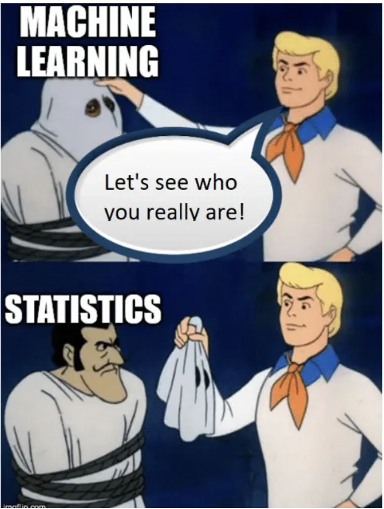

# Labels Reference

All labels in `ModuleNotes/`, grouped by file. Duplicates flagged with ⚠️.

Kind: *(sec)* = section/heading, *(eq)* = equation, *(fig)* = figure, *(adm)* = admonition, *(code)* = code cell.


---

## `BayesianInference.md`

- `chapter:bay` *(sec)* — # Bayesian Inference
- `eq:bay_bayes` *(eq)*
- `eq:bay_covidpost` *(eq)*
- `bayesian:beta` *(?)* — The Beta distribution is a flexible PDF for parameters const
- `eq:bay_betapdf` *(eq)*
- `eq:bay_betamom` *(eq)*
- `bayesian:conjugacy_bb` *(?)* — A key computational convenience arises when the Prior and th
- `eq:bay_bbpost` *(eq)*
- `eq:bay_gammapdf` *(eq)*
- `bayesian:poisson_gamma` *(?)* — Suppose we observe Poisson-distributed counts (e.g. particle
- `eq:bay_pred` *(eq)*
- `eq:bay_nbinpred` *(eq)*

---

## `Bootstrap.md`

- `chapter:Resampling` *(sec)* — # Resampling

---

## `DescribingData.md`

- `eq:expect` *(eq)*
- `eq:expectC` *(eq)*
- `fig:mean-expect-mp4` *(eq)*
- `eq:expectMu` *(eq)*
- `ExpectationAlgebra` *(sec)* — ### Expectation Algebra
- `LLN` *(sec)* — ## The Law of Large Numbers (LLN)
- `eq:lln` *(eq)*
- `fig:fluc` *(eq)*
- `fig:var-std-cartoon` *(eq)*
- `sec:truvar` *(sec)* — ### True Variance and Standard Deviation ⚠️
- `eq:truevar` *(eq)* ⚠️
- `eq:truevar2` *(eq)* ⚠️
- `sec:truvar` *(sec)* — ### True Variance and Standard Deviation ⚠️
- `eq:truevar` *(eq)* ⚠️
- `eq:truevar1` *(eq)*
- `eq:truevar2` *(eq)* ⚠️
- `eq:truesigma` *(eq)*
- `VarianceAlgebra` *(sec)* — ### Variance Algebra
- `eq:covmat-indep` *(eq)*
- `eq:covmat-dep` *(eq)*
- `eq:covterm` *(eq)*
- `fig:mda-cov` *(eq)*
- `eq:rho` *(eq)*
- `eq:rhomat` *(eq)*
- `fig:rho-wiki` *(eq)*
- `fig:mono` *(eq)*
- `fig:xkcd-correlation` *(eq)*
- `CovarianceAlgebra` *(sec)* — ### Covariance Algebra
- `sec:dd-propuncert` *(sec)* — ## 🆕 Propagation of Uncertainties
- `sec:dd-varfunc` *(sec)* — ### Variance of a Function
- `eq:expectF` *(eq)*
- `eq:varF` *(eq)*
- `eq:varFT_dd_1` *(eq)*
- `eq:varFT_dd_Z` *(eq)*
- `sec:dd_linear1` *(sec)* — ### A Linear Function of One RV
- `sec:dd_linear2` *(sec)* — ### A Linear Function of Two RVs
- `sec:dd_linear3` *(sec)* — ### A Linear Function of Three RVs
- `sec:dd_linearz` *(sec)* — ### A Linear Function of $Z$ RVs
- `sec:dd_nonlinear` *(sec)* — ### A Nonlinear function of $Z$ RVs
- `sec:dd_statsyst` *(sec)* — ### Combining Systematic and Statistical Uncertainties
- `dd-exercises` *(sec)* — ## 🆕 Exercises
- `eq:eofx` *(eq)*

---

## `DistributionsOverview.md`

- `chapter:dist-overview` *(sec)* — # Distributions Overview

---

## `EstimatorsIntro.md`

- `chapter:EstimatorsIntro` *(sec)* — # Estimators Intro
- `eq:mse` *(eq)*
- `fig:bias-var` *(eq)*
- `sec:mean-est` *(sec)* — ## The Sample Mean as an Estimator for the True Mean
- `eq:muhat` *(eq)*
- `eq:expmean` *(eq)*
- `eq:varmean` *(eq)*
- `eq:mean-est-uncert` *(eq)*
- `eq:mean-est-uncert-est` *(eq)*
- `sec:var-est` *(sec)* — ## The Sample Variance as an Estimator for the True Variance
- `tab:ei_varest` *(eq)*
- `sec:ei_sev` *(sec)* — ### The Standard Error on the Variance (SEV)
- `tab:ei_varest_var` *(eq)*
- `eq:vest-gen` *(eq)*
- `eq:sev-gen` *(eq)*
- `tab:ei_varest_var_gen` *(eq)*
- `eq:var-est-uncert` *(eq)*
- `sec:mse` *(sec)* — ## The Mean Squared Error (MSE)
- `sec:binned-data` *(sec)* — ## What to do when Data are Binned?
- `eq:binned-mean-est` *(eq)*
- `eq:binned-var-est` *(eq)*
- `sec:general-param-est` *(sec)* — ## Parameter Estimation Generally
- `sec:likelihood-est` *(sec)* — ## Likelihood
- `sec:ei_toy_single` *(sec)* — ### Toy Example: Single data point
- `fig:toylike1` *(eq)*
- `sec:ei_toy_two` *(sec)* — ### Toy Example: Two data points
- `fig:toylike2` *(eq)*
- `eq:multrule-twodata` *(eq)*
- `eq:multrule-alldata` *(eq)*
- `eq:multrule-alldata-cont` *(eq)*
- `sec:nll` *(sec)* — ### Negative Log Likelihood
- `eq:logprod` *(eq)*
- `eq:negloglike` *(eq)*
- `fig:likeLogNeg` *(eq)*
- `sec:nllpython` *(sec)* — ### Python Example
- `sec:interval-est` *(sec)* — ## Interval Estimation
- `sec:Resampling` *(sec)* — ## The Bootstrap Method
- `sec:seeding-breaks-randomness` *(sec)* — ## Seeding breaks randomness!

---

## `GeneralisedPDFs.md`

- `chapter:gpdf` *(sec)* — # Generalised Distributions
- `eq:bay_betapdf` *(eq)* ⚠️
- `eq:gpdf_betaker` *(eq)*
- `fig:gpdf_beta` *(eq)*
- `eq:gpdf_betacdf` *(eq)*
- `eq:gpdf_betacon` *(eq)*
- `sec:gpdf_gamma` *(sec)* — ## The Gamma Distribution
- `eq:bay_gammapdf` *(eq)* ⚠️
- `eq:gpdf_gammaker` *(eq)*
- `fig:gpdf_gamma` *(eq)*
- `eq:gpdf_gammacdf` *(eq)*
- `eq:gpdf_gammacon` *(eq)*

---

## `HypothesisTests.md`

- `chapter:hypothesis_tests` *(sec)* — # Hypothesis Tests
- `fig:higgs` *(eq)*
- `fig:espresso` *(eq)*
- `sec:crit-sig` *(sec)* — ### Critical Region and Significance Level
- `fig:robot-critregion` *(eq)* ⚠️
- `fig:critregion` *(eq)*
- `eq:purity1` *(eq)*
- `eq:purity2` *(eq)*
- `eq:purity3` *(eq)*
- `eq:efficiency1` *(eq)*
- `eq:efficiency2` *(eq)*
- `eq:efficiency3` *(eq)*
- `contingency-tables-again` *(sec)* — ### Contingency Tables
- `purity-alf` *(eq)*
- `efficiency-alf` *(eq)*
- `purity-null` *(eq)*
- `fig:roc` *(eq)*
- `eq:tpr` *(eq)*
- `eq:fpr` *(eq)*
- `fig:robot-critregion` *(eq)* ⚠️
- `fig:falsepos` *(eq)*
- `fig:confusion-mp4` *(eq)*
- `fig:pval1` *(eq)*
- `fig:snpvalzval` *(eq)*
- `fig:pz-cdf` *(eq)*
- `eq:cdf-alpha` *(eq)*
- `eq:cdf-alpha2` *(eq)*
- `fig:cdf2side` *(eq)*
- `pfromz` *(sec)* — ### Find the p value from the Z value
- `fig:zbad` *(eq)*

---

## `Intro.md`

- `chapter:intro` *(sec)* — # Data Analysis Techniques 890F3 
- `coursework` *(adm)* — ::::{dropdown} Quick Start (Coursework) Instructions
- `los:Term` *(adm)* — :::{dropdown} Terminology & Concepts
- `los:Prob` *(adm)* — :::{dropdown} Probability Essentials
- `los:Data` *(adm)* — :::{dropdown} Describing Data
- `los:Norm` *(adm)* — :::{dropdown} The Normal Distribution
- `los:Hypo` *(adm)* — :::{dropdown} Hypothesis Tests
- `los:NormTests` *(adm)* — :::{dropdown} Normal Tests
- `los:Estimation` *(adm)* — :::{dropdown} Estimation Essentials
- `los:PMFLikelihood` *(adm)* — :::{dropdown} Discrete Probabilities & Likelihoods
- `los:PDFLikelihood` *(adm)* — :::{dropdown} Continuous Probabilities & Likelihoods
- `los:MLM` *(adm)* — :::{dropdown} Maximum Likelihood Method
- `los:LSQ` *(adm)* — :::{dropdown} Linear Regression
- `los:Bayes` *(adm)* — :::{dropdown} Bayesian Inference
- `los:Predictions` *(adm)* — :::{dropdown} Predictions
- `help` *(adm)* — :::{seealso} Help!

---

## `LeastSquares.md`

- `chapter:lse` *(sec)* — # Linear Regression
- `fig:lse_lsq` *(eq)*
- `sec:lse_res` *(sec)* — ## Residuals
- `eq:lse_standres` *(eq)*
- `eq:lse_ssres` *(eq)*
- `sec:lse_chi2` *(sec)* — ## The Chi Squared Statistic, $\chi^2$
- `eq:lse_chi2` *(eq)*
- `fig:lse_gau` *(eq)*
- `fig:lse_gaumod` *(eq)*
- `eq:norm_pdf_lsq` *(eq)*
- `eq:norm_lik_lsq` *(eq)*
- `eq:lse_chi2ll` *(eq)*
- `fig:lse_hethom` *(eq)*
- `sec:lse_bin` *(sec)* — ## Chi Squared with Binned Data
- `fig:lse_poidat` *(eq)*
- `fig:lse_poimod` *(eq)*
- `eq:lse_chi2bin` *(eq)*
- `eq:lse_chi2binpop` *(eq)*
- `sec:lse_straline` *(sec)* — ## Estimating the Parameters of a Straight Line
- `eq:lse_chi2line` *(eq)*
- `eq:lse_chi2lineexp` *(eq)*
- `eq:lse_sums` *(eq)*
- `eq:lse_chi2derbs` *(eq)*
- `eq:lse_chi2derb` *(eq)*
- `eq:lse_chi2derab` *(eq)*
- `eq:lse_chi2hes` *(eq)*
- `eq:lse_ahat` *(eq)*
- `eq:lse_bhat` *(eq)*
- `eq:lse_delhom` *(eq)*
- `eq:lse_ahathom` *(eq)*
- `eq:lse_bhathom` *(eq)*
- `sec:lse_unc` *(sec)* — ### Parameter Uncertainties
- `eq:lse_chi2tay` *(eq)*
- `eq:lse_chi2tayl` *(eq)*
- `eq:lse_hesshet` *(eq)*
- `eq:lse_cov` *(eq)*
- `sec:lse_mat` *(sec)* — ## Matrix generalization
- `eq:lse_chi2mat` *(eq)*
- `eq:lse_covmat` *(eq)*
- `sec:lse_gaumar` *(sec)* — ## Ordinary Least Squares and the Gauss–Markov theorem
- `sec:lse_hom` *(sec)* — ### Homoscedastic Least Squares
- `eq:lse_sumshom` *(eq)*
- `sec:lse_py` *(sec)* — ## LSE with Python
- `sec:lse_sci` *(sec)* — ### LSE with `scipy.optimize.least_squares`
- `sec:lse_out` *(sec)* — ### Extreme outliers and robust least squares
- `sec:lse_nonlin` *(sec)* — ## Nonlinear models
- `fig:lse_out` *(eq)*
- `sec:lse_sum` *(sec)* — ## Summary

---

## `MCMC.md`

- `chapter:mcmc` *(sec)* — # Markov Chain Monte Carlo
- `eq:poisson_gamma_recap` *(eq)*
- `eq:mh_ratio` *(eq)*

---

## `MathMethodsA.md`

- `chapter:mma` *(sec)* — # Math Methods A: Functions and Calculus
- `sec:mma_func` *(sec)* — ## Functions
- `sec:mma_logexp` *(sec)* — ## Bases, Exponents, and Logarithms
- `sec:mma_logs` *(sec)* — ### Logarithms
- `sec:mma_difcal1` *(sec)* — ## Differential Calculus I
- `sec:mma_taylor` *(sec)* — ### Taylor and Maclaurin Series
- `sec:mma_difcal2` *(sec)* — ## Differential Calculus II
- `sec:mma_derspec` *(sec)* — ### Derivatives of Special Functions
- `sec:mma_charu` *(sec)* — ### Chain Rule
- `sec:mma_mulcal` *(sec)* — ## Multivariable Calculus
- `sec:mma_grad` *(sec)* — ### The Gradient
- `sec:mma_hessian` *(sec)* — ### The Hessian
- `sec:mma_intcal` *(sec)* — ## Integral Calculus
- `sec:mma_intbypar` *(sec)* — ### Integration by Parts
- `sec:mma_joinint` *(sec)* — ## Joint and Marginal Integrals
- `sec:mma_sympy` *(sec)* — ## `sympy` Methods Reference

---

## `MathMethodsB.md`

- `chapter:mmb` *(sec)* — # Math Methods B: Proofs and Estimator Theory
- `sec:mmb_varequiv` *(sec)* — ## Equivalence of Variance Definitions
- `sec:mmb_varlinf` *(sec)* — ## Proof that $V[aX+b] = a^2 V[X]$
- `sec:mmb_varlinf1` *(sec)* — ### Method 1: Expectations
- `eq:mmb_proofvarf` *(eq)*
- `sec:mmb_varlinf2` *(sec)* — ### Method 2: Taylor Series Expansion
- `sec:gpdf_gamma-function` *(sec)* — ## The Gamma Function
- `eq:mmb_gamdef` *(eq)*
- `eq:mmb_gamrec` *(eq)*
- `eq:mmb_gamfac` *(eq)*
- `eq:mmb_gamhalf` *(eq)*
- `sec:mmb_gammaln_example` *(sec)* — ### Python
- `sec:mmb_trans` *(sec)* — ## Transforms: Changing Variables
- `eq:transform_1d` *(eq)*
- `sec:gaus-int-trick` *(sec)* — ### The Gaussian Integral Trick
- `eq:transform_jacobian` *(eq)*
- `eq:jacobian` *(eq)*
- `sec:mmb_varbias` *(sec)* — ## Bias of the Sample Variance
- `eq:mmb_varid` *(eq)*
- `eq:mmb_varidpro` *(eq)*
- `eq:mmb_vartspro` *(eq)*
- `sec:mmb_mse` *(sec)* — ## Mean Squared Error
- `eq:mmb_mseag` *(eq)*
- `eq:mmb_msepro` *(eq)*
- `eq:mmb_msedecomp` *(eq)*
- `sec:mmb_cenmo` *(sec)* — ## Central Moments
- `eq:mmb_moments` *(eq)*
- `sec:mmb_stacenmo` *(sec)* — ### Standardised Central Moments
- `eq:mmb_stand_moments` *(eq)*
- `sec:mmb_scmgtk` *(sec)* — ### Good to know
- `eq:mmb_recursion` *(eq)*
- `eq:mmb_double_factorial` *(eq)*
- `eq:mmb_derivative_fZ` *(eq)*
- `eq:mmb_recursion_p` *(eq)*
- `tab:mmb_recursion` *(eq)*
- `sec:mmb_chisq_expect` *(sec)* — ## Chi Squared Expectation
- `sec:mmb_mgf` *(sec)* — ## Moment Generating Functions
- `sec:mmb_sevchi2` *(sec)* — ## Variance Bias is a Chi Squared RV
- `eq:sev-chisq` *(eq)*
- `eq:mmb_chisq_v_1` *(eq)*
- `eq:mmb_chisq_v_2` *(eq)*
- `eq:mmb_chisq_v_3` *(eq)*
- `sec:mmb_sevpro` *(sec)* — ## SEV for Normal Data
- `eq:chi2-samp-var` *(eq)*
- `eq:mmb_vestpro` *(eq)*
- `eq:mmb_sevpro` *(eq)*
- `eq:mmb_esevpro` *(eq)*
- `eq:mmb_sevbpro` *(eq)*
- `sec:mmb_deltam` *(sec)* — ## The Delta Method (Taylor Expansion)
- `eq:mmb_deltam` *(eq)*
- `sec:mmb_ses` *(sec)* — ## Standard Error of the Standard Deviation (SES)
- `eq:mmb_ses` *(eq)*
- `eq:mmb_sesest` *(eq)*
- `sec:mmb_sespy` *(sec)* — ### Python
- `sec:mmb_mvue` *(sec)* — ## Minimum Variance Unbiased Estimation
- `eq:mmb_fishinfo` *(eq)*
- `eq:mmb_cramrao` *(eq)*

---

## `MaxLike.md`

- `chapter:MaxLike` *(sec)* — # Maximum Likelihood Estimation
- `sec:likelihood` *(sec)* — ## The Likelihood Function (Recap)
- `eq:likelihood` *(eq)*
- `eq:mle-def` *(eq)*
- `eq:loglike` *(eq)*
- `eq:nll` *(eq)*
- `eq:nll-mle-def` *(eq)*
- `sec:mle-uncertainties` *(sec)* — ## Uncertainties on MLE
- `sec:mle-analytical` *(sec)* — ## Analytical MLE
- `eq:score-zero` *(eq)*
- `sec:mle-gauss` *(sec)* — ### Example: estimating Norm $\mu$ and $\sigma$
- `eq:mle-mu` *(eq)*
- `eq:mle-sigma` *(eq)*
- `sec:mle-score` *(sec)* — ### The Score
- `eq:score` *(eq)*
- `eq:score-pdf` *(eq)*
- `eq:escore-proof` *(eq)*
- `eq:descore-proof` *(eq)*
- `eq:descore-result` *(eq)*
- `sec:mle-information` *(sec)* — ## The Fisher Information
- `eq:vscore-proof` *(eq)*
- `eq:information` *(eq)*
- `eq:information1` *(eq)*
- `eq:informationN` *(eq)*
- `sec:ml_hess` *(sec)* — ### Hessian Matrix for Multiple Parameters
- `eq:hessian_ll` *(eq)*
- `eq:info_matrix` *(eq)*
- `eq:infomat_norm` *(eq)*
- `sec:mvb` *(sec)* — ### The Minimum Variance Bound (MVB)
- `eq:rcf` *(eq)*
- `eq:rcf-biased` *(eq)*
- `eq:mse-bound` *(eq)*
- `eq:infomat_norm_invert` *(eq)*
- `sec:mle-graphical` *(sec)* — ### The Graphical Method
- `eq:loglike-taylor` *(eq)*
- `eq:loglike-taylor-re` *(eq)*
- `eq:thetaplus` *(eq)*
- `eq:thetaminus` *(eq)*
- `eq:loglike-drop` *(eq)*
- `fig:graph-meth` *(eq)*
- `sec:mle-numerical` *(sec)* — ## Numerical MLE with `scipy`
- `sec:minim_intro` *(sec)* — ### General Introduction to Minimisation
- `sec:ml_scipy_methods` *(sec)* — ### `scipy` Methods
- `sec:ml_scipy_fit` *(sec)* — ### ```scipy.stats.fit```
- `sec:ml_scipy_fsolve` *(sec)* — ### ```scipy.optimize.fsolve```
- `sec:ml_scipy_minimize_scalar` *(sec)* — ### ```scipy.optimize.minimize_scalar```
- `sec:ml_scipy_minimize` *(sec)* — ### ```scipy.optimize.minimize```
- `eq:llr` *(eq)*
- `eq:aic` *(eq)*
- `eq:bic` *(eq)*

---

## `Normal.md`

- `chapter:norm` *(sec)* — # The Normal Distribution
- `fig:norm-everywhere` *(eq)*
- `fig:gaussian` *(eq)*
- `fig:gaussian_params` *(eq)*
- `fig:nsigma` *(eq)*
- `sec:CLT` *(sec)* — ## The Central Limit Theorem (CLT)
- `fig:clt1` *(eq)*
- `fig:clt2` *(eq)*
- `sec:normcdf` *(sec)* — ### The Cumulative Distribution Function (CDF)
- `eq:cdf_cont` *(eq)*
- `eq:cdf_disc` *(eq)*
- `eq:gaus_multi` *(eq)*
- `seaborn-gaus2` *(code)* — ```{code-cell} python

---

## `NormalTests.md`

- `chapter:normtest` *(sec)* — # Normal Tests
- `eq:expect_mean` *(eq)*
- `eq:var_mean` *(eq)*
- `eq:var_mean1` *(eq)*
- `sem` *(sec)* — ### Standard Error on the Mean $\mathsf{SEM}$
- `fig:sem1` *(eq)*
- `fig:sem2` *(eq)*
- `fig:sem3` *(eq)*
- `fig:sem4` *(eq)*
- `sec-sem` *(sec)* — ### The Uncertainty on the Mean
- `fig:sem5` *(eq)*
- `fig:sem6` *(eq)*
- `fig:sem7` *(eq)*
- `sosmall` *(sec)* — ### Small Datasets
- `data:threecities` *(sec)* — ## Three Cities Data
- `eq:zstat` *(eq)*
- `ZTestExample` *(sec)* — ### Z Test Example: Hours slept in Stockport
- `fig:pvalzval` *(eq)*
- `sec:t-test` *(sec)* — ## The Student's T Test
- `eq:est-sem` *(eq)*
- `eq:tstat` *(eq)*
- `eq:Tnu` *(eq)*
- `fig:tpdf` *(eq)*
- `eq:T2test` *(eq)*
- `eq:pooledvar` *(eq)*
- `eq:psi` *(eq)*
- `eq:fstat` *(eq)*
- `eq:varbetween` *(eq)*
- `eq:ws1` *(eq)*
- `eq:ws2` *(eq)*
- `eq:varwithin` *(eq)*
- `fig:fpdf` *(eq)*

---

## `PDFs.md`

- `chapter:PDFs` *(sec)* — # Continuous Probabilities & Likelihoods
- `sec:which_pdf` *(sec)* — ## Which PDF?
- `sec:uniform` *(sec)* — ## The Uniform Distribution
- `eq:uniform_pdf` *(eq)*
- `fig:uniformPDF` *(eq)*
- `eq:continuous_cdf` *(eq)*
- `eq:uniform_cdf` *(eq)*
- `eq:uniform_lik` *(eq)*
- `eq:loglike_uniform` *(eq)*
- `eq:uniform_mle` *(eq)*
- `sec:expon` *(sec)* — ## The Exponential Distribution
- `eq:expon_pdf` *(eq)*
- `eq:expon_kernel` *(eq)*
- `fig:exponPDF` *(eq)*
- `eq:expon_cdf` *(eq)*
- `eq:expon_lik` *(eq)*
- `eq:expon_loglik` *(eq)*
- `sec:normdist` *(sec)* — ## The Normal Distribution
- `eq:norm_pdf` *(eq)*
- `eq:norm_kernel` *(eq)*
- `fig:normPDF` *(eq)*
- `eq:norm_cdf` *(eq)*
- `sec:norm_like` *(sec)* — ### Likelihoods
- `eq:norm_lik` *(eq)*
- `eq:norm_loglik` *(eq)*
- `eq:norm_nll` *(eq)*
- `eq:norm_mle` *(eq)*
- `sec:chi2dist` *(sec)* — ## The Chi Squared ($\chi^2$) Distribution
- `eq:chi2` *(eq)*
- `sec:chi2-pdf-gamma` *(sec)* — ### PDF & Kernel
- `eq:chi2_pdf` *(eq)*
- `eq:chi2_kernel` *(eq)*
- `fig:chi2PDF` *(eq)*
- `fig:chi2PDF2` *(eq)*
- `fig:chi2redPDF` *(eq)*
- `eq:chi2_lik` *(eq)*
- `eq:chi2_loglik` *(eq)*
- `sec:mmb_trans-dupe` *(sec)* — ## Transforms: Changing Variables
- `eq:transform_1d` *(eq)* ⚠️
- `sec:gaus-int-trick` *(sec)* — ### Gaussian Integral Trick ⚠️
- `eq:transform_jacobian` *(eq)* ⚠️
- `eq:jacobian` *(eq)* ⚠️

---

## `PMFs.md`

- `chapter:PMFs` *(sec)* — # Discrete Probabilities & Likelihoods
- `sec:which_pmf` *(sec)* — ## Which PMF?
- `sec:bern` *(sec)* — ## Bernoulli
- `eq:bern_pmf` *(eq)*
- `eq:bern_kernel` *(eq)*
- `fig:bernPMF` *(eq)*
- `eq:discrete_cdf` *(eq)*
- `eq:bern_cdf` *(eq)*
- `eq:bern_like` *(eq)*
- `eq:bern_loglike` *(eq)*
- `eq:bern_loglike2` *(eq)*
- `eq:bern_loglike3` *(eq)*
- `eq:bern_loglike4` *(eq)*
- `sec:useful-derivatives` *(sec)* — ### Some Useful Derivatives
- `tab:pmfs_derivs` *(eq)*
- `eq:bern_loglike5` *(eq)*
- `sec:binom` *(sec)* — ## The Binomial Distribution
- `eq:binom_pmf` *(eq)*
- `eq:binom_kernel` *(eq)*
- `fig:binomPMF` *(eq)*
- `eq:binom_theorem` *(eq)*
- `eq:binom_series2` *(eq)*
- `sec:binom-coeff` *(sec)* — ### The Binomial Coefficient
- `eq:bnc` *(eq)*
- `eq:binom_cdf` *(eq)*
- `sec:binom_like` *(sec)* — ### Likelihoods
- `eq:binom_like` *(eq)*
- `eq:binom_loglike` *(eq)*
- `eq:binom_mle` *(eq)*
- `sec:poisson` *(sec)* — ## The Poisson Distribution
- `eq:poisson_pmf` *(eq)*
- `eq:poisson_kernel` *(eq)*
- `fig:poissonPMF` *(eq)*
- `eq:poisson_validity` *(eq)*
- `eq:poisson_validity2` *(eq)*
- `eq:expon_taylor_series` *(eq)*
- `eq:poisson_cdf` *(eq)*
- `eq:poisson_expect_calc` *(eq)*
- `sec:poisson_like` *(sec)* — ### Likelihoods
- `eq:poisson_like` *(eq)*
- `eq:poisson_loglike` *(eq)*
- `eq:poisson_loglike_deriv` *(eq)*
- `eq:poisson_mle` *(eq)*
- `sec:pmfs_gammaln_example` *(sec)* — ### 🆕 Example of using `gammaln` for $\ln(k!)$
- `fig:alf-poisson-binom` *(eq)*
- `sec:pmfs_summary` *(sec)* — ## Summary of Discrete Distributions

---

## `PlottingTipsAndTricks.md`

- `chapter:plotting-tips` *(sec)* — # Plotting Tips and Tricks
- `sec:plot-functions` *(sec)* — ## 1. Basic Function Plots
- `sec:plot-semilog` *(sec)* — ## 2. Semilog Plots
- `sec:plot-derivatives` *(sec)* — ## 3. Visualising Derivatives
- `sec:plot-bivariate` *(sec)* — ## 4. Bivariate (2D) Function Plots
- `sec:plot-bivariate-exercise` *(sec)* — ## Exercise: Adapt `joint_integral_plot1` for a New Function
- `sec:plot-methods-ref` *(sec)* — ## `matplotlib` Methods Reference

---

## `ProbabilityEssentials.md`

- `chapter:probess` *(sec)* — # Probability Essentials
- `fig:fernanda-and-betty` *(eq)*
- `our-sets` *(eq)*
- `fig:special-sets` *(eq)*
- `complement` *(sec)* — ### Complement $A'$
- `intersection` *(sec)* — ### Intersection $A\cap B$
- `frequentist-probability` *(sec)* — ## Frequentist Probability
- `fig:venn_axiom3` *(eq)*
- `kolmogorov` *(sec)* — ### The Kolmogorov Axioms
- `eq:kolmogorov1` *(eq)*
- `eq:kolmogorov2` *(eq)*
- `eq:kolmogorov3` *(eq)*
- `cond-prob` *(sec)* — ## Conditional Probability $P(A | B)$
- `contingency-tables` *(sec)* — ### Contingency Tables
- `tab:contingency1` *(eq)*
- `sec:multrule` *(sec)* — ### The Multiplication Rule
- `total-prob` *(sec)* — ### Total Probability
- `fig:venn_tot` *(eq)*
- `bayes-theorem` *(sec)* — ## Bayes' Theorem
- `bayes-theorem-special` *(sec)* — ### 🆕 Bayes' Theorem for Hypotheses and Measurements
- `tab:zorgs1` *(eq)* ⚠️
- `tab:zorgs1` *(eq)* ⚠️
- `tab:zorgs2` *(eq)*
- `probability-distributions` *(sec)* — ## Probability Distributions
- `eq:kolmogorov1pmf` *(eq)*
- `code:pmf-example` *(code)* — ```{code-cell} python
- `code:pdf-example` *(code)* — ```{code-cell} python
- `normalise-func` *(sec)* — ### From Function to PDF: the Normalisation Constant
- `fig:ftopdf` *(eq)*
- `sympy-integration` *(sec)* — ### Integration with ```sympy```
- `user-pdf` *(sec)* — ### Making a user PDF with ```scipy.stats```
- `harmonising` *(sec)* — ## 🆕 Harmonising Different Notations

---

## `PythonMethods.md`

- `chapter:python-methods` *(sec)* — # Python Methods Reference

---

## `TerminologyAndConcepts.md`

- `chapter:tandc` *(sec)* — # Terminology & Concepts
- `fig:models` *(eq)*
- `discovery` *(adm)* — :::{important}
- `fig:heart-data` *(eq)*
- `fig:theoretical-universe` *(eq)*
- `discrete` *(sec)* — ### Discrete RVs
- `continuous` *(sec)* — ### Continuous RVs
- `IID` *(sec)* — ## Independent & Identically Distributed (IID) Data
- `binned-mean` *(sec)* — ### The Binned Mean
- `fig:binned-mean` *(eq)*
- `weighted-mean` *(sec)* — ### The Weighted Mean
- `median-mode` *(sec)* — ### The Median and Mode
- `intro-variance` *(sec)* — ### Variance $v_x$
- `coeff-var` *(sec)* — ### The Coefficient of Variation
- `fig:random-robot` *(eq)*
- `fig:dilbert` *(eq)*
- `intro-plot` *(sec)* — ### ```plot```
- `intro-hist` *(sec)* — ### ```hist```
- `intro-scatter` *(sec)* — ### ```scatter```
- `code-scatter` *(eq)*

---

## ⚠️ Duplicate Labels

These labels appear in more than one file (or more than once in the same file):

- `eq:bay_betapdf` — `BayesianInference.md`, `GeneralisedPDFs.md`
- `eq:bay_gammapdf` — `BayesianInference.md`, `GeneralisedPDFs.md`
- `eq:jacobian` — `MathMethodsB.md`, `PDFs.md`
- `eq:transform_1d` — `MathMethodsB.md`, `PDFs.md`
- `eq:transform_jacobian` — `MathMethodsB.md`, `PDFs.md`
- `eq:truevar` — `DescribingData.md`, `DescribingData.md`
- `eq:truevar2` — `DescribingData.md`, `DescribingData.md`
- `fig:robot-critregion` — `HypothesisTests.md`, `HypothesisTests.md`
- `sec:gaus-int-trick` — `MathMethodsB.md`, `PDFs.md`
- `sec:truvar` — `DescribingData.md`, `DescribingData.md`
- `tab:zorgs1` — `ProbabilityEssentials.md`, `ProbabilityEssentials.md`
