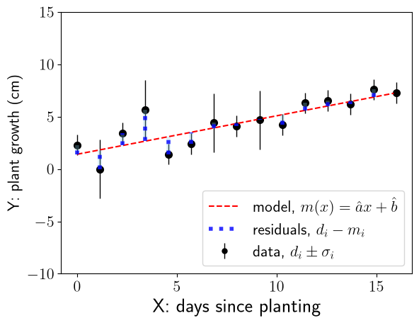
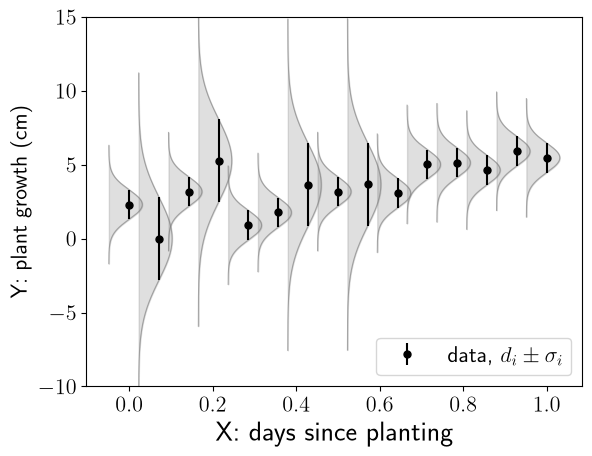
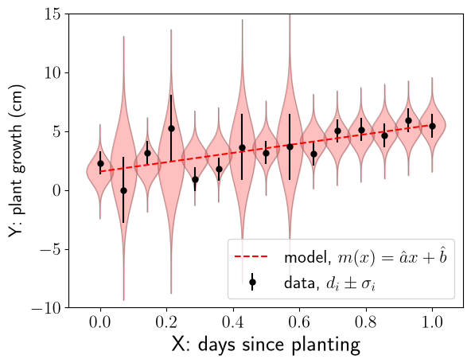
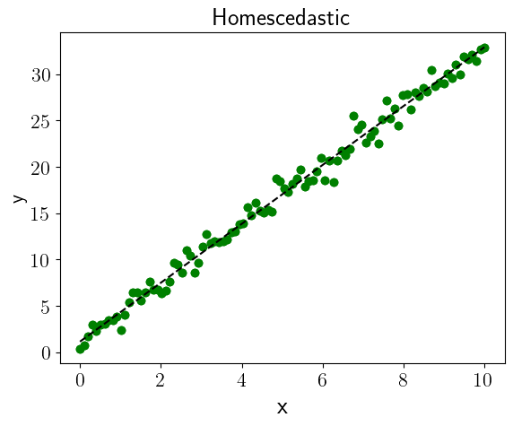
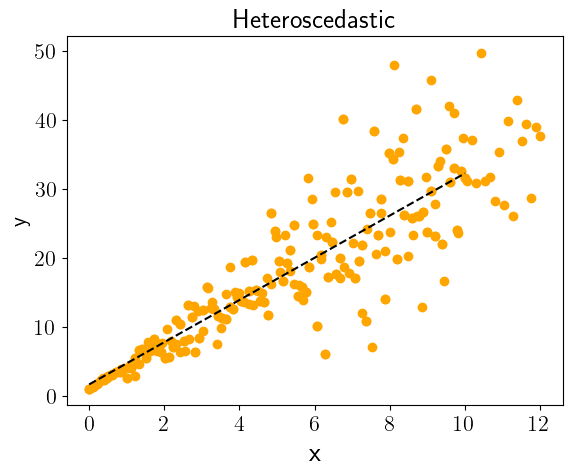
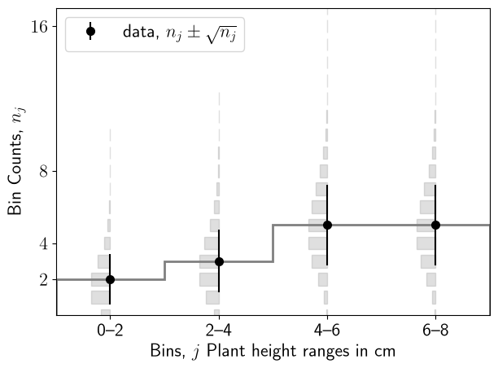
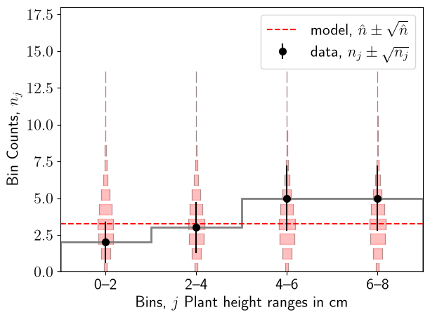

---
jupytext:
  formats: md:myst
  text_representation:
    extension: .md
    format_name: myst
kernelspec:
  display_name: Python 3
  language: python
  name: python3
---

(chapter:lse)=
# Linear Regression

* `numpy` methods: `linalg.inv`
* `scipy.optimize` methods: `least_squares`

Fitting means estimating the parameters, and sometimes also the functional form, that best describes a dataset. A functional form can have one parameter or lots of them.

The **Least Squares** approach minimises the [Residuals](#sec:lse_res) for all parameters simultaneously, to provide the best set of parameter estimates. The parameter estimates from the Least Squares Method are the **Least Squares Estimates (LSE)**, and are often indicated with the notation $\hat{\theta}_{\mathsf{LSE}}$ - akin to the Maximum Likelihood Estimates being denoted  $\hat{\theta}_{\mathsf{MLE}}$.  When the measurement uncertainties are Gaussian, minimising the sum of squared residuals is identical to minimising the [Negative Log Likelihood](#eq:mle_nll), so $\hat{\theta}_{\mathsf{LSE}} \equiv \hat{\theta}_{\mathsf{MLE}}$ for Gaussian Errors. 

An example of a Least Squares Fit (straight line) is shown in [](#fig:lse_lsq) for an example of Plant growth as a function of time. The control variable is the number of days since planting ($x$-axis). The control variable has evenly spaced intervals and negligible uncertainty. The Random Variable is the measured plant growth ($y$-axis) which has measurement uncertainty indicated by the vertical error bars on the data points.

:::{figure} 
:label: fig:lse_lsq



The Least Squares fit (red dashed line) is a simultaneous estimation of the parameters of the function $m(x)$. In this case the function is a straight line, $m(x)=ax+b$, with parameter estimates $\hat{a}=0.37$ (the gradient or slope of the line) and $\hat{b}=1.41$ (the intercept: the value of $y(x)$ when $x=0$). Least Squares estimates these parameters by minimising[^minim] the sum of the squared Residuals. The Residuals are shown as blue dotted lines for each data point.
:::

[^minim]: minimising a function means setting the first derivative of the function to zero, and checking the second derivative is positive. See [](#sec:mle_minin).


---


(sec:lse_res)=
## Residuals

The differences between each data point $d(x_i)$[^n1] and the Least Squares fit function at that point $m(x_i;\,\hat{\theta})$[^n2] are the **Residuals**:

$d(x_i) - m(x_i;\,\hat{\theta})\;\;\; \rightarrow \;\;\; d_i - m_i$,

with the simplified notation, $d_i - m_i$, chosen for clarity below.


[^n1]: $d(x_i)$ are the $y$-values of the black points in [](#fig:lse_lsq)

[^n2]: $m(x_i;\,\hat{\theta})$ are the $y$-values of the red dashed line in [](#fig:lse_lsq), where $\hat{\theta}=\{\hat{a}, \hat{b}\}$ are the parameter estimates from the fit.

Data points must always be provided with error bars, of course, because all measurements have uncertainty! We denote the uncertainty on each data point as $\sigma_i$. To take account of these uncertainties on the data points, we can Standardise the Residuals (divide each residual by the measurement uncertainty):

```{math}
:label: eq:lse_standres

r_i = \dfrac{ d_i - m_i }{ \sigma_i}

```

To consider all the data, rather than a single point at a time[^seeL] we could just add all of the residuals together... but this would be a mistake. If some of them are positive and some of them are negative, they could cancel out and give us a tiny total residual, despite the data, $d$, being very far away from the Least Squares fit model, $m$.

[^seeL]: Compare with the calculation of Likelihoods (week 6 lecture) - when we calculate the Likelihood from many data points we combine them by multiplying the PMFs, because the Multiplication Rule tells us that $P(A\cap B)= P(A) P(B)$ for IID $A,B$.


If we **Square the Residuals** before summing over them, this cancellation problem goes away[^pro].

[^pro]: Another option would be to take the absolute values of the residuals, rather than squaring them. Laplace used this approach, before Gauss came along with the idea to square them - see for example [Stephen Stigler's paper](https://doi.org/10.1214/aos/1176345451). The absolute value can be a good choice for reducing the "pull" of outliers - see [](#sec:lse_out).

The **Sum of Squared Residuals** is then:

```{math}
:label: eq:lse_ssres

\sum_i r^2_i = \sum\limits^N_i \left( \dfrac{d_i - m_i}{\sigma_i}\right)^2

```

The statistic defined in [](#eq:lse_ssres) is known as **Pearson's Chi Squared**, $\chi^2$, where the sum is over $N$ measurements, $d_i \pm \sigma_i$ and model predictions, $m_i$ (with estimated parameters $\hat{\theta} = \{\hat{a}, \hat{b}\}$).


:::{tip} Fun Fact
Gauss came up with the Normal distribution to justify the Least Squares method. See [this nice blog](https://notarocketscientist.xyz/posts/2023-01-27-how-gauss-derived-the-normal-distribution/) for the story.
:::


---

(sec:lse_chi2)=
## The Chi Squared Statistic, $\chi^2$

Rewriting [](#eq:lse_ssres) with the notation $\chi^2 \equiv \sum\limits_i^N r^2_i$, The **Chi Squared Statistic** is:

```{math}
:label: eq:lse_chi2
\chi^2 = \sum_{i=1}^{N} \left(\frac{d_i - m_i}{\sigma_i}\right)^2.
```

If we think of each **measurement $d_i \pm \sigma_i$** as representative of a normal distribution, Norm($d_i, \sigma_i$), we can generate the "data-centric" picture given in [](#fig:lse_gau).


:::{figure} 
:label: fig:lse_gau



Data-centric picture: each measurement $d_i \pm \sigma_i$ represents the mean and standard deviation of a Normal($d_i, \sigma_i$) distribution.
:::

If instead we think of each **fit point $m_i \pm \sigma_i$** as representative of a normal distribution, Norm($m_i, \sigma_i$), we can generate the "model-centric" picture given in [](#fig:lse_gaumod). Note that we are using the measurement uncertainty $\sigma_i$ at each data point as an estimator for the uncertainty on the model fit point.


:::{figure} 
:label: fig:lse_gaumod



Model-centric picture: each fit point $m_i \pm \sigma_i$ represents the mean and standard deviation of a Normal($m_i, \sigma_i$) distribution, where we are using the measured uncertainty on the data point as before for $\sigma_i$.
:::


Either of the choices are perfectly valid, with the [data-centric picture](#fig:lse_gau) perhaps being more intuitive, as it keeps the uncertainties attached to the data. We will use the [model-centric picture](#fig:lse_gaumod) to show that minimising the Negative Log Likelihood is equivalent to minimising the Pearson Chi Squared statistic.

The Norm$(m_i, \sigma_i)$ PDF is:

```{math}
:label: eq:lse_normpdf
f_Y(y) = \dfrac{1}{\sigma_i\sqrt{2\pi}}\exp\!\left[-\frac{1}{2}\left(\frac{d_i-m_i}{\sigma_i}\right)^2\right] 
```

The Likelihood (of the $N$ data measurements $d_i$ being described by model parameters $\theta_i = m_i, \sigma_i$) is then:

```{math}
:label: eq:lse_normlik

\begin{aligned}

\mathcal{L}_{\theta}(\theta;d) &= \prod_{i=1}^{N}\dfrac{1}{\sigma_i\sqrt{2\pi}}\exp\!\left[-\dfrac{1}{2}\left(\dfrac{d_i-m_i}{\sigma_i}\right)^2\right]\\ \\

\end{aligned}
```

The Negative Log Likelihood is[^note]:

```{math}
:label: eq:lse_chi2ll
\begin{aligned}

\mathsf{NLL} = -\ln \mathcal{L} &= \sum\limits_i^N \ln(\sigma_i) + \sum\limits_i^N \frac{1}{2}\ln(2\pi) +\sum\limits_i^N \left[\dfrac{1}{2}\left(\dfrac{d_i-m_i}{\sigma_i}\right)^2\right] \\
& =  \sum\limits_i^N \ln\sigma_i +\frac{N}{2}\ln(2\pi) + \frac{1}{2}\chi^2.

\end{aligned}
```


[^note]: In [](#eq:pdf_normnll) we considered $\sigma$ as a fixed value (a parameter of the true underlying distribution), so the Likelihood product (over densities) gave us the term $N\ln \sigma$. In this case, the $\sigma$ are (potentially) different in each case, as they represent measurement uncertainties. So the term is $\sum\limits_i^N \ln \sigma_i$


Minimising the NLL over $\theta$ is therefore *identical* to minimising $\chi^2$: the $\sigma_i$ are fixed measurement uncertainties, so the first two terms do not depend on $\theta$, and $\hat\theta_{\rm LS} = \hat\theta_{\rm MLE}$. This holds whether the uncertainties are all equal (the *homoscedastic* case) or not (*heteroscedastic*) - see [](#fig:lse_hethom).

> **Note:** We cannot also estimate every $\sigma_i$ from the data. For a single point, the NLL term $\ln\sigma_i + \frac{1}{2}(d_i - m_i)^2/\sigma_i^2$ is minimised at $\hat\sigma_i = |d_i - m_i|$: each point's uncertainty is simply set equal to its own residual. Worse, the model can always pass exactly through one of the points, making that residual (and $\hat\sigma_i$) zero, so $\ln\hat\sigma_i \to -\infty$ and the likelihood has no maximum. Least squares is interesting when the $\sigma_i$ are fixed by the measurement process.


::::{figure}
:label: fig:lse_hethom

:::{list-table}
:header-rows: 0

* - 
  - 
:::

Homoscedastic data have equal variances ($\sigma_i = \sigma$ for all $i$); heteroscedastic data do not.
::::


---

(sec:lse_bin)=
## Chi Squared with Binned Data

When data are binned (e.g. a histogram), the observed count $n_j$ in each bin follows a Poisson distribution ([](#sec:pmf_poi)). An attempt to illustrate this is shown in [](#fig:lse_poidat). The $K\sim$ Poisson($\lambda$) distribution has expectation $E[K]=\lambda$ and variance $V[K]=\lambda$, where the parameter $\lambda$ is the rate, e.g. the expected count per bin. The **count in each bin, $n_j$**, is one observation from a Poisson distribution, and it is our best estimate of that bin's mean $\lambda$. The **uncertainty on the count in each bin, $\sigma_j$**, is the square root of the Poisson variance, $\sqrt{V[K]} = \sqrt{\lambda}$, which we estimate as $\sqrt{n_j}$ (data-centric) or as $\sqrt{\hat{n}_j}$ from the model (model-centric, below). We can generate the "data-centric" picture given in [](#fig:lse_poidat).


:::{figure} 
:label: fig:lse_poidat



Data-centric picture of histogrammed (binned) data with Poisson uncertainties on the "counts per bin" RV.
:::


Just as we did the unbinned (Gaussian $\sigma$) example, we can instead think of each **fit point $\hat{n}_j \pm \sqrt{\hat{n}_j}$** as representative of a Poisson distribution, Poisson($\hat{n}_j$), and generate the "model-centric" picture given in [](#fig:lse_poimod). 

:::{figure} 
:label: fig:lse_poimod



Model-centric picture of histogrammed (binned) data with Poisson uncertainties on the "counts per bin" RV. The uncertainties $\sigma_j = \sqrt{\hat{n}_j}$ are now those of the model prediction $\hat{n}_j$ at the centre of each bin.

:::

Let's consider the Chi Squared test statistic for the binned data, using the model-centric uncertainties:


```{math}
:label: eq:lse_chi2bin
\chi^2 = \sum\limits_j^{N_{\rm bins}} \frac{(n_j - \hat{n}_j)^2}{\hat{n}_j},
```

where $\hat{n}_j$ is the model prediction for bin $j$. This is **Pearson's** $\chi^2$ (see [](#sec:pdf_chi2)).


The **binned** standardised residuals [](#eq:lse_standres) are often written in terms of the observed counts ($n_j$) and the expected counts ($\hat{n}_j$), as:

```{math}
:label: eq:lse_chi2binpop
 \frac{n_j - \hat{n}_j}{\sqrt{\hat{n}_j}} = \frac{\mathsf{observed} - \mathsf{expected}}{\sqrt{\mathsf{expected}}}
```

(sec:lse_neyman)=
### Pearson's versus Neyman's $\chi^2$

There are two natural choices for the uncertainty $\sigma_j$ on each bin, and they give two different statistics:

```{math}
:label: eq:lse_pearneym
\chi^2_{\mathsf{Neyman}} = \sum\limits_j^{N_{\rm bins}} \frac{(n_j - \hat{n}_j)^2}{n_j}
\qquad\qquad
\chi^2_{\mathsf{Pearson}} = \sum\limits_j^{N_{\rm bins}} \frac{(n_j - \hat{n}_j)^2}{\hat{n}_j}
```

Neyman's version uses the data-centric uncertainty $\sigma_j = \sqrt{n_j}$ ([](#fig:lse_poidat)); Pearson's uses the model-centric uncertainty $\sigma_j = \sqrt{\hat{n}_j}$ ([](#fig:lse_poimod)). When the counts are large, $n_j \approx \hat{n}_j$ and the two agree. When the counts are small, they do not, and **neither is unbiased**:

* **Neyman's $\chi^2$ is biased low.** A bin that fluctuates *down* gets a *smaller* error bar, $\sqrt{n_j}$, and therefore *more* weight in the fit, so the fit is pulled downwards. It also breaks down completely for an empty bin ($n_j = 0$), where the uncertainty is zero.
* **Pearson's $\chi^2$ is biased high**, by a smaller amount, because a larger model prediction comes with a larger error bar, which makes the $\chi^2$ smaller.
* **The Poisson likelihood** ([](#chapter:mle)) has neither problem, and is the right choice for low counts.

:::{warning}
If you draw a histogram with error bars $\sqrt{n_j}$ and pass those error bars to a weighted least squares fit (e.g. `scipy.optimize.least_squares` with standardised residuals), you are minimising **Neyman's** $\chi^2$, whether you meant to or not.
:::

We can see the bias by fitting a constant, $\hat{n}_j = c$, to many sets of fake histograms with a true count of 10 per bin. For a constant model, all three estimates have a simple closed form, which you can find by setting the derivative with respect to $c$ to zero (try it!):

```{math}
:label: eq:lse_constfits
\hat{c}_{\mathsf{Neyman}} = \frac{N_{\rm bins}}{\sum_j 1/n_j},
\qquad
\hat{c}_{\mathsf{Pearson}} = \sqrt{\frac{1}{N_{\rm bins}}\sum_j n_j^2},
\qquad
\hat{c}_{\mathsf{MLE}} = \frac{1}{N_{\rm bins}}\sum_j n_j
```

Neyman
: $\hat{c}_{\mathsf{Neyman}}$ is the **harmonic mean**: take the reciprocal of each count, average the reciprocals, then take the reciprocal of that average. Small counts have large reciprocals, so they drag the harmonic mean down.

Pearson
: $\hat{c}_{\mathsf{Pearson}}$ is the **root-mean-square (RMS)**: square each count, average the squares, then take the square root. Squaring emphasises the large counts, so they pull the RMS up.

Poisson likelihood
: $\hat{c}_{\mathsf{MLE}}$ is the ordinary (arithmetic) mean, $\bar{n}$.

For any set of positive numbers that are not all equal, harmonic mean $<$ arithmetic mean $<$ RMS, which is exactly the ordering of the three fits below.

```{code-cell} python
import numpy as np

def compare_binned_fits(true_count=10, n_bins=20, n_experiments=20000, seed=1):
    rng = np.random.default_rng(seed)
    counts = rng.poisson(true_count, size=(n_experiments, n_bins))

    # Neyman's chi^2 needs n_j > 0 in every bin: drop the (rare) histograms with an empty bin
    counts = counts[(counts > 0).all(axis=1)]

    c_neyman  = n_bins / np.sum(1 / counts, axis=1)    # minimises sum (n - c)^2 / n
    c_pearson = np.sqrt(np.mean(counts**2, axis=1))    # minimises sum (n - c)^2 / c
    c_mle     = np.mean(counts, axis=1)                # maximises the Poisson likelihood

    print(f"True count per bin:     {true_count}")
    print(f"Neyman chi^2 fit:       {np.mean(c_neyman):.2f}")
    print(f"Pearson chi^2 fit:      {np.mean(c_pearson):.2f}")
    print(f"Poisson likelihood fit: {np.mean(c_mle):.2f}")

compare_binned_fits()
```

The Neyman fit comes out about one count too low, the Pearson fit about half a count too high, and the Poisson likelihood fit is unbiased. Try changing `true_count` to 100: the biases stay about the same size, so they become much less important *relative* to the counts.

---

(sec:lse_straline)=
## Estimating the Parameters of a Straight Line

In the (unbinned) examples above, [](#fig:lse_lsq) and [](#fig:lse_gaumod), the model is $m(x; \hat{\theta}) = \hat{a}x + \hat{b}$: a straight line. The parameter estimates $\hat{\theta} = \{\hat{a}, \hat{b}\}$ are made via the **Method of Least Squares, (LS)**. We will briefly cover the math here.


Just as for the [Maximum Likelihood Method](#chapter:mle), we find the parameter estimates by minimising the objective function. For the MLE, the objective function is the [NLL](#eq:mle_nll). For Least Squares, the objective function is the $\chi^2$.

For a straight line model $m(x; a,b) = ax + b$, the Chi Squared statistic is:

```{math}
:label: eq:lse_chi2line
\chi^2 = \sum_{i=1}^{N} \left( \frac{d_i - (ax_i + b) }{\sigma_i} \right)^2.
```

Expanding the square in each term of the numerator:

```{math}
:label: eq:lse_chi2lineexp
\chi^2 = \sum_{i=1}^{N} \frac{1}{\sigma_i^2}
\bigl(d_i^2 + a^2 x_i^2 + b^2 + 2ab\,x_i - 2b\,d_i - 2a\,x_i\,d_i\bigr).
```

:::{tip}
There is going to be some quite "wordy" algebra below - let's make it more manageable using shorthand notation for the sums:

```{math}
:label: eq:lse_sums
s_1 = \sum_i \frac{1}{\sigma_i^2}, \quad
s_x = \sum_i \frac{x_i}{\sigma_i^2}, \quad
s_{xx} = \sum_i \frac{x_i^2}{\sigma_i^2}, \quad
s_y = \sum_i \frac{d_i}{\sigma_i^2}, \quad
s_{xy} = \sum_i \frac{x_i d_i}{\sigma_i^2}
```
:::


Just as for the MLE, we find the LS parameter estimates by taking the (partial) derivatives of the objective function (with respect to each of the parameters we seek to estimate) and setting them to zero. 


[1] Take the derivative of [](#eq:lse_chi2lineexp) with respect to $a$
: $$ \label{eq:lse_chi2dera} \frac{\partial \chi^2}{\partial a}= \sum_i \frac{1}{\sigma_i^2}(0 + 2ax_i^2 + 0 + 2bx_i - 0 - 2x_id_i)$$


[2] Set [](#eq:lse_chi2dera) to zero and rearrange
: $$\label{eq:lse_chi2derar}\sum_i \frac{x_id_i}{\sigma_i^2}= \hat a \sum_i \frac{x_i^2}{\sigma_i^2} + \hat b \sum_i \frac{x_i}{\sigma_i^2}$$

[3] Tidy up with our [shorthand notation](#eq:lse_sums)
: $$\label{eq:lse_chi2deras}s_{xy} = \hat a \, s_{xx}+ \hat b\, s_x$$

The same three steps for the derivative with respect to the other parameter, $b$, give us:

```{math}
:label: eq:lse_chi2derbs
s_y = \hat a\, s_x + \hat b\,   s_1
```


The simultaneous equations [](#eq:lse_chi2deras) and [](#eq:lse_chi2derbs) (known as the **Normal Equations**) can be solved to find the parameter estimates.

We eliminate $\hat b$ as follows:

1. Multiply [](#eq:lse_chi2deras) by $s_1$: $s_{xy}\, s_1 = \hat a \, s_{xx}\, s_1 + \hat b\, s_x\, s_1$

2. Multiply [](#eq:lse_chi2derbs) by $s_x$: $s_y s_x = \hat a\, s^2_x + \hat b\, s_x\,  s_1$

3. Subtract the two equations to eliminate $\hat b$ and solve for $\hat a$:

$$\label{eq:lse_lsqa} s_{xy} s_1  - s_y s_x  = (s_{xx} s_1 - s_x^2)\,\hat a $$

Following equivalent steps to solve for $\hat b$, we find:

$$\label{eq:lse_lsqb}
s_{xx} s_y - s_x s_{xy} = (s_{xx}s_1  - s_x^2)\,\hat b
$$


**The second derivatives** of [$\chi^2$](#eq:lse_chi2lineexp) with respect to the parameters are:

```{math}
:label: eq:lse_chi2derab
\frac{\partial^2\chi^2}{\partial a^2} = \sum_i \frac{2x_i^2}{\sigma_i^2} = 2s_{xx}, \qquad
\frac{\partial^2\chi^2}{\partial b^2} = \sum_i \frac{2}{\sigma_i^2} = 2s_1, \qquad
\frac{\partial^2\chi^2}{\partial a\,\partial b} = \sum_i \frac{2x_i}{\sigma_i^2} = 2s_x.
```

So the **Hessian matrix** [](#sec:mma_hessian) is:

```{math}
:label: eq:lse_chi2hes
H = 2
\begin{bmatrix}
s_{xx} & s_x \\[6pt]
s_x & s_1 \\
\end{bmatrix}
```


The Hessian/2 has **determinant**[^det] $\Delta = \left( s_{xx}s_1 - s_x^2\right)$. We can recognise $\Delta$ as the common factor in [](#eq:lse_lsqa) and [](#eq:lse_lsqb), and write our parameter estimates as:

[^det]: The determinant of a matrix $\begin{bmatrix} A & B \\ C & D \\ \end{bmatrix}$ is $AD-BC$.

```{math}
:label: eq:lse_ahat
\hat a = \frac{ s_{xy} s_1 - s_y s_x }{\Delta},
```


```{math}
:label: eq:lse_bhat
\hat b = \frac{s_{xx} s_y - s_x s_{xy}}{\Delta}.
```

Note that $\Delta=s_{xx}s_1 - s_x^2$ depends only on $x_i$ and $\sigma_i$, not on the data values $d_i$.


---

(sec:lse_unc)=
### Parameter Uncertainties

The propagation of uncertainties is treated in full in [Propagation of Uncertainties](#sec:dd_propun). Here we apply the [Taylor expansion](#eq:mma_taylor) method to the least-squares problem to obtain the uncertainties on the fitted parameters $\hat{\theta} = \{ \hat a, \hat b \}$.


$\chi^2(\theta) = \chi^2(\hat{\theta}) + \dfrac{\partial \chi^2}{\partial \theta}\bigg|_{\hat{\theta}} \, (\theta-\hat{\theta}) + \dfrac{1}{2!}\dfrac{\partial^2 \chi^2}{\partial \theta^2}\bigg|_{\hat{\theta}}\, (\theta-\hat{\theta})^2 + ...$


The first term
: $\chi^2(\hat{\theta})$ is the statistic evaluated at the estimated parameters, $a=\hat{a}$ and $b=\hat{b}$

The second term (first order derivative)
: $\dfrac{\partial \chi^2}{\partial \theta}\bigg|_{\hat{\theta}} =0$: the first derivative of the statistic evaluated at the estimated parameter values is zero by definition. This is because the derivative of a function at its minimum (or maximum) is zero.

The third term (second order derivative)
: $\dfrac{\partial^2 \chi^2}{\partial \theta^2}\bigg|_{\hat{\theta}}$: is the Hessian matrix of partial derivatives [](#eq:lse_chi2hes), evaluated at the parameter estimates.

   

Setting the second term to zero, and noting $(\theta-\hat{\theta}) = \begin{bmatrix} a-\hat a \\ b-\hat b \end{bmatrix}$, we have:

```{math}
:label: eq:lse_chi2tay
\chi^2(a,b) = \chi^2(\hat a,\hat b) +
\frac{1}{2!}
\begin{bmatrix} a-\hat a \\ b-\hat b \end{bmatrix}^{\!\top}
\mathsf{H}
\begin{bmatrix} a-\hat a \\ b-\hat b \end{bmatrix},
```


The factor of $\tfrac{1}{2!}$ cancels with the factor of $2$ in [$\mathsf{H}$](#eq:lse_chi2hes), so the quadratic form simplifies to

```{math}
:label: eq:lse_chi2tayl
\chi^2(a,b) = \chi^2(\hat a,\hat b) +
\begin{bmatrix} a-\hat a \\ b-\hat b \end{bmatrix}^{\!\top}
\begin{bmatrix} s_{xx} & s_x \\ s_x & s_1 \end{bmatrix}
\begin{bmatrix} a-\hat a \\ b-\hat b \end{bmatrix}.
```

The **Covariance Matrix** of the estimates is the inverse of the matrix in [](#eq:lse_chi2tayl):

```{math}
:label: eq:lse_hesshet
\boldsymbol{\Sigma} = \begin{bmatrix} s_{xx} & s_x \\ s_x & s_1 \end{bmatrix}^{-1}
= \frac{1}{\Delta}\begin{bmatrix} s_1 & -s_x \\ -s_x & s_{xx} \end{bmatrix},
```

giving

```{math}
:label: eq:lse_cov
\sigma^2_{\hat a} = \frac{s_1}{\Delta}, \qquad
\sigma^2_{\hat b} = \frac{s_{xx}}{\Delta}, \qquad
\operatorname{cov}(\hat a,\hat b) = -\frac{s_x}{\Delta}.
```

The *linear correlation coefficient* between $\hat a$ and $\hat b$ is

$$
\rho(\hat a,\hat b) = \frac{\operatorname{cov}(\hat a,\hat b)}{\sigma_{\hat a}\,\sigma_{\hat b}}.
$$

The sign of the correlation depends on where the $x$ values sit. Since $\Delta > 0$, $\operatorname{cov}(\hat a,\hat b) = -s_x/\Delta$ is negative whenever the (weighted) mean of $x$ is positive, as in most examples where $x$ starts at 0. The fitted line pivots about $\bar{x}$: if the slope comes out too steep, the line has to come down at $x=0$ to still pass near the data, so the intercept comes out too low. If we centre the $x$ values so that $\bar{x} = 0$, then $s_x = 0$ and the slope and intercept estimates are **uncorrelated**, which is a useful trick.


---

(sec:lse_hom)=
### Homoscedastic Least Squares 

If we follow the procedure above but with the assumption that our data are homoscedastic - constant variance - we have a simpler set of tasks.


:::{tip}
In the **homoscedastic** case ($\sigma_i = \sigma$ for all $i$), the shorthand sums [](#eq:lse_sums) simplify to:


```{math}
:label: eq:lse_sumshom
s_1 = \frac{N}{\sigma^2}, \quad
s_x = \frac{N\bar{x}}{\sigma^2}, \quad
s_{xx} = \frac{1}{\sigma^2}\sum_i x_i^2, \quad
s_y = \frac{N\bar{d}}{\sigma^2}, \quad
s_{xy} = \frac{1}{\sigma^2}\sum_i x_i d_i
```

:::


Hessian/2
: $\mathsf{H/2} =  \begin{bmatrix} s_{xx} & s_x \\[6pt] s_x & s_1 \end{bmatrix} = \dfrac{1}{\sigma^2} \begin{bmatrix} \sum x_i^2 & N\bar{x} \\[6pt] N\bar{x} & N \end{bmatrix}$

Determinant
: $\Delta = \left( s_{xx} s_1 - s_x^2 \right) = \dfrac{1}{\sigma^4} \left( N \sum x^2_i - N^2\bar{x}^2 \right)$

Covariance Matrix = Inverse of Hessian/2
: $(\mathsf{H}/2)^{-1} = \dfrac{1}{\Delta} \begin{bmatrix} s_1 & -s_x \\[6pt] -s_x & s_{xx} \end{bmatrix} = \dfrac{1}{\sigma^2\Delta} \begin{bmatrix} N & -N\bar{x} \\[6pt] -N\bar{x} & \sum x_i^2 \end{bmatrix} $


Parameter Uncertainties
: $\sigma^2_{\hat{a}} = \dfrac{s_1}{\Delta} = \dfrac{N}{\sigma^2\Delta},\;\;\;\;\;\; \sigma^2_{\hat{b}} = \dfrac{s_{xx}}{\Delta} = \dfrac{\sum x_i^2}{\sigma^2\Delta}$


---

(sec:lse_py)=
## LSE with Python 

:::{note} `scipy.optimize` method choice
`scipy.optimize` provides several optimisation routines; the right choice depends on the problem structure:

| Function | Use when | Returns |
|----------|----------|---------|
| `least_squares` | Minimising a **sum of squares** $\sum_i r_i^2$; supports robust losses and returns the Jacobian for covariance estimation | `result.x`, `result.jac`, `result.fun` |
| `minimize` | Minimising an **arbitrary scalar** function (e.g. a negative log-likelihood); general-purpose | `result.x`, optionally `result.hess_inv` |
| `minimize_scalar` | Minimising a **1-D scalar** function of a single variable only | `result.x` |
| `fsolve` | Finding **roots** of a system of equations $f(x)=0$ (e.g. score equations); not an optimiser | array of root values |
:::

Let's generate some fake data that follows $y(x) = ax + b$ but has some added noise to make it more realistic.

```{code-cell} python
import numpy as np
from numpy.random import default_rng

def gen_data(seed=None):

  rng = default_rng(seed)

  # True parameter values
  a = -3.0
  b =  2.0

  # independent variable x
  x = np.linspace(0, 10, 10)

  # Gaussian Noise term: standard normal (sigma=1)
  #noise = 0.1 * rng.standard_normal(x.size)
  noise = rng.standard_normal(x.size)

  # Fake data following y(x) = ax + b with added noise
  data = a * x + b + noise 

  return x, data


# only set the seed for demos!
xvals, data = gen_data(seed=123)

print(f"data measurements: {data}")
```

Always plot the data before doing anything else, even when it is fake!


```{code-cell} python
import matplotlib.pyplot as plt

def plot_data(xvals, data):

  fig, ax = plt.subplots()

  ax.scatter(xvals, data, color='black', label="data")
  ax.set_xlabel('x')
  ax.set_ylabel('y')
  plt.legend()
  plt.show()


# only set the seed for demos!
plot_data(xvals, data)

```


Now let's do a by-hand implementation of a least squares fit ([homoscedastic](#sec:lse_hom)) to find the LSE for the parameters a and b:


```{code-cell} python
def byhand_LSE(x, data):

  # the number of data points
  N = len(data)

  # the shorthand sums for the homoscedastic case
  s1  = N
  sxx = np.sum(x**2)
  sx  = np.sum(x)
  sy  = np.sum(data)
  sxy = np.sum(x * data)

  # determinant
  delta = N * sxx - sx**2

  # parameter estimates
  a_est = (sxy * N  - sx * sy)  / delta
  b_est = (sxx * sy - sxy * sx) / delta

  model = a_est * x + b_est

  # residuals - not standardised
  resids    = data - model

  # number of degrees of freedom = Ndata - Nparams
  nu = N - 2

  # homoscedastic sigma^2
  sigma2  = np.sum(resids**2) / nu

  # parameter uncertainties
  sigma_a = np.sqrt(sigma2 * N    / delta)
  sigma_b = np.sqrt(sigma2 * sxx  / delta)
  cov_ab  = sigma2 * (-sx / delta)
  rho_ab  = cov_ab / (sigma_a * sigma_b)

    
  print(f"Slope      a: {a_est:.4f}  ±  {sigma_a:.4f}")
  print(f"Intercept  b: {b_est:.4f}  ±  {sigma_b:.4f}")
  print(f"cov(a,b):  {cov_ab:.4f}")
  print(f"rho(a,b):  {rho_ab:.4f}")

  return a_est, b_est, sigma_a, sigma_b, cov_ab

a_est, b_est, sigma_a, sigma_b, cov_ab = byhand_LSE(xvals, data)

```

Let's plot the fit result on top of the fake data:


```{code-cell} python


def plot_data_and_fit(x, data, a_est, b_est, sigma_a, sigma_b, cov_ab):

  import matplotlib.pyplot as plt

  fig, ax = plt.subplots()

  ax.scatter(x, data, color='black',label="data d(x)")
  model = a_est * x + b_est

  # Propagated uncertainty on model prediction at each x 
  sigma_model = np.sqrt(x**2 * sigma_a**2 + sigma_b**2 + 2 * x * cov_ab)

  ax.plot(x, model,'r--', label=f"model m(x) = {a_est:.2f}x + {b_est:.2f}")

  ax.fill_between(x, model-sigma_model, model+sigma_model, alpha=0.25, color='red')

  ax.set_xlabel('x')
  ax.set_ylabel('y')
  plt.legend()
  plt.show()

plot_data_and_fit(xvals, data, a_est, b_est, sigma_a, sigma_b, cov_ab)

```

The uncertainty band (shaded red) indicates the uncertainty on the model prediction at each value of the independent variable, $x$. We calculate this using Propagation of Uncertainty for a linear function of two RVs [](#sec:dd_linear2).


:::{tip}
For a model $m(x; a,b) = ax +b$ where $x$ is known and $a,b$ are unknown, we treat $a,b$ as the RVs.
:::

The Expectation [](#eq:dd_expf2) is $E[m] = E[ax+b] = xE[\hat{a}] + E[\hat{b}]$

The Variance [](#eq:dd_varf2) is $V[m] = x^2 V[\hat{a}] + V[\hat{b}] + 2x\, \mathsf{cov}(\hat{a},\hat{b})$

The model uncertainty is therefore:

```{math}
\sigma_m = \sqrt{ x^2 \sigma^2_{\hat{a}} + \sigma^2_{\hat{b}} + 2x\, \mathsf{cov}(\hat{a},\hat{b}) }
``` 

indicated in the code as:

```
# Propagated uncertainty on model prediction at each x 
  sigma_model = np.sqrt(x**2 * sigma_a**2 + sigma_b**2 + 2 * x * cov_ab)
```

The output of `byhand_LSE` includes the covariance between the parameters, `cov_ab`, and we see it is negative, because our $x$ values are all positive ($\bar{x} = 5$). This makes sense: if we over-estimate the slope parameter $\hat{a}$, the fit has to under-estimate the intercept parameter $\hat{b}$ to compensate.

Notice that the uncertainty band is narrowest towards the center of the plot. This narrowest region corresponds to the minimum of the model uncertainty. The minimum of a function is found by taking its first derivative:


```{math}
\dfrac{d}{dx} \sigma^2_m = \dfrac{d}{dx} \left( x^2 \sigma^2_{\hat{a}} + \sigma^2_{\hat{b}} + 2x\, \mathsf{cov}(\hat{a},\hat{b})\right) = 2x\,\sigma^2_{\hat{a}} + 2\,\mathsf{cov}(\hat{a},\hat{b}) 
``` 

This is equal to zero (indicating a minimum, a maximum, or an inflection point) when:

```{math}
x = -  \dfrac{\mathsf{cov}(\hat{a},\hat{b})}{\sigma^2_{\hat{a}}} = \dfrac{s_x}{s_1} = \bar{x},
``` 

confirming that the uncertainty is at a minimum[^notemin] at the mean value of the independent variable, $\bar{x}$. (The last step uses the homoscedastic sums [](#eq:lse_sumshom); in general $s_x/s_1$ is the mean of $x$ weighted by $1/\sigma_i^2$.)

[^notemin]: We confirm this is a minimum, rather than a maximum or inflection point, by taking the second derivative $\dfrac{d^2}{dx^2} \sigma^2_m  = 2\sigma^2_{\hat{a}}$: this is positive, so we have a minimum.

---

(sec:lse_sci)=
### LSE with `scipy.optimize.least_squares` 

The [`scipy.optimize.least_squares`](https://docs.scipy.org/doc/scipy/reference/generated/scipy.optimize.least_squares.html) method allows us to find the LSE for parameters without doing any of the math above, but it is very easy to get it wrong without some understanding of what we have covered in this chapter. The method fits (estimates the parameters of) a model by minimising the sum of squares of a user-supplied **unstandardised** residuals function: the numerator $d_i - m_i$ of the standardised residual given in [](#eq:lse_standres)

The method returns a `result` object from which we can get interesting things such as:

`r = result.fun`
: The vector of (unstandardised) residuals evaluated at the LSE for the parameters

`J = result.jac` 
: the Jacobian matrix of partial derivatives of the (unstandardised) residuals function, at the LSE for the parameters 

`theta = result.x`
: the vector of LSE parameter estimates.


**Important Note about `scipy`'s `least_squares`**

:::{warning}
Because `scipy`'s `least_squares` does not take a standardised residuals function, the Jacobian returned by the method is missing the $1/\sigma_i$ factors on the partial derivatives of the standardised residuals. This means that when we construct the Hessian with `H = J.T@J` it is missing the $1/\sigma_i^2$ weights (compare [](#eq:lse_chi2dera)), so it is not the same as the $\mathsf{H}/2$ from [](#eq:lse_chi2hes), which has $1/\sigma_i^2$ weights on all its elements.
:::


The **unweighted sum of squared residuals** is:

$$
S = \sum_i (d_i - m_i)^2.
$$

In the homoscedastic case ($\sigma_i = \sigma$: the uncertainty on all measurements is equal), after fitting $Z=2$ parameters, the quantity $Q = S/\sigma^2$ follows a $\chi^2$ distribution with $\nu = N - Z$ degrees of freedom, whose mean is $\nu$.

$Q \sim \chi^2(\nu) \;\;\;\; E[Q] = E[\frac{S}{\sigma^2}] = \nu $ - see [](#eq:pdf_expchi2)

Multiplying the expectation by the constant $\frac{\sigma^2}{\nu}$ yields $E\left[\frac{S}{\nu}\right] = \sigma^2$, so $S/\nu$ is an unbiased estimate of $\sigma^2$: the formula is using the scatter of the residuals to estimate the uncertainty on the measurements, $\sigma$, when this is unknown.  

**When constructing the Covariance Matrix using the `result.jac` returned by `least_squares`, we must multiply through by the estimator for $\sigma^2$:  $\frac{S}{\nu}$**, where $\nu = N-N_p$.

:::{seealso}
When using `scipy.optimize.minimize` for MLE, the inverse Hessian of the log-likelihood — $[-\partial^2 \ln\mathcal{L}/\partial\theta^2]^{-1}$, which equals the parameter covariance matrix — is available directly as `result.hess_inv` when `method='BFGS'` is specified. See [](#sec:mle_scimin) for details and caveats.
:::

```
# Vector of unstandardised residuals: [d_i - m_i] =  [d_i - (est_a * x_i + est_b) ]
r = result.fun

# Sum of squared unstandardised residuals
S = np.sum(r**2)

# Estimated sigma^2 from  E[\frac{S}{\sigma^2}] = \nu
sigma2_est = S / nu

# Jacobian of partial first derivatives without 1/\sigma^2 weights
J = result.jac

# Hessian of partial second derivatives without 1/\sigma^2 weights
H = J.T @ J

# Inverse of Hessian without \sigma^2 weights
Hinv = np.linalg.inv(H)

# Covariance Matrix: all terms must be multiplied through by sigma2_est
cov  = Hinv * sigma2_est 
```


Now that we have very clearly heeded the warnings above, let's fit!


```{code-cell} python

def scipy_LSE(x, data):
  from scipy.optimize import least_squares

  # residuals function, parameters are theta = [a, b]
  def residuals(theta, x, data):
      # model: y = ax + b
      model = theta[0] * x + theta[1]
      # residual (not standardised!) : (data - model ) 
      return data - model

  # we are estimating two parameters: a and b
  N_params = 2

  # number of degrees of freedom = N - N_params
  nu = len(data) - N_params

  # choose some starting values for the parameters a=1,b=1
  theta0 = np.array([1.0, 1.0])

  # call the fit function
  # first argument - residuals - is the d-m function we defined above
  # second argument - theta0 - is the array of starting parameter values for the fit
  # third argument - args=(x, data) - tells the fit that the x,data arguments of the residuals function are "spectators", we are not trying to estimate their values 

  result = least_squares(residuals, theta0, args=(x, data))

  # Vector of unstandardised residuals: [d_i - m_i] =  [d_i - (est_a * x_i + est_b) ]
  r = result.fun

  # Sum of squared unstandardised residuals
  S = np.sum(r**2)

  # Estimated sigma^2 from  E[\frac{S}{\sigma^2}] = \nu
  sigma2_est = S / nu

  # Jacobian of partial first derivatives without 1/\sigma^2 weights
  J = result.jac

  # Hessian of partial second derivatives without 1/\sigma^2 weights
  H = J.T @ J

  # Inverse of Hessian without \sigma^2 weights
  Hinv = np.linalg.inv(H)

  # Covariance Matrix: all terms must be multiplied through by sigma2_est
  cov  = Hinv * sigma2_est 
  var   = np.diagonal(cov)            # [sigma_a^2, sigma_b^2]
  sigma = var**0.5                    # [sigma_a, sigma_b]   
  cov_ab = cov[0, 1]
  rho_ab = cov_ab / (sigma[0] * sigma[1])


  print(f"Slope      a: {result.x[0]:.4f}  ±  {sigma[0]:.4f}")
  print(f"Intercept  b: {result.x[1]:.4f}  ±  {sigma[1]:.4f}")
  print(f"cov(a,b):  {cov_ab:.4f}")
  print(f"rho(a,b):  {rho_ab:.4f}")

scipy_LSE(xvals, data)
```

Note that the `scipy_LSE` function returns exactly the same parameters and uncertainties as the `byhand_LSE` function above.

---

(sec:lse_out)=
### Extreme outliers and robust least squares

Because the residuals appear **squared** in $\chi^2$, a single outlier can dominate the fit and pull the estimated parameters far from their true values.


**Robust Least Squares** replaces the squared residuals with a loss function that is less sensitive to large deviations.  The *Least Absolute Deviations* (LAD) method uses $|d_i - m_i|$ instead of $(d_i - m_i)^2$.  `scipy.optimize.least_squares` provides the `loss` argument with several built-in options:

| `loss`     | Effect |
|-----------|--------|
| `'linear'` | Standard LS (default) |
| `'soft_l1'`| Smooth approximation to LAD |
| `'huber'`  | Quadratic near zero, linear in the tails |
| `'cauchy'` | Very robust, maximally down-weights outliers |

:::{tip}Why is the default loss called `'linear'`?
The loss function is $\rho(z)$, where $z = (f_i/s)^2$, $s$ is `f_scale` (default 1), and $f_i$ is whatever your residual function returns for point $i$. In our examples the residual functions return the unstandardised residuals, $d_i - m_i$ (or its negative: the sign does not matter once squared); if you return the [standardised residuals](#eq:lse_standres) instead, $z = r_i^2/s^2$.  For the default `'linear'` choice, $\rho(z) = z$, which is linear in $z$ — hence the name. The model itself can still be linear *or* nonlinear in $x$; the word “linear” here refers to the rho function, not to the functional form of $m(x)$.  For `'soft_l1'`, $\rho(z) = 2(\sqrt{1+z}-1)$, which grows more slowly for large $z$ and therefore down-weights outliers.
:::


The `f_scale` parameter is crucial for all `loss` functions other than `linear`. It sets the transition scale between the near-quadratic and near-linear regimes.


Let's generate some more fake data, this time having a quadratic form, $ y(x) = ax + bx^2$. We will make two of our data points into outliers for this example by inflating the noise on their positions by a factor $10^4$.

```{code-cell} python

def gen_quad_data(seed=None):

  rng = default_rng(seed)

  # True parameter values
  a = 0.5
  b = 2.0
  true_params = [a,b]

  # independent variable x
  x = np.linspace(-10, 10, 15)

  # small Gaussian noise term (sigma = 0.01) to make the fake data more realistic
  noise = 0.01 * rng.standard_normal(x.size)
  
  # Add a couple of outliers with inflated residuals
  outliers = rng.integers(0, x.size, 2)
  noise[outliers] *= 10000

  # Fake data following y(x) = ax + bx^2 with added noise
  data = a * x + b * x**2 + noise 

  return x, data, true_params


# only set the seed for demos!
xvals_quad, data_quad, true_params = gen_quad_data(seed=123)

#print(f"data measurements: {data_quad}")
```

As usual, we will plot the fake data next. We are using `scatter` rather than `errorbar` in the python snippet below, because we are assuming we have no information about the uncertainty on our fake data measurements.


```{code-cell} python
import matplotlib.pyplot as plt

def plot_quad_data(xvals, data):

  fig, ax = plt.subplots()

  ax.scatter(xvals, data, color='black', label="data")
  ax.set_xlabel('x')
  ax.set_ylabel('y')
  plt.legend()
  plt.show()


# only set the seed for demos!
plot_quad_data(xvals_quad, data_quad)

```

We can see the data follow a quadratic shape, as expected given the choice we made for generating the fake data. We can also see the very obvious outliers: two points that do not seem to follow the same function as the others.

**Now let's fit!** We will define two models this time. One will use the default `least_squares`, which uses `linear` as the loss function. The other will use `loss='soft_l1'` and `f_scale=0.1`.


```{code-cell} python
def LSE_fit(x, data):
  from scipy.optimize import least_squares

  def residuals_quad(p, x, y):
      return p[0] * x + p[1] * x**2 - y

  p0 = np.array([1.0, 1.0])

  # standard LS
  result_linear  = least_squares(residuals_quad, p0, args=(x, data))

  # robust LS with loss function soft_l1
  result_softl1  = least_squares(residuals_quad, p0, args=(x, data), loss='soft_l1', f_scale=0.1)

  print("True:        a={:.3f}, b={:.3f}".format(true_params[0], true_params[1]))
  
  print("Standard LS: a={:.3f}, b={:.3f}".format(*result_linear.x))
  
  print("soft_l1 LS:  a={:.3f}, b={:.3f}".format(*result_softl1.x))

  # --- Covariance matrices from Jacobian ---
  nu = len(x) - len(p0)  # degrees of freedom = N - N_params

  # Standard LS: exact covariance, Cov = (J^T J)^{-1} * (S / nu)
  J_lin = result_linear.jac
  S_lin = np.sum(result_linear.fun**2)
  cov_lin = np.linalg.inv(J_lin.T @ J_lin) * (S_lin / nu)

  # Robust LS: the covariance recipe above assumes squared residuals, so we do not use it for soft_l1

  return result_linear.x[0], result_linear.x[1], result_softl1.x[0], result_softl1.x[1], cov_lin

a_lin, b_lin, a_sl1, b_sl1, cov_lin = LSE_fit(xvals_quad, data_quad)

```

Notice that we have printed the parameter estimates **rounded** to 3 decimal places using `:.3f` in the f-string. For this demo I chose 3 decimal places because I wanted to keep it as short as possible (3 significant figures = 2 decimal places is usually a good rule of thumb for this sort of thing). Using a precision of 2 decimal places I found the parameter estimates with `soft_l1` were identical to the true parameters, so I dialled up the precision as a sanity check.

Reminder: **never, ever round estimates within calculations**. We only round numerical values when we are displaying them as final results, and when we do that we must be thoughtful and consistent in the precision we give.

We see that the default `least_squares` method finds $m = -1.271 x + 2.162 x^2$, while the fit using `soft_l1` loss finds $m = 0.498 x + 2.000 x^2$. In this example with two extreme outliers we find that using a `soft_l1` loss results in significantly better parameter estimates.


**Now let's plot the fit results!** I will use a blue dotted line for `soft_l1` using the matplotlib shorthand `b:`, and a red dashed line for the default loss function using `r--`.

```{code-cell} python


def plot_data_quad_and_fit(x, data, a_lin, b_lin, a_sl1, b_sl1 ):

  import matplotlib.pyplot as plt

  fig, ax = plt.subplots()

  ax.scatter(x, data, color='black',label="data")

  model_lin = a_lin * x + b_lin * x**2

  ax.plot(x, model_lin ,'r--', label=f"linear LS")

  model_softl1 = a_sl1 * x + b_sl1 * x**2

  ax.plot(x, model_softl1 ,'b:', label=f"soft l1 LS")

  ax.set_xlabel('x')
  ax.set_ylabel('y')

  # ncols=3 makes the three legend entries appear in a row rather than in one column.
  plt.legend(loc='upper center', ncols=3)
  plt.show()

plot_data_quad_and_fit(xvals_quad, data_quad,a_lin, b_lin, a_sl1, b_sl1)

```

The `soft_l1` loss function with `f_scale=0.1` prevents the outliers from pulling the fit away from the more reliable data points, resulting in significantly better parameter estimates and an improved fit, visible by eye.

**Parameter uncertainties from the Jacobian** can be visualised as uncertainty bands on the model.
For the model $m(x) = \hat{a}x + \hat{b}x^2$, error propagation gives:

```{math}
:label: eq:lse_varmodel
\sigma^2_m(x) = x^2\,\sigma^2_{\hat{a}} + x^4\,\sigma^2_{\hat{b}} + 2x^3\,\mathsf{cov}(\hat{a},\hat{b}),
```

where $\sigma^2_{\hat{a}}$, $\sigma^2_{\hat{b}}$ and $\mathsf{cov}(\hat{a},\hat{b})$ are the diagonal and off-diagonal elements of the 2×2 covariance matrix of the standard fit returned by `LSE_fit`.

:::{dropdown} Show derivation using error propagation

For the model $m(x) = \hat{a}x + \hat{b}x^2$ we treat $\hat{a}$ and $\hat{b}$ as the random variables ($x$ is fixed and known). The partial derivatives are:

$$\dfrac{\partial m}{\partial \hat{a}} = x, \qquad \dfrac{\partial m}{\partial \hat{b}} = x^2$$

Substituting into the general error-propagation result $V[m] = \mathsf{J}\,\Sigma\,\mathsf{J}^\top$:

```{math}
\begin{aligned}
\sigma^2_m(x)
&= \left(\dfrac{\partial m}{\partial \hat{a}}\right)^{\!2}\sigma^2_{\hat{a}}
  + \left(\dfrac{\partial m}{\partial \hat{b}}\right)^{\!2}\sigma^2_{\hat{b}}
  + 2\,\dfrac{\partial m}{\partial \hat{a}}\,\dfrac{\partial m}{\partial \hat{b}}\,\mathsf{cov}(\hat{a},\hat{b}) \\[6pt]
&= x^2\,\sigma^2_{\hat{a}} + x^4\,\sigma^2_{\hat{b}} + 2x^3\,\mathsf{cov}(\hat{a},\hat{b})
\end{aligned}
```

:::


```{code-cell} python
def plot_data_quad_fit_and_bands(x, data, a_lin, b_lin, a_sl1, b_sl1, cov_lin):
  import matplotlib.pyplot as plt

  x_fine = np.linspace(x.min(), x.max(), 300)

  # Model predictions on a fine grid
  model_lin = a_lin * x_fine + b_lin * x_fine**2
  model_sl1 = a_sl1 * x_fine + b_sl1 * x_fine**2

  # 1-sigma band: sigma^2_m = x^2*cov[0,0] + x^4*cov[1,1] + 2*x^3*cov[0,1]
  sigma_lin = np.sqrt(
      x_fine**2 * cov_lin[0, 0] +
      x_fine**4 * cov_lin[1, 1] +
      2 * x_fine**3 * cov_lin[0, 1]
  )

  fig, ax = plt.subplots()
  ax.scatter(x, data, color='black', label='data')

  ax.plot(x_fine, model_lin, 'r--', label='linear LS')
  ax.fill_between(
      x_fine, model_lin - sigma_lin, model_lin + sigma_lin,
      color='red', alpha=0.15, label=r'linear LS $\pm1\sigma$'
  )

  ax.plot(x_fine, model_sl1, 'b:', label='soft l1 LS')

  ax.set_xlabel('x')
  ax.set_ylabel('y')
  plt.legend(loc='upper center', ncols=3)
  plt.show()

plot_data_quad_fit_and_bands(
    xvals_quad, data_quad, a_lin, b_lin, a_sl1, b_sl1, cov_lin
)
```

Notice that the standard fit is dragged towards the outliers, inflating $S$ and thus $\hat{\sigma}^2 = S/\nu$ and its uncertainty band. We have not drawn a band for the robust fit: the covariance recipe above assumes squared residuals, so it does not apply to `soft_l1`. A [bootstrap](#sec:ei_res) is a simple way to get robust-fit uncertainties.


---

(sec:lse_bey)=
### Beyond Gaussian and Poisson Measurements


For non-Gaussian/non-Poisson measurements, a [Generalised Linear Model (GLM)](https://www.statsmodels.org/stable/glm.html) provides the appropriate framework. `statsmodels.genmod` implements GLMs for the most common families:

| Distribution | Typical use | `statsmodels` family |
|--------------|-------------|----------------------|
| Gaussian | Continuous measurements with additive noise | `families.Gaussian()` |
| Poisson | Count data (events per bin, photons, etc.) | `families.Poisson()` |
| Binomial | Binary outcomes, proportions | `families.Binomial()` |
| Gamma | Positive-valued, skewed continuous data | `families.Gamma()` |


---

(sec:lse_sum)=
## Summary

**Least Squares** minimises the Chi Squared statistic ([](#eq:lse_chi2)) over the model parameters.  For Gaussian measurement uncertainties this is equivalent to maximising the Likelihood ([](#eq:lse_chi2ll)).

**The Chi Squared statistic**
: $\chi^2 = \sum_{i=1}^{N}\left(\dfrac{d_i - m_i}{\sigma_i}\right)^2$,
  where $d_i \pm \sigma_i$ are the data points and $m_i$ are the model predictions.

**Parameter estimates for a straight line** $m(x;a,b)=ax+b$ ([](#eq:lse_ahat), [](#eq:lse_bhat))
: $\hat a = \dfrac{s_{xy}s_1 - s_y s_x}{\Delta}, \qquad \hat b = \dfrac{s_{xx}s_y - s_x s_{xy}}{\Delta}$,
  where the shorthand sums $s_1,\,s_x,\,s_{xx},\,s_y,\,s_{xy}$ are defined in [](#eq:lse_sums) and $\Delta = s_{xx}s_1 - s_x^2$.

**Covariance matrix** ([](#eq:lse_hesshet), [](#eq:lse_cov))
: $\boldsymbol{\Sigma} = \dfrac{1}{\Delta}\begin{bmatrix}s_1 & -s_x \\ -s_x & s_{xx}\end{bmatrix},
  \qquad \sigma^2_{\hat a} = \dfrac{s_1}{\Delta},\quad
  \sigma^2_{\hat b} = \dfrac{s_{xx}}{\Delta},\quad
  \operatorname{cov}(\hat a,\hat b) = -\dfrac{s_x}{\Delta}.$
  The covariance matrix is the inverse of $\mathsf{H}/2$, where $\mathsf{H}$ is the Hessian of $\chi^2$ ([](#eq:lse_chi2hes)).

**Homoscedastic case** ($\sigma_i = \sigma$ for all $i$, [](#sec:lse_hom))
: The sums simplify ([](#eq:lse_sumshom)) and $\Delta = \frac{1}{\sigma^4}(N\sum_i x_i^2 - N^2\bar{x}^2)$.
  When $\sigma$ is unknown it is estimated from the residuals: $\hat\sigma^2 = S/\nu$, where $S=\sum_i(d_i-m_i)^2$ and $\nu = N-2$.

**Using `scipy.optimize.least_squares`** ([](#sec:lse_sci))
: The function minimises the **unweighted** residuals $r_i = d_i - m_i$ (no $1/\sigma_i$ weights).
  The Jacobian $\mathsf{J}$ returned by `result.jac` satisfies $\mathsf{J}^\top\mathsf{J} \neq \mathsf{H}/2$.
  The covariance matrix must be constructed as
  $\boldsymbol{\Sigma} = (\mathsf{J}^\top\mathsf{J})^{-1}\,\hat\sigma^2$, where $\hat\sigma^2 = S/\nu$.

**Robust Least Squares** ([](#sec:lse_out))
: When outliers are present, the `loss` argument of `scipy.optimize.least_squares`
  (`'soft_l1'`, `'huber'`, `'cauchy'`) replaces squared residuals with a function that grows
  more slowly for large deviations, reducing the influence of outliers on the parameter estimates.
  The scale parameter `f_scale` sets the transition between the near-quadratic and near-linear regimes.

