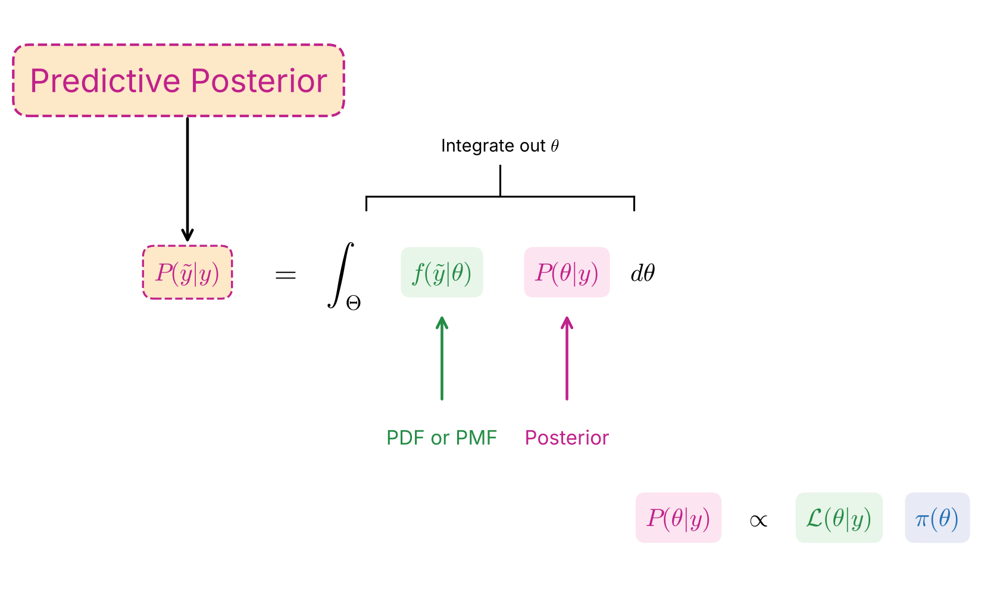
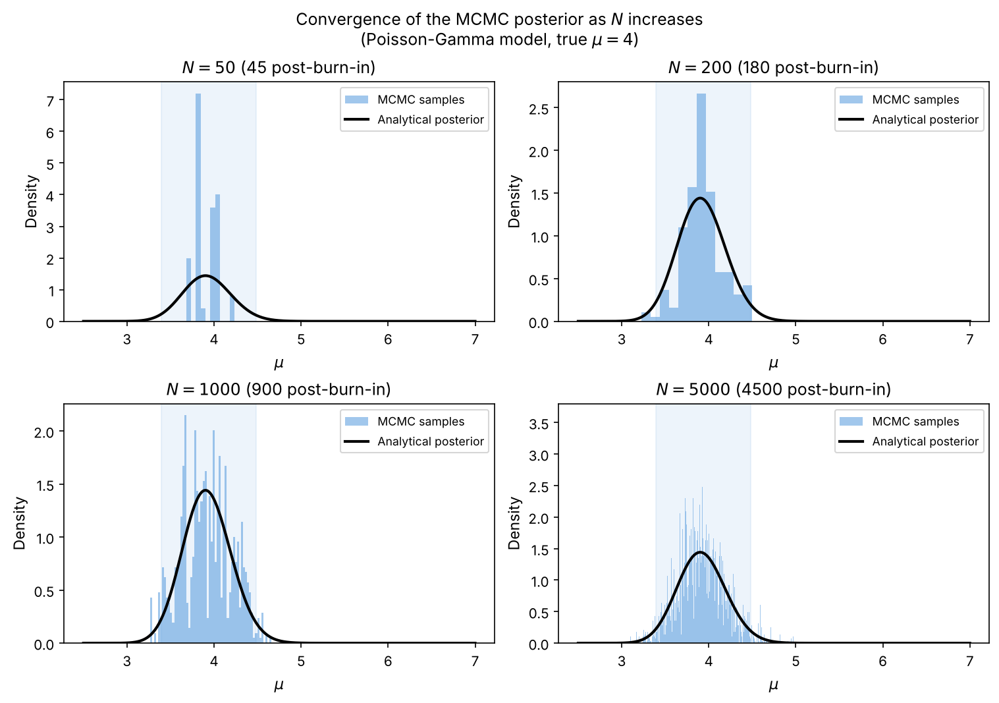
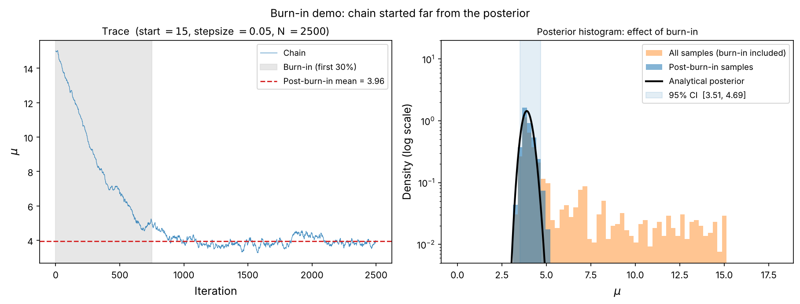
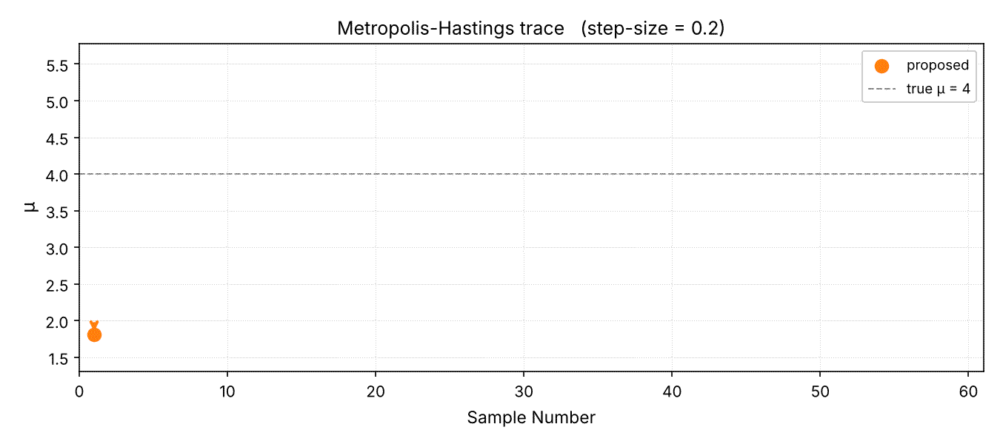
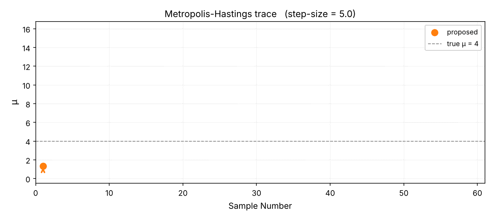

---
jupytext:
  formats: md:myst
  text_representation:
    extension: .md
    format_name: myst
kernelspec:
  name: python3
  display_name: 'Python 3'
---

(chapter:mcmc)=
# Predicting the Future

:::{warning}
🚧  This chapter is under development  🚧
:::

---

(sec:mcmc_predpost)=
## Predictive Posterior

In the [previous chapter](#chapter:bay) we derived the conjugate models analytically for Bernoulli and Binomial (Beta), Poisson and Exponential (Gamma), and Normal (Normal). This allowed use to generate Posterior probability distributions on the parameters, which give us the Maximum A Posteriori (MAP) parameter estimates and credible intervals.

We can continue analytically to find the **Predictive Posterior** distributions in some cases. These are not distributions on the parameter space but on the sample space: they are **predictive distributions of data not yet seen**.

The Predictive distribution is recovered by integrating out the parameter uncertainty, as illustrated in [](#fig:mcmc_pred).


:::{figure}
:label: fig:mcmc_pred

:::


The Posterior $P(\theta|y)$ gives us a distribution over the **parameter** $\theta$. The **Predictive Posterior** instead gives us a distribution over a **future observation** $\tilde{y}$, integrating out the parameter uncertainty:

```{math}
:label: eq:bay_pred

P(\tilde{y} \mid y) = \int_\Theta f(\tilde{y} \mid \theta)\; P(\theta \mid y)\, d\theta
```

<!--
For the Poisson-Gamma case, this integral can be computed analytically. The result is a **Negative Binomial** distribution:

```{math}
:label: eq:bay_nbinpred

P(\tilde{y} \mid y) = \text{NBinom}\!\left(\alpha + n\bar{y},\;\frac{\beta+n}{\beta+n+1}\right)
```

The Negative Binomial models the number of failures before a fixed number of successes. As a predictive distribution it has a key property: unlike the Posterior (which shrinks to a spike at $\hat{\theta}$ as $n \to \infty$), the Predictive Posterior maintains the same shape as the data distribution, because it integrates over parameter uncertainty.
-->


---

(sec:mcmc_predlomax)=
### Expon-Gamma $\rightarrow$ Lomax

To see how this integral is computed in practice, we work through the **Exponential-Gamma** case in full.

The Exponential likelihood for a single new observation $\tilde{y}$ is 

```{math}
:label: eq:mcmc_expon_new
f(\tilde{y}|\theta) = \theta\, e^{-\theta\tilde{y}}
```

The $\mathsf{Gamma}(\alpha', \beta')$ posterior on $\theta$ has PDF: 

```{math}
:label: eq:mcmc_gampost_new
P(\theta|y) = \dfrac{\beta'^{\alpha'}}{\Gamma(\alpha')}\, \theta^{\alpha'-1}\, e^{-\beta'\theta} 
```

Substituting both into the predictive integral yields:

```{math}
:label: eq:mcmc_lomax_end
P(\tilde{y} \mid y) = \frac{\alpha'\,\beta'^{\alpha'}}{(\beta'+\tilde{y})^{\,\alpha'+1}}
```


:::{dropdown} show lomax integral

```{math}
:label: eq:mcmc_lomax
\begin{aligned}
P(\tilde{y} \mid y)
  &= \int_0^{\infty} f(\tilde{y} \mid \theta)\; P(\theta \mid y)\; d\theta \\[8pt]
  &= \int_0^{\infty}
       \theta\, e^{-\theta\tilde{y}}
       \cdot
       \frac{\beta'^{\alpha'}}{\Gamma(\alpha')}\,\theta^{\alpha'-1}\,e^{-\beta'\theta}
     \; d\theta \\[8pt]
  &= \frac{\beta'^{\alpha'}}{\Gamma(\alpha')}
     \int_0^{\infty}
       \theta^{\,1}\cdot\theta^{\alpha'-1}\; e^{-\theta\tilde{y}}\cdot e^{-\beta'\theta}
     \; d\theta \\[8pt]
  &= \frac{\beta'^{\alpha'}}{\Gamma(\alpha')}
     \int_0^{\infty}
       \theta^{\alpha'}\, e^{-(\beta'+\tilde{y})\,\theta}
     \; d\theta
\end{aligned}
```

The remaining integral is a **standard Gamma integral**: for any $n > 0$ and $c > 0$,

$$\int_0^{\infty} \theta^{n-1}\, e^{-c\theta}\, d\theta = \frac{\Gamma(n)}{c^{\,n}}$$

Our integrand has $\theta^{\alpha'}$, so $n - 1 = \alpha'$, i.e. $n = \alpha' + 1$; and $c = \beta' + \tilde{y}$:

```{math}
:label: eq:mcmc_lomax2
\begin{aligned}
P(\tilde{y} \mid y)
  &= \frac{\beta'^{\alpha'}}{\Gamma(\alpha')} \cdot \frac{\Gamma(\alpha'+1)}{(\beta'+\tilde{y})^{\,\alpha'+1}} \\[8pt]
  &= \frac{\beta'^{\alpha'}}{\Gamma(\alpha')} \cdot \frac{\alpha'\,\Gamma(\alpha')}{(\beta'+\tilde{y})^{\,\alpha'+1}}
     \qquad \bigl[\,\Gamma(\alpha'+1) = \alpha'\,\Gamma(\alpha')\,\bigr] \\[8pt]
  &= \frac{\alpha'\,\beta'^{\alpha'}}{(\beta'+\tilde{y})^{\,\alpha'+1}}
\end{aligned}
```
:::


This is the PDF of the **Lomax distribution** (also called Pareto Type II) with the updated parameters we found in [](#sec:bay_expgam):

```{math}
:label: eq:mcmc_lomax_summary
\tilde{y} \mid y \;\sim\; \mathsf{Lomax}(\alpha',\, \beta') \qquad \text{with} \quad \alpha' = \alpha+N,\;\; \beta' = \beta + N\bar{y}
```

The series of plots in [](#fig:mcmc_eganim) is identical to that in [Bayesian Inference: Expon-Gamma](#fig:bay_egamanim) but with the addition of the Lomax predictive disrtibution in the third panel.

:::{figure}
:label: fig:mcmc_eganim


As we accumulate data, the Lomax Predictive Posterior distribution $P(\tilde{y}|y)$ quickly resembles the underlying true distribution of the data. This demonstrates the huge power of the predictive posterior to produce an accurate simulated data distribution informed by a small number of data measurements. 
:::


---

(sec:mcmc_predbetabinom)=
### Binomial-Beta $\rightarrow$ BetaBinom

The **Binomial-Beta** case follows the same pattern but uses the Beta integral instead of the Gamma integral.

The Binomial likelihood for a single new observation $\tilde{y} \in \{0,\ldots,n\}$ is:

```{math}
:label: eq:mcmc_binom_new
f(\tilde{y}|\theta) = \binom{n}{\tilde{y}} \theta^{\tilde{y}}(1-\theta)^{n-\tilde{y}}
```


The Beta posterior on $\theta$ — with updated parameters $\alpha' = \alpha + s$ and $\beta' = \beta + Nn - s$ (where $s = \sum_{i=1}^N y_i$) — has PDF:

```{math}
:label: eq:mcmc_betapost_new
P(\theta|y) = \dfrac{\theta^{\alpha'-1}(1-\theta)^{\beta'-1}}{B(\alpha',\beta')}
```

Substituting both into the predictive integral yields:

```{math}
:label: eq:mcmc_betabinom_end
P(\tilde{y} \mid y) = \binom{n}{\tilde{y}}\, \frac{B\!\left(\alpha'+\tilde{y},\; \beta'+n-\tilde{y}\right)}{B(\alpha',\beta')}
```

:::{dropdown} show beta-binomial integral

```{math}
:label: eq:mcmc_betabinom
\begin{aligned}
P(\tilde{y} \mid y)
  &= \int_0^{1} f(\tilde{y} \mid \theta)\; P(\theta \mid y)\; d\theta \\[8pt]
  &= \int_0^{1}
       \binom{n}{\tilde{y}} \theta^{\tilde{y}}\,(1-\theta)^{n-\tilde{y}}
       \cdot
       \frac{\theta^{\alpha'-1}(1-\theta)^{\beta'-1}}{B(\alpha',\beta')}
     \; d\theta \\[8pt]
  &= \frac{\dbinom{n}{\tilde{y}}}{B(\alpha',\beta')}
     \int_0^{1}
       \theta^{\,\tilde{y}}\cdot\theta^{\alpha'-1}\;
       (1-\theta)^{n-\tilde{y}}\cdot(1-\theta)^{\beta'-1}
     \; d\theta \\[8pt]
  &= \frac{\dbinom{n}{\tilde{y}}}{B(\alpha',\beta')}
     \int_0^{1}
       \theta^{\alpha'+\tilde{y}-1}\,
       (1-\theta)^{\beta'+n-\tilde{y}-1}
     \; d\theta
\end{aligned}
```

The remaining integral is a **standard Beta integral**: for any $a, b > 0$,

$$\int_0^{1} \theta^{a-1}(1-\theta)^{b-1}\, d\theta = B(a,\,b)$$

Here $a = \alpha' + \tilde{y}$ and $b = \beta' + n - \tilde{y}$:

```{math}
:label: eq:mcmc_betabinom2
\begin{aligned}
P(\tilde{y} \mid y)
  &= \frac{\dbinom{n}{\tilde{y}}}{B(\alpha',\beta')}
     \cdot B\!\left(\alpha'+\tilde{y},\; \beta'+n-\tilde{y}\right) \\[8pt]
  &= \binom{n}{\tilde{y}}\, \frac{B\!\left(\alpha'+\tilde{y},\; \beta'+n-\tilde{y}\right)}{B(\alpha',\beta')}
\end{aligned}
```
:::

This is the PMF of the **Beta-Binomial distribution** with the updated parameters we found in [](#sec:bay_binbet):

```{math}
:label: eq:mcmc_betabinom_summary
\tilde{y} \mid y \;\sim\; \mathsf{BetaBinom}(n,\, \alpha',\, \beta') \qquad \text{with} \quad \alpha' = \alpha + s,\;\; \beta' = \beta + Nn - s
```

The series of plots in [](#fig:mcmc_bbanim) is identical to that in [Bayesian Inference: Binomial-Beta](#fig:bay_bbanim) but with the addition of the BetaBinomial predictive disrtibution in the third panel.

:::{figure}
:label: fig:mcmc_bbanim


As we accumulate data, the BetaBinomial Predictive Posterior distribution $P(\tilde{y}|y)$ quickly resembles the underlying true distribution of the data. This demonstrates the huge power of the predictive posterior to produce an accurate simulated data distribution informed by a small number of data measurements. 
:::
---

(sec:mcmc_sumtables)=
### Summary of Predictive Distributions


The Predictive Posterior distributions and parameters for the most common data distributions are given in [](#tab:conjugate_table). The Normal model with known variance has longer update equations, given in [](#tab:conjugate_normal).

Throughout the tables:

- $N$ is the number of observations
- $s = \sum\limits_i^N y_i$ is the sum of observations
- $\bar{y} = s/N$ is the sample mean

Note that the Likelihood `distributions` in the second columnd are given in terms of the Prior forms (or equivalently, to the Posterior forms with uninformative priors); this choice results in continuous likelihood distributions with identical forms to the product of PMFs, for example `beta(s+1, N-s+1)` $= \prod\limits_i^N$ `bernoulli(p)`.

:::{table}
:label: tab:conjugate_table

| Data $y$  | Likelihood $\theta$ | Conjugate prior $\theta$| Posterior $\theta$| Predictive $\tilde{y}$|
|---|---|---|---|---|
| $θ^y(1-θ)^{1-y}$ <br /> `bernoulli(p)` <br/> `p=θ` | $θ^{s}(1-θ)^{N-s}$ <br />`beta(a,b)` <br /> `a=s+1` <br /> `b=N-s+1` |  $θ^{\alpha_0-1}(1-θ)^{\beta_0-1}$ <br />`beta(a,b)`<br /> `a=a0` <br /> `b=b0`| <br />`beta(a,b)`<br/> `a=a0+s` <br /> `b=b0+N-s`|<br />`betabinom(n,a,b)`<br/> `n=1`<br>`a=a0+s`<br/>`b=b0+N-s`|
| $θ^y(1-θ)^{n-y}$ <br /> `binom(n,θ)` | $θ^{s}(1-θ)^{Nn-s}$ <br /> `beta(s+1,Nn-s+1)` | $θ^{\alpha_0-1}(1-θ)^{\beta_0-1}$ <br /> `beta(a0,b0)` | `beta(a,b)`<br/>`a=a0+s`<br/>`b=b0+Nn-s`|`betabinom(n,a,b)`<br/>`a=a0+s`<br/>`b=b0+Nn-s`|
| $θ^ye^{-\theta}$ <br /> `poisson(θ)` | $θ^{s}e^{-N\theta}$ <br /> `gamma(s+1,N)` | $θ^{\alpha_0-1}e^{-\theta \beta_0}$ <br /> `gamma(a0,b0)` | `gamma(a=a,scale=1/b)`<br/>`a=a0+s`<br/>`b=b0+N`|`nbinom(n=a, p=p)`<br/>`a=a0+s`<br/>`b=b0+N`<br/>`p=b/(b+1)`|
| $θe^{-\theta y}$ <br /> `expon(θ)` | $θ^{N}e^{-\theta s}$ <br /> `gamma(N+1,s)` | $θ^{\alpha_0-1}e^{-\theta \beta_0}$ <br /> `gamma(a0,b0)` | `gamma(a=a,scale=1/b)`<br/>`a=a0+N`<br/>`b=b0+s`|`lomax(c=a,scale=b)`<br/>`a=a0+N`<br/>`b=b0+s`|

Lookup table for the distributions and parameters for  Bernoulli, Binomial, Poisson, and Exponential data.
:::


:::{table}
:label: tab:conjugate_normal

| Data $y$ | Likelihood $\mu$ | Conjugate prior $\mu$ | Posterior $\mu$ | Predictive $\tilde{y}$ |
|---|---|---|---|---|
| $e^{-(y-\mu)^2/2\sigma^2}$ <br /> `norm(μ,σ)` <br /> (σ known) | $e^{-N(\bar{y}-\mu)^2/2\sigma^2}$ <br /> `norm(ȳ, σ/√N)` | $e^{-(\mu-\mu_0)^2/2\sigma_0^2}$ <br /> `norm(μ_0, σ_0)` | `norm(μ_N, σ_N)`<br/>`σ_N=sqrt(1/(1/σ_0²+N/σ²))`<br/>`μ_N=σ_N²*(μ_0/σ_0²+N*ȳ/σ²)` | `norm(μ_N, sqrt(σ²+σ_N²))` |

Lookup table for the distributions and parameters for  Normal data with known $\sigma$.
:::


(sec:mcmc_noint)=
### No Integral, No Problem

In general, the posterior integral $\int \mathcal{L}(y|\theta)\,\pi(\theta)\,d\theta$ cannot be solved analytically.

For example, **logistic regression** models a binary outcome with probability $p = \sigma(X\beta)$, where $\sigma(z) = 1/(1+e^{-z})$ is the **logistic (sigmoid) function** — the S-shaped curve that squashes any real number into the interval $(0,1)$. No prior on the regression coefficients $\beta$ is conjugate to this likelihood, so the posterior integral has no closed form. 

More generally, any model with two or more **correlated** parameters leads to a multi-dimensional integral $\iint \mathcal{L}\,\pi\,d\theta_1\,d\theta_2$ that cannot be evaluated analytically, even when each marginal likelihood is in the exponential family.


In these cases, we can still use the magic of Bayesian Updating to predict the future, as we can approximate the posterior by **sampling** from it using a **Markov Chain**.

---

(sec:mcmc_mcmc)=
## Markov Chain Monte Carlo (MCMC)

Rather than integrating analytically, MCMC builds up an **empirical sampling distribution** that approximates the posterior. To build the sampling distribution, we:

1. Start at some value of the parameter $\theta$.
2. Take a random step to a new proposed value.
3. Decide whether to accept the new value or stay at the old one.
4. Repeat — the sequence of accepted values forms a **Markov Chain**.

The chain is **memoryless**: each decision depends only on the current value, not on how we got there.

An attractive property of this approach is that we only ever need the **ratio** of posteriors between two proposed parameter values — the normalising constants (evidence) cancel out:

```{math}
:label: eq:mh_ratio
p_a = \frac{P(\theta_1|y)}{P(\theta_0|y)} = \frac{\mathcal{L}(\theta_1|y)\,\pi(\theta_1)}{\mathcal{L}(\theta_0|y)\,\pi(\theta_0)}
```

---

(sec:mcmc_mha)=
### The Metropolis-Hastings Algorithm

The Metropolis-Hastings (MH) algorithm is an iterative process that implements the Markov Chain steps above. One MH iteration is:

1. **Start**: current value $\theta_0$ (initial guess).
2. **Propose**: add random noise to get a candidate $\theta_1 \sim \mathsf{Norm}(\theta_0, \sigma_\mathsf{step})$, where $\sigma_\mathsf{step})$ is the noise level or **step size**, a hyperparameter of the MH algorithm.
3. **Compare**: compute the [posterior ratio](eq:mh_ratio) $p_a = P(\theta_1|y)/P(\theta_0|y)$:
   - If $p_a > 1$: **accept** $\theta_1$ (it's better).
   - If $p_a > \mathsf{U}(0,1)$[^note2]: **randomly accept** $\theta_1$ (it's worse but not by much — this is what allows the chain to explore).
   - Otherwise: **reject**, keep $\theta_0$.
4. **Repeat**: the winner ($\theta_0$ or $\theta_1$) becomes the starting point for the next iteration.

[^note2]: The notation $\mathsf{U}(0,1)$ indicates a number drawn from a Uniform distribution on (0,1). The value drawn will be from the pseudorandom distribution in that range.

After many iterations we have a sample of values from the posterior, which we can use as an **Empirical Predictive Posterior**. We can use this to compute MAP estimates and credible intervals.

---

(sec:mcmc_tuning)=
### Tuning the Sampler

Three hyperparameters control the behaviour of the chain.

**Number of samples** (`s_N`). The empirical histogram of accepted values converges to the true posterior as $N \to \infty$. With too few samples the histogram is lumpy and credible intervals are unreliable; a few thousand samples are typically sufficient for a one-parameter model. More is always better — the only cost is computation time.

:::{figure}
:label: fig:mcmc_N_convergence


MCMC posterior approximation for $N = 50$, $200$, $1000$, $5000$ samples (Poisson-Gamma model, true $\mu = 4$).
The black curve is the analytical posterior; the histogram is the MCMC approximation.
The posterior converges visibly as $N$ increases.
:::

**Burn-in** (`s_burnin`). The chain starts at an arbitrary initial value $\theta_0$, which may be far from the region of high posterior mass. The first few steps are therefore unreliable: the chain is "walking in" to the posterior. Discarding the initial `s_burnin` fraction removes this warm-up period from the resulting sampling distribution. If the starting value is very far from the true parameter — for example, starting at $\theta_0 = 100$ when the posterior is concentrated near $4$ — a generous burn-in fraction is essential.

:::{figure}
:label: fig:mcmc_burnin


Burn-in demo: the chain starts at $\theta_0 = 15$, far from the posterior mode near $4$.
**Left**: trace plot with the burn-in period shaded grey; the chain walks into the
high-probability region within the first ~100 iterations.
**Right**: including the burn-in samples skews the histogram (orange); discarding them
recovers the correct posterior (blue), which matches the analytical curve (black).
:::


**Step size** (`s_stepsize`). At each iteration, the proposed value $\theta_1$ is drawn from a $\mathsf{Norm}(\theta_0,\,\sigma_\mathsf{step})$ distribution. If $\sigma_\mathsf{step}$ is too **small**, the chain moves very slowly — it accepts almost every proposal but explores only a tiny neighbourhood at each step, so it takes a very long time to map out the posterior. If $\sigma_\mathsf{step}$ is too **large**, almost every proposal lands in the low-probability tail and is rejected — the chain barely moves. A well-tuned step size produces an **acceptance fraction** of roughly 20–50%.[^mh_opt]


[^mh_opt]: The 20–50% rule of thumb reflects two theoretical results. Roberts, Gelman & Gilks (1997)[^rgb1997] showed that for a high-dimensional isotropic target the asymptotically optimal acceptance rate is ≈‣23.4%; Roberts & Rosenthal (2001)[^rr2001] showed the 1-D optimum is ≈‣44%. The intuition: a low acceptance fraction means most proposals are wasted (the step is so large that the chain rarely moves); a high fraction means the step is so small that the chain moves but barely explores — either extreme leads to high autocorrelation and poor effective sample size. The sweet spot balances exploration against acceptance.
[^rgb1997]: Roberts, G.O., Gelman, A. & Gilks, W.R. (1997). *Weak convergence and optimal scaling of random walk Metropolis algorithms.* Ann. Appl. Probab. 7(1), 110–120.
[^rr2001]: Roberts, G.O. & Rosenthal, J.S. (2001). *Optimal scaling for various Metropolis-Hastings algorithms.* Stat. Sci. 16(4), 351–367.

A plot of the accepted value at each step —— known as a **Trace Plot** —— illustrates the effect of the `s_stepsize` parameter. The animation in [](#fig:mcmc_trace) shows 60 steps of the sampler for a Poisson-Gamma model with true $\mu = 4$: green markers are proposals accepted outright ($p_a > 1$), the blue markers indicate proposals accepted at random ($p_a < 1$ but $p_a > \mathsf{U}(0,1)$), and the red markers are rejected proposals (the chain stays at its previous value).

:::{figure}
:label: fig:mcmc_trace


Metropolis-Hastings trace plot for a Poisson-Gamma model (true $\mu = 4$, step-size $= 1.0$). Green = accepted; blue = randomly accepted; red = rejected.
:::

The two animations below contrast a step size that is [too small](#fig:mcmc_trace_small) and one that is [too large](#fig:mcmc_trace_large).

:::{figure}
:label: fig:mcmc_trace_small


Step size too small (step-size $= 0.2$, acceptance fraction 68%). The chain accepts almost every proposal but moves only tiny distances at each step — it takes far more iterations to explore the posterior than a well-tuned sampler would.
:::

:::{figure}
:label: fig:mcmc_trace_large


Step size too large (step-size $= 5.0$, acceptance fraction 13%). Nearly every proposal is rejected and the chain barely moves, spending long stretches at the same value.
:::


---

(sec:mcmc_multi)=
## Multiple Parameters


(sec:mcmc_gibbs)=
### Gibbs Sampling

**Gibbs sampling** extends Metropolis-Hastings to multiple parameters. Instead of proposing all parameters simultaneously, it updates **one parameter at a time**, conditioning on the current values of all others.

For two parameters $a$ and $b$:

1. Start with initial guesses $(a_0, b_0)$.
2. Propose $a_1 \sim \mathsf{Norm}(a_0, \sigma_a)$.
3. Compare posteriors **given** $b_0$; accept or reject $a_1$ as in MH.
4. Propose $b_1 \sim \mathsf{Norm}(b_0, \sigma_b)$.
5. Compare posteriors **given** $a_1$; accept or reject $b_1$.
6. Repeat from step 2.

Gibbs sampling can be **very slow** when parameters are correlated, because the chain zigzags through the posterior rather than moving efficiently along the main axis of correlation.

---

(sec:mcmc_diffev)=
### Differential Evolution

**Differential Evolution (DE)** addresses the inefficiency of Gibbs sampling by running **multiple chains simultaneously** and using the information across chains to generate proposals.

For each chain $i$:

1. **Start**: initial guess $\theta_i^{(t=0)}$ (one guess per chain, usually spread across the parameter space).
2. **Propose**: randomly select two other chains $j$ and $k$; the proposal is

   $$\theta_i^* = \theta_i^{(t)} + \gamma\,(\theta_j^{(t)} - \theta_k^{(t)}) + \epsilon$$

   where $t$ indicates the iteration, $\gamma$ is a tuning scale factor and $\epsilon$ is a small random noise (to avoid degeneracy).
3. **Accept/Reject**: as in MH.

DE has only **two tuning parameters** (the scale $\gamma$ and the noise $\epsilon$), regardless of the number of model parameters — a significant advantage over standard MH which needs a separate step size for each parameter. The multiple chains automatically adapt to the shape of the posterior.

---

(sec:mcmc_ppl)=
### Probabilistic Programming Libraries

In practice, most MCMC analyses use dedicated libraries rather than hand-coded samplers. Two popular choices:

**PyMC** ([docs](https://www.pymc.io/welcome.html)) is the most widely used probabilistic programming library in Python. It uses Differential Evolution and other modern samplers. The documentation can be dense, but the [Bayesian Methods for Hackers](https://nbviewer.org/github/CamDavidsonPilon/Probabilistic-Programming-and-Bayesian-Methods-for-Hackers/blob/master/Chapter1_Introduction/Ch1_Introduction_PyMC2.ipynb) notebook is an excellent introduction.

**emcee** ([docs](https://emcee.readthedocs.io/en/stable/tutorials/quickstart/)) is a simpler library popular in astronomy. It is easy to get started with, but does not support predictive posteriors out of the box.

The example below reproduces the Poisson-Gamma analysis in PyMC so you can compare the
result directly with the hand-coded sampler in the next section. PyMC becomes especially
powerful for multi-parameter models where no analytical posterior exists.

```python
import pymc as pm

with pm.Model() as model:
    # Prior: Gamma(shape=5, rate=1)
    # PyMC uses rate (beta), not scale — Gamma(alpha=5, beta=1) = Gamma(shape=5, scale=1)
    mu = pm.Gamma("mu", alpha=5, beta=1)
    # Likelihood
    y  = pm.Poisson("y", mu=mu, observed=data)
    # Draw posterior samples using DE-MCMC
    trace = pm.sample(2000, tune=1000, chains=2,
                      random_seed=42, progressbar=False)

pm.plot_posterior(trace, var_names=["mu"])
```

**Stan** ([mc-stan.org](https://mc-stan.org)) is a compiled probabilistic programming
language with a C++ backend, used widely in academic research including high-energy physics
experiments. Stan is typically faster than Python-based samplers for complex hierarchical
models. Python users can access it via
[CmdStanPy](https://mc-stan.org/cmdstanpy/). Unlike PyMC, the model is specified in a
separate `.stan` file that is compiled before sampling.


---

(sec:mcmc_python)=
## Python Examples

This section builds the MCMC pipeline step by step. The [Sampler](#sec:mcmc_sampler) implements the Metropolis-Hastings algorithm with plain function arguments. [Autocorrelation](#sec:mcmc_acf) shows how to diagnose chain quality. The [Posterior Plot](#sec:mcmc_postplot) produces the standard two-panel summary of the posterior distribution.

---

(sec:mcmc_sampler)=
### Sampler

```{code-cell} python
import numpy as np
from scipy.stats import norm, gamma, poisson

def sampler(data, prior_shape, prior_scale,
            N=5000, stepsize=1.0, burnin=0.1, thin=1, non_neg=True):
    """Metropolis-Hastings sampler for a Poisson-Gamma model.

    Parameters
    ----------
    data : array-like        observed counts
    prior_shape, prior_scale : float    Gamma prior hyperparameters (scale convention)
    N : int                  total MH iterations
    stepsize : float         std of the Normal proposal distribution
    burnin : float           fraction of iterations to discard (0–1)
    thin : int               keep every thin-th sample
    non_neg : bool           reflect proposals to stay non-negative
    """
    prior = gamma(a=prior_shape, scale=prior_scale)
    a0 = float(np.random.choice(data))   # start at a random data value
    if non_neg:
        a0 = abs(a0)
    samples = []
    for i in range(N):
        # --- Propose ---
        a1 = norm(a0, stepsize).rvs()
        if non_neg:
            a1 = abs(a1)
        # --- Log-likelihoods ---
        LL0 = np.sum(poisson(mu=a0).logpmf(data))
        LL1 = np.sum(poisson(mu=a1).logpmf(data))
        # --- Posterior ratio in log-space ---
        log_post0 = LL0 + np.log(prior.pdf(a0))
        log_post1 = LL1 + np.log(prior.pdf(a1))
        p_a = np.exp(log_post1 - log_post0)
        # --- Decision ---
        if p_a > 1 or p_a > np.random.rand():
            a0 = a1
        # --- Store (after burn-in, keeping every thin-th sample) ---
        if i >= int(burnin * N) and i % thin == 0:
            samples.append(a0)
    return samples
```

```{code-cell} python
# Data and prior
np.random.seed(42)
data        = poisson(mu=4).rvs(size=50)
prior_shape = 5.0
prior_scale = 1.0

# Sampler settings
N, stepsize, burnin, thin = 5_000, 1.0, 0.1, 1

samples = sampler(data, prior_shape, prior_scale,
                  N=N, stepsize=stepsize, burnin=burnin, thin=thin)
print(f"{len(samples)} samples  |  mean = {np.mean(samples):.3f}  |  "
      f"95% CI = [{np.percentile(samples, 2.5):.3f}, {np.percentile(samples, 97.5):.3f}]")
```


---

(sec:mcmc_acf)=
### Autocorrelation

The **Autocorrelation Function (ACF)** tests whether consecutive samples are statistically
independent. If sample $i$ and sample $i+k$ are correlated — i.e. the ACF at lag $k$ is large
— consecutive samples carry redundant information and the **effective sample size** is smaller
than $N$.

The blue shaded band marks the 95% confidence region under the null hypothesis of zero
correlation. Bars *inside* the band are not significantly different from zero — the target
behaviour for a well-mixed chain. The cell below runs the sampler three times with different
step sizes and plots the ACF for each.

```{code-cell} python
from statsmodels.graphics.tsaplots import plot_acf
import matplotlib.pyplot as plt

n_acf = 500   # short run to make autocorrelation visible

sam_small = sampler(data, prior_shape, prior_scale, N=n_acf, stepsize=0.2, burnin=0)
sam_good  = sampler(data, prior_shape, prior_scale, N=n_acf, stepsize=1.0, burnin=0)
sam_large = sampler(data, prior_shape, prior_scale, N=n_acf, stepsize=5.0, burnin=0)

fig, axes = plt.subplots(3, 1, figsize=(9, 6), sharex=True, sharey=True, layout='tight')
for ax, samp, ss, col in zip(
        axes,
        [sam_small, sam_good, sam_large],
        [0.2, 1.0, 5.0],
        ['#d62728', '#2ca02c', '#ff7f0e']):
    nlags = min(len(samp) - 1, 40)
    plot_acf(samp, ax=ax, lags=nlags, title=None, c=col,
             markersize=8, alpha=0.05, vlines_kwargs={"colors": "slategray"})
    ax.set_ylim(-0.4, 1.2)
    ax.text(0.55, 0.78, f'stepsize = {ss}  (N = {len(samp)})',
            transform=ax.transAxes, fontsize=11)

fig.supylabel('Autocorrelation', fontsize=13)
fig.supxlabel('Lag', fontsize=13)
plt.show()
```


---

(sec:mcmc_postplot)=
### Posterior Plot

A standard posterior plot has two panels: the **trace** on the left (every accepted value as a
function of iteration, with the burn-in period shaded) and the **posterior histogram** on the
right, overlaid with the analytical PDF and a 95% credible interval.

The function `run_trace` below is a minimal MH loop that returns *every* chain value so the
full trace is visible — unlike `sampler`, it applies no burn-in or thinning internally.

```{code-cell} python
from scipy.stats import gamma as gamma_dist
import matplotlib.pyplot as plt

def run_trace(data, prior_shape, prior_scale, N=1000, stepsize=1.0, start=None):
    """MH loop returning every chain value — no burn-in or thinning applied."""
    prior = gamma_dist(a=prior_shape, scale=prior_scale)
    a0 = start if start is not None else float(np.random.choice(data))
    a0 = abs(a0)
    trace = []
    for _ in range(N):
        a1 = abs(norm(a0, stepsize).rvs())
        LL0 = np.sum(poisson(mu=a0).logpmf(data))
        LL1 = np.sum(poisson(mu=a1).logpmf(data))
        lp0 = LL0 + np.log(prior.pdf(a0))
        lp1 = LL1 + np.log(prior.pdf(a1))
        if np.exp(lp1 - lp0) > np.random.rand():
            a0 = a1
        trace.append(a0)
    return trace

np.random.seed(0)
N_trace     = 1000
burnin_frac = 0.2
burnin_N    = int(burnin_frac * N_trace)

trace        = run_trace(data, prior_shape, prior_scale, N=N_trace)
post_samples = trace[burnin_N:]

# Analytical posterior  (Poisson-Gamma conjugacy)
post_a     = prior_shape + np.sum(data)
post_scale = 1.0 / (1.0 / prior_scale + len(data))
x_pdf      = np.linspace(2.5, 7.0, 300)
post_pdf   = gamma_dist(a=post_a, scale=post_scale).pdf(x_pdf)
lo, hi     = np.percentile(post_samples, [2.5, 97.5])

fig, (ax1, ax2) = plt.subplots(1, 2, figsize=(12, 4))

# --- left: trace ---
ax1.plot(trace, color='#1f77b4', linewidth=0.6, alpha=0.85)
ax1.axvspan(0, burnin_N, color='#dddddd', alpha=0.65, label='burn-in')
ax1.axhline(np.mean(post_samples), color='#d62728', linewidth=1.3,
            linestyle='--', label=f'mean = {np.mean(post_samples):.2f}')
ax1.set_xlabel('Iteration')
ax1.set_ylabel(r'$\mu$')
ax1.set_title('Trace plot')
ax1.legend(fontsize=9)

# --- right: histogram + analytical posterior ---
ax2.hist(post_samples, bins=40, density=True, alpha=0.5,
         color='#1f77b4', label='MCMC samples')
ax2.plot(x_pdf, post_pdf, 'k-', linewidth=2, label='Analytical posterior')
ax2.axvspan(lo, hi, alpha=0.15, color='#1f77b4',
            label=f'95% CI  [{lo:.2f}, {hi:.2f}]')
ax2.axvline(np.mean(post_samples), color='#d62728', linewidth=1.5,
            linestyle='--', label=f'mean = {np.mean(post_samples):.2f}')
ax2.set_xlabel(r'$\mu$')
ax2.set_ylabel('Density')
ax2.set_title('Posterior distribution')
ax2.legend(fontsize=9)

fig.tight_layout()
plt.show()
```

<!--
Note that **log-likelihoods** are used (`logpmf`) rather than likelihoods to avoid numerical underflow with large datasets, and the ratio is computed in log space as shown above.

### Sampler Hyperparameters

The key settings that control the MCMC run:

```python
s_N        = 5_000    # Number of samples (more is better, but slower)
s_guess    = -1       # Starting value (-1 = random draw from data range)
s_stepsize = 4.0      # Step size: std of the Normal proposal distribution
s_burnin   = 0.01     # Fraction of samples to discard as burn-in
s_thin     = 1        # Keep every s_thin-th sample (1 = keep all)
s_non_neg  = True     # Enforce non-negative parameter values
```

**Burn-in**: The first few samples in a chain may be unreliable because the chain starts at an arbitrary point. Discarding the initial `s_burnin` fraction removes this warm-up period.

**Thinning**: If `s_thin > 1`, only every $k$-th sample is kept. This reduces the autocorrelation between consecutive samples, at the cost of fewer samples.
-->

---

<!--
## Workshop: `PoissonGamma-v2.py`

The workshop file `PoissonGamma-v2.py` implements the full Metropolis-Hastings MCMC pipeline for the Poisson-Gamma model. The key sections of the file are:

### Data and Prior Setup

```python
# Data: drawn from Poisson(data_shape)
data_shape = 4       # true Poisson rate mu
data_N     = 50      # number of data points

# Prior: Gamma(prior_shape, prior_scale)  [scale convention, not rate]
prior_shape = 5.     # Gamma alpha hyperparameter
prior_scale = 1.0    # Gamma scale hyperparameter (scale = 1/rate)
```

**Important**: `PoissonGamma-v2.py` uses the **scale** convention for the Gamma distribution (`scale = 1/rate`), consistent with `scipy.stats.gamma`. This differs from the lecture notes where $\beta$ is the **rate** (and `scipy` is called with `scale=1/beta`). Always check which convention a file uses.

### Running the Sampler

The sampler is called as:

```python
samples, sval = sampler(data, prior_config, hp1)
```

where `sval` is the starting value used (for diagnostics). The returned `samples` list contains the accepted parameter values, already filtered by burn-in and thinning.

### Diagnostics

The file produces three standard MCMC diagnostics:

**Trace plot**: the accepted parameter value at each step. A good trace should look like white noise — exploring freely around the true value. A trace that moves too slowly (step size too small) or that jumps erratically (step size too large) indicates poor mixing.

**Autocorrelation function (ACF)**: measures correlation between samples separated by different lags. Good MCMC samples should have low autocorrelation. High autocorrelation suggests the chain needs more thinning or a larger step size.

**Acceptance fraction**: the proportion of proposed steps that were accepted. A very high acceptance fraction (near 1) means the step size is too small (the sampler barely moves). A very low fraction means the step size is too large (most proposals are rejected). A target of roughly 20–50% is typical.

### Comparing MCMC to the Analytical Result

Since we know the analytical posterior for Poisson-Gamma is $\text{Gamma}(\alpha + n\bar{y},\; \beta + n)$, we can **validate** the MCMC output by overlaying:

* The **MCMC histogram** of sampled $\theta$ values
* The **analytical posterior** Gamma PDF
* The **predictive posterior** NBinom PMF vs the MCMC-based predictive

When properly tuned, the MCMC histogram should closely match the analytical posterior — confirming the sampler is working correctly.
-->
---

<!--
## Summary

| Technique | When to Use | Key Idea |
|---|---|---|
| Non-parametric bootstrap | Uncertainty on any statistic; distribution unknown | Resample with replacement, compute statistic many times |
| Parametric bootstrap | Uncertainty on statistic; distribution known | Resample from fitted MLE distribution |
| Smoothed bootstrap | Inflated uncertainty (conservative) | Add noise to each bootstrap resample |
| Metropolis-Hastings | Single parameter, posterior known up to normalisation | Propose, accept/reject via posterior ratio |
| Gibbs sampling | Multiple parameters, can sample each conditional | MH one parameter at a time |
| Differential Evolution | Multiple correlated parameters | Multiple chains; proposals informed by inter-chain differences |

The bootstrap is a **frequentist** tool: it estimates sampling variability of a statistic under repeated experiments. MCMC is a **Bayesian** tool: it explores the posterior distribution of parameters given the data. Both are indispensable for modern data analysis.
00-->