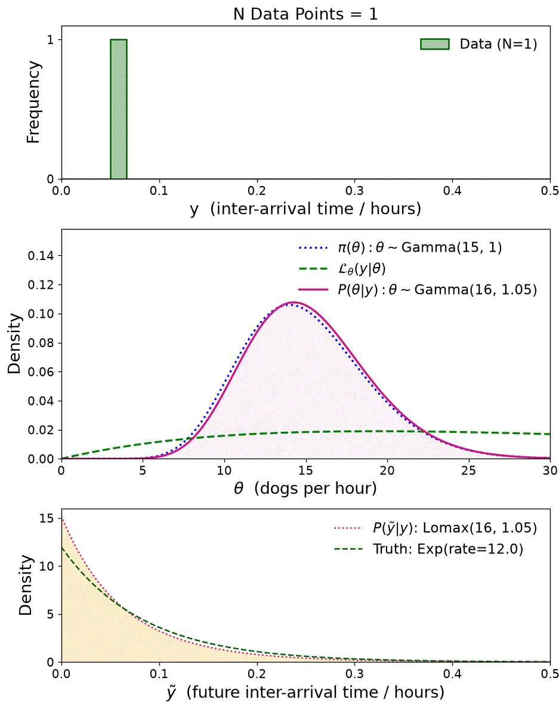
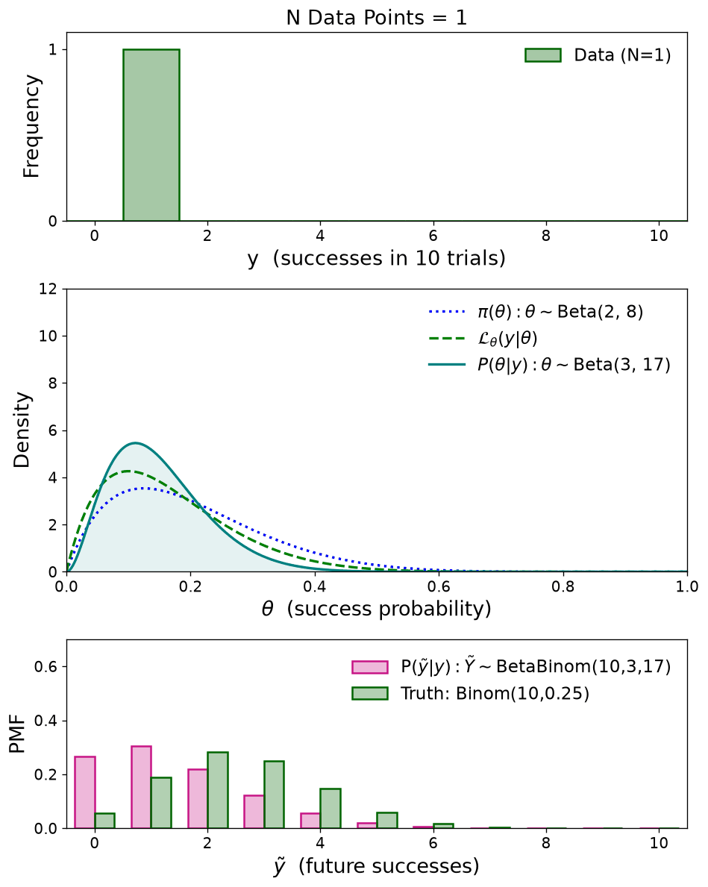
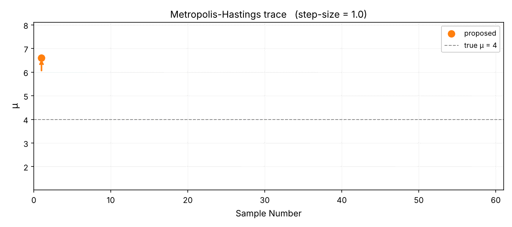

---
jupytext:
  formats: md:myst
  text_representation:
    extension: .md
    format_name: myst
kernelspec:
  name: python3
  display_name: 'Python 3'
---

(chapter:mcmc)=
# Predicting the Future

* `numpy` methods: `sort, ceil, random.rand`
* `scipy.stats` distributions: `nbinom`
* `scipy.stats` methods: `logpmf`
* `statsmodels` methods: `plot_acf`
* `pymc` methods: `Model, Gamma, Poisson, sample`
* `arviz` methods: `summary`
* `matplotlib` methods: `axvspan, axhline, supxlabel, supylabel, colors.to_rgb`

---

(sec:mcmc_predpost)=
## Posterior Predictive (Analytical)

In the [previous chapter](#chapter:bay) we derived the conjugate models analytically for Bernoulli and Binomial (Beta), Poisson and Exponential (Gamma), and Normal (Normal). This allowed us to generate Posterior probability distributions on the parameters, which give us the Maximum A Posteriori (MAP) parameter estimates and credible intervals.

We can continue analytically to find the **Posterior Predictive** distributions in some cases. These are not distributions on the parameter space but on the sample space: they are **predictive distributions of data not yet seen**.

The posterior predictive distribution is found by integrating out the parameter uncertainty, as illustrated in [](#fig:mcmc_pred).


:::{figure}
:label: fig:mcmc_pred


The posterior predictive distribution of a new observation $\ynew$: the PDF or PMF of the data, $f(\ynew|\theta)$, averaged over the Posterior for $\theta$.
:::


The Posterior $P(\theta|y)$ gives us a distribution over the **parameter** $\theta$. The **Posterior Predictive** instead gives us a distribution over a **future observation** $\ynew$, integrating out the parameter uncertainty:

```{math}
:label: eq:mcmc_pred

P(\ynew | y) = \int_\Theta f(\ynew | \theta)\; P(\theta | y)\, d\theta
```


---

(sec:mcmc_predlomax)=
### Expon-Gamma $\rightarrow$ Lomax

To see how this integral is computed in practice, we work through the [**Exponential-Gamma**](#sec:bay_expgam) case in full.

The Exponential likelihood for a single new observation $\ynew$ is 

```{math}
:label: eq:mcmc_expon_new
f(\ynew|\theta) = \theta\, e^{-\theta\ynew}
```

The $\mathsf{Gamma}(\alpha', \beta')$ posterior on $\theta$ has PDF: 

```{math}
:label: eq:mcmc_gampost_new
P(\theta|y) = \dfrac{\beta'^{\alpha'}}{\Gamma(\alpha')}\, \theta^{\alpha'-1}\, e^{-\beta'\theta} 
```

Substituting both into the predictive integral, the $\theta$ terms combine into a standard **Gamma integral**, $\int_0^\infty \theta^{n-1}e^{-c\theta}\,d\theta = \Gamma(n)/c^{\,n}$ (see [Math Methods B](#sec:mmb_predlomax) for the full working), which gives:

```{math}
:label: eq:mcmc_lomax_end
P(\ynew | y) = \frac{\alpha'\,\beta'^{\alpha'}}{(\beta'+\ynew)^{\,\alpha'+1}}
```


This is the PDF of the **Lomax distribution** (also called Pareto Type II) with the updated parameters we found in [](#sec:bay_expgam):

```{math}
:label: eq:mcmc_lomax_summary
\ynew | y \;\sim\; \mathsf{Lomax}(\alpha',\, \beta') \qquad \text{with} \quad \alpha' = \alpha+N,\;\; \beta' = \beta + N\bar{y}
```

:::{tip} The story of the Lomax distribution
In 1954, K. S. Lomax, a statistician at the University of Manchester, was studying how long businesses survive, using records of the shops and firms of Poughkeepsie, New York, from 1844 to 1926 ([Lomax 1954](https://doi.org/10.1080/01621459.1954.10501239)). If businesses failed at a constant rate, their lifetimes would follow an Exponential distribution, which has **no memory**: a business that has survived for ten years would be just as likely to fail next year as a brand-new one. That is not what he found. The longer a business had survived, the *less* likely it was to fail. The distribution he used to describe this now carries his name.

Our dog-spotting posterior predictive has the same feature, for a different reason. If we knew the rate $\theta$ exactly, the waiting time to the next dog would be Exponential, and having already waited ten minutes would tell us nothing. But we don't know $\theta$; we only have a Posterior for it. A long wait is itself evidence that the rate may be lower than we thought, so **the longer we have been waiting, the longer we should expect to keep waiting**. Averaging the memoryless Exponential over our uncertainty about $\theta$ gives exactly Lomax's distribution.
:::

The series of plots in [](#fig:mcmc_eganim) is identical to that in [Bayesian Inference: Expon-Gamma](#fig:bay_egamanim) but with the addition of the Lomax predictive distribution in the third panel.

:::{figure}
:label: fig:mcmc_eganim


As we accumulate data, the Lomax posterior predictive distribution $P(\ynew|y)$ approaches the true distribution of the data. With only a few measurements it is wider than the truth, because it includes our uncertainty about $\theta$; as that uncertainty shrinks, the prediction sharpens.
:::


---

(sec:mcmc_predbetabinom)=
### Binomial-Beta $\rightarrow$ BetaBinom

The [**Binomial-Beta**](#sec:bay_binbet) case follows the same pattern but uses the Beta integral instead of the Gamma integral.

The Binomial likelihood for a single new observation $\ynew \in \{0,\ldots,n\}$ is:

```{math}
:label: eq:mcmc_binom_new
f(\ynew|\theta) = \binom{n}{\ynew} \theta^{\ynew}(1-\theta)^{n-\ynew}
```


The Beta posterior on $\theta$ — with updated parameters $\alpha' = \alpha + s$ and $\beta' = \beta + Nn - s$ (where $s = \sum_{i=1}^N y_i$) — has PDF:

```{math}
:label: eq:mcmc_betapost_new
P(\theta|y) = \dfrac{\theta^{\alpha'-1}(1-\theta)^{\beta'-1}}{B(\alpha',\beta')}
```

Substituting both into the predictive integral, the $\theta$ terms combine into a standard **Beta integral**, $\int_0^1 \theta^{a-1}(1-\theta)^{b-1}\,d\theta = B(a,b)$ (see [Math Methods B](#sec:mmb_predbetabinom) for the full working), which gives:

```{math}
:label: eq:mcmc_betabinom_end
P(\ynew | y) = \binom{n}{\ynew}\, \frac{B\!\left(\alpha'+\ynew,\; \beta'+n-\ynew\right)}{B(\alpha',\beta')}
```


This is the PMF of the **Beta-Binomial distribution** with the updated parameters we found in [](#sec:bay_binbet):

```{math}
:label: eq:mcmc_betabinom_summary
\ynew | y \;\sim\; \mathsf{BetaBinom}(n,\, \alpha',\, \beta') \qquad \text{with} \quad \alpha' = \alpha + s,\;\; \beta' = \beta + Nn - s
```

:::{tip} The story of the Beta-Binomial: Pólya's urn
The Beta-Binomial was first written down as a distribution by J. G. Skellam in 1948, for Binomial experiments whose probability of success varies from one set of trials to the next ([Skellam 1948](https://doi.org/10.1111/j.2517-6161.1948.tb00014.x)). But there is a more charming way to meet it: **Pólya's urn**, named after the Hungarian mathematician George Pólya, who invented it with Florian Eggenberger in 1923 to model the spread of contagious diseases: each new case makes further cases more likely.

Start with an urn holding $\alpha$ red balls and $\beta$ white balls. Draw a ball at random, note its colour, and put it back **together with another ball of the same colour**. Repeat $n$ times. The number of red balls you draw follows a $\mathsf{BetaBinom}(n, \alpha, \beta)$ distribution. The urn is a little "rich get richer" machine: every red draw makes the next red draw more likely.

It is also Bayesian updating in disguise. Remember the rule from [](#sec:bay_toyber): *each success adds 1 to $\alpha$, each failure adds 1 to $\beta$*. That is exactly what the urn does! For [Alf's trick shot](#sec:bay_toybin), the $\mathsf{Beta}(2,8)$ Prior is an urn with 2 "pot" balls and 8 "miss" balls. After his 7 pots and 23 misses, the urn holds 9 and 31 balls: the $\mathsf{Beta}(9,31)$ Posterior. Predicting his next 10 shots is the same as drawing 10 more balls from this urn.
:::

The series of plots in [](#fig:mcmc_bbanim) is identical to that in [Bayesian Inference: Binomial-Beta](#fig:bay_bbanim) but with the addition of the BetaBinomial predictive distribution in the third panel.

:::{figure}
:label: fig:mcmc_bbanim


As we accumulate data, the Beta-Binomial posterior predictive distribution $P(\ynew|y)$ approaches the true distribution of the data. With only a few measurements it is wider than the truth, because it includes our uncertainty about $\theta$; as that uncertainty shrinks, the prediction sharpens.
:::

---

(sec:mcmc_sumtables)=
### Summary of Posterior Predictive Distributions


The posterior predictive distributions and parameters for the most common data distributions are given in [](#tab:conjugate_table). The Normal model with known variance has longer update equations, given in [](#tab:conjugate_normal).

Throughout the tables:

- $N$ is the number of observations
- $s = \sum\limits_i^N y_i$ is the sum of observations
- $\bar{y} = s/N$ is the sample mean

Note that the Likelihood `distributions` in the second column are given in terms of the Prior forms (or equivalently, the Posterior forms with uniform priors); this choice gives a continuous distribution in $\theta$ with the same shape as the product of PMFs, for example `beta(s+1, N-s+1)` $\propto \prod\limits_i^N$ `bernoulli(p)` (equal up to a normalising constant). All `gamma` distributions are written in the `scipy` form, with `scale` = 1/rate.

:::{table}
:label: tab:conjugate_table

| Data $y$  | Likelihood $\theta$ | Conjugate prior $\theta$| Posterior $\theta$| Predictive $\ynew$|
|---|---|---|---|---|
| $θ^y(1-θ)^{1-y}$ <br /> `bernoulli(p)` <br/> `p=θ` | $θ^{s}(1-θ)^{N-s}$ <br />`beta(a,b)` <br /> `a=s+1` <br /> `b=N-s+1` |  $θ^{\alpha_0-1}(1-θ)^{\beta_0-1}$ <br />`beta(a,b)`<br /> `a=a0` <br /> `b=b0`| <br />`beta(a,b)`<br/> `a=a0+s` <br /> `b=b0+N-s`|<br />`betabinom(n,a,b)`<br/> `n=1`<br>`a=a0+s`<br/>`b=b0+N-s`|
| $θ^y(1-θ)^{n-y}$ <br /> `binom(n,θ)` | $θ^{s}(1-θ)^{Nn-s}$ <br /> `beta(s+1,Nn-s+1)` | $θ^{\alpha_0-1}(1-θ)^{\beta_0-1}$ <br /> `beta(a0,b0)` | `beta(a,b)`<br/>`a=a0+s`<br/>`b=b0+Nn-s`|`betabinom(n,a,b)`<br/>`a=a0+s`<br/>`b=b0+Nn-s`|
| $θ^ye^{-\theta}$ <br /> `poisson(θ)` | $θ^{s}e^{-N\theta}$ <br /> `gamma(a=s+1,scale=1/N)` | $θ^{\alpha_0-1}e^{-\theta \beta_0}$ <br /> `gamma(a=a0,scale=1/b0)` | `gamma(a=a,scale=1/b)`<br/>`a=a0+s`<br/>`b=b0+N`|`nbinom(n=a, p=p)`<br/>`a=a0+s`<br/>`b=b0+N`<br/>`p=b/(b+1)`|
| $θe^{-\theta y}$ <br /> `expon(θ)` | $θ^{N}e^{-\theta s}$ <br /> `gamma(a=N+1,scale=1/s)` | $θ^{\alpha_0-1}e^{-\theta \beta_0}$ <br /> `gamma(a=a0,scale=1/b0)` | `gamma(a=a,scale=1/b)`<br/>`a=a0+N`<br/>`b=b0+s`|`lomax(c=a,scale=b)`<br/>`a=a0+N`<br/>`b=b0+s`|

Lookup table for the distributions and parameters for  Bernoulli, Binomial, Poisson, and Exponential data.
:::


:::{table}
:label: tab:conjugate_normal

| Data $y$ | Likelihood $\mu$ | Conjugate prior $\mu$ | Posterior $\mu$ | Predictive $\ynew$ |
|---|---|---|---|---|
| $e^{-(y-\mu)^2/2\sigma^2}$ <br /> `norm(μ,σ)` <br /> (σ known) | $e^{-N(\bar{y}-\mu)^2/2\sigma^2}$ <br /> `norm(ȳ, σ/√N)` | $e^{-(\mu-\mu_0)^2/2\sigma_0^2}$ <br /> `norm(μ_0, σ_0)` | `norm(μ_N, σ_N)`<br/>`σ_N=sqrt(1/(1/σ_0²+N/σ²))`<br/>`μ_N=σ_N²*(μ_0/σ_0²+N*ȳ/σ²)` | `norm(μ_N, sqrt(σ²+σ_N²))` |

Lookup table for the distributions and parameters for  Normal data with known $\sigma$.
:::

---

(sec:mcmc_noint)=
## No Integral, No Problem

In general, the integrals we need, such as the Evidence $\int \mathcal{L}(\theta|y)\,\pi(\theta)\,d\theta$ or the posterior predictive integral [](#eq:mcmc_pred), cannot be solved analytically. Conjugate priors only exist for a limited set of likelihoods.

For example, **logistic regression** models a binary outcome with probability $p = S(X\mathbf{w}) = \dfrac{1}{1+e^{-X\mathbf{w}}}$, where $S$ is the **logistic (sigmoid) function** — the S-shaped curve that squashes any real number into the interval $(0,1)$ — and $\mathbf{w}$ are the regression coefficients (often called *weights*). No prior on $\mathbf{w}$ is conjugate to this likelihood, so the posterior integral has no closed form. 

Even when we could evaluate the integrand, models with many parameters lead to high-dimensional integrals, $\int\!\cdots\!\int \mathcal{L}\,\pi\,d\theta_1 \cdots d\theta_Z$. Evaluating these on a grid quickly becomes impossible: with 100 grid points per parameter, a model with $Z$ parameters needs $100^Z$ evaluations of the posterior.


In these cases, we can still use the magic of Bayesian Updating to predict the future, as we can approximate the posterior by **sampling** from it using a **Markov Chain**.

---

(sec:mcmc_mcmc)=
## Markov Chain Monte Carlo (MCMC)

Rather than integrating analytically, MCMC builds up an **empirical sampling distribution** that approximates the posterior. To build the sampling distribution, we:

1. Start at some value of the parameter $\theta$.
2. Take a random step to a new proposed value.
3. Decide whether to accept the new value or stay at the old one.
4. Repeat — the sequence of accepted values forms a **Markov Chain**.

The chain is **memoryless**: each decision depends only on the current value, not on how we got there.

An advantage of this approach is that we only ever need the **ratio** of posteriors between two proposed parameter values: the normalising constant (the [Evidence](#sec:bay_evcon), which we noted is often impossible to calculate) cancels out, so we never have to calculate it:

```{math}
:label: eq:mh_ratio
p_a = \frac{P(\theta_1|y)}{P(\theta_0|y)} = \frac{\mathcal{L}(\theta_1|y)\,\pi(\theta_1)}{\mathcal{L}(\theta_0|y)\,\pi(\theta_0)}
```

:::{tip} The story of MCMC
:label: tip:mcmc_story
**Markov.** In 1913 the Russian mathematician Andrey Markov sat down with Alexander Pushkin's verse novel *Eugene Onegin* and, ignoring the story completely, wrote out its first 20,000 letters and counted the vowels and consonants. He was in the middle of an argument. Another mathematician, Pavel Nekrasov, had claimed that the law of large numbers only works for *independent* events, and saw in this a link with free will. Markov wanted to show that averages still settle down even when each event depends on the one before. In Pushkin's text, whether a letter is a vowel depends on whether the previous letter was one, and yet the fraction of vowels still settles down to a stable value (about 43%). This chain of letters, where each step depends only on the step before, was one of the first examples of what we now call a **Markov chain**.

**Monte Carlo.** In 1946, Stanislaw Ulam was recovering from a serious illness and passing the time playing Canfield solitaire. He wondered what the chance was that a game would come out, and realised that, rather than calculating it, he could simply play lots of games and count the wins. Back at Los Alamos, he and John von Neumann applied the same idea to neutrons in nuclear weapons. Secret work needed a code name, and Nicholas Metropolis suggested "Monte Carlo", after Ulam's uncle, who would borrow money from relatives because he "just had to go to Monte Carlo".

**The algorithm.** In 1953, five people published the algorithm in this chapter: Metropolis, Arianna and Marshall Rosenbluth, and Augusta and Edward Teller. It has carried Metropolis's name ever since. But fifty years later, Marshall Rosenbluth told a different story: Edward Teller suggested using statistical averages, Marshall worked out the method, and **Arianna Rosenbluth wrote all of the code**, on the [MANIAC](https://en.wikipedia.org/wiki/MANIAC_I), one of the first electronic computers. Metropolis provided the computer time. Arianna left physics soon afterwards, and her role went unrecognised for decades. The algorithm could just as well carry her name. Some physicists now call it the $\text{MR}^2\text{T}^2$ method (Metropolis–Rosenbluth–Rosenbluth–Teller–Teller), after all five authors, and the NOvA neutrino experiment named its MCMC code [ARIA](#sec:mcmc_ppl) in her honour ([NOvA Collaboration 2023](https://arxiv.org/abs/2311.07835)). NOvA's other sampler uses [Stan](#sec:mcmc_stan), which is named after Ulam.

**Hastings.** The method stayed mostly in physics until 1970, when the Canadian statistician W. Keith Hastings generalised it to proposals that are not symmetric, and showed statisticians how useful it is that the normalising constant cancels. His paper also contains the first version of the one-parameter-at-a-time sampler in [](#sec:mcmc_cwmh). That is why the algorithm is now called Metropolis–Hastings.
:::

---

(sec:mcmc_mha)=
### The Metropolis-Hastings Algorithm

The Metropolis-Hastings (MH) algorithm is an iterative process that implements the Markov Chain steps above. One MH iteration is:

1. **Start**: current value $\theta_0$ (initial guess).
2. **Propose**: add random noise to get a candidate $\theta_1 \sim \mathsf{Norm}(\theta_0, \sigma_\mathsf{step})$, where $\sigma_\mathsf{step}$ is the noise level or **step size**, a hyperparameter of the MH algorithm.
3. **Compare**: compute the [posterior ratio](#eq:mh_ratio) $p_a = P(\theta_1|y)/P(\theta_0|y)$:
   - If $p_a > 1$: **accept** $\theta_1$ (it's better).
   - If $p_a > \mathsf{U}(0,1)$[^note2]: **randomly accept** $\theta_1$. The proposal is worse, so it is accepted only with probability $p_a$: slightly worse proposals are usually accepted, much worse ones only rarely. These occasional steps "downhill" are what allow the chain to explore the whole posterior, tails included, rather than getting stuck at the peak.
   - Otherwise: **reject**, keep $\theta_0$.
4. **Repeat**: the winner ($\theta_0$ or $\theta_1$) becomes the starting point for the next iteration.

[^note2]: The notation $\mathsf{U}(0,1)$ indicates a number drawn from a Uniform distribution on (0,1). The value drawn will be from the pseudorandom distribution in that range.

After many iterations we have a sample of values from the posterior: an **empirical posterior**. We can use it to compute MAP estimates and credible intervals, and to make predictions ([](#sec:mcmc_mcmcpred)).

Because the Normal proposal is symmetric, this is strictly the **Metropolis** algorithm: stepping up by $+0.5$ (say from 4.0 to 4.5) is exactly as likely as stepping back down by $-0.5$ (from 4.5 to 4.0), because the Normal only cares about the *size* of the step, not its direction. **Hastings'** generalisation adds a correction factor to $p_a$ for asymmetric proposals.

---

(sec:mcmc_tuning)=
### Tuning the Sampler

Three hyperparameters control the behaviour of the chain. Here *hyperparameter* has its machine-learning meaning: a setting of the **algorithm** that we choose ourselves, rather than something estimated from the data. This is different from the [Bayesian meaning](#tip:bay_hyper), a parameter of the Prior. What the two have in common is that neither is the parameter $\theta$ we are trying to learn about.

**Number of iterations** ($N_{\text{iter}}$, `n_iter` in the code). The empirical histogram of accepted values converges to the true posterior as $N_{\text{iter}} \to \infty$. With too few samples the histogram is lumpy and credible intervals are unreliable; a few thousand samples are typically sufficient for a one-parameter model. More is always better — the only cost is computation time.

:::{figure}
:label: fig:mcmc_N_convergence


MCMC posterior approximation for $N_{\text{iter}} = 50$, $200$, $1000$, $5000$ iterations (Poisson-Gamma model, true $\mu = 4$; the same data and prior as in [](#sec:mcmc_sampler)).
The pink curve is the analytical posterior and the shaded band is its 95% HPD credible interval; the histogram (with the same bins in every panel) is the MCMC approximation.
The histogram converges on the analytical posterior as $N_{\text{iter}}$ increases.
:::

**Burn-in** (`burnin`). The chain starts at an arbitrary initial value $\theta_0$, which may be far from the region of high posterior mass. The first few steps are therefore unreliable: the chain is "walking in" to the posterior. Discarding the initial `burnin` fraction removes this warm-up period from the resulting sampling distribution. If the starting value is very far from the true parameter — for example, starting at $\theta_0 = 100$ when the posterior is concentrated near $4$ — a generous burn-in fraction is essential.

:::{figure}
:label: fig:mcmc_burnin


Burn-in demo: the chain starts at $\theta_0 = 15$, far from the posterior mode near $4$.
The step size is very small ($0.05$), so the walk in is slow.
**Left**: trace plot with the burn-in period (the first 40%) in grey; the chain walks into the
high-probability region after about 700 iterations.
**Right**: including the burn-in samples gives a long tail in the histogram (grey); discarding them
leaves the kept samples (pink), which match the analytical posterior (pink curve).
:::


**Step size** (`stepsize`). At each iteration, the proposed value $\theta_1$ is drawn from a $\mathsf{Norm}(\theta_0,\,\sigma_\mathsf{step})$ distribution. If $\sigma_\mathsf{step}$ is too **small**, the chain moves very slowly — it accepts almost every proposal but explores only a tiny neighbourhood at each step, so it takes a very long time to map out the posterior. If $\sigma_\mathsf{step}$ is too **large**, almost every proposal lands in the low-probability tail and is rejected — the chain barely moves. A well-tuned step size produces an **acceptance fraction** of roughly 20–50%.[^mh_opt]


[^mh_opt]: The 20–50% rule of thumb reflects two theoretical results. Roberts, Gelman & Gilks (1997) showed that for a high-dimensional isotropic target the asymptotically optimal acceptance rate is ≈23.4%; Roberts & Rosenthal (2001) showed the 1-D optimum is ≈44%. The intuition: a low acceptance fraction means most proposals are wasted (the step is so large that the chain rarely moves); a high fraction means the step is so small that the chain moves but barely explores — either extreme leads to high autocorrelation and poor effective sample size. The sweet spot balances exploration against acceptance. References: Roberts, G.O., Gelman, A. & Gilks, W.R. (1997). *Weak convergence and optimal scaling of random walk Metropolis algorithms.* Ann. Appl. Probab. 7(1), 110–120. Roberts, G.O. & Rosenthal, J.S. (2001). *Optimal scaling for various Metropolis-Hastings algorithms.* Stat. Sci. 16(4), 351–367.


A plot of the accepted value at each step, known as a **Trace Plot**, illustrates the effect of the `stepsize` parameter. The animation in [](#fig:mcmc_trace) shows 60 steps of the sampler for a Poisson-Gamma model with true $\mu = 4$: green markers are proposals accepted outright ($p_a > 1$), the blue markers indicate proposals accepted at random ($p_a < 1$ but $p_a > \mathsf{U}(0,1)$), and the red markers are rejected proposals (the chain stays at its previous value).

:::{figure}
:label: fig:mcmc_trace


Metropolis-Hastings trace plot for a Poisson-Gamma model (true $\mu = 4$, step-size $= 1.0$). Green = accepted; blue = randomly accepted; red = rejected.
:::

The two animations below contrast a step size that is [too small](#fig:mcmc_trace_small) and one that is [too large](#fig:mcmc_trace_large).

:::{figure}
:label: fig:mcmc_trace_small


Step size too small (step-size $= 0.2$, acceptance fraction 68%). The chain accepts most proposals but moves only tiny distances at each step — it takes far more iterations to explore the posterior than a well-tuned sampler would.
:::

:::{figure}
:label: fig:mcmc_trace_large


Step size too large (step-size $= 5.0$, acceptance fraction 13%). Nearly every proposal is rejected and the chain barely moves, spending long stretches at the same value.
:::


---

(sec:mcmc_python)=
### MCMC in Python

This section builds the MCMC pipeline step by step. The [Sampler](#sec:mcmc_sampler) implements the Metropolis-Hastings algorithm with plain function arguments. [Autocorrelation](#sec:mcmc_acf) shows how to diagnose chain quality. The [Posterior Plot](#sec:mcmc_postplot) produces the standard two-panel summary of the posterior distribution.

---

(sec:mcmc_sampler)=
#### Sampler

```{code-cell} python
import numpy as np
from scipy.stats import norm, gamma, poisson

def sampler(data, prior_shape, prior_scale,
            n_iter=5000, stepsize=1.0, burnin=0.1, thin=1, non_neg=True):
    """Metropolis-Hastings sampler for a Poisson-Gamma model.

    Parameters
    ----------
    data : array-like        observed counts
    prior_shape, prior_scale : float    Gamma prior hyperparameters (scale convention)
    n_iter : int             total MH iterations
    stepsize : float         std of the Normal proposal distribution
    burnin : float           fraction of iterations to discard (0–1)
    thin : int               keep every thin-th sample
    non_neg : bool           reflect proposals to stay non-negative
    """
    prior = gamma(a=prior_shape, scale=prior_scale)
    a0 = float(np.random.choice(data))   # start at a random data value
    if non_neg:
        a0 = abs(a0)
    samples = []
    for i in range(n_iter):
        # --- Propose ---
        a1 = norm(a0, stepsize).rvs()
        if non_neg:
            a1 = abs(a1)
        # --- Log-likelihoods ---
        LL0 = np.sum(poisson(mu=a0).logpmf(data))
        LL1 = np.sum(poisson(mu=a1).logpmf(data))
        # --- Posterior ratio in log-space ---
        log_post0 = LL0 + np.log(prior.pdf(a0))
        log_post1 = LL1 + np.log(prior.pdf(a1))
        p_a = np.exp(log_post1 - log_post0)
        # --- Decision ---
        if p_a > 1 or p_a > np.random.rand():
            a0 = a1
        # --- Store (after burn-in, keeping every thin-th sample) ---
        if i >= int(burnin * n_iter) and i % thin == 0:
            samples.append(a0)
    return samples
```

```{code-cell} python
# Data and prior
np.random.seed(42)
data        = poisson(mu=4).rvs(size=50)
prior_shape = 5.0
prior_scale = 1.0

# Sampler settings
n_iter, stepsize, burnin, thin = 5_000, 1.0, 0.1, 1

samples = sampler(data, prior_shape, prior_scale,
                  n_iter=n_iter, stepsize=stepsize, burnin=burnin, thin=thin)
def hpd_samples(samples, prob=0.95):
    """HPD interval from samples: the narrowest window holding `prob` of the sorted samples."""
    s = np.sort(samples)
    n_in = int(np.ceil(prob * len(s)))            # number of samples inside the interval
    widths = s[n_in - 1:] - s[:len(s) - n_in + 1]  # width of every window of n_in samples
    i = np.argmin(widths)                         # the narrowest one
    return s[i], s[i + n_in - 1]

lo, hi = hpd_samples(samples, 0.95)
print(f"{len(samples)} samples  |  mean = {np.mean(samples):.3f}")
print(f"95% HPD credible interval          = [{lo:.3f}, {hi:.3f}]")
print(f"95% equal-tailed credible interval = [{np.percentile(samples, 2.5):.3f}, {np.percentile(samples, 97.5):.3f}]")
```


---

(sec:mcmc_acf)=
#### Autocorrelation

The **Autocorrelation Function (ACF)** tests whether consecutive samples are statistically
independent. If sample $i$ and sample $i+k$ are correlated — i.e. the ACF at lag $k$ is large
— consecutive samples carry redundant information and the **effective sample size** is smaller
than the number of samples.

:::{tip} A real-world picture: the weather
Suppose you want the average temperature in Brighton in July. You could record the temperature **every minute for one afternoon**: that gives you 240 readings! But the temperature barely changes in a minute, so each reading is almost exactly the same as the one before, and those 240 numbers carry hardly more information than a single reading. Recording **once a day across July** gives only 31 readings, but in a whole day the weather has time to change (clouds come and go, the wind shifts, a warm spell ends), so each reading is much less tied to the one before. Together, those 31 daily readings tell you far more about July than 240 readings from a single afternoon.

The minute-by-minute readings are strongly **autocorrelated**: knowing one tells you most of what the next one will be. Their *effective* sample size is close to 1, even though there are 240 of them.

An MCMC chain with a step size that is too small behaves like the minute-by-minute readings: each sample is very close to the one before, the ACF stays high for many lags (intervals between samples), and the effective sample size is much smaller than the number of samples. A well-tuned chain is like the daily readings: each sample brings new information.
:::

The blue shaded band marks the 95% confidence region under the null hypothesis of zero
correlation. Bars *inside* the band are not significantly different from zero — the target
behaviour for a well-mixed chain. The cell below runs the sampler three times with different
step sizes and plots the ACF for each.

We use the `plot_acf` function from **`statsmodels`**, a Python library for statistical modelling that we met briefly in [](#sec:lse_bey). The `tsa` in `statsmodels.graphics.tsaplots` stands for **time series analysis**: an MCMC chain is a time series, a sequence of values in "time" order (iteration number), so the same tools apply. See the [`plot_acf` documentation](https://www.statsmodels.org/stable/generated/statsmodels.graphics.tsaplots.plot_acf.html) for the options.

```{code-cell} python
from statsmodels.graphics.tsaplots import plot_acf
import matplotlib.pyplot as plt

n_acf = 500   # short run to make autocorrelation visible

sam_small = sampler(data, prior_shape, prior_scale, n_iter=n_acf, stepsize=0.2, burnin=0)
sam_good  = sampler(data, prior_shape, prior_scale, n_iter=n_acf, stepsize=1.0, burnin=0)
sam_large = sampler(data, prior_shape, prior_scale, n_iter=n_acf, stepsize=5.0, burnin=0)

fig, axes = plt.subplots(3, 1, figsize=(9, 6), sharex=True, sharey=True, layout='tight')
for ax, samp, ss, col in zip(
        axes,
        [sam_small, sam_good, sam_large],
        [0.2, 1.0, 5.0],
        ['tab:red', 'tab:green', 'tab:orange']):
    nlags = min(len(samp) - 1, 40)
    plot_acf(samp, ax=ax, lags=nlags, title=None, c=col,
             markersize=8, alpha=0.05, vlines_kwargs={"colors": "slategray"})
    ax.set_ylim(-0.4, 1.2)
    ax.text(0.55, 0.78, f'stepsize = {ss}  (n_iter = {len(samp)})',
            transform=ax.transAxes, fontsize=13)

fig.supylabel('Autocorrelation', fontsize=13)
fig.supxlabel('Lag', fontsize=13)
plt.show()
```


---

(sec:mcmc_postplot)=
#### Posterior Plot

A standard posterior plot has two panels: the **trace** on the left (every accepted value as a
function of iteration, with the burn-in period shaded) and the **posterior histogram** on the
right, overlaid with the analytical PDF and the 95% HPD credible interval.

The function `run_trace` below is a minimal MH loop that returns *every* chain value so the
full trace is visible — unlike `sampler`, it applies no burn-in or thinning internally. We start the chain at $\theta_0 = 15$, far from the posterior, so that you can see it walk in during the burn-in period, as in [](#fig:mcmc_burnin).

```{code-cell} python
from scipy.stats import gamma as gamma_dist
import matplotlib.pyplot as plt

def run_trace(data, prior_shape, prior_scale, n_iter=1000, stepsize=1.0, start=None):
    """MH loop returning every chain value — no burn-in or thinning applied."""
    prior = gamma_dist(a=prior_shape, scale=prior_scale)
    a0 = start if start is not None else float(np.random.choice(data))
    a0 = abs(a0)
    trace = []
    for _ in range(n_iter):
        a1 = abs(norm(a0, stepsize).rvs())
        LL0 = np.sum(poisson(mu=a0).logpmf(data))
        LL1 = np.sum(poisson(mu=a1).logpmf(data))
        lp0 = LL0 + np.log(prior.pdf(a0))
        lp1 = LL1 + np.log(prior.pdf(a1))
        if np.exp(lp1 - lp0) > np.random.rand():
            a0 = a1
        trace.append(a0)
    return trace

np.random.seed(0)
n_iter      = 1000
burnin_frac = 0.05   # the chain reaches the posterior within ~20 iterations; discard 50 to be safe
n_burnin    = int(burnin_frac * n_iter)

# start far from the posterior (theta_0 = 15), so the burn-in is visible
trace        = run_trace(data, prior_shape, prior_scale, n_iter=n_iter, start=15.0)
post_samples = trace[n_burnin:]

# Analytical posterior  (Poisson-Gamma conjugacy)
post_a     = prior_shape + np.sum(data)
post_scale = 1.0 / (1.0 / prior_scale + len(data))
x_pdf      = np.linspace(2.8, 5.2, 300)
post_pdf   = gamma_dist(a=post_a, scale=post_scale).pdf(x_pdf)
lo, hi     = hpd_samples(post_samples, 0.95)

fig, (ax1, ax2) = plt.subplots(1, 2, figsize=(12, 4))

# --- left: trace ---
ax1.plot(np.arange(n_burnin + 1), trace[:n_burnin + 1], color='grey', linewidth=0.8)
ax1.plot(np.arange(n_burnin, n_iter), trace[n_burnin:], color='mediumvioletred', linewidth=0.6)
ax1.axvspan(0, n_burnin, color='lightgrey', alpha=0.65, label='burn-in')
ax1.axhline(np.mean(post_samples), color='k', linewidth=1.3,
            linestyle='--', label=f'mean = {np.mean(post_samples):.2f}')
ax1.set_xlabel('Iteration')
ax1.set_ylabel(r'$\mu$')
ax1.set_title('Trace plot')
ax1.legend(fontsize=12)

# --- right: histogram + analytical posterior ---
counts, _, _ = ax2.hist(post_samples, bins=np.arange(2.8, 5.25, 0.1), density=True,
         color='mediumvioletred', alpha=0.3, label='MCMC samples')
ax2.plot(x_pdf, post_pdf, color='mediumvioletred', linewidth=2.5, label='Analytical posterior')
ax2.axvspan(lo, hi, alpha=0.08, color='mediumvioletred',
            label=f'95% HPD  [{lo:.2f}, {hi:.2f}]')
ax2.axvline(np.mean(post_samples), color='k', linewidth=1.5,
            linestyle='--', label=f'mean = {np.mean(post_samples):.2f}')
ax2.set_xlabel(r'$\mu$')
ax2.set_ylabel('Density')
ax2.set_title('Posterior distribution')
ax2.set_ylim(0, 1.8 * max(counts.max(), post_pdf.max()))   # headroom for the legend
ax2.legend(fontsize=12, loc='upper right')

fig.tight_layout()
plt.show()
```


---

(sec:mcmc_mcmcpred)=
### Posterior Predictive from MCMC Samples

MCMC gives us samples $\theta_1, \theta_2, \ldots$ from the Posterior, not a formula. We can still make predictions, by doing the [posterior predictive integral](#eq:mcmc_pred) with Monte Carlo instead of calculus:

1. Take each posterior sample $\theta_i$ in turn.
2. Draw one new observation from the data distribution with that parameter value: $\ynew_i \sim f(\ynew|\theta_i)$.

The $\ynew_i$ are samples from the posterior predictive distribution $P(\ynew| y)$. Values of $\theta$ that are more probable appear more often in the chain, so they contribute more predictions: this is exactly the weighting by $P(\theta| y)$ in [the integral](#eq:mcmc_pred).

For our Poisson-Gamma example we know the answer analytically: the posterior predictive is a negative binomial ([](#tab:conjugate_table)). Let's check that the MCMC version agrees.

```{code-cell} python
from scipy.stats import nbinom
import matplotlib.pyplot as plt
from matplotlib.colors import to_rgb

# One predicted count for each posterior sample
rng = np.random.default_rng(1)
y_pred = rng.poisson(lam=np.array(samples))

# Analytical posterior predictive: negative binomial (see the summary table)
a_post = prior_shape + np.sum(data)         # posterior shape
b_post = 1.0 / prior_scale + len(data)      # posterior rate
pred   = nbinom(n=a_post, p=b_post / (b_post + 1))

k = np.arange(0, 15)
fig, ax = plt.subplots()
ax.hist(y_pred, bins=np.arange(-0.5, 15.5, 1), density=True,
        facecolor=(*to_rgb('orange'), 0.2), edgecolor='mediumvioletred',
        linestyle=':', linewidth=1.5, label='MCMC posterior predictive')
ax.plot(k, pred.pmf(k), 'o', markersize=8, color='mediumvioletred',
        linestyle='none', label='Analytical (negative binomial)')
ax.set_xlabel(r'Predicted count $\widetilde{y}$')
ax.set_ylabel('Probability')
ax.legend()
plt.show()

print(f"MCMC predictive:       mean = {np.mean(y_pred):.2f},  variance = {np.var(y_pred):.2f}")
print(f"Analytical predictive: mean = {pred.mean():.2f},  variance = {pred.var():.2f}")
```

The predictive mean matches the posterior mean of $\theta$, but the predictive variance is slightly **larger** than the mean, unlike a Poisson distribution, whose variance equals its mean. The extra spread is our remaining uncertainty about $\theta$. With more data that uncertainty shrinks, and the posterior predictive approaches the true $\mathsf{Poisson}(\theta)$ distribution of the data.

---

(sec:mcmc_multi)=
## Multiple Parameters

So far $\theta$ has been a single number. Most real models have several parameters, and the sampler has to explore a multi-dimensional posterior.

(sec:mcmc_cwmh)=
### Component-wise Metropolis-Hastings

The simplest extension of Metropolis-Hastings to several parameters updates **one parameter at a time**, conditioning on the current values of all the others. This is often called *Metropolis-within-Gibbs*.

For two parameters $a$ and $b$:

1. Start with initial guesses $(a_0, b_0)$.
2. Propose $a_1 \sim \mathsf{Norm}(a_0, \sigma_a)$.
3. Compare posteriors **given** $b_0$; accept or reject $a_1$ as in MH.
4. Propose $b_1 \sim \mathsf{Norm}(b_0, \sigma_b)$.
5. Compare posteriors **given** $a_1$; accept or reject $b_1$.
6. Repeat from step 2.

(sec:mcmc_gibbs)=
### Gibbs Sampling

**Gibbs sampling** is the special case where we can draw each parameter *directly* from its **full conditional** distribution: the posterior of that parameter with all the others held fixed. This is possible, for example, when each full conditional is a conjugate distribution from [](#chapter:bay). Because each draw comes from the exact conditional distribution, there is no accept/reject step: every draw is accepted.

Both component-wise MH and Gibbs sampling can be **very slow** when parameters are correlated, because the chain zigzags through the posterior one axis at a time, rather than moving efficiently along the main axis of correlation.

---

(sec:mcmc_diffev)=
### Differential Evolution

**Differential Evolution (DE)** addresses the inefficiency of one-at-a-time updates by running **multiple chains simultaneously** and using the information across chains to generate proposals.

For each chain $i$:

1. **Start**: initial guess $\theta_i^{(t=0)}$ (one guess per chain, usually spread across the parameter space).
2. **Propose**: randomly select two other chains $j$ and $k$; the proposal is

   $$\theta_i^* = \theta_i^{(t)} + \gamma\,(\theta_j^{(t)} - \theta_k^{(t)}) + \epsilon$$

   where $t$ indicates the iteration, $\gamma$ is a tuning scale factor and $\epsilon$ is a small random noise (to avoid degeneracy).
3. **Accept/Reject**: as in MH.

DE has only **two tuning parameters** (the scale $\gamma$ and the noise $\epsilon$), regardless of the number of model parameters — a significant advantage over standard MH which needs a separate step size for each parameter. The multiple chains automatically adapt to the shape of the posterior.

---

(sec:mcmc_ppl)=
## Probabilistic Programming Libraries

In practice, most MCMC analyses use dedicated libraries rather than hand-coded samplers. Three popular choices are PyMC, emcee and Stan. Large experiments sometimes write their own: the NOvA neutrino experiment's sampler ARIA, for example, is its own implementation of the algorithm in this chapter, named after [Arianna Rosenbluth](#tip:mcmc_story).

**PyMC** ([docs](https://www.pymc.io/welcome.html)) is the most widely used probabilistic programming library in Python. Its default sampler for continuous parameters is the **No-U-Turn Sampler (NUTS)**, a **Hamiltonian** Monte Carlo method that uses the gradient of the log-posterior to make long, efficient moves; Differential Evolution (`pm.DEMetropolis`) is also available. PyMC can also draw the posterior predictive directly, with `pm.sample_posterior_predictive`. The documentation can be dense, but the [Bayesian Methods for Hackers](https://nbviewer.org/github/CamDavidsonPilon/Probabilistic-Programming-and-Bayesian-Methods-for-Hackers/blob/master/Chapter1_Introduction/Ch1_Introduction_PyMC_current.ipynb) notebook is an excellent introduction.

:::{tip} What does "Hamiltonian" mean?
:label: tip:mcmc_hmc
"Hamiltonian" comes from physics, where it means the total energy of a system (energy of motion plus energy of position), named after the Irish mathematician William Rowan Hamilton. In Hamiltonian Monte Carlo the negative log-posterior is treated as a landscape, with valleys where the posterior is high. The current position is a ball on that landscape: give it a random push, let it roll for a while following the laws of physics, and use where it ends up as the proposal. The gradient tells the ball which way is downhill, so it naturally rolls towards, and along, the high-posterior regions, making long moves that are still likely to be accepted. NUTS ("No-U-Turn") decides automatically how long to let the ball roll: it stops when the path starts to turn back on itself.
:::

The example below reproduces the Poisson-Gamma analysis in PyMC so you can compare the
result directly with the hand-coded sampler in [](#sec:mcmc_python). PyMC becomes especially
powerful for multi-parameter models where no analytical posterior exists.
PyMC's summaries come from its companion library [ArviZ](https://python.arviz.org), which calls the HPD interval the **HDI** (highest density interval).

```{code-cell} python
import pymc as pm
import arviz as az
import matplotlib.pyplot as plt
from scipy.stats import gamma as gamma_dist

with pm.Model() as model:
    # Prior: Gamma(shape=5, scale=1)
    # PyMC uses the rate (beta = 1/scale), so this is Gamma(alpha=5, beta=1)
    mu = pm.Gamma("mu", alpha=prior_shape, beta=1.0 / prior_scale)
    # Likelihood
    y  = pm.Poisson("y", mu=mu, observed=data)
    # Draw posterior samples (PyMC chooses NUTS automatically)
    idata = pm.sample(2000, tune=1000, chains=4,
                      random_seed=42, progressbar=False)

# all the posterior samples of mu, from all four chains
mu_samples = idata.posterior["mu"].values.ravel()
lo, hi     = hpd_samples(mu_samples, 0.95)

# analytical posterior for comparison
post_a     = prior_shape + np.sum(data)
post_scale = 1.0 / (1.0 / prior_scale + len(data))
x_pdf      = np.linspace(2.8, 5.2, 300)

fig, ax = plt.subplots(figsize=(8, 4.5))
ax.hist(mu_samples, bins=np.arange(2.8, 5.25, 0.1), density=True,
        color='mediumvioletred', alpha=0.3, label='PyMC samples (NUTS)')
ax.plot(x_pdf, gamma_dist(a=post_a, scale=post_scale).pdf(x_pdf),
        color='mediumvioletred', linewidth=2.5, label='Analytical posterior')
ax.axvspan(lo, hi, alpha=0.08, color='mediumvioletred',
           label=f'95% HPD  [{lo:.2f}, {hi:.2f}]')
ax.set_xlabel(r'$\mu$')
ax.set_ylabel('Density')
ax.set_ylim(0, 2.3)
ax.legend(fontsize=12, loc='upper right')
plt.show()

# ArviZ summary table, with the 95% HPD ("hdi") interval
az.summary(idata, ci_prob=0.95, ci_kind="hdi")
```

The table printed below the plot is ArviZ's summary of the posterior samples. Before we quote any results from it, such as the posterior mean or the credible interval, it is good practice to check that the sampler has worked. The columns of the table are:

| Column | Meaning | What to look for |
|---|---|---|
| `mean` | Posterior mean of $\mu$ | |
| `sd` | Posterior standard deviation: our uncertainty on $\mu$ | |
| `hdi95_lb`, `hdi95_ub` | Lower and upper ends of the 95% HPD credible interval | |
| `ess_bulk` | [Effective sample size](#sec:mcmc_acf) for the middle of the distribution (the mean and median): how many independent samples our correlated samples are worth | At least 400 (100 per chain) |
| `ess_tail` | Effective sample size for the tails, which set the ends of the credible interval | At least 400 (100 per chain) |
| `r_hat` | $\hat{R}$ ("R-hat"): compares the spread **within** each chain with the spread **between** the chains. If all the chains are exploring the same distribution, these agree and $\hat{R} = 1$ | Below 1.01 |
| `mcse_mean` | Monte Carlo standard error of the mean: how much `mean` would change if we ran the sampler again. This is the error from using a finite number of samples, not our uncertainty on $\mu$ | Small compared with `sd` |
| `mcse_sd` | The same, for `sd` | Small compared with `sd` |

Here everything looks healthy: $\hat{R} = 1.00$, thousands of effective samples, and Monte Carlo errors around 0.005, much smaller than the posterior standard deviation of 0.28. We would report $\mu = 3.93 \pm 0.28$, with 95% HPD credible interval $[3.39, 4.48]$. The rules of thumb are from [Vehtari et al. (2021)](https://doi.org/10.1214/20-BA1221). If $\hat{R}$ is too high or the effective sample size too low, run the chains for longer, or check that the model is set up correctly.
For more on these checks, see the [online appendix](https://avehtari.github.io/rhat_ess/rhat_ess.html) to Vehtari et al., which has worked examples.

**emcee** ([docs](https://emcee.readthedocs.io/en/stable/tutorials/quickstart/)) is a simpler library popular in astronomy. It runs an ensemble of chains ("walkers") that use each other's positions to make proposals, in a similar spirit to Differential Evolution. It is easy to get started with, but it only samples the posterior: you draw the posterior predictive yourself, as in [](#sec:mcmc_mcmcpred).

(sec:mcmc_stan)=
**Stan** ([mc-stan.org](https://mc-stan.org)) is a probabilistic programming language with a compiled C++ backend, named after Stanisław Ulam (see [The story of MCMC](#tip:mcmc_story)). Like PyMC it uses NUTS, which was developed by the Stan team. It is widely used in academic research (for example in the social sciences, epidemiology and astronomy) because it is mature and well tested, it warns you clearly when the sampler has gone wrong, and the same model file can be run from R, Python or Julia, so a model can be shared alongside a paper. Python users can access it via [CmdStanPy](https://mc-stan.org/cmdstanpy/). Unlike PyMC, the model is written in a separate `.stan` file that is compiled before sampling.


---
