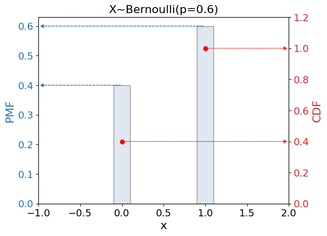
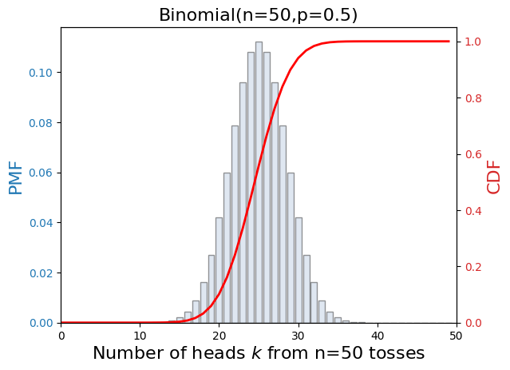
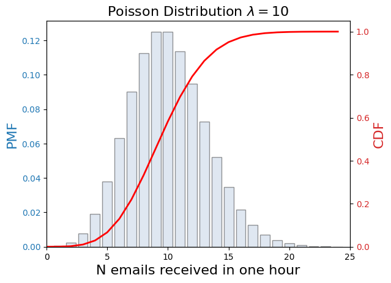
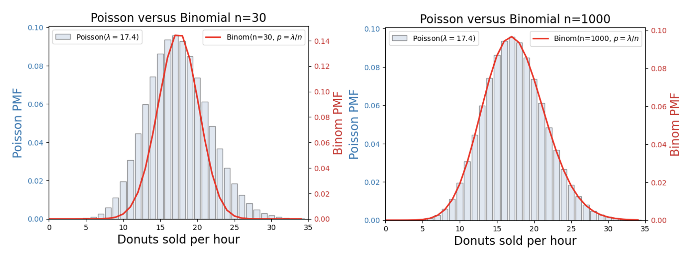

---
jupytext:
  formats: md:myst
  text_representation:
    extension: .md
    format_name: myst
kernelspec:
  name: python3
  display_name: 'Python 3'
---

(chapter:pmf)=
# Discrete Probabilities & Likelihoods

I strongly recommend the [Probability Playground](https://probabilityplayground.com/bernoulli) to help become familiar with special distributions. It has all of the distributions we will be thinking about, plus more!


* `scipy.stats` distributions: `bernoulli, binom, poisson `
* `math` methods: `factorial`
* `scipy.special` methods: `binom, gamma, gammaln, factorial`
* `timeit` methods: `timeit`


If a discrete RV $K$ follows a special distribution, we can immediately use it to calculate the probabilities. **But, we need to know the form and the parameter(s) of the special distribution to do this**. If the parameters are not known, we have to **Estimate** them using data. We can do this by calculating the Likelihoods for a range of parameter values and choosing the Maximum Likelihood Estimate (MLE).

We will use this topic to:
* Figure out which PMF is useful for what
* Identify the **Kernels** of some special PMFs
* Practice calculating Probabilities, Expectation, Variance.
* Note the usefulness of **Likelihoods**.

---

(sec:pmf_whipmf)=
## Which PMF?

**Discrete RVs** model counts or categories. The most commonly used discrete distributions are: Bernoulli, Binomial, Negative Binomial, Multinomial, and Poisson


| Situation | Distribution |
|-----------|-------------|
| Single binary trial (yes/no) | [Bernoulli](#sec:pmf_bern) |
| Count successes in n trials | [Binomial](#sec:pmf_bin) |
| Trials needed until r successes | Negative Binomial |
| n trials across k categories | Multinomial |
| Events per unit time/space | [Poisson](#sec:pmf_poi) |

---

(sec:pmf_bern)=
## Bernoulli 

Bernoulli is the distribution we use to describe the outcome of a single experiment with two possible outcomes: success/failure; heads/tails; on/off;

The possible outcomes of **a single coin toss** experiment are described by a Discrete RV $K$, and $K$ follows a Bernoulli PMF.

$K\sim$ Bernoulli($p$)

The **Parameter** is $p$: the probability of success.

---

(sec:pmf_bernpk)=
### PMF & Kernel

The Bernoulli PMF is:

```{math}
:label: eq:pmf_bernpmf
p_K(k) = (1-p)^{(1-k)}\, p^k\;\; ; \;\; 0 \leq k \leq 1
```

The **Support** of $K$ is $0 \leq k \leq 1$: all the values $k$ with non-zero probability. 

For the two possible outcomes, we let $k=1$ represent success and $k=0$ represent failure.

The first term, $(1-p)^{(1-k)}$
:  $k=0$: Probability of failure ($1-p$) to the power one ($1-0$) = $1-p$
   
   $k=1$: Probability of failure ($1-p$) to the power zero ($1-k$) = 1

The second term, $p^k$
: $k=1$: Probability of success ($p$) to the power one ($k$) = $p$
  
  $k=0$: Probability of success ($p^0=1$) to the power zero ($0$) = 1

:::{note}
I acknowledge the PMF seems a b it contrived, as one of the two terms is always going to be equal to one, given that any number to the power zero is equal to one. But keeping it explicit in this way will help us with the next PMF, Binomial.
:::

The **Kernel** of the Bernoulli PMF is given in [](#eq:pmf_bernkern); this is the part of the PMF that depends on the RV, $k$, which in this case is the whole PMF.

```{math}
:label: eq:pmf_bernkern
(1-p)^{(1-k)}\, p^k
```


A plot of the Bernoulli PMF for a chosen parameter value $p=0.6$ is shown in [](#fig:pmf_bern) along with the Cumulative Distribution Function (CDF).


:::{figure}
:label: fig:pmf_bern



The Bernoulli PMF is shown in blue with reference to the left-hand $y$-axis, and the CDF is shown in red with reference to the right-hand $y$-axis. The parameter value is $p=0.6$, meaning the outcome of each experiment has a 60% probability of success. Because $K$ is a discrete RV, the probabilities can be read directly from the left-hand $y$-axis. The CDF is the Cumulative probability, which must total 1 as a sum over all possible outcomes.
:::

Example
: A fair coin has $p=0.5$, meaning the probability of getting heads on a single toss is 50%. 
  
  If we choose success = heads, we have $k=1$ for heads and $k=0$ for tails.

  The PMF for heads (success) is:
  
  ```{math}
  \begin{aligned}
  p_K(k=1) &= \textcolor{red}{(1-0.5)^{(1-1)}}\, 0.5^1\\
           &= \textcolor{red}{(0.5)^{0}}\, 0.5^1\\
           &= \textcolor{red}{1}\,\cdot 0.5\\
           &= 0.5\\            
  \end{aligned}
  ```

  The PMF for tails (failure) is:
  
  ```{math}
  \begin{aligned}
  p_K(k=0) &= \textcolor{red}{(1-0.5)^{(1-0)}}\, 0.5^0\\
           &= \textcolor{red}{(0.5)^{1}}\, 0.5^0\\
           &= \textcolor{red}{0.5}\,\cdot 1\\
           &= \textcolor{red}{0.5}\\            
  \end{aligned}
  ```

For a PMF to be valid, it must satistify [Kolmogorov's normalisation axiom](#eq:pe_kol2).

Is $\sum\limits_{k_i \in S} p_K(k_i) =1$ ?

Normalisation check
: $\sum\limits_{k_i \in S} p_K(k_i) = \left[ (1-p)^{(1-0)}\, p^0 \right] + \left[ (1-p)^{(1-1)}\, p^1 \right] =  (1-p) + p = 1$:
  the Bernoulli PMF is valid.

---

(sec:pmf_bernprob)=
### Probabilities

The Cumulative Probability (CDF) for a discrete RV is the sum over the range of the lower bound of the support to the value at which we want to know the CDF.

The sum is over the PMFs calculated at each possible value, $k_i$.

```{math}
:label: eq:pmf_disccdf
F_K(k) = P(K\leq k) = \sum\limits_{k_i}^{k} p_K(k_i)
```

The Bernoulli CDF is:

```{math}
:label: eq:pmf_berncdf

F_K(k) = 
\begin{cases}
     0\; & k<0\\[1ex] 
  1-p\; & 0\leq k<1 \\[2ex]
  1\; & 1 \leq k \\[2ex]
\end{cases}
```

The CDF  must be written in terms of ranges of values, because **the Probability from the CDF is always for a range**.

---

(sec:pmf_bernev)=
### Expectation & Variance

The Bernoulli PMF has
: $$ \label{eq:pmf_bernexp} E[K] = p $$
  
  $$ \label{eq:pmf_bernvar} V[K] = p(1-p) $$


The **Expectation** is calculated as:

$E[K]  = \sum\limits_{k_i \in S} k_i \,p_K(k_i)  = 0(1-p) + 1(p) = p$

The **Variance** is calculated as:

$V[K]  = E[K^2]-E^2[K]$ 

*Term 1*:  $E[K^2] = \sum\limits_{k_i \in S} k^2_i\, p_K(k_i)  = 0^2(1-p) + 1^2(p) = p$

*Term 2*:  $E^2[K]  =p^2$

$V[K]  = p-p^2 = p(1-p)$


---

(sec:pmf_bernpy)=
### Python

:::{warning}
There are two `bernoulli` methods in `scipy`. The distribution (PMF) is accessed via `scipy.stats.bernoulli`; this is what we use here. The series of Bernoulli numbers (which we don't use) is accessed via `scipy.special.bernoulli`.
:::

```{code-cell} python

def ExploreBernoulli(p):

  # import the bernoulli distribution
  from scipy.stats import bernoulli

  # set up an instantiation of the distribution with our chosen parameter value p
  bern =  bernoulli(p) 

  # access the lower bound and upper bound of the support
  lb, ub = bern.support()

  print(f"Support is {lb} <= k <= {ub}")

  # calculate the probability of k=0 (failure)
  pmf0 = bern.pmf(0)
  print(f"p_K(k=0) = {pmf0:.2f}")

  # calculate the probability of k=1 (success)
  pmf1 = bern.pmf(1)
  print(f"p_K(k=1) = {pmf1:.2f}")

  # calculate the cumulative probability of k<=1
  cdf1 = bern.cdf(1)
  print(f"P(K<=1) = {cdf1}")

  # extract the true mean and variance
  mean, var = bern.stats(moments='mv')
  print(f"Expectation = {mean}, Variance = {var}")

ExploreBernoulli(0.45)

```

---

(sec:pmf_bernlike)=
### Likelihoods

Suppose we run a blood test on $N$ people and record the binary outcome $k_i \in \{0,1\}$ for each person ($1$ = positive, $0$ = negative). We want to estimate the true prevalence $p$ — the probability that a randomly selected person tests positive.

Each measurement is an IID Bernoulli$(p)$ trial, so the **Likelihood** of the full dataset as a function of $p$ is:

```{math}
:label: eq:pmf_bernlike
\mathcal{L}_{p}(p;k) = \prod_{i=1}^{N} p^{k_i}(1-p)^{1-k_i}
```

First we take the Log, to get rid of that pesky product [](#eq:ei_logpro):

```{math}
:label: eq:pmf_bernll
\ln\mathcal{L}_{p}(p;k) = \sum_{i=1}^{N} \ln{ \left( p^{k_i}(1-p)^{1-k_i} \right)}
```

Then we use [](#eq:ei_logpro) again to separate the terms:

```{math}
:label: eq:pmf_bernll2
\ln\mathcal{L}_{p}(p;k) = \sum_{i=1}^{N} \left( \ln{ p^{k_i}} + \ln{ (1-p)^{1-k_i}} \right)
```

Then we use [](#eq:ei_logpow):

```{math}
:label: eq:pmf_bernll3
\ln\mathcal{L}_{p}(p;k) =
\sum_{i=1}^{N}
\left( 
  k_i\, \ln{p} + 
  (1-k_i)\ln{(1-p)}
   \right)
```

Finally tidy up with $n_1 = \sum\limits_{i=1}^N k_i$ for the number of positive results and $n_0 = N - n_1$ for the number of negative results.

```{math}
:label: eq:pmf_bernll4
\ln\mathcal{L}_{p}(p;k) = n_1\ln p + n_0\ln(1-p)
```

To find the most likely parameter value, $\hat{p}_{_{\mathsf{MLE}}}$ we find the value of $p$ for which the derivative of the Log Likelihood is zero.

To do this we need to know how to differentiate. Here are some key results:

(sec:pmf_useder)=
### Some Useful Derivatives


Using [MathMethodsA: Derivatives of Special Functions](#sec:mma_derspec) and [MathMethodsA: Chain Rule](#sec:mma_charu):

:::{table} 
:align: center
:label: tab:pmf_derivs
| Function $f(\theta)$ | Derivative $\dfrac{df}{d\theta}$ | Note
|---|---|---|
| $\ln{\theta}$ | $\dfrac{1}{\theta}$ | Derivative of Log |
| $a\ln{\theta}$ | $\dfrac{a}{\theta}$ | Derivative of (Log times constant) |
| $\ln{a}$ | $0$ | Derivative of (Log of constant) |
| $f(\,g(\theta)\,)$ | $\dfrac{df}{dg}\,\dfrac{dg}{d\theta}$ | Derivative of (function of function) |
:::

<!--
Derivative of Log
: $\dfrac{d}{d\theta} \ln{\theta} = \dfrac{1}{\theta}$

Derivative of Log times constant
: $\dfrac{d}{d\theta} a\ln{\theta} = \dfrac{a}{\theta}$

Derivative of Log of constant
: $\dfrac{d}{d\theta} \ln{a} = 0$

Chain Rule
: $\dfrac{d}{d\theta} f(g(\theta)) = \dfrac{df}{dg}\,\dfrac{dg}{d\theta}$
-->

The derivative of [](#eq:pmf_bernll3) is:


```{math}
:label: eq:pmf_bernll5
\begin{aligned}
\dfrac{d}{dp} \ln\mathcal{L}(p;\mathbf{k}) &= \dfrac{d}{dp} \left( n_1\ln p + n_0\ln(1-p) \right)\\
&= \dfrac{d}{dp} n_1\ln p + \dfrac{d}{dp} n_0\ln(1-p)\\
&= \dfrac{n_1}{p} + (-1) ( \dfrac{n0}{1-p} )\\
&= \dfrac{n_1}{p} - \dfrac{n0}{1-p} \\
\end{aligned}
```

We set this derivative to zero to solve for $\hat{p}_{\mathsf{MLE}}$:


$\dfrac{d}{dp} \ln\mathcal{L}(p;\mathbf{k}) = \dfrac{n_1}{p} - \dfrac{n_0}{1-p} = 0$:


and find:

$\hat{p}_{\mathsf{MLE}} = \dfrac{n_1}{n_0+n_1} = \dfrac{n_1}{N}$


The MLE for the Bernoulli probability is simply the observed fraction of successes — which is exactly what we would expect it to be.


---

(sec:pmf_bin)=
## The Binomial Distribution

We will stick with the coin toss for one more PMF. This time we will **toss the coin n times**. I will count the number of heads, $k$, and that count is my Discrete RV $K$.

$K\sim$ Binomial($n,p$)

The parameters are $n,p$ where $p$ is again the probability of success for a single coin toss, just as for [Bernoulli](#sec:pmf_bern). Note that one Binomial trial consists of $n$ Bernoulli trials.

---

(sec:pmf_binpk)=
### PMF & Kernel

The Binomial PMF is:

```{math}
:label: eq:pmf_binpmf
p_K(k) = \binom{n}{k} \, p^k\, (1-p)^{n-k} \;\; ; \;\;  0\leq k \leq n
```

The **Support** of $K$ is $0 \leq k \leq n$: all values $k$ with non-zero probability. 

The **Kernel** of the Binomial PMF is given in [](#eq:pmf_binkern); this is the part of the PMF that depends on the RV, $k$, which in this case is the whole PMF.

```{math}
:label: eq:pmf_binkern
 \binom{n}{k} p^k\, (1-p)^{n-k}
```

:::{warning}
I incorrectly claimed the Binomial Kernel was $p^k\, (1-p)^{n-k}$ in a previous draft of these notes - this is not correct of course because the binomial coefficient is a function of the RV $K$, so belongs in the kernel.
:::


A plot of the Binomial PMF for chosen parameter values $p=0.5$ and $n=50$ is shown in [](#fig:pmf_bin) along with the Cumulative Distribution Function (CDF).

:::{note}
The distribution shown in [](#fig:pmf_bin) is a theoretical distribution with infinite data points. To generate this distribution with actual
coin tosses you would get **one data point for each experiment**, where an experiment is a set of $n=50$ tosses (trials). Then you would need to repeat the experiment a very large number of times (big $N$, the number of samples) to get a distribution that resembles the theoretical distribution.
:::


:::{figure}
:label: fig:pmf_bin



The Binomial PMF is shown in blue with reference to the left-hand $y$-axis, and the CDF is shown in red with reference to the right-hand $y$-axis. The parameter values are $p=0.5$, meaning the outcome of each experiment has a 50% probability of success, and $n=50$, meaning the total number of trials is 50. Because $K$ is a discrete RV, the prrobabilities can be read directly from the left-hand $y$-axis. The CDF is the Cumulative probability, which must total 1 as a sum over all possible outcomes.
:::


Let's examine the PMF.

$ p_K(k) = \binom{n}{k}\, p^k \,(1-p)^{n-k}
\;\; ; \;\;  0\leq k \leq n $

$\binom{n}{k}$ is called the **Binomial Coefficient**. We need it
because our RV $K$ is the number of heads, and **there is more than
one way to get $k$ heads from $n$ tosses**. 

$p^k$: probability of heads, $p$, to the power of the number of heads
observed, $k$

$(1-p)^{n-k}$: probability of "not heads", $1-p$, to the power of the number of "not-heads" observed, $n-k$.


For a PMF to be valid, it must satistify [Kolmogorov's normalisation axiom](#eq:pe_kol2).

Is $\sum\limits_{k_i \in S} p_K(k_i) =1$ ?

The parameter $n$ has limits $1 \leq n \leq \infty$, and $k$ can take any non-negative value up to and including $n$: we have a sum to infinity. When that happens we need a **Series**. The series we need in this case is provided by the **Binomial Theorem**.

```{math}
:label: eq:pmf_binthm
(a+b)^n = \sum\limits_{k=0}^{\infty} \binom{n}{k}\; a^k\; b^{n-k}:
```

Comparing [](#eq:pmf_binthm) with [](#eq:pmf_binpmf) we have $a=p$, $b=1-p$.

```{math}
:label: eq:pmf_binser2

(p+1-p)^n = \sum\limits_{k=0}^{\infty} \binom{n}{k}\; p^k\; (1-p)^{n-k}\\

```

Normalisation check
: $\sum\limits_{k=0}^{\infty}  p_K(k_i) = (p+(1-p))^n =1^n = 1$: the
Binomial PMF is valid.

---

(sec:pmf_bincoef)=
### The Binomial Coefficient

The Binomial Coefficient $\binom{n}{k}$ is a count of the number of ways to get $k$ successful outcomes from $n$ trials.

Example
: Let $n=4$: we will toss the coin four times. How many ways are there to get $k=3$ heads?

  HHHT, HHTH, HTHH, THHH: four different ways:

  $C_k^n =4$.

Thankfully, there is a formula for calculating the Binomial Coefficient:

```{math}
:label: eq:pmf_bnc
\binom{n}{k} = \dfrac{ n! } { k! (n-k)!}
```

:::{dropdown} Factorials

$4! =4\cdot 3\cdot 2\cdot 1=24$

$3! =3\cdot 2\cdot 1=6$

$2! =2\cdot 1 =2$

$1! = 1$

$0! =1\;\;$ (by definition!)

$-1!=$ undefined

Note that $\dfrac{ a!}{(a-1)!} = a$

:::

Note that Binomial Coefficients can be very large, even for quite modest numbers of trials $n$.

```{code-cell} python
def ByHandBNC(n,k):
  import math

  bnc = math.factorial(n)/ ( math.factorial(k) * math.factorial(n-k) )

  return bnc

# n=20 tosses, k=9 heads
print(f"bnc(n=20,k=9)= {ByHandBNC(20,9)}")

# n=30 tosses, k=15 heads
print(f"bnc(n=30,k=15)= {ByHandBNC(30,15)}")

# n=200 tosses, k=171 heads
print(f"bnc(n=200,k=172)= {ByHandBNC(200,172)}")
```

Unsurprisingly, `scipy` has a method for calculating the binomial coefficients, shown below. I do not recommend reinventing the wheel  with eg the `ByHandBNC` function above - I include this for transparency only, as the built-in `scipy` methods tend to be very general and therefore not easy to understand in simple terms. The `scipy.special.binom` method for calculating the binomial coefficient is far superior to my toy version above[^nonintfact] - it works for any value of $k$ (not just integers, and not just $k\leq 170$).

[^nonintfact]: For $K\sim$ Binomial($n,p$), $n$ and $k$ will always be integers, so the by-hand method is fine, **providing k is not larger than 170**. See [](#sec:pmf_gamln) for a discussion of how to manage large factorials. We can calculate the binomial coefficient for non-integers using the `scipy.special.binom` method via use of Gamma and Beta functions, introduced briefly in [](#sec:pdf_chi2gam)


```{code-cell} python

# I do not want this special.binom function floating around, given that is also the name of the stats.binom distribution, so I will import it with a name I have chosen: ScipyBNC

from scipy.special import binom as ScipyBNC


# n=20 tosses, k=9 heads
print(f"bnc(n=20,k=9)= {ScipyBNC(20,9)}")

# n=30 tosses, k=15 heads
print(f"bnc(n=30,k=15)= {ScipyBNC(30,15)}")
```

:::{warning}
There are two `binom` methods in `scipy`. The distribution (PMF) is accessed via `scipy.stats.binom`. The Binomial Coefficient is accessed via `scipy.special.binom`.
:::

---

(sec:pmf_binprob)=
### Probabilities

The [CDF](#eq:pmf_disccdf) is calculated as the sum over PMFs.

The Probability of observing $k \leq m$ successes, given some values of the parameters $n,p$, is:

```{math}
:label: eq:pmf_bincdf
P(K\leq m |\,n,p) = \sum\limits_{k=0}^{m} \binom{n}{k}\,p^k\,(1-p)^{n-k}
```

Example
: The probability of getting $k\leq4$ heads from $n=5$ tosses of a fair coin ($p=0.5$) is:

  $P(K\leq 4 |\, n,p) = \sum\limits_{k=0}^{4} \binom{5}{k}\, 0.5^k 0.5^{5-k} = 0.96875$

  The probability of getting **at least** $k=4$ heads is:

  $1 - P(K\leq 3 |\, n,p) = 1 - \sum\limits_{k=0}^{3} \binom{5}{k}\,\, 0.5^k 0.5^{5-k} = 0.1875$

---

(sec:pmf_binev)=
### Expectation & Variance

The Binomial PMF has
: $$\label{eq:pmf_binexp}E[K] = np$$


  $$\label{eq:pmf_binvar}V[K] = np(1-p)$$

The **Expectation** of the Binomial $K$ can be inferred from [](#eq:pmf_bernexp), because Binomial $K$ is the sum of $n$ Bernoulli trials, and the expectation of a sum of RVs is the sum of their expectations [](#sec:dd_expalg).

```{math}
\begin{aligned}
E[K] & = E\left[ \sum\limits_j^n K_j \right] \\
     & =  \sum\limits_j^n E[ K_j ] \;\; \mathsf{\textcolor{blue}{because\; E[sum] = sum(E)}}\\
     & =  \sum\limits_j^n p \;\; \mathsf{\textcolor{blue}{because\; E[K_j] = p\; (Bernoulli\; expectation)}}\\
     & =  n p \\    
\end{aligned}
```


The **Variance** of the Binomial $K$ can likewise be inferred from [](#eq:pmf_bernvar), because the variance of a sum of IID RVs is the sum of their variances [](#sec:dd_varalg). Note that this variance algebra only applies to IID RVs, whereas the expectation algebra does not require independence.

---

(sec:pmf_binpy)=
### Python

:::{warning}
There are two `binom` methods in `scipy`. The distribution (PMF) is accessed via `scipy.stats.binom`. The Binomial Coefficient is accessed via `scipy.special.binom`.
:::

```{code-cell} python

def ExploreBinom(n,p):

  # import the binomial distribution
  from scipy.stats import binom

  # set up an instantiation of the distribution with our chosen parameter values n, p
  bino =  binom(n,p) 

  # access the lower bound and upper bound of the support
  lb, ub = bino.support()

  print(f"Support is {lb} <= k <= {ub}")

  # calculate the probability of k=0 (zero successes)
  pmf0 = bino.pmf(0)
  print(f"p_K(k=0) = {pmf0:.2f}")

  # calculate the probability of k=n-1 (n-1 successes)
  pmf1 = bino.pmf(n-1)
  print(f"p_K(k={n-1}) = {pmf1:.2f}")

  # calculate the cumulative probability of k<=n
  cdf1 = bino.cdf(n)
  print(f"P(K<={n}) = {cdf1}")

  # extract the true mean and variance
  mean, var = bino.stats(moments='mv')
  print(f"Expectation = {mean}, Variance = {var}")

ExploreBinom(5,0.5)
```

---

(sec:pmf_binlike)=
### Likelihoods

Is my coin fair?

Suppose we toss a coin $n=10$ times and observe $k=6$ heads. The **Likelihood** of (the data being described by) parameter $p$, given this result is:

```{math}
:label: eq:pmf_binlike
\mathcal{L}(p; k, n) = \binom{n}{k} p^k (1-p)^{n-k}
```

Note that we don't have a product over PMFs in [](#eq:pmf_binlike) because we are only considering a single experiment, $N=1$.

Since the binomial coefficient $\binom{n}{k}$ does not depend on $p$, it plays no role in determining which $p$ maximises the likelihood (because the derivative of a constant is zero, [](#sec:pmf_useder) ).

The **Log-Likelihood** is:

```{math}
:label: eq:pmf_binll
\ln\mathcal{L}(p; k, n) = \text{const} + k\ln p + (n-k)\ln(1-p)
```

The derivative of the Log Likelihood with respect to p:

```{math}
:label: eq:pmf_binllder
\begin{aligned}
\dfrac{\partial \ln\mathcal{L}}{\partial p} &= 0 + \dfrac{k}{p} - \dfrac{n-k}{1-p} \\
&= \dfrac{k}{p} - \dfrac{n-k}{1-p} \\
\end{aligned}
```


Setting $\dfrac{d}{dp} \ln\mathcal{L} = 0$:

```{math}
:label: eq:pmf_binlldzer
\begin{aligned}
 \dfrac{k}{\hat{p}} &= \dfrac{n-k}{1-\hat{p}} \\
  k(1-\hat{p}) &= \hat{p}(n-k) \\
  k- k\hat{p} - \hat{p}n + \hat{p}k &= 0 \\
  k- \hat{p}n &= 0 \\
  \hat{p} &= \dfrac{k}{n} \\
 \end{aligned}
```

The **MLE** for p is:

```{math}
:label: eq:pmf_binmle
\hat{p}_{\mathsf{MLE}} = \frac{k}{n}
```

For $k=6$ heads from $n=10$ tosses: $\hat{p} = 0.6$. The MLE suggests the coin is slightly biased toward heads. Whether this departure from $p=0.5$ is significant given only 10 tosses is a question for [Hypothesis Testing](#chapter:hyp).


---

(sec:pmf_poi)=
## The Poisson Distribution

The Poisson distribution models rates rather than counts. The rate is the number of events **in a given time/space period**. For example, emails received in one hour, donuts sold in one day, number of events in one histogram bin. 

$K\sim$ Poisson($\lambda$)

The parameter of the Poisson distribution is $\lambda$: the expected rate.

---

(sec:pmf_poipk)=
### PMF & Kernel

The Poisson PMF is:

```{math}
:label: eq:pmf_poipmf
p_K(k) =  e^{-\lambda}\, \dfrac{ \lambda^k}{k!} \;\; ; \;\;  0\leq k \leq \infty
```

The **Support** of $K$ is $0 \leq k \leq \infty$: all values of the measured rate $k$ with non-zero probability. 

The **Kernel** of the Poisson PMF is given in [](#eq:pmf_poikern); this is the part of the PMF that depends on the RV.

```{math}
:label: eq:pmf_poikern
\dfrac{ \lambda^k}{k!}
```

A plot of the Poisson PMF for chosen rate parameter value $\lambda=10$ is shown in [](#fig:pmf_poi) along with the Cumulative Distribution Function (CDF).


:::{figure}
:label: fig:pmf_poi



The Poisson PMF is shown in blue with reference to the left-hand $y$-axis, and the CDF is shown in red with reference to the right-hand $y$-axis. The parameter value is $\lambda=10$, meaning the mean rate of emails per hour is 10. Because $K$ is a discrete RV, the probabilities can be read directly from the left-hand $y$-axis. The CDF is the Cumulative probability, which must total 1 as a sum over all possible outcomes.
:::


For a PMF to be valid, it must satistify [Kolmogorov's normalisation axiom](#eq:pe_kol2).

Is $\sum\limits_{k_i \in S} p_K(k_i) =1$ ?

Note that for infinite sum over [Poisson PMFs](#eq:pmf_poipmf) to equal 1, we need:

```{math}
:label: eq:pmf_poival
\sum\limits_{k_i \in S} \dfrac{\lambda^k}{k!}  = e^{\lambda}
```

such that:

```{math}
:label: eq:pmf_poival2

\begin{aligned}
\sum\limits_{k_i \in S} p_K(k_i) = e^{-\lambda} \sum\limits_{k_i \in S} \dfrac{\lambda^k}{k!} & = e^{-\lambda}e^{\lambda} \\
& = e^{-\lambda+\lambda} \\
& = e^{0} \\
& = 1 \\
\end{aligned}
```


An infinite sum requires a series. The **Taylor Series** expansion for $f(x) = e^{x}$ is:

```{math}
:label: eq:pmf_exptay

e^{x} =\sum\limits_{n=0}^{\infty}  \dfrac{x^n}{n!}
```

Comparing [](#eq:pmf_exptay) with [](#eq:pmf_poival) with $x \rightarrow \lambda$, $n \rightarrow k$, we see that this is satisfied.

Normalisation check
: $\sum\limits_{k=0}^{\infty}  p_K(k_i) = 1$: the Poisson PMF is valid.

---

(sec:pmf_poiprob)=
### Probabilities

The [CDF](#eq:pmf_disccdf) is calculated as the sum over PMFs.

The Probability of measuring a rate $k \leq m$, given some value of the parameter $\lambda$, is:

```{math}
:label: eq:pmf_poicdf
P(K\leq m | \lambda) = e^{-\lambda}\, \sum\limits_{k=0}^{m} \, \dfrac{ \lambda^k}{k!}
```

Example
: I receive $\lambda \approx 10$ emails per hour. What is the probability of me getting zero emails in a given hour?:

  ```{math}
  \begin{aligned}
  P(K\leq 0) &= e^{-\lambda}\, \sum\limits_{k=0}^{0} \dfrac{ \lambda^k}{k!} \\
            &= e^{-\lambda}\, \dfrac{ \lambda^0}{0!} \\
            &= e^{-10}\, \dfrac{ 10^0}{0!} \\
            &= e^{-10}\, \dfrac{ 1}{1}\\
            &= e^{-10} \\
            &= 4.5\times10^{-5}\\           
  \end{aligned}
  ```

---

(sec:pmf_poiev)=
### Expectation & Variance

The Poisson PMF has
: $$\label{eq:pmf_poiexp}E[K] = \lambda$$

  $$\label{eq:pmf_poivar}V[K] = \lambda$$

The **Expectation** can be calculated as

```{math}
:label: eq:pmf_poiexpc
\begin{aligned}
E[K] &= \sum\limits_{k_i=0}^{\infty} k_i\,  e^{-\lambda}\, \dfrac{ \lambda^{k_i}}{k_i!}\\

     &= e^{-\lambda}\, \sum\limits_{k_i=0}^{\infty} \, \dfrac{ k_i}{k_i!}\,\lambda^{k_i}\;\;\\

     &= e^{-\lambda}\, \sum\limits_{k_i=1}^{\infty} \, \dfrac{ 1}{(k_i-1)!}\,\lambda^{k_i}\;\; \mathsf{\textcolor{blue}{Note} }\\

     &= e^{-\lambda}\, \sum\limits_{k_i=0}^{\infty} \, \dfrac{ 1}{(k_i-1)!}\,\lambda^{k_i-1}\,\lambda\\

     &= e^{-\lambda}\, e^{\lambda}\,\lambda\\

     &= \lambda\\
\end{aligned}
```

On the noted line we reindexed from $k_i=0$ to $k_i=1$. The reindexing has no effect, because the $k_i=0$ term does not conntribute to the sum, but this allows use to use the [Taylor Expansion for $e^{\lambda}$](#eq:pmf_exptay) on the next line.

The **Variance** can be calculated by one of the methods shown [here](https://proofwiki.org/wiki/Variance_of_Poisson_Distribution).

---

(sec:pmf_poipy)=
### Python

:::{warning}
The greek letter $\lambda$ is spelled "lambda", but `lambda` has a special meaning in python, see [here](https://python-basics-tutorial.readthedocs.io/en/latest/functions/lambda.html). So `scipy.stats` uses `mu` for Poisson $\lambda$ in python. This makes sense to me because it is the true mean rate. 
:::

```{code-cell} python

def ExplorePoisson(mu):

  # import the poisson distribution
  from scipy.stats import poisson

  # set up an instantiation of the distribution with our chosen parameter value mu (the expected rate)
  pois =  poisson(mu=mu) 

  # access the lower bound and upper bound of the support
  lb, ub = pois.support()

  print(f"Support is {lb} <= k <= {ub}")

  # calculate the probability of k=0 (0 occurrences in a given time frame)
  pmf0 = pois.pmf(0)
  print(f"p_K(k=0) = {pmf0:.2f}")

  # calculate the probability of k=mu (mu occurrences in a given time frame)
  pmf1 = pois.pmf(mu)
  print(f"p_K(k={mu}) = {pmf1:.2f}")

  # calculate the cumulative probability of k<=mu
  cdf1 = pois.cdf(mu)
  print(f"P(K<={mu}) = {cdf1}")

  # extract the true mean and variance
  mean, var = pois.stats(moments='mv')
  print(f"Expectation = {mean}, Variance = {var}")

ExplorePoisson(5.4)
```

---

(sec:pmf_poilike)=
### Likelihoods

Poisson distributions model **Rates** (counts in given time periods) — this is something we do a lot of in my field. My friend Alf is not a big fan of work, but he has found an example from his life that he would like me to share.

Alf measures his donut sales over $N=7$ days and records $\mathbf{k} = (15, 18, 20, 14, 19, 17, 16)$. What is the MLE estimate of his true average daily rate $\lambda$?

Each day's count is an IID Poisson$(\lambda)$ trial, so the **Likelihood** of the full dataset is:

```{math}
:label: eq:pmf_poilike
\mathcal{L}(\lambda;\mathbf{k}) = \prod_{i=1}^{N} e^{-\lambda}\,\dfrac{\lambda^{k_i}}{k_i!}
```

The **Log-Likelihood** is:

```{math}
:label: eq:pmf_poill
\ln\mathcal{L}(\lambda;k) = -N\lambda + \ln(\lambda)\sum_{i=1}^{N} k_i - \sum_{i=1}^{N} \ln(k_i!)
```

The last term does not depend on $\lambda$, so it plays no role in finding the MLE. 


The derivative of the Log Likelihood with respect to $\lambda$:

```{math}
:label: eq:pmf_poillder
\dfrac{d}{d\lambda} \ln\mathcal{L}(\lambda;k) = -N + \dfrac{1}{\lambda}\sum_{i=1}^{N} k_i - 0
```


Setting $\dfrac{d}{d\lambda}\ln\mathcal{L} = 0$, we find:

```{math}
:label: eq:pmf_poimle
\hat{\lambda} = \frac{1}{N}\sum_{i=1}^{N} k_i = \bar{k}
```

The MLE for the Poisson rate is simply the sample mean. For Alf's data: $\hat{\lambda} = (15+18+20+14+19+17+16)/7 = 17.0$ donuts per day.

:::{tip}

The Poisson Negative Log Likelihood is the objective function that we miniminise to find the parameter estimate $\hat{\lambda}$ using `scipy` methods.

```{math}
\begin{aligned}
\mathsf{NLL} & = - \ln\mathcal{L}(\lambda;k) \\[4pt]
&= \sum\limits_{i=1}^{N} \left( \lambda - \ln(\lambda)k_i +  \ln(k_i!) \right) \\[4pt]
&= \sum\limits_{i=1}^{N} \left( \lambda - \ln(\lambda)k_i +  \ln \Gamma(k_i+1) \right) \\[4pt]

\end{aligned}
```

The $\ln(k_i!)$ can be more helpfully written with the [Gamma function](#sec:mmb_gamfun): $\ln(k_i!) = \ln \Gamma(k+1)$.

An example of using `scipy`'s `gammaln` method is given [below](#sec:pmf_gamln).

:::

---

(sec:pmf_gamln)=
### 🆕 Example of using `gammaln` for $\ln(k!)$

```{code-cell} python
import numpy as np
from scipy.special import gamma, gammaln, factorial

def log_fac_comparison(k):
    """Compute ln(k!) by three methods and check they agree."""

    lfk = []

    # Method 1: float factorial then log (overflows for large k)
    log_factorial_k = float(np.log( factorial(k) ))
    lfk.append(log_factorial_k)

    # convert result to a right-justified string with a width of 12 characters
    m1 = str(round(log_factorial_k,6)).rjust(12)

    # Method 2: log of Gamma function (overflows for large k)
    log_gamma_k1 = np.log( gamma(k+1) )
    lfk.append(log_gamma_k1)
    m2 = str(round(log_gamma_k1,6)).rjust(17)

    # Method 3: gammaln - numerically stable, never overflows
    gammaln_k1 = gammaln( k+1 )
    lfk.append(gammaln_k1)
    m3 = str(round(gammaln_k1,6)).rjust(12)

    allclose = np.allclose(lfk[0], lfk[1:])
    check = str(allclose).rjust(10)

    print(f"{str(k).rjust(7)} | {m1} | {m2} | {m3} | {check}")


print("# -------------------------------------------------")
print("# Compare log factorial methods")
print("# -------------------------------------------------\n")

print(f"{'k'.rjust(7)} | {'log(k!)'.rjust(12)} | {'log(Gamma(k+1))'.rjust(17)} | {'gammaln(k+1)'.rjust(12)} | {'allclose?'.rjust(10)}")


for k in [0, 0.2, 3, 170,171]:
    log_fac_comparison(k)

```

Notice that all methods give the same result for small values of k, but for k=171 the first two methods hit the overflow problem - the number 171! in the intermediate calculation is too large for the computer to handle, so is set to `inf`. Using `gammaln` avoids this problem. The `scipy gamma` and `gammaln` methods are also significantly quicker than the `factorial` method, as illustrated in the `SpeedTest()` example below.


```{code-cell} python
# Which method is quickest? 

def SpeedTest(k,num):

  # using the timeit module
  from timeit import timeit as tt

  # the :_ formats the printed number with underscores at thousand separators 
  # - makes it easier to read large numbers.
  print("\n# -------------------------------------------------")
  print(f"# Speed Tests for {num:_} repeated calls, k={k}")
  print("# -------------------------------------------------")

  # we pass the methods to timeit using the lambda function
  # lambda: my_func returns the value of the function
  t1   = tt(lambda: np.log(factorial(k)),  number=num)
  t2   = tt(lambda: np.log(gamma(k + 1)),  number=num)
  t3   = tt(lambda: gammaln(k + 1),        number=num)
  print(f"  np.log(factorial(k)):  {t1:.4f} s")
  print(f"  np.log(gamma(k+1)):    {t2:.4f} s")
  print(f"  gammaln(k+1):          {t3:.4f} s")

SpeedTest(123, 100_000)

```


---

(sec:pmf_poibin)=
## Poisson versus Binomial

The obvious choice for modelling the rate of donut sales in Alf's shop is to go with $K\sim\;$ Poisson($\lambda=17.0$).


```{figure}


```


A less obvious choice would be to go with $K\sim$ Binomial($n,p$): $n$ is
the total number of people in Brighton, $p$ is the probability that any of them buys a donut.

Compare Expectations
: Poisson $E[K] = \lambda$

  Binomial $E[K] = np$


So $\lambda = np$ or $p=\lambda/n$.

Note that the rate $\lambda$ has no limit on the number of people it draws from. In the limit of $n\to \infty$, the Binomial is a valid model. 

Binom($n, \lambda/n$) $\rightarrow$ Poisson($\lambda$) as $n\rightarrow \infty$

```{figure}
:label: fig:pmf_alfpoi



Rates of Donut Sales using the Binomial and Poisson PMFs for left: Binomial $n=30$, right: Binomial $n=1000$.

```

Alf concludes that it is safer to use $K\sim$ Poisson($\lambda$) as his
model for the hourly rate of donut sales.

---

(sec:pmf_sum)=
## Summary of Discrete Distributions

```{table} Bernoulli, Binomial, and Poisson

|  Name | Kernel  | E[K] | V[K] | Support | Parameters  | `scipy.stats` |
| ---   |  ---     | ---  | ---  | ---     |  ---        |  ---          |
|  Bernoulli | $(1-p)^{(1-k)}\, p^k$ | p | p(1-p) |$0 \leq k \leq 1$ | $0\leq p \leq 1$ | `bernoulli(p)` |
|  Binomial | $\binom{n}{k}\,(1-p)^{(n-k)}\, p^k$ | np | np(1-p) |$0 \leq k \leq n$ | $0\leq p \leq 1$, $0\leq n \leq \infty$  | `binom(n,p)` |
|  Poisson | $\dfrac{\lambda^k}{k!}$ | $\lambda$ | $\lambda$ | $0 \leq k \leq \infty$ | $0\leq \lambda \leq \infty$  | `poisson(mu)` |


```