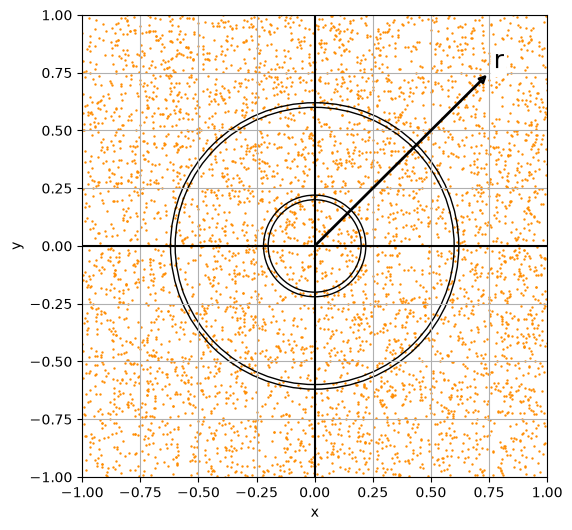

---
jupytext:
  formats: md:myst
  text_representation:
    extension: .md
    format_name: myst
kernelspec:
  name: python3
  display_name: 'Python 3'
numbering:
  title: false
  headings: true
  equation: true
---

(chapter:math-methods-b)=
# Math Methods B: Proofs and Estimator Theory

This appendix collects a few proofs and derivations referenced from the main module notes. The focus is on results that require a little more mathematical machinery. I don't expect students to read this - it is here only for those with a special interest. 

---

(sec:mmb_varequiv)=
## Equivalence of Variance Definitions

Proof that [](#eq:truevar2) is equivalent to [](#eq:truevar).


```{math}
\begin{aligned}
V[X] & = E[\, X^2 + E^2[X] - 2X\,E[X] \,]\\ \\
  & = E[\, X^2\,] + E[\, E^2[X] \,]- E[\,2X\,E[X] \,]\;\; \mathsf{because}\; E[A+B] = E[A] + E[B] \\ \\
  & = E[ X^2] + E^2[X] - 2E[X]  E[X]\;\; \mathsf{because}\; E[E[A]] = E[A]\\ \\
  & = E[ X^2] + E^2[X]  - 2E^2[X]   \\  \\
  & = E[ X^2] - E^2[X]   \\
\end{aligned}
```


---

(sec:mmb_varlinf)=
## Proof that $V[aX+b] = a^2 V[X]$

A linear function of one RV, $X$, is $g(x) = ax + b $.

(sec:mmb_varlinf1)=
### Method 1: Expectations

Using the definition [](#eq:varF) of variance, $V[g] = E[g^2] - E^2[g]$.

The first term is:

$E[g^2] = E[(aX+b)^2] = E[ a^2X^2 + b^2 + 2abX ] = a^2 E[X^2] + b^2 + 2ab E[X]$

The second term is:

$E^2[g] = \bigl(a E[X] + b\bigr)^2 = a^2 E^2[X] + b^2 + 2ab E[X]$

Therefore the variance is:

```{math}
:label: eq:proof_varf
V[g] = E[g^2] - E^2[g] = a^2 \bigl(E[X^2] - E^2[X]\bigr) = a^2 V[X]
```

(sec:mmb_varlinf2)=
### Method 2: Taylor Series Expansion

Using the notation $f'_{\mu} \equiv \dfrac{df}{dx}\bigg|_{x=\mu}$, the [Taylor expansion](#sec:mma_taylor) truncated at first order (exact for linear $f$) gives:

```{math}
f = f_{\mu} + f'_{\mu}\,(x - \mu)
```

Rearranging and squaring:

```{math}
(f - f_{\mu})^2 = f^{'2}_{\mu}\,(x-\mu)^2
```

Taking the expectation of both sides, and noting that $f_{\mu}' = \mathrm{const}$ (because the function is linear):

```{math}
E\!\left[(f - f_{\mu})^2\right] = {f_{\mu}'}^2\, E\!\left[(x-\mu)^2\right]
```

Since $f_{\mu} = E[f]$, the left side is $V[f]$ by definition, and the right side is ${f_{\mu}'}^2\, V[X]$:

```{math}
V[f] = \frac{df}{dx}\bigg|_{x=\mu}^{\!2} V[X]
```

For the linear function $g(x) = ax + b $, with derivative $\frac{dg}{dx} = a $, we find:

```{math}
V[g] = a^2 V[X]
```

---

(sec:gamma-function)=
## The Gamma Function

The **Gamma function** is a generalisation of the factorial to non-integer (and complex) arguments. It appears in the $\chi^2$ PDF and in many other distributions.

```{math}
:label: eq:gamma-def
\Gamma(s) = \int_0^{\infty} x^{s-1}\, e^{-x}\, dx \;, \qquad s > 0
```

### Key Properties

**Recurrence relation:**

```{math}
:label: eq:gamma-recurrence
\Gamma(s+1) = s\,\Gamma(s)
```

*Proof:* Integrate [](#eq:gamma-def) by parts with $u = x^s$ and $dv = e^{-x}\,dx$:

$$\Gamma(s+1) = \left[-x^s e^{-x}\right]_0^{\infty} + s\int_0^{\infty} x^{s-1}e^{-x}\,dx = 0 + s\,\Gamma(s)$$

**Integer arguments (factorials):**

```{math}
:label: eq:gamma-factorial
\Gamma(n) = (n-1)! \qquad (n = 1, 2, 3, \ldots)
```

This follows immediately by applying the recurrence [](#eq:gamma-recurrence) repeatedly: $\Gamma(1) = 1 = 0!$, $\Gamma(2) = 1\cdot\Gamma(1) = 1 = 1!$, and so on.

**Half-integer values:**

```{math}
:label: eq:gamma-half
\Gamma\!\left(\tfrac{1}{2}\right) = \sqrt{\pi}
```

*Proof:* Set $x = u^2$ in [](#eq:gamma-def):

$$\Gamma\!\left(\tfrac{1}{2}\right) = \int_0^{\infty} x^{-1/2} e^{-x}\,dx = 2\int_0^{\infty} e^{-u^2}\,du = \int_{-\infty}^{\infty} e^{-u^2}\,du = \sqrt{\pi}$$

where the last step uses the [Gaussian integral trick](#sec:gaus-int-trick) below.

Higher half-integers follow from the recurrence: $\Gamma(3/2) = \frac{1}{2}\sqrt{\pi}$, $\Gamma(5/2) = \frac{3}{4}\sqrt{\pi}$, etc.

### Values appearing in the $\chi^2$ PDF

The $\chi^2(\nu)$ PDF contains $\Gamma(\nu/2)$ in its normalisation. The first few values are:

| $\nu$ | $\nu/2$ | $\Gamma(\nu/2)$ |
|:------:|:-------:|:---------------:|
| 1 | 1/2 | $\sqrt{\pi}$ |
| 2 | 1   | $0! = 1$ |
| 3 | 3/2 | $\frac{1}{2}\sqrt{\pi}$ |
| 4 | 2   | $1! = 1$ |
| 5 | 5/2 | $\frac{3}{4}\sqrt{\pi}$ |

### Python

```{code-cell} python
import numpy as np
from scipy.special import gamma, gammaln

# Gamma function values
print(f"Γ(1/2) = {gamma(0.5):.6f}  (should be √π = {np.sqrt(np.pi):.6f})")
print(f"Γ(1)   = {gamma(1.0):.6f}  (should be 0! = 1)")
print(f"Γ(3/2) = {gamma(1.5):.6f}  (should be √π/2 = {np.sqrt(np.pi)/2:.6f})")
print(f"Γ(4)   = {gamma(4.0):.6f}  (should be 3! = 6)")

# For large arguments, use gammaln (log of Gamma) to avoid overflow
print(f"\nlog Γ(100) = {gammaln(100):.4f}")
```

:::{note}
For numerical work with large arguments, use `scipy.special.gammaln` (the natural log of the Gamma function) to avoid floating-point overflow — then exponentiate only at the end if needed.
:::

---

(sec:transforms)=
## Transforms: Changing Variables

In real life we often cannot measure the RV we want directly. We measure $X$ and want the PDF for $Y = f(X)$. We saw in the main notes that we can access the uncertainties on a function using Expectation Algebra or Taylor Series expansion. When we want the **full PDF** of $Y$, not just its mean and variance, we need variable transforms.

---

### One-Dimensional Monotonic Transform

Suppose $Y = f(X)$ is a **monotonically increasing** function of $X$ (no turning points), with inverse $X = g(Y)$.

Because $Y$ increases whenever $X$ increases:

```{math}
P(Y \leq y) = P(X \leq g(y)) = F_X(g(y))
```

Differentiating the CDF of $Y$ to get its PDF:

```{math}
f_Y(y) = \dfrac{d}{dy} F_Y(y) = \dfrac{d}{dy} F_X(g(y)) = \dfrac{dg}{dy}\, f_X(g(y)) = \dfrac{dx}{dy}\, f_X(x)
```

For a **monotonically decreasing** function the same argument applies with a sign flip, so in general:

```{math}
:label: eq:transform_1d
f_Y(y) = \left|\dfrac{dx}{dy}\right| f_X(x)
```

where $x = g(y)$ is the inverse function evaluated at $y$.

:::{note}
If $f(X)$ is **not** monotonic, we can split the domain into intervals on which it is monotonic and sum the contributions.
:::

**Example:** Suppose $X \sim \mathrm{Expon}(\lambda)$ with PDF $f_X(x;\lambda) = \lambda e^{-\lambda x}$.

Define a new RV $Y = 2X$: "double the waiting time".

$x = \dfrac{y}{2}$, so $\dfrac{dx}{dy} = \dfrac{1}{2}$.

$$f_Y(y) = \dfrac{1}{2}\, \lambda\, e^{-\lambda y/2} = \dfrac{\lambda}{2}\, e^{-(\lambda/2)\, y}$$

$Y \sim \mathrm{Expon}(\lambda/2)$: doubling the RV is equivalent to halving the rate parameter.

---

(sec:gaus-int-trick)=
### The Gaussian Integral Trick

Let $I = \int\limits_{-\infty}^{\infty} e^{-u^2}\,du$. We cannot evaluate $I$ directly, but we can evaluate $I^2$:

```{math}
\begin{aligned}
I^2 &= \left(\int_{-\infty}^{\infty} e^{-x^2}\,dx\right)\!\left(\int_{-\infty}^{\infty} e^{-y^2}\,dy\right)\\
     &= \int_{-\infty}^{\infty}\!\int_{-\infty}^{\infty} e^{-(x^2+y^2)}\,dx\,dy
\end{aligned}
```

Switching to polar coordinates $x = r\cos\theta$, $y = r\sin\theta$, with "area element" $dx\,dy = r\,dr\,d\theta$:

```{math}
\begin{aligned}
I^2 &= \int_0^{2\pi}\!\int_0^{\infty} e^{-r^2}\, r\,dr\,d\theta \\
    &= 2\pi \int_0^{\infty} r\,e^{-r^2}\,dr \\ 
    &= 2\pi \left[-\tfrac{1}{2}e^{-r^2}\right]_0^{\infty} \\
    &= \pi
\end{aligned}
```

So $I = \int\limits_{-\infty}^{\infty} e^{-u^2}\,du = \sqrt{\pi}$.

This trick can be used to show the Gaussian PDF is valid (integrates to 1):

$u = \dfrac{x-\mu}{\sigma\sqrt{2}}$

$du = \dfrac{1}{\sigma\sqrt{2}} dx$

$u^2 = \dfrac{1}{2}\left(\dfrac{x-\mu}{\sigma}\right)^2$

 confirms that the Normal PDF integrates to 1:

$$\int_{-\infty}^{\infty} \dfrac{1}{\sigma\sqrt{2\pi}}\exp\!\left(-\dfrac{(x-\mu)^2}{2\sigma^2}\right)\,dx = \dfrac{1}{\sigma\sqrt{2\pi}} \cdot \sigma\sqrt{2} \cdot I = \dfrac{I}{\sqrt{\pi}} = 1$$

---

### Multivariate Transform and the Jacobian

For a multivariate RV $\mathbf{X} = (X_1, X_2, \ldots, X_Z)$ transformed to $\mathbf{Y} = (Y_1, Y_2, \ldots, Y_Z)$ via some set of relationships $Y_i = f_i(X_1, \ldots, X_Z)$, the generalisation of [](#eq:transform_1d) involves the **Jacobian**:

```{math}
:label: eq:transform_jacobian
f_{\mathbf{Y}}(\mathbf{y}) = \dfrac{1}{|\mathbf{J}|}\, f_{\mathbf{X}}(\mathbf{x})
```

where $\mathbf{J}$ is the $Z\times Z$ **matrix** of partial derivatives and $|\mathbf{J}|$ denotes its determinant:

```{math}
:label: eq:jacobian
\mathbf{J} = \begin{pmatrix}
\dfrac{\partial y_1}{\partial x_1} & \cdots & \dfrac{\partial y_1}{\partial x_Z} \\
\vdots & \ddots & \vdots \\
\dfrac{\partial y_Z}{\partial x_1} & \cdots & \dfrac{\partial y_Z}{\partial x_Z}
\end{pmatrix}
```

**Example: Cartesian to Polar.** Points $(x,y)$ are uniformly distributed in a plane. Transform to polar coordinates $(r,\theta)$ via $r = \sqrt{x^2+y^2}$, $\theta = \arctan(y/x)$.

The partial derivatives are:
$$\dfrac{\partial r}{\partial x} = \dfrac{1}{2} (x^2+y^2)^{-\frac{1}{2}}\cdot 2x = \dfrac{x}{r}$$

$$\dfrac{\partial r}{\partial y} = \dfrac{1}{2} (x^2+y^2)^{-\frac{1}{2}}\cdot 2y= \dfrac{y}{r}$$

$$\dfrac{\partial \theta}{\partial x} =  \dfrac{1}{1+(\frac{y}{x})^2}\cdot \left(-\dfrac{y}{x}\right) = -\dfrac{y}{r^2} $$

$$ \dfrac{\partial \theta}{\partial y} = \dfrac{1}{1+(\frac{y}{x})^2}\cdot \left(\dfrac{1}{x}\right)= \dfrac{x}{r^2}$$

The Jacobian determinant is:
$$|\mathbf{J}| = \dfrac{x}{r}\cdot\dfrac{x}{r^2} - \dfrac{y}{r}\cdot\!\left(-\dfrac{y}{r^2}\right) = \dfrac{x^2+y^2}{r^3} = \dfrac{1}{r}$$

So $f(r,\theta) = r\, g(x,y)$: if $(x,y)$ are uniform (constant $g$), then $f(r,\theta) \propto r$, meaning the density in polar coordinates increases linearly with $r$. This makes geometric sense — concentric rings of equal width have area $\propto r$.


:::{figure}


:::
---

(sec:var-bias-proof)=
## Bias of the Sample Variance

:::{note}
This replaces the uploaded png of my ipad proof, finally :)
:::

The [sample variance](#eq:variance) is a **biased** estimator of the true variance $\sigma^2 = V[X]$, as stated in the main notes [](#eq:vartruesamp). 

**Key identity.** For any sample $\{x_i\}$ with mean $\overline{x}$ and true mean $\mu$:

```{math}
:label: eq:var-identity
\sum_{i=1}^N (x_i - \overline{x})^2 = \sum_{i=1}^N (x_i - \mu)^2 - N(\overline{x} - \mu)^2
```

*Proof of the identity:* Write $x_i - \overline{x} = (x_i - \mu) - (\overline{x} - \mu)$, expand the square, and sum over $i$. The cross-term gives $-2(\overline{x}-\mu)\sum_i(x_i-\mu) = -2N(\overline{x}-\mu)^2$, and the third term gives $N(\overline{x}-\mu)^2$, leaving the result above.

**Taking expectations.** Each $x_i$ is independent with $E[(x_i - \mu)^2] = V[X] = \sigma^2$, and $E[(\overline{x}-\mu)^2] = V[\overline{x}] = \sigma^2/N$. Therefore:

```{math}
\begin{aligned}
E\!\left[\sum_{i=1}^N (x_i - \overline{x})^2\right]
&= \sum_{i=1}^N E\!\left[(x_i - \mu)^2\right] - N\, E\!\left[(\overline{x} - \mu)^2\right] \\
&= N\sigma^2 - N \cdot \dfrac{\sigma^2}{N} \\
&= (N-1)\sigma^2
\end{aligned}
```

Dividing through by $N$:

```{math}
:label: eq:vartruesamp-proof
E\!\left[v_{x,b}\right] = E\!\left[\hat{V}[X]\right] = \dfrac{N-1}{N}\,\sigma^2
```

The bias is $b = E[\hat{V}] - \sigma^2 = -\sigma^2/N$. The **unbiased** estimator divides by $(N-1)$ instead:

```{math}
v_{x} = \dfrac{1}{N-1}\sum_{i=1}^N (x_i - \overline{x})^2 \;\; \Rightarrow \;\; E[v_{x}] = \sigma^2
```

---

(sec:mse-proof)=
## Mean Squared Error

The **Mean Squared Error** (MSE) of an estimator $\hat{\theta}$ for a true parameter $\theta$ is defined as:

```{math}
:label: eq:mse_again
\mathrm{MSE}(\hat{\theta}) = E\!\left[(\hat{\theta} - \theta)^2\right]
```

The MSE decomposes into variance plus squared bias.

**Proof.** Let $\mu = E[\hat{\theta}]$ be the mean of the estimator. Add and subtract $\mu$ inside the square:

```{math}
:label: eq:mse_proof
\begin{aligned}
E\!\left[ (\hat{\theta} -\theta)^2 \right]
&= E\!\left[ ( \hat{\theta} -\mu + \mu - \theta )^2 \right]
 & & \textcolor{blue}{\text{add and subtract } \mu = E[\hat{\theta}]}\\
&= E\!\left[ (\hat{\theta}-\mu)^2 \right] + (\mu-\theta)^2 + 2(\mu-\theta)\,E[\hat{\theta}-\mu]
 & & \textcolor{blue}{E(\text{sum}) = \text{sum}(E)}\\
&= V[\hat{\theta}] + (\mu-\theta)^2 + 0
 & & \textcolor{blue}{E[\hat{\theta}-\mu] = \mu - \mu = 0}\\
&= V[\hat{\theta}] + b^2
\end{aligned}
```

where $b = \mu - \theta = E[\hat{\theta}] - \theta$ is the **bias**.

```{math}
:label: eq:mse-decomp
\mathsf{MSE}(\hat{\theta}) = V[\hat{\theta}] + b^2
```

<!--
**Application to the variance estimators.** Using the results from [](#sec:normal-sev) (assuming Normality):

Biased estimator $v_{x,b}$ ($b = -\sigma^2/N$, $V[v_{x,b}] = 2(N-1)\sigma^4/N^2$):

```{math}
\mathrm{MSE}(v_{x,b}) = \dfrac{2(N-1)\sigma^4}{N^2} + \dfrac{\sigma^4}{N^2} = \dfrac{(2N-1)\sigma^4}{N^2}
```

Unbiased estimator $v_{x}$ ($b = 0$, $V[v_{x}] = 2\sigma^4/(N-1)$):

```{math}
\mathrm{MSE}(v_{x}) = \dfrac{2\sigma^4}{N-1}
```

For large $N$ both are $\sim 2\sigma^4/N$, but the biased estimator has slightly smaller MSE for finite $N$: $\mathrm{MSE}(v_{x,b}) < \mathrm{MSE}(v_x)$ since $(2N-1)/N^2 < 2/(N-1)$ for all $N \geq 2$.
-->
---

(sec:mmb-central-moments)=
## Central Moments

:::{tip}
Please see this [excellent blog post](https://gregorygundersen.com/blog/2020/04/11/moments/) by Gregory Gunderson. Even if you are not interested in moments, you should read it, as it is a masterclass in making a potentially dry topic interesting, in my opinion!
:::

The **Central Moments** of a RV $X$ describe the shape of the distribution of $X$: central value, spread, symmetry, and curvature.

```{math}
:label: eq:mmb_moments

\mu_n \equiv  E[(X-\mu)^n]
```

The first five central moments are:

$\mu_0  = E[(X-\mu)^0] = 1$
: The zeroth central moment is 1, because any number to the power zero is 1, and the expectation of a number is just the number.

$ \mu_1 = E[(X-\mu)^1] = 0$
: The first central moment is 0, because $E[(X-\mu)] = E[X] - E[\mu] =  \mu - \mu$, where we used  E(sum) = sum(E) [](#eq:expect_sum).

$\mu_2 = E[(X-\mu)^2] $
: The second central moment is the **Variance**, as shown in [](#sec:truvar). This quantifies the **spread** of the distribution. See [](#eq:truevar).

$\mu_3 = E[(X-\mu)^3] $
: The third central moment has an odd power, meaning that it is "signed". The higher power also indicates a larger weight is given to values further from the mean.

$\mu_4 = E[(X-\mu)^4]$
: The fourth central moment has an even power, so is always positive, and gives a higher weight still to values further from the mean.


(sec:mmb-stand-central-moments)=
### Standardised Central Moments

It is useful (for the third and fourth moments) to write down the central moments in terms of the **Standard Normal RV** $Z = \dfrac{X-\mu}{\sigma}$.


```{math}
:label: eq:mmb_stand_moments

\overline{\mu}_n = \dfrac{\mu_n}{\sigma^n} = \dfrac{E[(X-\mu)^n]}{\sigma^n}  = E[Z^n]
```

The **Standardised Central Moments** $\overline{\mu}_{n}$ are:

$\overline{\mu}_0 = \dfrac{\mu_0}{\sigma^0}  = E[Z^0] = 1$
: The zeroth standardised central moment is always 1. 

$\overline{\mu}_1 = \dfrac{\mu_1}{\sigma^1} = E[Z^1] = 0$
: The first standardised central moment is always 0.

$\overline{\mu}_2 =\dfrac{\mu_2}{\sigma^2} = E[Z^2]$
: The second standardised central moment is always 1 (variance divided by variance).

$\overline{\mu}_3 = \dfrac{\mu_3}{\sigma^3} = E[Z^3] = \gamma_1$
: The third standardised central moment defines the **Skewness**, $\gamma_1$. This speaks to the **symmetry** of the distribution tails (note that symmetric distributions have $\gamma_1$, but $\gamma_1=0$ distributions can be asymmetric...). 

$\overline{\mu}_4 =\dfrac{\mu_4}{\sigma^4} = E[Z^4] = \kappa$
: The fourth standardised central moment defines the **Kurtosis** $\kappa$. This quantifies the relative **curvature** of the distribution, comparing the mass in the tails to the mass in the distribution. Positive kurtosis: fatter tails.


(sec:mmb-scm-good-to-know)=
### Good to know

For a Standard Normal RV:

```{math}
:label: eq:mmb_recursion
E[Z^{2n}] = (2n-1)!! 
```

where !! indicates a double factorial - a mathematical operation that multiplies all positive integers up to n that share the same parity (odd or even):

```{math}
:label: eq:mmb_double_factorial
(2n-1)!! = 1 \cdot 3 \cdot 5 \cdots (2n-1)
```


To prove [](#eq:mmb_recursion) we need:


[1] The definition of the [Expectation](#eq:expectC)
: $E[X] = \int\limits_{-\infty}^{\infty} x f_X(x)\, dx$

[2] The form of the [Standard Normal PDF](#eq:standard-norm)
: $f_Z(z) = \dfrac{1}{\sqrt{2\pi}} e^{-z^2/2}$

[3] [Integration by parts](#sec:mma-int-by-parts)
: $\int u\, dv = uv - \int v\, du$

[4] [The chain rule](#sec:mma-chain-rule)
: $\frac{df}{dx}= \frac{df}{dg}\cdot\frac{dg}{dx}$


Start with the derivative of $f_Z(z)$:

Let $g(z) = -z^2/2$ and $f(g) = e^{g}$, so $\dfrac{dg}{dz} = -z$ and $\dfrac{df}{dg} = e^{g}$.

```{math}
:label: eq:mmb_derivative_fZ
\dfrac{d}{dz} f_Z(z) = -z f_Z(z)
```

Integrate by parts:

$E[Z^{2n}] = \int\limits_{-\infty}^{\infty} z^{2n} f_Z(z)\, dz$ is an integral of a product of functions.

$\int u\, dv = uv - \int v\, du$

:::{table}
| | |
|:--|:--|
| $dv$ | $z\, f_Z(z) dz$[^note] |
| $v$ | $-f_Z(z) $ |
| $u$ | $\frac{1}{z} z^{2n} = z^{2n-1}$ |
| $du$| $(2n-1) z^{2n-2} dz$ |
:::

[^note]: Using [](#eq:mmb_derivative_fZ)

The first term on the RHS is:

$uv = \left[ - z^{2n-1} f_Z(z) \right]\bigg|_{-\infty}^{\infty} = 0$


The second term on the RHS is:


$\int v\, du = - \int f_Z(z) (2n-1) z^{2n-2} dz $

So $\int u\, dv = - \int v\, du$

```{math}
:label: eq:mmb_recursion_p
E[Z^{2n}] = (2n-1) E[Z^{2n-2}]
```

With the result [](#eq:mmb_recursion_p) we have proven [](#eq:mmb_recursion) - the first few values of $n$ are given here to help clarify this:

:::{table} Standardised Central Moments
:label: tab:mmb_recursion
| n | recursion | result |
|:--|:--|:--|
| 1 | $E[Z^{2}] = 1\cdot E[Z^{0}]$ | 1 |
| 2 | $E[Z^{4}] = 3\cdot E[Z^{2}]$ | 3 |
| 3 | $E[Z^{6}] = 5\cdot E[Z^{4}]$ | 15 |
| n | $E[Z^{2n}]$ | $(2n-1)!!$ |
:::
<!--Recall that we can write the Variance in terms of the Expectation, [](#eq:truevar). The Variance is the "second central moment", where the central moments $\mu_n$ are as follows:-->


---

(sec:mmb_chisq_expect)=
## Chi Squared Expectation

The $Q\sim \chi^2(\nu)$ distribution has:
: $$E[Q] = \nu$$

  $$V[Q] = 2\nu$$

These follow directly from the definition [](#eq:chi2), using the [Standardised Central Moments](#tab:mmb_recursion).

$E[z_i^2]=1\;\;\rightarrow \;\; E[Q] = \sum\limits_{i=1}^\nu E[z_i^2] = \nu$

$V[z_i^2] = E[z_i^4] - E^2[z_i^2] = 3 - 1^2 = 2\;\;\rightarrow \;\; V[Q] = \sum\limits_{i=1}^\nu V[z_i^2] = 2\nu$

---
(sec:mmb_mgf)=
## Moment Generating Functions

The **moment generating function** (MGF) of a random variable $X$ is

$$M_X(t) \;=\; E\!\left[e^{tX}\right],$$

where $t$ is a free parameter, provided this expectation exists for $t$ in some open interval around zero.

The MGF has two properties that make it useful here.

**Uniqueness.** If two random variables have the same MGF (on an interval containing zero),
they have the same distribution. So proving that a quantity has a particular MGF is enough to
identify its distribution — we do not need to derive the PDF directly.

**Additivity for independent variables.** If $A$ and $B$ are independent, then

$$M_{A+B}(t) \;=\; E\!\left[e^{t(A+B)}\right] \;=\; E\!\left[e^{tA}\right]E\!\left[e^{tB}\right]
\;=\; M_A(t)\,M_B(t).$$

This means that if we know $A + B$ and $B$ each have a particular MGF, we can solve for
the MGF of $A$ by dividing.

**MGF of the chi-squared distribution.** The chi-squared distribution $\chi^2(\nu)$ has MGF

$$M_{\chi^2(\nu)}(t) \;=\; (1-2t)^{-\nu/2}, \qquad t < \tfrac{1}{2}.$$

In particular:

:::{card}
A single squared standard normal, $Z^2$ where $Z\sim$ Norm(0,1), satisfies
  $Z^2 \sim \chi^2(1)$ and has MGF: $$\label{card:chi2_1} (1-2t)^{-1/2}$$.
:::

:::{card}
A sum of $N$ independent squared standard normals, $\sum\limits_{i=1}^N Z_i^2 \sim \chi^2(N)$, has MGF: $$\label{card:chi2_N}(1-2t)^{-N/2}$$ (by the additivity rule applied $N$ times).
:::

$\textcolor{red}{TO\;DO}$: Show A and B are independent - the above is only valid if they are.

---

(sec:sev-chisq-proof)=
## Variance Bias is a Chi Squared RV

The unbiased estimator of variance is [](#eq:varianceU).

For IID $X \sim$ Norm($\mu, \sigma)$, we will show that:

```{math}
:label: eq:sev-chisq
\dfrac{ (N-1)v_x } {V[X]} \sim \chi^2(N-1)
```

Let's write:

```{math}
\begin{aligned}
x_i - \mu &= (x_i - \bar{x}) + (\bar{x} - \mu) \\
\end{aligned}
```

Sum the squares of both sides:

```{math}
\begin{aligned}
\sum_{i=1}^N (x_i - \mu)^2  

&= \sum_{i=1}^N (x_i - \bar{x})^2 
+ \sum_{i=1}^N(\bar{x} - \mu)^2 
+ \sum_{i=1}^N (x_i - \bar{x})(\bar{x} - \mu) \\ \\

&= \sum_{i=1}^N (x_i - \bar{x})^2 
+ N(\bar{x} - \mu)^2 
+ 2(\bar{x} - \mu) \sum_{i=1}^N (x_i - \bar{x}) \\ \\

&= \sum_{i=1}^N (x_i - \bar{x})^2 
+ N(\bar{x} - \mu)^2\;\;\; \mathsf{\textcolor{blue}{Note\; 1}}\\ \\


&= N v_{x,b} 
+ N(\bar{x} - \mu)^2\;\;\; \mathsf{\textcolor{blue}{Note\; 2}}\\ \\

&= (N-1) v_{x} 
+ N(\bar{x} - \mu)^2\;\;\; \mathsf{\textcolor{blue}{Note\; 3}}\\


\end{aligned}
```

$\mathsf{\textcolor{blue}{Note\; 1}}$: The cross term vanishes because $\sum_{i=1}^N (x_i - \bar{x}) = N\bar{x} - N\bar{x} = 0$.

$\mathsf{\textcolor{blue}{Note\; 2}}$: using $v_{x,b}$ for the [biased variance](#eq:variance).

$\mathsf{\textcolor{blue}{Note\; 3}}$: using $v_{x,b} = \dfrac{N-1}{N} v_{x} $


Dividing both sides by the true variance $V[X] = \sigma^2$:


```{math}
:label: eq:mmb_chisq_v_1
\begin{aligned}
\sum_{i=1}^N \left( \dfrac{x_i - \mu}{\sigma} \right)^2  

&= \dfrac{ (N-1) v_{x} }{V[X]} 
+\dfrac{ N }{V[X]} \left(\bar{x} - \mu\right)^2 \\

&= \dfrac{ (N-1) v_{x} }{V[X]} 
+\dfrac{ 1 }{V[\bar{x}]} \left(\bar{x} - \mu\right)^2 \\

&= \dfrac{ (N-1) v_{x} }{V[X]} 
+  \left( \dfrac{ \bar{x} - \mu }{\sqrt{ V[\bar{x}] }} \right)^2 \\

\end{aligned}
```

The left-hand side is a sum of $N$ independent squared standard normals, so it is $\chi^2(N)$.

The last term on the right is a single squared standard normal, since
$\bar{x} \sim$ Norm$(\mu, \sigma_{\bar{x}})$, so it is $\chi^2(1)$.

Therefore we can write [](#eq:mmb_chisq_v_1) as [](#eq:mmb_chisq_v_2):


```{math}
:label: eq:mmb_chisq_v_2
\chi^2(N) = \dfrac{ (N-1) v_{x} }{V[X]} +  \chi^2(1) 
```

Finally we can use [](#card:chi2_1) and [](#card:chi2_N) to write:

$A =  \chi^2(1)$

$A+B =  \chi^2(N)$

$M_A (t) = \dfrac{ M_{A+B} (t)}{M_B (t) } = \dfrac{ (1-2t)^{-N/2} }{ (1-2t)^{-1/2} } = (1-2t)^{-(N-1)/2}$

Giving:

```{math}
:label: eq:mmb_chisq_v_3
\dfrac{ (N-1) v_{x} }{V[X]} = \chi^2(N-1)
```


---
(sec:sev-proof)=
## SEV for Normal Data

The Standard Error on the Variance (SEV) for Normally distributed data is stated in the main notes as [](#eq:sev). Here we prove it.

From [](#sec:sev-chisq-proof) we have:

```{math}
:label: eq:chi2-samp-var
\dfrac{(N-1)\, v_{x}}{\sigma^2} \sim \chi^2(N-1),
```

where $v_x$ is the [unbiased estimator of variance](#eq:varianceU).


**Deriving the SEV.** Since $V[\chi^2(\nu)] = 2\nu$ (see [](#sec:mmb_chisq_expect)):

```{math}
V\!\left[\dfrac{(N-1)\,v_x}{\sigma^2}\right] = 2(N-1)
```

Pulling the constant $\left(\dfrac{N-1}{\sigma^2}\right)^2$ out of the variance (see [](#eq:var_multc)):

```{math}
\dfrac{(N-1)^2}{\sigma^4}\, V[v_x] = 2(N-1)
```

Solving for $V[v_x]$:

```{math}
:label: eq:vest-proof
V[v_x] = \dfrac{2\sigma^4}{N-1}
```

Taking the square root:

```{math}
:label: eq:mmb_sev-proof
\mathsf{SEV} = \sqrt{V[v_x]} = \sigma^2\sqrt{\dfrac{2}{N-1}}
```

This confirms [](#eq:sev) in the main notes. 


In practice we estimate $\sigma^2 \approx v_x$, giving 


```{math}
:label: eq:mmb_esev-proof
\widehat{\mathsf{SEV} } = v_x\sqrt{\dfrac{2}{N-1}}
```

For the [biased estimator of variance](#eq:variance), we use here the notation $v_{x,b}= \frac{N-1}{N}v_x$ [](#eq:vartruesamp-proof), and we have:

```{math}
V[v_{x,b}] = \left(\dfrac{N-1}{N}\right)^2 V[v_x] = \dfrac{2(N-1)\sigma^4}{N^2}
```

which gives

```{math}
:label: eq:mmb_sevb-proof
\mathsf{SEV}_b = \sigma^2\sqrt{\dfrac{2(N-1)}{N}},
```

confirming [](#eq:sevB).

---

(sec:mmb_delta-method)=
## The Delta Method (Taylor Expansion)

Suppose $\hat{\theta}$ is an estimator with known variance $V[\hat{\theta}]$. We want the variance of a smooth function $g(\hat{\theta})$.

Using a first-order Taylor expansion around the true value $\theta$:

```{math}
g(\hat{\theta}) \approx g(\theta) + g'(\theta)\,(\hat{\theta} - \theta)
```

Rearranging:

$$g(\hat{\theta}) - g(\theta) \approx g'(\theta)\,(\hat{\theta} - \theta)$$

Now take the variance of both sides. Since $g(\theta)$ is a constant, subtracting it does not affect the variance [](#variancealgebra):

$$V\!\left[g(\hat{\theta})\right] \approx V\!\left[g'(\theta)\,(\hat{\theta} - \theta)\right]$$

$g'(\theta)$ is also a constant (it is evaluated at the true value $\theta$, not the random $\hat{\theta}$), so it comes out of the variance squared:

$$V\!\left[g(\hat{\theta})\right] \approx \left[g'(\theta)\right]^2 V\!\left[\hat{\theta} - \theta\right]$$


Finally, $\theta$ is a constant, so $V[\hat{\theta} - \theta] = V[\hat{\theta}]$:

```{math}
:label: eq:delta-method
V[g(\hat{\theta})] \approx \left[g'(\theta)\right]^2 V[\hat{\theta}]
```

This is the **Delta method** (sometimes called **error propagation**). It is exact if $g$ is linear; otherwise it is an approximation that improves as $V[\hat{\theta}]$ decreases (i.e. as $N$ grows).


:::{seealso}
The Delta Method generalises to multivariate functions via the Jacobian: $V[h] = \mathbf{J}\,\Sigma\,\mathbf{J}^T$. This general form is covered in [Describing Data](#sec:dd-varfunc).
:::


(sec:mmb_ses)=
## Standard Error of the Standard Deviation (SES)

The sample standard deviation is $\sigma_x = \sqrt{v_x}$: a nonlinear function of the sample variance. Applying the [Delta Method](#sec:mmb_delta-method) with $g(\theta) = \sqrt{\theta}$:

$$g'(\theta) = \dfrac{1}{2\sqrt{\theta}}$$

```{math}
V[\sigma_x] = V[\sqrt{v_x}] \approx \left(\dfrac{1}{2\sqrt{\sigma^2}}\right)^2 V[v_x]
= \dfrac{1}{4\sigma^2} \cdot \dfrac{2\sigma^4}{N-1}
= \dfrac{\sigma^2}{2(N-1)}
```

The **Standard Error of the Standard Deviation** is therefore:

```{math}
:label: eq:ses
\mathsf{SES} = \sqrt{V[\sigma_x]} \approx \dfrac{\sigma}{\sqrt{2(N-1)}}
```

In practice, replace $\sigma$ with $\sigma_x$:

```{math}
:label: eq:ses-est
\widehat{\mathsf{SES}} = \dfrac{\sigma_x}{\sqrt{2(N-1)}}
```

:::{note}
The SES formula [](#eq:ses) assumes Normally distributed data. For non-Normal data, the Bootstrap method gives a more reliable uncertainty on the standard deviation.
:::


### Python

```{code-cell} python
import numpy as np

def ses(data):
    """Standard error of the standard deviation (Normal data assumption)."""
    N = len(data)
    s = np.std(data, ddof=1)           # unbiased std dev
    return s / np.sqrt(2 * (N - 1))

# Example
rng = np.random.default_rng(42)
data = rng.normal(loc=5.0, scale=2.0, size=200)
sigma_x = np.std(data, ddof=1)
print(f"sigma_x = {sigma_x:.4f} ± {ses(data):.4f}")
print(f"Analytical SES: {2.0 / np.sqrt(2*(len(data)-1)):.4f}")  # true σ = 2
```

---

(sec:mvue)=
## Minimum Variance Unbiased Estimation

We have seen that the unbiased sample variance $v_x$ is an unbiased estimator for $\sigma^2$. But could there be a *better* unbiased estimator — one with smaller variance? This is the question of **Minimum Variance Unbiased Estimation (MVUE)**.

### Fisher Information and the Cramér–Rao Bound

The **Fisher Information** quantifies how much information a single observation $x$ carries about a parameter $\theta$:

```{math}
:label: eq:fisher-info
I(\theta) = E\!\left[\left(\dfrac{\partial \ln f(x;\theta)}{\partial \theta}\right)^2\right]
```

where $f(x;\theta)$ is the PDF of a single observation. Under mild regularity conditions this equals $-E\!\left[\dfrac{\partial^2 \ln f}{\partial \theta^2}\right]$.

The **Cramér–Rao bound** states that for any **unbiased** estimator $\hat{\theta}$ based on $N$ i.i.d.\ observations:

```{math}
:label: eq:cramer-rao
V[\hat{\theta}] \geq \dfrac{1}{N\, I(\theta)}
```

An estimator that achieves this bound is called **efficient** — it is the MVUE.

### Application to the Normal Variance

For the Normal distribution with known mean, the Fisher information for $\theta = \sigma^2$ is:

```{math}
I(\sigma^2) = \dfrac{1}{2\sigma^4}
```

The Cramér–Rao bound gives:

```{math}
V[\hat{\sigma}^2] \geq \dfrac{2\sigma^4}{N}
```

But we showed in [](#sec:sev-proof) that $V[v_x] = 2\sigma^4/(N-1)$. Since $1/(N-1) > 1/N$, the unbiased sample variance does **not** achieve the Cramér–Rao bound! It is unbiased but not efficient.

This is one reason the biased estimator $v_{x,b}$ can have smaller MSE for finite $N$ (as we saw in [](#sec:mse-proof)): it sacrifices unbiasedness to trade variance for bias in a way that can be favourable.

### Rao–Blackwell and Sufficient Statistics

The **Rao–Blackwell theorem** gives a systematic way to improve estimators. If $\hat{\theta}$ is any unbiased estimator and $T$ is a **sufficient statistic** for $\theta$ (a statistic that captures all the information in the data about $\theta$), then:

$$\tilde{\theta} = E[\hat{\theta} \mid T]$$

is also unbiased and has $V[\tilde{\theta}] \leq V[\hat{\theta}]$. Iterating this process leads to the MVUE.

For the Normal distribution, the pair $(\overline{x},\, v_x)$ is jointly sufficient for $(\mu, \sigma^2)$. It can be shown (via Lehmann–Scheffé) that $v_x$ is in fact the MVUE for $\sigma^2$ when $\mu$ is unknown — even though it doesn't achieve the Cramér–Rao bound (which assumes known $\mu$).

### Practical Note: Bootstrap

In practice, when the data distribution is unknown, analytical MVUE results may not apply. The **Bootstrap method** provides a reliable, assumption-free way to estimate the variance (and hence the uncertainty) of any estimator:

1. Resample $N$ values **with replacement** from the data, many times (e.g.\ 10 000 resamples).
2. Compute your estimator on each resample.
3. The standard deviation of the resulting distribution of estimates is the bootstrap standard error.

This works for any estimator (mean, variance, median, correlation, ...) and requires no assumption of Normality.

```{code-cell} python
import numpy as np

def bootstrap_sev(data, n_boot=10_000, rng=None):
    """Bootstrap estimate of SEV (standard error of variance)."""
    if rng is None:
        rng = np.random.default_rng()
    N = len(data)
    boot_vars = np.array([
        np.var(rng.choice(data, size=N, replace=True), ddof=1)
        for _ in range(n_boot)
    ])
    return np.std(boot_vars)

rng = np.random.default_rng(42)
data = rng.normal(loc=5.0, scale=2.0, size=200)

sev_analytical = np.var(data, ddof=1) * np.sqrt(2 / (len(data) - 1))
sev_bootstrap  = bootstrap_sev(data, rng=rng)

print(f"SEV (analytical, Normal assumption): {sev_analytical:.4f}")
print(f"SEV (bootstrap, no assumptions):    {sev_bootstrap:.4f}")
```

---

*These proofs are provided for those who want to understand where the formulas come from. In day-to-day data analysis you will use the results — the SEV formula, the MSE decomposition, the Delta method — rather than re-deriving them each time.*
